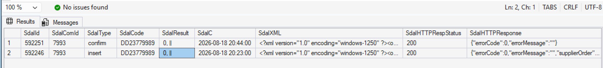
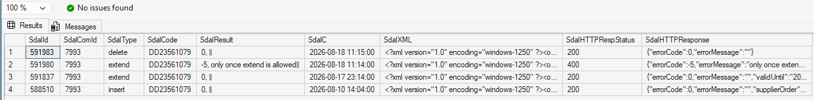
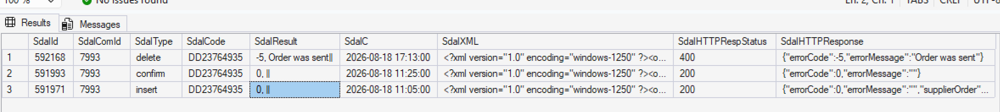
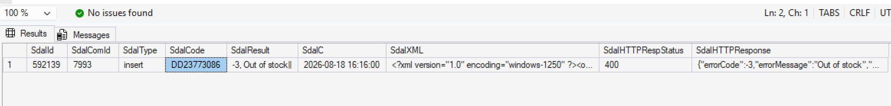

# Alza Dropshipment

> **Note:** Alza sends requests in **JSON** format. During processing, however, the request is automatically converted to **XML** (probably to make working with SQL easier). Real-world samples in the original JSON form are not available yet – hopefully I'll manage to get them.

*The document is structured according to the order phases (based on the API sequence diagram). In the **Order** section, the requests are sent by Alza (Buyer) towards SWS (Supplier) – <span style="background:#0F1B42;color:#fff;padding:1px 7px;border-radius:3px;font-size:0.85em;">Alza</span> &rarr; <span style="background:#FFC800;color:#000;padding:1px 7px;border-radius:3px;font-size:0.85em;font-weight:bold;">SWS</span>. In the **Availability and shipping** section it is the other way round – the request is sent by SWS and the response is returned by Alza – <span style="background:#FFC800;color:#000;padding:1px 7px;border-radius:3px;font-size:0.85em;font-weight:bold;">SWS</span> &rarr; <span style="background:#0F1B42;color:#fff;padding:1px 7px;border-radius:3px;font-size:0.85em;">Alza</span>.*

## Store Availability

### Availability

Test endpoint for the **Availability** method on the Buyer's side (Alza). SWS uses it to report stock availability to Alza. 

*Sent by: <span style="background:#FFC800;color:#000;padding:1px 7px;border-radius:3px;font-size:0.85em;font-weight:bold;">SWS</span> &rarr; <span style="background:#0F1B42;color:#fff;padding:1px 7px;border-radius:3px;font-size:0.85em;">Alza</span> (the request is sent by SWS)*

Possible scenarios according to the API documentation:
- Partial/Full import of product prices – at night
- Update import of product prices – every 5 minutes


*A sample of concrete SDAL records is still missing – it will be added once the data is available.*

## Order Processing

*The requests in this section are sent by Alza (Buyer) to SWS (Supplier) – <span style="background:#0F1B42;color:#fff;padding:1px 7px;border-radius:3px;font-size:0.85em;">Alza</span> &rarr; <span style="background:#FFC800;color:#000;padding:1px 7px;border-radius:3px;font-size:0.85em;font-weight:bold;">SWS</span>.*

### Confirm order



#### Sample records (SDAL log)

| SdalId | Type    | Code        | Result | Date                  | HTTP |
|--------|---------|-------------|--------|-----------------------|------|
| 592246 | insert  | DD23779989  | 0      | 2026-08-18 20:23:00   | 200  |
| 592251 | confirm | DD23779989  | 0      | 2026-08-18 20:44:00   | 200  |

<details open>
<summary>592246 – insert – 2026-08-18 20:23:00</summary>

**XML request** (<span style="background:#0F1B42;color:#fff;padding:1px 7px;border-radius:3px;font-size:0.85em;">Alza</span>):
```xml
<?xml version="1.0" encoding="windows-1250" ?><orders><timestamp>2026-08-18T20:22:33.923</timestamp><customerId>7993</customerId><supplierId>200</supplierId><supplierBranchId>235</supplierBranchId><regNo>27082440</regNo><vatNo>CZ27082440</vatNo><itemsPriceCurrency>CZK</itemsPriceCurrency><orderItems><orderItemId>3508830476</orderItemId><code>ASC00342</code><quantity>1</quantity><unitPrice>1305</unitPrice><purchasePriceWithoutFees>1305</purchasePriceWithoutFees><serialNumbersExpected>false</serialNumbersExpected><serialNumbersRequired>false</serialNumbersRequired></orderItems></orders>
```

**HTTP response (200)** (<span style="background:#FFC800;color:#000;padding:1px 7px;border-radius:3px;font-size:0.85em;font-weight:bold;">SWS</span>):
```json
{"errorCode":0,"errorMessage":"","supplierOrder":"OP26132530","validUntil":"2026-08-25T23:59:00.000"}
```

</details>

<details open>
<summary>592251 – confirm – 2026-08-18 20:44:00</summary>

**XML request** (<span style="background:#0F1B42;color:#fff;padding:1px 7px;border-radius:3px;font-size:0.85em;">Alza</span>):
```xml
<?xml version="1.0" encoding="windows-1250" ?><orders><timestamp>2026-08-18T20:44:01.303</timestamp><customerId>7993</customerId><supplierId>200</supplierId><supplierBranchId>235</supplierBranchId><regNo>27082440</regNo><vatNo>CZ27082440</vatNo><shippingCarrier><shippingCarrierCode>ALZA</shippingCarrierCode><shippingCarrierDeliveryType>ALZABOX</shippingCarrierDeliveryType></shippingCarrier><parcelShop><parcelShopIdentification>ALZABOX</parcelShopIdentification><parcelShopBranchCode>AB3478</parcelShopBranchCode></parcelShop><route><routeName>SWS CZ01 -&gt; CZTC1 -&gt; Východní Čechy L 12*</routeName><routeStops><branchName>CZTC1</branchName><ramp>L17</ramp></routeStops><routeDeliveryOrder>6</routeDeliveryOrder></route><shipmentDeliveryType>ParcelShop</shipmentDeliveryType><shipmentShippingMode>Supplier</shipmentShippingMode><cashOnDeliveryValue>0</cashOnDeliveryValue><cashOnDeliveryValueCurrency>CZK</cashOnDeliveryValueCurrency><packageSorting><packageSortingGroup>Linehaul</packageSortingGroup><packageSortingPrint>L</packageSortingPrint></packageSorting><demandedExpeditionDate>2026-08-19</demandedExpeditionDate><shipmentDepartureTime>2026-08-19T14:30:00</shipmentDepartureTime><paymentVS>1504853468</paymentVS><deliveryAddress><companyName>Liberec - Staré Pavlovice - Hrdinů</companyName><addressName>Filip Frýba</addressName><streetWithNumber>Hrdinů 34/30</streetWithNumber><city>Liberec</city><phone>+420775146569</phone><email>filipfryba0@gmail.com</email><country>CZ</country><zip>46001</zip></deliveryAddress><shipmentValue>1782</shipmentValue><shipmentValueCurrency>CZK</shipmentValueCurrency></orders>
```

**HTTP response (200)** (<span style="background:#FFC800;color:#000;padding:1px 7px;border-radius:3px;font-size:0.85em;font-weight:bold;">SWS</span>):
```json
{"errorCode":0,"errorMessage":""}
```

</details>

### Extend order



#### Sample records (SDAL log)

| SdalId | Type   | Code        | Result                            | Date                  | HTTP |
|--------|--------|-------------|------------------------------------|-----------------------|------|
| 588510 | insert | DD23561079  | 0                                  | 2026-08-10 14:04:00   | 200  |
| 591837 | extend | DD23561079  | 0                                  | 2026-08-17 23:14:00   | 200  |
| 591980 | extend | DD23561079  | -5 (only once extend is allowed)  | 2026-08-18 11:14:00   | 400  |
| 591983 | delete | DD23561079  | 0                                  | 2026-08-18 11:15:00   | 200  |

<details open>
<summary>588510 – insert – 2026-08-10 14:04:00</summary>

**XML request** (<span style="background:#0F1B42;color:#fff;padding:1px 7px;border-radius:3px;font-size:0.85em;">Alza</span>):
```xml
<?xml version="1.0" encoding="windows-1250" ?><orders><timestamp>2026-08-10T14:03:45.19</timestamp><customerId>7993</customerId><supplierId>200</supplierId><supplierBranchId>235</supplierBranchId><regNo>27082440</regNo><vatNo>CZ27082440</vatNo><itemsPriceCurrency>CZK</itemsPriceCurrency><orderItems><orderItemId>3489207239</orderItemId><code>LNC00660</code><quantity>1</quantity><unitPrice>74100</unitPrice><purchasePriceWithoutFees>74100</purchasePriceWithoutFees><alzaBarCodes>BCX3489207239</alzaBarCodes><serialNumbersExpected>true</serialNumbersExpected><serialNumbersRequired>true</serialNumbersRequired></orderItems></orders>
```

**HTTP response (200)** (<span style="background:#FFC800;color:#000;padding:1px 7px;border-radius:3px;font-size:0.85em;font-weight:bold;">SWS</span>):
```json
{"errorCode":0,"errorMessage":"","supplierOrder":"OP26127149","validUntil":"2026-08-17T23:59:00.000"}
```

</details>

<details open>
<summary>591837 – extend – 2026-08-17 23:14:00</summary>

**XML request** (<span style="background:#0F1B42;color:#fff;padding:1px 7px;border-radius:3px;font-size:0.85em;">Alza</span>):
```xml
<?xml version="1.0" encoding="windows-1250" ?><orders><timestamp>2026-08-17T23:14:09.627</timestamp><customerId>7993</customerId><supplierId>200</supplierId><supplierBranchId>235</supplierBranchId><regNo>27082440</regNo><vatNo>CZ27082440</vatNo><validUntil>2026-08-18T12:00:00</validUntil></orders>
```

**HTTP response (200)** (<span style="background:#FFC800;color:#000;padding:1px 7px;border-radius:3px;font-size:0.85em;font-weight:bold;">SWS</span>):
```json
{"errorCode":0,"errorMessage":"","validUntil":"2026-08-18T12:00:00.000"}
```

</details>

<details open>
<summary>591980 – extend – 2026-08-18 11:14:00 – error: only once extend is allowed</summary>

**XML request** (<span style="background:#0F1B42;color:#fff;padding:1px 7px;border-radius:3px;font-size:0.85em;">Alza</span>):
```xml
<?xml version="1.0" encoding="windows-1250" ?><orders><timestamp>2026-08-18T11:14:13.75</timestamp><customerId>7993</customerId><supplierId>200</supplierId><supplierBranchId>235</supplierBranchId><regNo>27082440</regNo><vatNo>CZ27082440</vatNo><validUntil>2026-08-19T12:00:00</validUntil></orders>
```

**HTTP response (400)** (<span style="background:#FFC800;color:#000;padding:1px 7px;border-radius:3px;font-size:0.85em;font-weight:bold;">SWS</span>):
```json
{"errorCode":-5,"errorMessage":"only once extend is allowed"}
```

</details>

<details open>
<summary>591983 – delete – 2026-08-18 11:15:00</summary>

**XML request** (<span style="background:#0F1B42;color:#fff;padding:1px 7px;border-radius:3px;font-size:0.85em;">Alza</span>):
```xml
<?xml version="1.0" encoding="windows-1250" ?><orders><timestamp>2026-08-18T11:14:30.887</timestamp><customerId>7993</customerId><supplierId>200</supplierId><supplierBranchId>235</supplierBranchId><regNo>27082440</regNo><vatNo>CZ27082440</vatNo></orders>
```

**HTTP response (200)** (<span style="background:#FFC800;color:#000;padding:1px 7px;border-radius:3px;font-size:0.85em;font-weight:bold;">SWS</span>):
```json
{"errorCode":0,"errorMessage":""}
```

</details>

### Cancel order



#### Sample records (SDAL log)

| SdalId | Type    | Code        | Result                    | Date                  | HTTP |
|--------|---------|-------------|----------------------------|-----------------------|------|
| 591971 | insert  | DD23764935  | 0                          | 2026-08-18 11:05:00   | 200  |
| 591993 | confirm | DD23764935  | 0                          | 2026-08-18 11:25:00   | 200  |
| 592168 | delete  | DD23764935  | -5 (Order was sent)       | 2026-08-18 17:13:00   | 400  |

<details open>
<summary>591971 – insert – 2026-08-18 11:05:00</summary>

**XML request** (<span style="background:#0F1B42;color:#fff;padding:1px 7px;border-radius:3px;font-size:0.85em;">Alza</span>):
```xml
<?xml version="1.0" encoding="windows-1250" ?><orders><timestamp>2026-08-18T11:04:32.713</timestamp><customerId>7993</customerId><supplierId>200</supplierId><supplierBranchId>235</supplierBranchId><regNo>27082440</regNo><vatNo>CZ27082440</vatNo><itemsPriceCurrency>CZK</itemsPriceCurrency><orderItems><orderItemId>3507695973</orderItemId><code>DLS01306</code><quantity>25</quantity><unitPrice>2046.17</unitPrice><purchasePriceWithoutFees>2046.17</purchasePriceWithoutFees><alzaBarCodes>BCX35076959731</alzaBarCodes><alzaBarCodes>BCX35076959732</alzaBarCodes><alzaBarCodes>BCX35076959733</alzaBarCodes><alzaBarCodes>BCX35076959734</alzaBarCodes><alzaBarCodes>BCX35076959735</alzaBarCodes><alzaBarCodes>BCX35076959736</alzaBarCodes><alzaBarCodes>BCX35076959737</alzaBarCodes><alzaBarCodes>BCX35076959738</alzaBarCodes><alzaBarCodes>BCX35076959739</alzaBarCodes><alzaBarCodes>BCX350769597310</alzaBarCodes><alzaBarCodes>BCX350769597311</alzaBarCodes><alzaBarCodes>BCX350769597312</alzaBarCodes><alzaBarCodes>BCX350769597313</alzaBarCodes><alzaBarCodes>BCX350769597314</alzaBarCodes><alzaBarCodes>BCX350769597315</alzaBarCodes><alzaBarCodes>BCX350769597316</alzaBarCodes><alzaBarCodes>BCX350769597317</alzaBarCodes><alzaBarCodes>BCX350769597318</alzaBarCodes><alzaBarCodes>BCX350769597319</alzaBarCodes><alzaBarCodes>BCX350769597320</alzaBarCodes><alzaBarCodes>BCX350769597321</alzaBarCodes><alzaBarCodes>BCX350769597322</alzaBarCodes><alzaBarCodes>BCX350769597323</alzaBarCodes><alzaBarCodes>BCX350769597324</alzaBarCodes><alzaBarCodes>BCX350769597325</alzaBarCodes><serialNumbersExpected>true</serialNumbersExpected><serialNumbersRequired>true</serialNumbersRequired></orderItems></orders>
```

**HTTP response (200)** (<span style="background:#FFC800;color:#000;padding:1px 7px;border-radius:3px;font-size:0.85em;font-weight:bold;">SWS</span>):
```json
{"errorCode":0,"errorMessage":"","supplierOrder":"OP26131910","validUntil":"2026-08-25T23:59:00.000"}
```

</details>

<details open>
<summary>591993 – confirm – 2026-08-18 11:25:00</summary>

**XML request** (<span style="background:#0F1B42;color:#fff;padding:1px 7px;border-radius:3px;font-size:0.85em;">Alza</span>):
```xml
<?xml version="1.0" encoding="windows-1250" ?><orders><timestamp>2026-08-18T11:25:21.76</timestamp><customerId>7993</customerId><supplierId>200</supplierId><supplierBranchId>235</supplierBranchId><regNo>27082440</regNo><vatNo>CZ27082440</vatNo><shippingCarrier><shippingCarrierCode>ALZA</shippingCarrierCode><shippingCarrierDeliveryType>Supplier</shippingCarrierDeliveryType></shippingCarrier><route><routeName>SWS CZ01 -&gt; CZTC1 -&gt; CZLC4 -&gt; Čakovice</routeName><routeStops><branchName>CZTC1</branchName><ramp>L05</ramp></routeStops><routeStops><branchName>CZLC4</branchName><ramp>L53</ramp></routeStops></route><shipmentDeliveryType>Branch</shipmentDeliveryType><shipmentShippingMode>Supplier</shipmentShippingMode><cashOnDeliveryValue>0</cashOnDeliveryValue><cashOnDeliveryValueCurrency>CZK</cashOnDeliveryValueCurrency><packageSorting><packageSortingGroup>CrossLC</packageSortingGroup><packageSortingPrint>C</packageSortingPrint></packageSorting><demandedExpeditionDate>2026-08-19</demandedExpeditionDate><shipmentDepartureTime>2026-08-19T14:30:00</shipmentDepartureTime><paymentVS>1504752017</paymentVS><deliveryAddress><companyName>alza.cz Čakovice</companyName><addressName></addressName><streetWithNumber>Kostelecká 823/77</streetWithNumber><city>Praha</city><phone>+420 225 340 111</phone><email>sales.cakovice@alza.cz</email><country>CZ</country><zip>19600</zip></deliveryAddress><deliveryBranchId>4255</deliveryBranchId><shipmentValue>74750</shipmentValue><shipmentValueCurrency>CZK</shipmentValueCurrency></orders>
```

**HTTP response (200)** (<span style="background:#FFC800;color:#000;padding:1px 7px;border-radius:3px;font-size:0.85em;font-weight:bold;">SWS</span>):
```json
{"errorCode":0,"errorMessage":""}
```

</details>

<details open>
<summary>592168 – delete – 2026-08-18 17:13:00 – error: Order was sent</summary>

**XML request** (<span style="background:#0F1B42;color:#fff;padding:1px 7px;border-radius:3px;font-size:0.85em;">Alza</span>):
```xml
<?xml version="1.0" encoding="windows-1250" ?><orders><timestamp>2026-08-18T17:12:45.39</timestamp><customerId>7993</customerId><supplierId>200</supplierId><supplierBranchId>235</supplierBranchId><regNo>27082440</regNo><vatNo>CZ27082440</vatNo></orders>
```

**HTTP response (400)** (<span style="background:#FFC800;color:#000;padding:1px 7px;border-radius:3px;font-size:0.85em;font-weight:bold;">SWS</span>):
```json
{"errorCode":-5,"errorMessage":"Order was sent"}
```

</details>

### Insert order – Out of stock
The order could not be inserted, the product is out of stock.




#### Sample records (SDAL log)

| SdalId | Type   | Code        | Result                     | Date                  | HTTP |
|--------|--------|-------------|------------------------------|-----------------------|------|
| 592139 | insert | DD23773086  | -3 (Out of stock)           | 2026-08-18 16:16:00   | 400  |

<details open>
<summary>592139 – insert – 2026-08-18 16:16:00 – error: Out of stock</summary>

**XML request** (<span style="background:#0F1B42;color:#fff;padding:1px 7px;border-radius:3px;font-size:0.85em;">Alza</span>):
```xml
<?xml version="1.0" encoding="windows-1250" ?><orders><timestamp>2026-08-18T16:16:10.06</timestamp><customerId>7993</customerId><supplierId>200</supplierId><supplierBranchId>235</supplierBranchId><regNo>27082440</regNo><vatNo>CZ27082440</vatNo><itemsPriceCurrency>CZK</itemsPriceCurrency><orderItems><orderItemId>3508338463</orderItemId><code>573295</code><quantity>5</quantity><unitPrice>88.35</unitPrice><purchasePriceWithoutFees>88.35</purchasePriceWithoutFees><serialNumbersExpected>false</serialNumbersExpected><serialNumbersRequired>false</serialNumbersRequired></orderItems></orders>
```

**HTTP response (400)** (<span style="background:#FFC800;color:#000;padding:1px 7px;border-radius:3px;font-size:0.85em;font-weight:bold;">SWS</span>):
```json
{"errorCode":-3,"errorMessage":"Out of stock","errorProducts":[{"code":"573295","quantity":0}]}
```

</details>

*Note: according to the API documentation, there are further test scenarios for the order methods that are not yet illustrated by a real record in this document – e.g. "Invalid Supplier Testing URL" for Insert order, or the distinction between "Intended/Unintended failed reservation" for Extend order. They will be added as soon as the corresponding SDAL data is available.*

## Order Shipping

*The requests in this section are sent by SWS (Supplier) to Alza (Buyer) – <span style="background:#FFC800;color:#000;padding:1px 7px;border-radius:3px;font-size:0.85em;font-weight:bold;">SWS</span> &rarr; <span style="background:#0F1B42;color:#fff;padding:1px 7px;border-radius:3px;font-size:0.85em;">Alza</span>.*


### Shipment departure

Test endpoint for the **Shipment departure** method on the Buyer's side – SWS uses it to report the departure of a shipment. Request parameter: `shipment` (shipment number).

**Request** (<span style="background:#FFC800;color:#000;padding:1px 7px;border-radius:3px;font-size:0.85em;font-weight:bold;">SWS</span>):
```
Sending request: https://terminal.sws.cz/wsdrop-alza/sws1.ashx/shipdep?shipment=6955290x8715633AAy PostData:shpdep="shippingCarrier":%20{"shippingCarrierCode":%20"DPD",%20"shippingCarrierDeliveryType":%20"DPD"},"cashOnDeliveryValue":%200.00,"cashOnDeliveryValueCurrency":%20"CZK","shipmentValue":%203032.00,"shipmentValueCurrency":%20"CZK","shipmentWeight":%200.80000,"packages":%20[{"number":"13825096221168","weight":0.80000,"fullNumber":"%25007030013825096221168327203"}],"items":%20[{"order":"DD23334255","packageNumber":"13825096221168","quantity":1,"orderItemId":3471466988,"code":"848007","serials":["201040003001V00EMR"]}]
```

**Response** (<span style="background:#0F1B42;color:#fff;padding:1px 7px;border-radius:3px;font-size:0.85em;">Alza</span>):
```
200 OK
{"errorCode":0,"errorMessage":""}
```


### Delivery result

Test endpoint for the **Delivery result** method on the Buyer's side – SWS uses it to report the final result of the order delivery. Request parameter: `order` (order number).

Possible scenarios according to the API documentation:
- Delivered
- Rejected
- Canceled
- Invalid update

*A sample of concrete SDAL records is still missing – it will be added once the data is available.*
