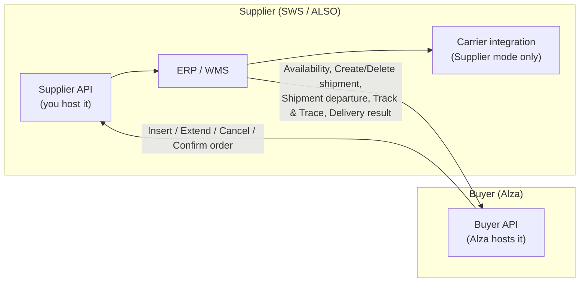
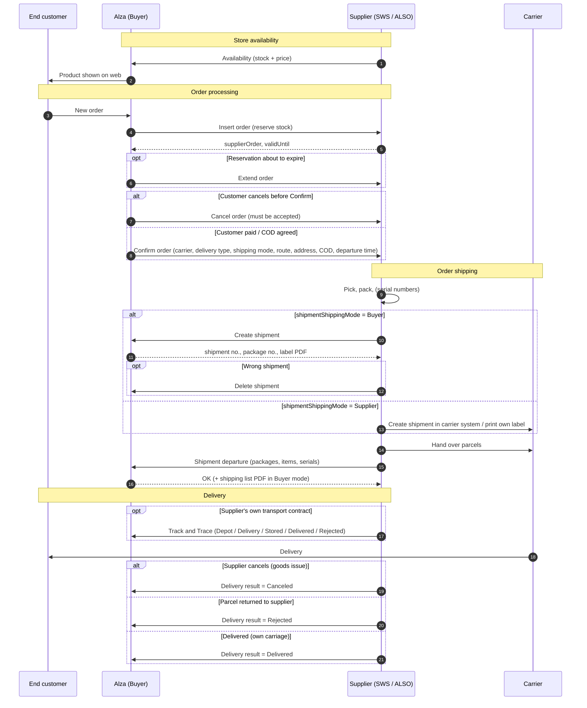
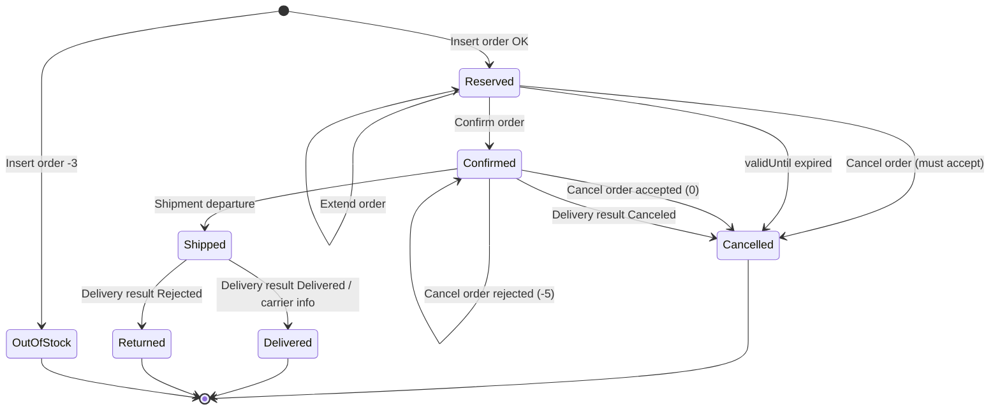
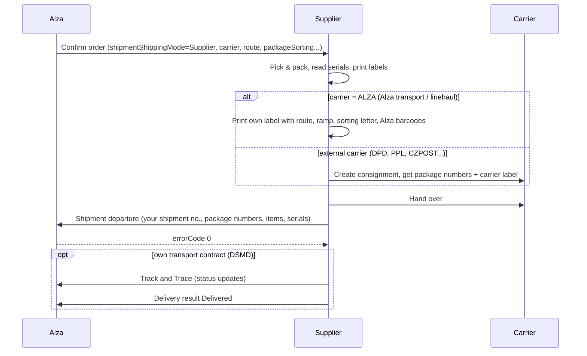
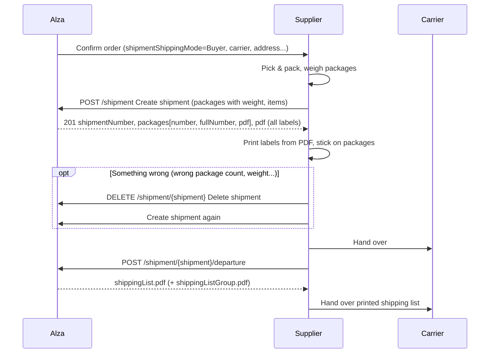
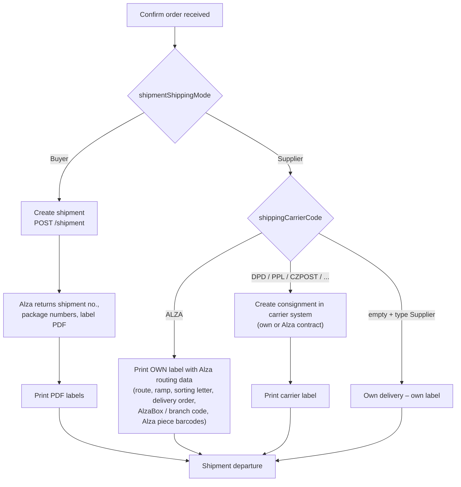
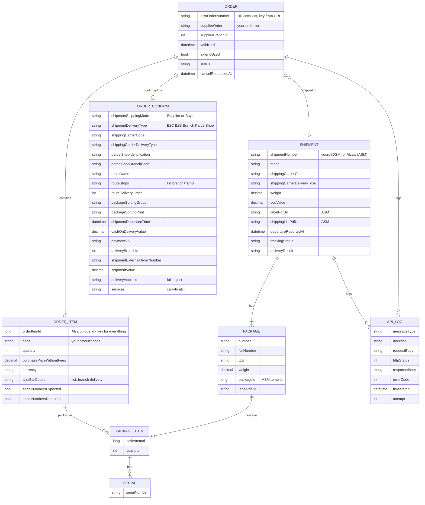

# Alza Dropshipment – Shipping Cookbook

*How shipment communication with Alza works, how labels are created, which API messages each shipping mode needs and what data has to be stored – written from the point of view of a supplier (SWS) that runs this integration in production.*

| | |
|---|---|
| **Audience** | ALSO – implementation team |
| **Source of truth** | Alza Trade API – <https://trade-api-docs.alza.cz/> (version **1.185**, 20.10.2026). The old Apiary page (`dropa.docs.apiary.io`) now only redirects there. |
| **Real-world examples** | SWS production logs (August 2026). Personal data of end customers is anonymised. |
| **Status** | DRAFT – sections marked **[TODO – SWS]** are being completed (SQL data model, ERP screenshots). |

---

## Contents

1. [TL;DR – answers to your questions](#1-tldr--answers-to-your-questions)
2. [Roles, endpoints and basic rules](#2-roles-endpoints-and-basic-rules)
3. [End-to-end order lifecycle](#3-end-to-end-order-lifecycle)
4. [Shipping modes](#4-shipping-modes)
5. [Which API messages are needed in each mode](#5-which-api-messages-are-needed-in-each-mode)
6. [Delivery types, carriers and consolidation](#6-delivery-types-carriers-and-consolidation)
7. [Label creation](#7-label-creation)
8. [What data you need to store](#8-what-data-you-need-to-store)
9. [How SWS does it (as-is)](#9-how-sws-does-it-as-is)
10. [Error handling, retries, timeouts](#10-error-handling-retries-timeouts)
11. [Implementation checklist](#11-implementation-checklist)
12. [Open points](#12-open-points)

---

## 1. TL;DR – answers to your questions

**"How does shipment communication with Alza work?"**
Alza (the *Buyer*) pushes orders to you (the *Supplier*) – `Insert` → (`Extend`) → `Confirm` / `Cancel`. The `Confirm order` message tells you **where**, **how** and **when** the shipment goes (carrier, delivery type, shipping mode, route, departure time, COD, address). Once the parcel physically leaves your warehouse you report it with `Shipment departure`. After that you report tracking (`Track and Trace`, own contract only) and the final result (`Delivery result`).

**"How are labels created?"**
It depends on the **shipping mode** sent in `Confirm order` → `shipmentShippingMode`:

| `shipmentShippingMode` | Who creates shipment no., package no. and label | How |
|---|---|---|
| `Supplier` (DSM) | **You** | Your own carrier integration (DPD, PPL, …) **or**, for Alza's own transport (`shippingCarrierCode = ALZA`), your own label printed with the routing data Alza sends in `Confirm order`. |
| `Buyer` (ASM) | **Alza** | You call `Create shipment` and Alza returns shipment number, package numbers and a **PDF with carrier labels**. The shipping list (handover protocol) comes back in the `Shipment departure` response. |

**"Which API messages are needed for each mode?"** → see the [matrix in chapter 5](#5-which-api-messages-are-needed-in-each-mode).

**"What information do we need to store?"** → see [chapter 8](#8-what-data-you-need-to-store). In short: the Alza order number + your order number, every `orderItemId`, the complete `Confirm order` payload, the shipment/package numbers you report, the serial numbers, and a full log of every request/response.

---

## 2. Roles, endpoints and basic rules

| Term in the API | Who | Implements |
|---|---|---|
| **Buyer** | Alza | **Buyer API** – the supplier calls it (`Availability`, `Create shipment`, `Delete shipment`, `Shipment departure`, `Track and Trace`, `Delivery result`) |
| **Supplier** | SWS / ALSO | **Supplier API** – Alza calls it (`Insert order`, `Extend order`, `Cancel order`, `Confirm order`) |
| **End customer** | Alza's customer | – |



**Basic rules (all required by Alza):**

- HTTPS with a commonly trusted certificate, TLS 1.2+.
- JSON, `Content-Type: application/json; charset=utf-8`, `User-Agent` header filled.
- 23 h/day availability, maintenance window max. 1 h between 22:00 and 03:00.
- Authentication: HMAC-SHA1 token, Base64 + URL-encoded (see *Authentication token* in the Alza docs).
- `timestamp` must always be current – also when a message is re-sent.
- Messages must be **idempotent**: the receiver must accept the same message repeated within a short time (only `timestamp` changes).
- All times are **CET**.

---

## 3. End-to-end order lifecycle



### Order states (supplier side)



Key rules:

- **Cancel before Confirm** → must be accepted immediately (`-5` is **not** allowed).
- **Cancel after Confirm, before departure** → you may reject with `-5` (e.g. "Order was sent"). If you do not know yet, answer `-5` and later send `Delivery result = Canceled` if you managed to stop it.
- **After `Shipment departure`** → the order can no longer be cancelled.
- `shipmentDepartureTime` (formerly `demandedExpeditionDate`) in `Confirm order` is binding – the shipment must not leave **earlier or later**.

---

## 4. Shipping modes

Shipping mode defines **who handles the shipment number, package numbers, shipping list, shipping labels and carrier data**. It is sent per order in `Confirm order` → `shipmentShippingMode`. Modes can be combined – one supplier can get orders in both modes.

| | **Supplier mode – DSMD** | **Supplier mode – DSMA** | **Buyer mode – ASM** |
|---|---|---|---|
| `shipmentShippingMode` | `Supplier` | `Supplier` | `Buyer` |
| Transport contract | Supplier's | Alza's | Alza's |
| Shipment number | Supplier | Supplier | **Alza** (`Create shipment`) |
| Package numbers | Supplier / carrier | Supplier / carrier | **Alza** (`Create shipment`) |
| Shipping label | Supplier (carrier system) | Supplier (carrier system or own label for `ALZA` routes) | **Alza** – PDF from `Create shipment` |
| Shipping list (handover protocol) | Supplier | Supplier | **Alza** – PDF in `Shipment departure` response |
| Track and Trace message | **Required** | Not required | Not required |
| Typical use | Supplier already has carrier integrations | Supplier has integrations, Alza's prices / Alza's own transport | Supplier has no carrier integration |

> **Note:** DSMD / DSMA / ASM are Alza's internal names. Which contract (yours or Alza's) applies to which carrier is agreed with Alza during onboarding – it is **not** sent in the API. **[TODO – SWS]** confirm how this is set up for SWS (see [open points](#12-open-points)).

### Supplier mode (DSM) – shipping phase



### Buyer mode (ASM) – shipping phase



---

## 5. Which API messages are needed in each mode

Legend: **R** = required, **C** = conditional, **–** = not used. Direction: A→S = Alza calls you, S→A = you call Alza.

| API message | Dir. | DSMD (Supplier, own contract) | DSMA (Supplier, Alza contract) | ASM (Buyer) | Notes |
|---|---|---|---|---|---|
| `POST /availability` | S→A | R | R | R | Stock + price. Update every ≥10 min (changes only), `PartialFull` at night 00:00–06:00. |
| `POST /order/{order}` Insert order | A→S | R | R | R | Reserve stock. Return `supplierOrder`, `validUntil`. `-3` = out of stock. |
| `POST /order/{order}/extend` Extend order | A→S | R | R | R | Return `-5` if you don't want to extend → Alza cancels. |
| `DELETE /order/{order}` Cancel order | A→S | R | R | R | See cancellation rules in chapter 3. |
| `POST /order/{order}/confirm` Confirm order | A→S | R | R | R | **The shipping instruction.** Store everything. |
| `POST /shipment` Create shipment | S→A | – | – | **R** | Returns shipment no., package no., label PDFs. |
| `DELETE /shipment/{shipment}` Delete shipment | S→A | – | – | C | Only before departure, to fix a wrong shipment. |
| `POST /shipment/{shipment}/departure` Shipment departure | S→A | R | R | R | `{shipment}` = your number (DSM) or Alza's number from Create shipment (ASM). Returns shipping list in ASM. |
| `POST /track` Track and Trace | S→A | **R** | – | – | Required with supplier's own contract. ParcelShop: send `Stored` before `Delivered`. |
| `POST /order/{order}/delivery` Delivery result | S→A | R | C | C | `Delivered` – own carriage only. `Canceled` / `Rejected` – any mode. |

### Fields that differ by mode in the shipping messages

| Field | Create shipment (ASM) | Shipment departure – DSM | Shipment departure – ASM |
|---|---|---|---|
| `shippingCarrier.shippingCarrierCode` | required, same as in Confirm | required for new suppliers | required for new suppliers |
| `shippingCarrier.shippingCarrierDeliveryType` | real type, **`Supplier` forbidden** | real type, or `Supplier` = you deliver yourself | real type, **`Supplier` forbidden** |
| `parcelShop` | required if it was in Confirm | required if it was in Confirm | required if it was in Confirm |
| `packages[]` | `packageId` (your temp id) + `weight` | `number` (+ `fullNumber`, `ttUrl`, `weight`) | numbers returned by Create shipment |
| `items[]` | `order`, `orderItemId`, `packageId`, `quantity` | `order`, `orderItemId`, `packageNumber`, `quantity`, `serials` | same as DSM |
| Response | `shipment.pdf`, `packages[].pdf` | `errorCode` | `shipment.shippingList.pdf`, `shippingListGroup.pdf` |

**One product in two packages** (FAQ from Alza): the first package carries `quantity: 1`, the second one the same `orderItemId` with `quantity: 0`.

**Serial numbers:** if `serialNumbersRequired = true` in Insert order, `items[].serials` in Shipment departure is mandatory. If only `serialNumbersExpected = true`, send them when you have them.

---

## 6. Delivery types, carriers and consolidation

### `shipmentDeliveryType` (in Confirm order)

| Value | Meaning | Consolidation of several orders in one shipment |
|---|---|---|
| `B2C` | End customer address | Not allowed |
| `B2B` | Business customer address | Not allowed |
| `Branch` | Alza branch / warehouse (`deliveryBranchId` filled) | **Required** – group orders going to the same branch into consolidated packages |
| `ParcelShop` | Parcel shop / AlzaBox (`parcelShop` object filled) | Not allowed |

In all cases **one order must go in one shipment** (no splitting of an order across shipments).

### Carrier codes and delivery types

`shippingCarrierCode`: `ALZA, CZPOST, DHL, DPD, DPDSK, DPDHU, FOFR, GebruderWeiss, GEISPARCEL, GEISCARGO, GLS, GO, HELICAR, MagyarPOST, Najbert, PPL, RHENUS, SKPOST, SKYNET, TOPTRANS, UPS, WEDO, ZASILKOVNA, ZavolejSiKuryra`

`shippingCarrierDeliveryType` (selection): `COURIER, ALZABRANCH, ALZABOX, CZPOSTD, CZPOSTP, CZPOSTB, DPD, DPDALZABOX, DPDBOX, DPDPARCELSHOP, PPL, PPLPARCELSHOP, GLS, ZASILKOVNA, …` and the special value **`Supplier`**.

**The special value `Supplier`** in Confirm order:

- `shippingCarrierCode` filled (e.g. `CZPOST`) + delivery type `Supplier` → **you choose** the concrete delivery type for that carrier (e.g. `CZPOSTD`) and send it back in Create shipment / Shipment departure.
- `shippingCarrierCode` empty + delivery type `Supplier` → **you deliver yourself**; send back `Supplier`.

### Package sorting

`Confirm order` → `packageSorting.packageSortingGroup` = `RegularDirect` (default) | `Linehaul` | `CrossLC`. **Packages from different groups must not be physically mixed** during shipping. In Supplier mode, print `packageSortingPrint` (e.g. `L`, `C`) on the label.

---

## 7. Label creation



### 7.1 Buyer mode (ASM) – Alza creates the label

1. Pack the order, weigh each package.
2. `POST /shipment` with `packages[]` (`packageId`, `weight`, optional `volume`) and `items[]` (which `orderItemId` is in which `packageId`).
3. Response `201`: `shipment.shipmentNumber`, `shipment.packages[]` (`packageId`, `number`, `fullNumber`, `pdf`), `shipment.pdf` (all labels in one PDF).
4. Download and print the PDF, stick labels. **Store** shipment number and package numbers – you need them for departure.
5. If anything changes (number of packages, weights) → `DELETE /shipment/{shipment}` and create again. Not possible after departure.
6. `POST /shipment/{shipmentNumber}/departure` → response contains the **shipping list** PDF to hand over to the driver.

### 7.2 Supplier mode with an external carrier (DPD, PPL, CZPOST, …)

The label comes from **your carrier integration** exactly as for any other shipment of yours. Alza only needs the result in `Shipment departure`:

- `packages[].number` – package number (short),
- `packages[].fullNumber` – the full barcode from the label (substring is usually the tracking number),
- `packages[].ttUrl` – tracking URL (preferred way to give Alza correct tracking),
- `shippingCarrier` – real carrier code and delivery type.

For parcel shop deliveries use `parcelShop.parcelShopBranchCode` from Confirm order as the pick-up point in the carrier system.

### 7.3 Supplier mode with Alza's own transport (`shippingCarrierCode = ALZA`)

Alza picks up from the supplier's warehouse and moves parcels through its hubs (linehaul). The supplier prints **its own label** with the data from `Confirm order`:

| Data on the label | Source field in Confirm order | Example (SWS) |
|---|---|---|
| Route | `route.routeName` | `SWS CZ01 -> CZTC1 -> Východní Čechy L 12*` |
| Hub(s) and ramp(s) | `route.routeStops[].branchName` + `ramp` | `CZTC1 / L17` |
| Delivery order number | `route.routeDeliveryOrder` | `6` |
| Sorting letter | `packageSorting.packageSortingPrint` | `L` (Linehaul), `C` (CrossLC) |
| AlzaBox / parcel shop | `parcelShop.parcelShopBranchCode` | `AB3478` |
| Alza branch | `deliveryBranchId` + `deliveryAddress` | `4255` – alza.cz Čakovice |
| External order number | `shipmentExternalOrderNumber` | *"Required for label printing"* |
| COD | `cashOnDeliveryValue` + currency | `0 CZK` |
| Recipient | `deliveryAddress` | |
| Your package barcode | your package number (sent later in departure) | |

For **Branch** deliveries Alza also sends `orderItems[].alzaBarCodes` in **Insert order** – one barcode per piece (e.g. `BCX3489207239`). **Print them (Code-128) on each piece.** The count equals the ordered quantity.

> **[TODO – SWS]** Add a photo/scan of a real SWS label for an `ALZA` route (AlzaBox and Branch) and of a DPD label, with the fields highlighted.

---

## 8. What data you need to store

Everything below is needed either to answer later messages, to build labels, or to resolve disputes with Alza.



### Minimum checklist

| Store | Why |
|---|---|
| Alza order number (`DD…`) ↔ your order number | Key in all Alza URLs; you return `supplierOrder` in Insert. |
| `orderItemId` per line | Preferred item identification in Create shipment / Departure; **required for Branch delivery**. |
| `alzaBarCodes` | Must be printed on each piece for Branch delivery. |
| `serialNumbersExpected/Required` | Decides whether serials are mandatory in departure. |
| `validUntil`, extend counter | Reservation expiry, handling of repeated Extend. |
| **The whole Confirm order payload** | It is the shipping instruction (carrier, mode, address, route, COD, departure time). Keep the raw JSON too. |
| Shipment number, package numbers, full numbers, tracking URL | Sent in departure; needed for T&T and support. ASM: returned by Alza. |
| Package ↔ item ↔ quantity ↔ serials | Content of departure `items[]`. |
| Label PDF / shipping list PDF URLs (ASM) | Re-print. |
| Raw log of every request + response + HTTP status | Retries, idempotency, disputes with Alza (Alza support asks for it). |

> **[TODO – SWS]** Add the SWS data model: real SQL tables and columns (order header, items, shipment, packages, log table `SDAL`) – to be supplied.

---

## 9. How SWS does it (as-is)

### 9.1 Overview

- SWS runs **Supplier shipping mode** (`shipmentShippingMode = Supplier`) – SWS creates shipment numbers, package numbers and labels itself.
- Carriers seen in production: **`ALZA`** (Alza's own transport from SWS warehouse `CZ01` via hub `CZTC1`, for AlzaBox and Alza branch deliveries) and **`DPD`**.
- Incoming JSON from Alza is converted to XML by the SWS middleware (`wsdrop-alza`) and processed in SQL; every message is logged in table **`SDAL`**.
- Reservation (`validUntil`) = 7 days, end of day (e.g. Insert 18.08. → valid until 25.08. 23:59).
- Extend is allowed **once**; a second Extend gets `-5 "only once extend is allowed"` → Alza then cancels.
- Cancel after the parcel left gets `-5 "Order was sent"`.

**`SDAL` log table** (one row per API message):

| Column | Meaning |
|---|---|
| `SdalId` | Log id |
| `SdalComId` | Customer (Alza) id in SWS ERP – `7993` |
| `SdalType` | `insert`, `extend`, `delete`, `confirm`, … |
| `SdalCode` | Alza order number (`DD…`) |
| `SdalResult` | Returned `errorCode` |
| `SdalC` | Created (date/time) |
| `SdalXML` | Request converted to XML |
| `SdalHTTPRespStatus` | Returned HTTP status |
| `SdalHTTPResponse` | Returned JSON body |

> **[TODO – SWS]** Process screenshots from ERP **i6**: Alza order in the order list, order detail with Confirm data, picking/packing screen, label printing, departure / dispatch screen, cancellation handling.

### 9.2 Example – AlzaBox via Alza transport (anonymised)

`Confirm order` (shown as XML after SWS conversion):

```xml
<orders>
  <supplierId>200</supplierId><supplierBranchId>235</supplierBranchId>
  <shippingCarrier>
    <shippingCarrierCode>ALZA</shippingCarrierCode>
    <shippingCarrierDeliveryType>ALZABOX</shippingCarrierDeliveryType>
  </shippingCarrier>
  <parcelShop>
    <parcelShopIdentification>ALZABOX</parcelShopIdentification>
    <parcelShopBranchCode>AB3478</parcelShopBranchCode>
  </parcelShop>
  <route>
    <routeName>SWS CZ01 -&gt; CZTC1 -&gt; Východní Čechy L 12*</routeName>
    <routeStops><branchName>CZTC1</branchName><ramp>L17</ramp></routeStops>
    <routeDeliveryOrder>6</routeDeliveryOrder>
  </route>
  <shipmentDeliveryType>ParcelShop</shipmentDeliveryType>
  <shipmentShippingMode>Supplier</shipmentShippingMode>
  <cashOnDeliveryValue>0</cashOnDeliveryValue><cashOnDeliveryValueCurrency>CZK</cashOnDeliveryValueCurrency>
  <packageSorting><packageSortingGroup>Linehaul</packageSortingGroup><packageSortingPrint>L</packageSortingPrint></packageSorting>
  <shipmentDepartureTime>2026-08-19T14:30:00</shipmentDepartureTime>
  <paymentVS>1504853468</paymentVS>
  <deliveryAddress>
    <companyName>Liberec - Staré Pavlovice - Hrdinů</companyName>
    <addressName>[customer name]</addressName>
    <streetWithNumber>Hrdinů 34/30</streetWithNumber><city>Liberec</city><zip>46001</zip><country>CZ</country>
    <phone>[customer phone]</phone><email>[customer e-mail]</email>
  </deliveryAddress>
  <shipmentValue>1782</shipmentValue><shipmentValueCurrency>CZK</shipmentValueCurrency>
</orders>
```

→ SWS prints its own label with route `CZTC1 / L17`, delivery order `6`, sorting letter `L`, AlzaBox `AB3478`.

### 9.3 Example – Alza branch via Alza transport (consolidated)

```xml
<shippingCarrier><shippingCarrierCode>ALZA</shippingCarrierCode><shippingCarrierDeliveryType>Supplier</shippingCarrierDeliveryType></shippingCarrier>
<route>
  <routeName>SWS CZ01 -&gt; CZTC1 -&gt; CZLC4 -&gt; Čakovice</routeName>
  <routeStops><branchName>CZTC1</branchName><ramp>L05</ramp></routeStops>
  <routeStops><branchName>CZLC4</branchName><ramp>L53</ramp></routeStops>
</route>
<shipmentDeliveryType>Branch</shipmentDeliveryType>
<shipmentShippingMode>Supplier</shipmentShippingMode>
<packageSorting><packageSortingGroup>CrossLC</packageSortingGroup><packageSortingPrint>C</packageSortingPrint></packageSorting>
<shipmentDepartureTime>2026-08-19T14:30:00</shipmentDepartureTime>
<deliveryAddress><companyName>alza.cz Čakovice</companyName><streetWithNumber>Kostelecká 823/77</streetWithNumber><city>Praha</city><zip>19600</zip><country>CZ</country>...</deliveryAddress>
<deliveryBranchId>4255</deliveryBranchId>
```

The matching Insert order carried 25 pieces with 25 `alzaBarCodes` (`BCX35076959731` … `BCX350769597325`) – one sticker per piece. Branch delivery = orders to the same branch are consolidated.

### 9.4 Example – Shipment departure via DPD (anonymised)

```json
{
  "shippingCarrier": { "shippingCarrierCode": "DPD", "shippingCarrierDeliveryType": "DPD" },
  "cashOnDeliveryValue": 0.00, "cashOnDeliveryValueCurrency": "CZK",
  "shipmentValue": 3032.00, "shipmentValueCurrency": "CZK",
  "shipmentWeight": 0.8,
  "packages": [
    { "number": "13825096221168", "weight": 0.8, "fullNumber": "%007030013825096221168327203" }
  ],
  "items": [
    { "order": "DD23334255", "packageNumber": "13825096221168", "quantity": 1,
      "orderItemId": 3471466988, "code": "848007", "serials": ["201040003001V00EMR"] }
  ]
}
```

URL: `POST /shipment/{shipment}/departure`, where `{shipment}` is the SWS shipment number. Response `200 {"errorCode":0,"errorMessage":""}`.

> **[TODO – SWS]** Track and Trace and Delivery result – does SWS send them for DPD (own contract), and an example from the log.

---

## 10. Error handling, retries, timeouts

### Error codes

| Code | Meaning | Data accepted |
|---|---|---|
| `0` | Success | Yes |
| `-1` | Generic error (see `errorMessage`) | No |
| `-2` | Invalid input data | No |
| `-3` | Out of stock (Insert order) | Yes |
| `-4` | Invalid price | No |
| `-5` | Operation rejected (Extend, Cancel after Confirm, Availability limit) | Yes |
| `-6` | Bad response | Yes |
| `-7` | Resend limit violated | No |

If data is **not** accepted, the sender must resend until it is. Always fill `errorMessage` on errors. HTTP `429` (no body) = rate limit → resend per intervals. Any HTTP status other than the documented 200/201/400 = not delivered → resend.

### Resend intervals (minutes)

| Message | Short | Default | Observed range | Subject |
|---|---|---|---|---|
| Insert / Extend / Cancel / Confirm order | 1 | 10 | 60 | Order |
| Create / Delete shipment, Shipment departure, Track and Trace | 1 | 15 (temporarily 5) | 60 | Shipment |
| Delivery result | 5 | 30 | 60 | Order |
| Availability – Update / PartialFull / Full | 1/1/10 | 10/1/10 | 30/60/60 | Branch |

*Short* applies when ≤ 2 other messages are in the observed range, otherwise *Default*.

### Timeouts (seconds) – sender must wait longer than receiver

| Message | Alza timeout | Supplier timeout |
|---|---|---|
| Insert / Extend / Cancel / Confirm order | 80 | 60 |
| Create / Delete shipment, Departure, T&T, Delivery result | 60 | 80 |
| Availability | 280 | 300 |

Max. **5 parallel requests** of the same type per supplier.

---

## 11. Implementation checklist

1. Get from Alza: `supplierId`, `supplierBranchId`(s), HMAC secret, test/production URLs; give Alza your Supplier API URL and your `customerId` for Alza.
2. Implement Supplier API: Insert, Extend, Cancel, Confirm – idempotent, logged, response within 60 s.
3. Decide which shipping modes you will run (Supplier / Buyer) and which carrier contracts (yours / Alza's) – agree with Alza.
4. Map Confirm order → your ERP shipping order (carrier, delivery type, parcel shop, route, sorting, COD, departure time).
5. Labels: carrier integration (DSM), own label for `ALZA` routes incl. Alza piece barcodes, or Create shipment PDF (ASM).
6. Shipment departure with packages, items, serials – exactly at `shipmentDepartureTime`.
7. Track and Trace (own contract) + Delivery result (Canceled / Rejected / Delivered).
8. Availability: Update (changes only, 10 min–1 h), PartialFull at night.
9. Retry engine with resend intervals, `-7` / `429` handling, full request/response log.
10. Test with **Testing Buyer API** (`/trade-test/v2/...`) and **Invoke Supplier API** (Alza calls your API with test scenarios, e.g. `invokeInsertOrder`) – then switch to production.

---

## 12. Open points

| # | Topic | Owner |
|---|---|---|
| 1 | SWS SQL data model (tables + columns) | SWS |
| 2 | ERP i6 screenshots of the whole process | SWS |
| 3 | Real SWS label examples (ALZA route – AlzaBox, Branch; DPD) | SWS |
| 4 | DPD for Alza – SWS contract (DSMD) or Alza contract (DSMA)? Does SWS send Track and Trace? | SWS |
| 5 | Delivery result – real example from the log | SWS |
| 6 | Does SWS receive any `shipmentShippingMode = Buyer` orders (ASM)? | SWS |
| 7 | Upcoming Alza changes 2026: `CompanyAddress`, `ShipmentAddress` (`shipmentDeliveryAddress` may differ from `deliveryAddress`), `glnList`, `taxNo`, `vatNo` max. 30 chars | ALSO – plan for it |
