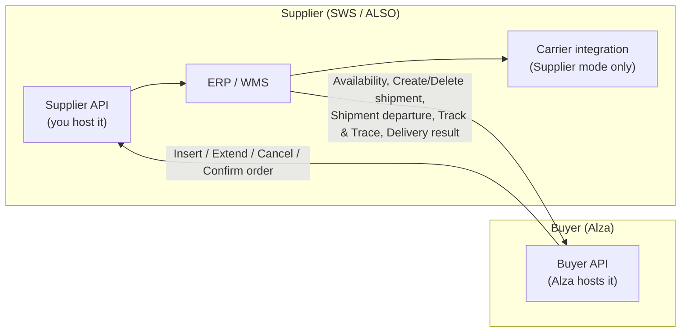
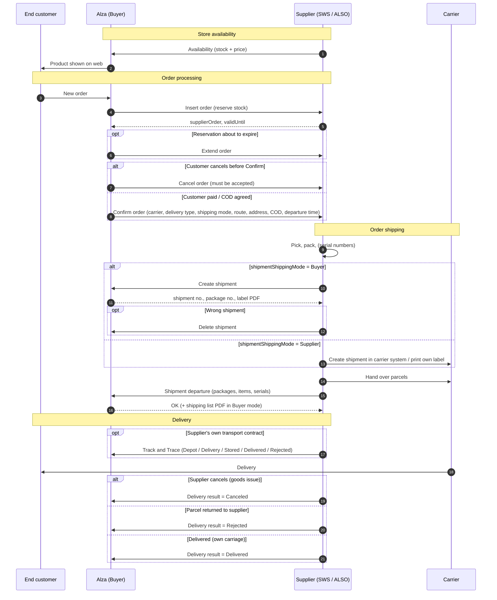
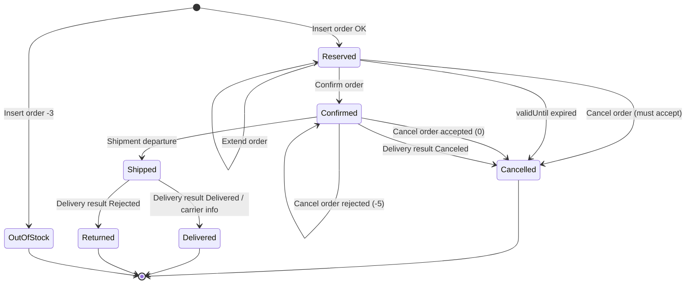
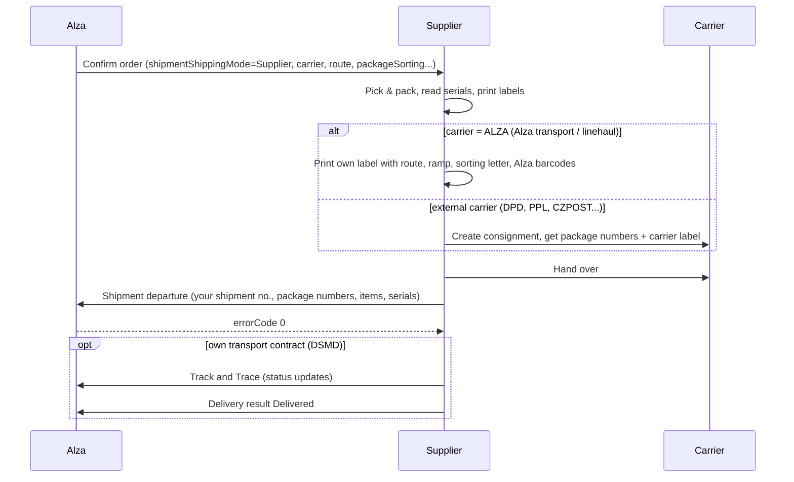
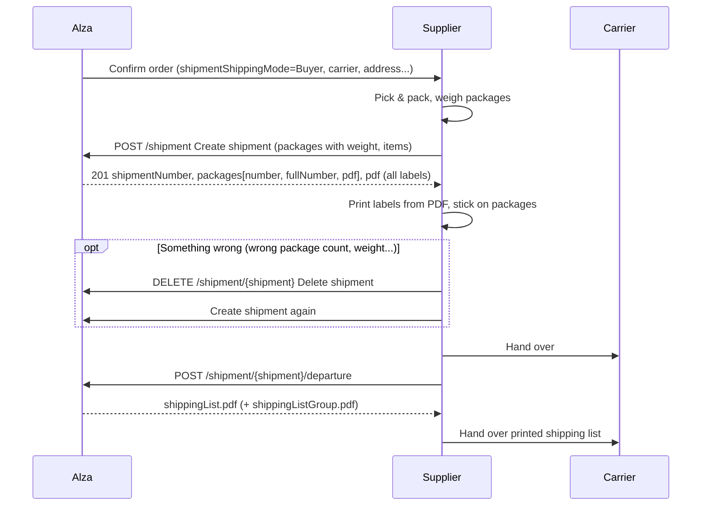
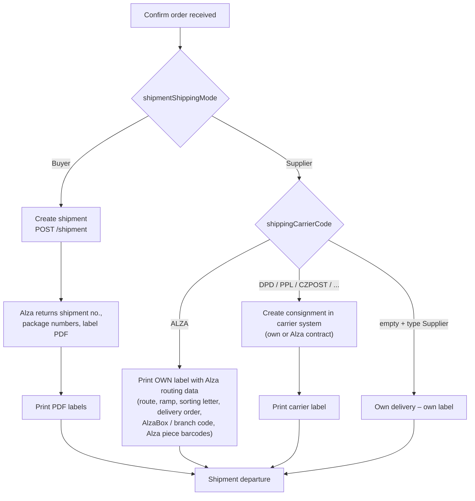
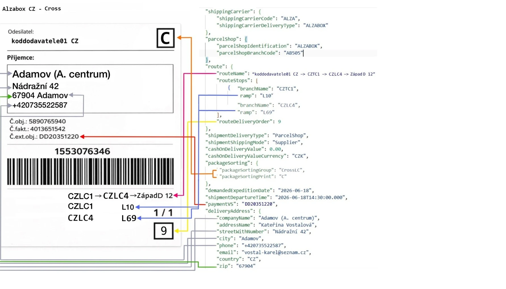
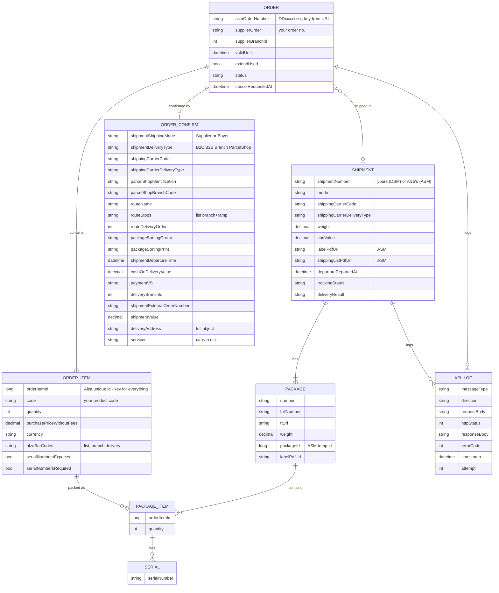
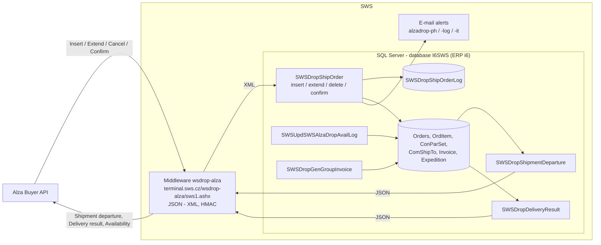

# Alza Dropshipment – Shipping Cookbook

*How shipment communication with Alza works, how labels are created, which API messages each shipping mode needs and what data has to be stored – written from the point of view of a supplier (SWS) that runs this integration in production.*

| | |
|---|---|
| **Audience** | ALSO – implementation team |
| **Source of truth** | Alza Trade API – <https://trade-api-docs.alza.cz/> (version **1.185**, 20.10.2026). The old Apiary page (`dropa.docs.apiary.io`) now only redirects there. |
| **Real-world data** | SWS production data – message log (August 2026) and SQL procedures from database `I6SWS` (15.11.2026). Unmodified, including customer data. |
| **Status** | DRAFT – sections marked **[TODO – SWS]** are still being completed (middleware, availability, labels, ERP screenshots). |

---

## Contents

1. [TL;DR – answers to your questions](#1-tldr--answers-to-your-questions)
2. [Roles, endpoints and basic rules](#2-roles-endpoints-and-basic-rules)
3. [End-to-end order lifecycle](#3-end-to-end-order-lifecycle)
4. [Shipping modes](#4-shipping-modes)
5. [Which API messages are needed in each mode](#5-which-api-messages-are-needed-in-each-mode)
6. [Delivery types, carriers and consolidation](#6-delivery-types-carriers-and-consolidation)
7. [Label creation](#7-label-creation)
8. [What data you need to store](#8-what-data-you-need-to-store)
9. [How SWS does it (as-is)](#9-how-sws-does-it-as-is)
10. [Error handling, retries, timeouts](#10-error-handling-retries-timeouts)
11. [Implementation checklist](#11-implementation-checklist)
12. [Open points](#12-open-points)

---

## 1. TL;DR – answers to your questions

**"How does shipment communication with Alza work?"**
Alza (the *Buyer*) pushes orders to you (the *Supplier*) – `Insert` → (`Extend`) → `Confirm` / `Cancel`. The `Confirm order` message tells you **where**, **how** and **when** the shipment goes (carrier, delivery type, shipping mode, route, departure time, COD, address). Once the parcel physically leaves your warehouse you report it with `Shipment departure`. After that you report tracking (`Track and Trace`, own contract only) and the final result (`Delivery result`).

**"How are labels created?"**
It depends on the **shipping mode** sent in `Confirm order` → `shipmentShippingMode`:

| `shipmentShippingMode` | Who creates shipment no., package no. and label | How |
|---|---|---|
| `Supplier` (DSM) | **You** | Your own carrier integration (DPD, PPL, …) **or**, for Alza's own transport (`shippingCarrierCode = ALZA`), your own label printed with the routing data Alza sends in `Confirm order`. |
| `Buyer` (ASM) | **Alza** | You call `Create shipment` and Alza returns shipment number, package numbers and a **PDF with carrier labels**. The shipping list (handover protocol) comes back in the `Shipment departure` response. |

**"Which API messages are needed for each mode?"** → see the [matrix in chapter 5](#5-which-api-messages-are-needed-in-each-mode).

**"What information do we need to store?"** → see [chapter 8](#8-what-data-you-need-to-store). In short: the Alza order number + your order number, every `orderItemId`, the complete `Confirm order` payload, the shipment/package numbers you report, the serial numbers, and a full log of every request/response.

---

## 2. Roles, endpoints and basic rules

| Term in the API | Who | Implements |
|---|---|---|
| **Buyer** | Alza | **Buyer API** – the supplier calls it (`Availability`, `Create shipment`, `Delete shipment`, `Shipment departure`, `Track and Trace`, `Delivery result`) |
| **Supplier** | SWS / ALSO | **Supplier API** – Alza calls it (`Insert order`, `Extend order`, `Cancel order`, `Confirm order`) |
| **End customer** | Alza's customer | – |



**Basic rules (all required by Alza):**

- HTTPS with a commonly trusted certificate, TLS 1.2+.
- JSON, `Content-Type: application/json; charset=utf-8`, `User-Agent` header filled.
- 23 h/day availability, maintenance window max. 1 h between 22:00 and 03:00.
- Authentication: HMAC-SHA1 token, Base64 + URL-encoded (see *Authentication token* in the Alza docs).
- `timestamp` must always be current – also when a message is re-sent.
- Messages must be **idempotent**: the receiver must accept the same message repeated within a short time (only `timestamp` changes).
- All times are **CET**.

---

## 3. End-to-end order lifecycle



### Order states (supplier side)



Key rules:

- **Cancel before Confirm** → must be accepted immediately (`-5` is **not** allowed).
- **Cancel after Confirm, before departure** → you may reject with `-5` (e.g. "Order was sent"). If you do not know yet, answer `-5` and later send `Delivery result = Canceled` if you managed to stop it.
- **After `Shipment departure`** → the order can no longer be cancelled.
- `shipmentDepartureTime` (formerly `demandedExpeditionDate`) in `Confirm order` is binding – the shipment must not leave **earlier or later**.

---

## 4. Shipping modes

Shipping mode defines **who handles the shipment number, package numbers, shipping list, shipping labels and carrier data**. It is sent per order in `Confirm order` → `shipmentShippingMode`. Modes can be combined – one supplier can get orders in both modes.

| | **Supplier mode – DSMD** | **Supplier mode – DSMA** | **Buyer mode – ASM** |
|---|---|---|---|
| `shipmentShippingMode` | `Supplier` | `Supplier` | `Buyer` |
| Transport contract | Supplier's | Alza's | Alza's |
| Shipment number | Supplier | Supplier | **Alza** (`Create shipment`) |
| Package numbers | Supplier / carrier | Supplier / carrier | **Alza** (`Create shipment`) |
| Shipping label | Supplier (carrier system) | Supplier (carrier system or own label for `ALZA` routes) | **Alza** – PDF from `Create shipment` |
| Shipping list (handover protocol) | Supplier | Supplier | **Alza** – PDF in `Shipment departure` response |
| Track and Trace message | **Required** | Not required | Not required |
| Typical use | Supplier already has carrier integrations | Supplier has integrations, Alza's prices / Alza's own transport | Supplier has no carrier integration |

> **Note:** DSMD / DSMA / ASM are Alza's internal names. Which contract (yours or Alza's) applies to which carrier is agreed with Alza during onboarding – it is **not** sent in the API. **[TODO – SWS]** confirm how this is set up for SWS (see [open points](#12-open-points)).

### Supplier mode (DSM) – shipping phase



### Buyer mode (ASM) – shipping phase



---

## 5. Which API messages are needed in each mode

Legend: **R** = required, **C** = conditional, **–** = not used. Direction: A→S = Alza calls you, S→A = you call Alza.

| API message | Dir. | DSMD (Supplier, own contract) | DSMA (Supplier, Alza contract) | ASM (Buyer) | Notes |
|---|---|---|---|---|---|
| `POST /availability` | S→A | R | R | R | Stock + price. Update every ≥10 min (changes only), `PartialFull` at night 00:00–06:00. |
| `POST /order/{order}` Insert order | A→S | R | R | R | Reserve stock. Return `supplierOrder`, `validUntil`. `-3` = out of stock. |
| `POST /order/{order}/extend` Extend order | A→S | R | R | R | Return `-5` if you don't want to extend → Alza cancels. |
| `DELETE /order/{order}` Cancel order | A→S | R | R | R | See cancellation rules in chapter 3. |
| `POST /order/{order}/confirm` Confirm order | A→S | R | R | R | **The shipping instruction.** Store everything. |
| `POST /shipment` Create shipment | S→A | – | – | **R** | Returns shipment no., package no., label PDFs. |
| `DELETE /shipment/{shipment}` Delete shipment | S→A | – | – | C | Only before departure, to fix a wrong shipment. |
| `POST /shipment/{shipment}/departure` Shipment departure | S→A | R | R | R | `{shipment}` = your number (DSM) or Alza's number from Create shipment (ASM). Returns shipping list in ASM. |
| `POST /track` Track and Trace | S→A | **R** | – | – | Required with supplier's own contract. ParcelShop: send `Stored` before `Delivered`. |
| `POST /order/{order}/delivery` Delivery result | S→A | R | C | C | `Delivered` – own carriage only. `Canceled` / `Rejected` – any mode. |

### Fields that differ by mode in the shipping messages

| Field | Create shipment (ASM) | Shipment departure – DSM | Shipment departure – ASM |
|---|---|---|---|
| `shippingCarrier.shippingCarrierCode` | required, same as in Confirm | required for new suppliers | required for new suppliers |
| `shippingCarrier.shippingCarrierDeliveryType` | real type, **`Supplier` forbidden** | real type, or `Supplier` = you deliver yourself | real type, **`Supplier` forbidden** |
| `parcelShop` | required if it was in Confirm | required if it was in Confirm | required if it was in Confirm |
| `packages[]` | `packageId` (your temp id) + `weight` | `number` (+ `fullNumber`, `ttUrl`, `weight`) | numbers returned by Create shipment |
| `items[]` | `order`, `orderItemId`, `packageId`, `quantity` | `order`, `orderItemId`, `packageNumber`, `quantity`, `serials` | same as DSM |
| Response | `shipment.pdf`, `packages[].pdf` | `errorCode` | `shipment.shippingList.pdf`, `shippingListGroup.pdf` |

**One product in two packages** (FAQ from Alza): the first package carries `quantity: 1`, the second one the same `orderItemId` with `quantity: 0`.

**Serial numbers:** if `serialNumbersRequired = true` in Insert order, `items[].serials` in Shipment departure is mandatory. If only `serialNumbersExpected = true`, send them when you have them.

---

## 6. Delivery types, carriers and consolidation

### `shipmentDeliveryType` (in Confirm order)

| Value | Meaning | Consolidation of several orders in one shipment |
|---|---|---|
| `B2C` | End customer address | Not allowed |
| `B2B` | Business customer address | Not allowed |
| `Branch` | Alza branch / warehouse (`deliveryBranchId` filled) | **Required** – group orders going to the same branch into consolidated packages |
| `ParcelShop` | Parcel shop / AlzaBox (`parcelShop` object filled) | Not allowed |

In all cases **one order must go in one shipment** (no splitting of an order across shipments).

### Carrier codes and delivery types

`shippingCarrierCode`: `ALZA, CZPOST, DHL, DPD, DPDSK, DPDHU, FOFR, GebruderWeiss, GEISPARCEL, GEISCARGO, GLS, GO, HELICAR, MagyarPOST, Najbert, PPL, RHENUS, SKPOST, SKYNET, TOPTRANS, UPS, WEDO, ZASILKOVNA, ZavolejSiKuryra`

`shippingCarrierDeliveryType` (selection): `COURIER, ALZABRANCH, ALZABOX, CZPOSTD, CZPOSTP, CZPOSTB, DPD, DPDALZABOX, DPDBOX, DPDPARCELSHOP, PPL, PPLPARCELSHOP, GLS, ZASILKOVNA, …` and the special value **`Supplier`**.

**The special value `Supplier`** in Confirm order:

- `shippingCarrierCode` filled (e.g. `CZPOST`) + delivery type `Supplier` → **you choose** the concrete delivery type for that carrier (e.g. `CZPOSTD`) and send it back in Create shipment / Shipment departure.
- `shippingCarrierCode` empty + delivery type `Supplier` → **you deliver yourself**; send back `Supplier`.

### Package sorting

`Confirm order` → `packageSorting.packageSortingGroup` = `RegularDirect` (default) | `Linehaul` | `CrossLC`. **Packages from different groups must not be physically mixed** during shipping. In Supplier mode, print `packageSortingPrint` (e.g. `L`, `C`) on the label.

---

## 7. Label creation



### 7.1 Buyer mode (ASM) – Alza creates the label

1. Pack the order, weigh each package.
2. `POST /shipment` with `packages[]` (`packageId`, `weight`, optional `volume`) and `items[]` (which `orderItemId` is in which `packageId`).
3. Response `201`: `shipment.shipmentNumber`, `shipment.packages[]` (`packageId`, `number`, `fullNumber`, `pdf`), `shipment.pdf` (all labels in one PDF).
4. Download and print the PDF, stick labels. **Store** shipment number and package numbers – you need them for departure.
5. If anything changes (number of packages, weights) → `DELETE /shipment/{shipment}` and create again. Not possible after departure.
6. `POST /shipment/{shipmentNumber}/departure` → response contains the **shipping list** PDF to hand over to the driver.

### 7.2 Supplier mode with an external carrier (DPD, PPL, CZPOST, …)

The label comes from **your carrier integration** exactly as for any other shipment of yours. Alza only needs the result in `Shipment departure`:

- `packages[].number` – package number (short),
- `packages[].fullNumber` – the full barcode from the label (substring is usually the tracking number),
- `packages[].ttUrl` – tracking URL (preferred way to give Alza correct tracking),
- `shippingCarrier` – real carrier code and delivery type.

For parcel shop deliveries use `parcelShop.parcelShopBranchCode` from Confirm order as the pick-up point in the carrier system.

### 7.3 Supplier mode with Alza's own transport (`shippingCarrierCode = ALZA`)

Alza picks up from the supplier's warehouse and moves parcels through its hubs (linehaul). The supplier prints **its own label** with the data from `Confirm order`. The three label samples below show the same AlzaBox order in the three sorting groups; the arrows show which JSON field goes where.

#### Label layout (AlzaBox, CZ)

| # | Position on the label | Content | Source |
|---|---|---|---|
| 1 | Top left – *Odesilatel* (sender) | Supplier code + country, e.g. `koddodavatele01 CZ` | First part of `route.routeName` (before the first `->`) |
| 2 | Top right – box | Sorting letter `C` / `L`; **empty box** for `RegularDirect` | `packageSorting.packageSortingPrint` |
| 3 | *Příjemce* (recipient), large | AlzaBox / branch name | `deliveryAddress.companyName` |
| 4 | Recipient – lines 2–4 | Street, ZIP + city, phone | `deliveryAddress.streetWithNumber`, `zip` + `city`, `phone` |
| 5 | *Č.obj.* | Supplier's order number | Supplier ERP (SWS: `OrdCode` = `supplierOrder`) |
| 6 | *Č.fakt.* | Supplier's invoice number | Supplier ERP |
| 7 | *Č.ext.obj.* | Alza order number, e.g. `DD20351220` | `paymentVS` in the samples (equals the Alza order number); the API now also has `shipmentExternalOrderNumber` *"required for label printing"* |
| 8 | Barcode + number above it | Package number, e.g. `1553076346` | Supplier – the same number is later sent in Shipment departure as `packages[].number` |
| 9 | Route line | Route without the sender part, e.g. `CZLC1 → CZLC4 → ZápadD 12` | `route.routeName` |
| 10 | Stop lines | One line per stop: hub + ramp, e.g. `CZLC1  L10`, `CZLC4  L69` | `route.routeStops[].branchName` + `ramp` |
| 11 | `1 / 1` | Package number / number of packages in the shipment | Supplier |
| 12 | Bottom right – box | Delivery order, e.g. `9` | `route.routeDeliveryOrder` |

Not printed: `addressName` (customer name), `email`, `parcelShopBranchCode` (`AB505`), COD (0 in the samples).

#### The three sorting variants

| Variant | `packageSortingGroup` | `packageSortingPrint` | Route stops | Box top right |
|---|---|---|---|---|
| **Direct** | `RegularDirect` | – (not sent) | 1 (`CZTC1 / L10`) | empty |
| **Linehaul** | `Linehaul` | `L` | 1 (`CZTC1 / L10`) | `L` |
| **Cross** | `CrossLC` | `C` | 2 (`CZTC1 / L10`, `CZLC4 / L69`) – via cross-dock | `C` |

Packages from different groups must not be mixed physically (see chapter 6).




> **Note:** in the samples the JSON says hub `CZTC1`, while the printed label shows `CZLC1`. Print exactly what Alza sends in `routeName` / `routeStops`.

For **Branch** deliveries Alza also sends `orderItems[].alzaBarCodes` in **Insert order** – one barcode per piece (e.g. `BCX3489207239`). **Print them (Code-128) on each piece.** The count equals the ordered quantity.

> **[TODO – SWS]** Label for **Branch** delivery (with Alza piece barcodes), a **DPD** label, and which i6 report / template prints the `ALZA` label.

---

## 8. What data you need to store

Everything below is needed either to answer later messages, to build labels, or to resolve disputes with Alza.



### Minimum checklist

| Store | Why |
|---|---|
| Alza order number (`DD…`) ↔ your order number | Key in all Alza URLs; you return `supplierOrder` in Insert. |
| `orderItemId` per line | Preferred item identification in Create shipment / Departure; **required for Branch delivery**. |
| `alzaBarCodes` | Must be printed on each piece for Branch delivery. |
| `serialNumbersExpected/Required` | Decides whether serials are mandatory in departure. |
| `validUntil`, extend counter | Reservation expiry, handling of repeated Extend. |
| **The whole Confirm order payload** | It is the shipping instruction (carrier, mode, address, route, COD, departure time). Keep the raw JSON too. |
| Shipment number, package numbers, full numbers, tracking URL | Sent in departure; needed for T&T and support. ASM: returned by Alza. |
| Package ↔ item ↔ quantity ↔ serials | Content of departure `items[]`. |
| Label PDF / shipping list PDF URLs (ASM) | Re-print. |
| Raw log of every request + response + HTTP status | Retries, idempotency, disputes with Alza (Alza support asks for it). |

> **SWS data model:** how SWS stores all of this in ERP i6 (tables, columns, parameter ids) is described in [9.4](#94-where-the-data-is-stored-in-i6).

---

## 9. How SWS does it (as-is)

*Based on the production SQL procedures in database `I6SWS` (ERP i6, state 15.11.2026) and the message log. Object names, IDs and data are real and unmodified. Points that are read from the code but not yet confirmed by SWS are marked "(to confirm)".*

### 9.1 Architecture

- SWS runs **Supplier shipping mode** – it creates shipment numbers, package numbers and labels itself.
- Carriers in production: **`ALZA`** (Alza's own transport from SWS warehouse `CZ01` via hub `CZTC1`, for AlzaBoxes and Alza branches) and **`DPD`**.
- A middleware **`wsdrop-alza`** (`https://terminal.sws.cz/wsdrop-alza/sws1.ashx`) receives Alza's JSON, converts it to XML and calls the SQL procedure. Outgoing messages are built by SQL procedures as JSON fragments and sent by the middleware.
- IDs: Alza = company **`ComId 7993`** in i6; `supplierId 200`, `supplierBranchId 235`; all automatic actions run as i6 user **`270` / `DDD`**.
- Every dropship order carries the parameter **`ConParSet 434 / 3501`** – that is how all procedures recognise dropship orders.



### 9.2 Database objects

| Object | Type | Purpose |
|---|---|---|
| `SWSDropShipOrder` | procedure | Handles all incoming Supplier API messages (`insert`, `extend`, `delete`, `confirm`). |
| `SWSDropShipmentDeparture` | procedure | Builds Shipment departure messages for shipped orders. |
| `SWSDropDeliveryResult` | procedure | Builds Delivery result messages (Canceled / Rejected). |
| `SWSDropGenGroupInvoice` | procedure | Merges temporary dropship invoices to Alza into one group invoice. |
| `SWSUpdSWSAlzaDropAvailLog` | procedure | After availability is sent, stores the "last sent" snapshot used by price checks in Insert order. |
| `SWSDropShipOrderLog` | table | Log of every incoming message (columns `Sdal…`). |
| `SWSAlzaDropAvailLog1` | table | Current offer prepared for Alza (`LStiId, LQtyFree, LSipPriceOrd, LStiCode, LStiEAN, LTaxRate, LSndStatus`). |
| `SWSAlzaDropAvailLog` | table | Snapshot of the availability last sent to Alza. |

### 9.3 Incoming messages – `SWSDropShipOrder`

Parameters: `@typ` (`insert` / `extend` / `delete` / `confirm`), `@OrdCodeO` (Alza order number `DD…`), `@ComId` (7993), `@xml` (message converted to XML), `@HTTPRespStatus`, `@HTTPResponse`.

#### Logging and idempotency (all message types)

1. Every call inserts a row into `SWSDropShipOrderLog`; `SdalResult` is pre-set to `-1, || Unspecified error`.
2. The procedure looks for an **earlier identical message** (same type + order + XML, ignoring `timestamp` via `dbo.SWSRemoveXMLTag`). Earlier attempts that ended with deadlock / timeout (HTTP 500) or "Previous request still running" are ignored.
   - earlier one still running (no HTTP status yet) → `-1 Previous request still running`,
   - earlier one finished → **the same result is returned again** (repeat-safe, as Alza requires).
3. At the end `SdalResult` = `<errorCode>, <message>||<internal error text>`.
4. The middleware calls the procedure **a second time** with `@HTTPRespStatus` + `@HTTPResponse`; that call only stores what was actually returned to Alza into `SdalHTTPRespStatus` / `SdalHTTPResponse` (max. 500 characters).

| Log column | Meaning |
|---|---|
| `SdalId` | Log id |
| `SdalComId` | Alza in i6 – `7993` |
| `SdalType` | `insert`, `extend`, `delete`, `confirm` |
| `SdalCode` | Alza order number (`DD…`) |
| `SdalXML` | Request converted to XML |
| `SdalResult` | `errorCode, message\|\|internal error` |
| `SdalC` | Created (date/time) |
| `SdalHTTPRespStatus` | HTTP status returned to Alza |
| `SdalHTTPResponse` | JSON body returned to Alza |

#### Insert order

| # | Check | Response |
|---|---|---|
| 1 | Order `DD…` already exists in i6 and there is no earlier identical message | `-1 Invalid Order Number - already exists` |
| 2 | Product missing in current offer (`SWSAlzaDropAvailLog1`) or current price higher than Alza's price | `-3 Out of stock`, `errorProducts[].quantity = 0` |
| 3 | Product missing in last sent availability (`SWSAlzaDropAvailLog`) | `-2 Bad product code` |
| 4 | Code not paired with an i6 product (`StoItem` + `CompanyPrice` for Alza) | `-2 Bad product code in pairing` |
| 5 | Price ≠ last sent price | `-4 Bad product price` |
| 6 | Reservation order created, stock blocked (`OrdBlock`); blocked qty ≠ ordered qty | rollback, `-3 Out of stock` with the really blocked quantity |
| 7 | Number of `alzaBarCodes` ≠ quantity | rollback, `-1 Ordered quantity is not same as count AlzaBarCodes` |
| 8 | OK | `0`, `supplierOrder` = `OrdCode` (e.g. `OP26132530`), `validUntil` = today + 7 days 23:59 |

What is created in i6:

- `Orders`: `OrdCodeO` = Alza order number, `OrdCode` = new number from numeration "O", `OrdYSetId = 3` (reservation order), `OrdDelTo` = validUntil, `OrdNotCheck = 1`, `OrdNoteExt = 'Dropshipment rezervacni objednavka'`.
- `ConParSet 434 / 3501` on the order (dropship marker).
- `OrdItem` per line (price = Alza price = price from availability).
- Parameter `879` on each item: `CpsTag` = Alza `orderItemId`, `CpsTagI` = `serialNumbersRequired`.
- Parameter `880` on each item: one row per Alza barcode (`CpsTag` = barcode, `CpsTagI` = index 0…n).
- If contact parameter `1048` is set, stock is first taken over from other (non-dropship) Alza reservation orders (re-blocking, recorded in parameter `964 / 3228`).

#### Extend order

| Check | Response |
|---|---|
| Order not found | `-5 Order number not found` |
| Order already invoiced | `-5 Order was sent` |
| Order closed (reservation expired) | `-5 Reservation expired.` |
| New `validUntil` in the past | `-5 untilValid is the past` |
| New `validUntil` later than today + 9 days | `-5 untilValid is too long` |
| Already extended once (`WSREQEXTEND` in `OrdNoteExt`) or order has `!DDR!` | `-5 only once extend is allowed` |
| OK | `OrdDelTo` = new validUntil, `WSREQEXTEND <time>` added to `OrdNoteExt` → `0` + `validUntil` |

#### Cancel order (`delete`)

| Situation | Response | What happens |
|---|---|---|
| Order not found | `-5 Order number not found` | |
| Order already invoiced (confirmed and processed) | `-5 Order was sent` | E-mail to dispatch: stop the shipment if possible and send Delivery result Canceled; if Shipment departure was already sent, keep `!DSD!` and send Delivery result Rejected. |
| Order closed | `0 Order is closed` | `WSREQDELETE <time>` written to `OrdNoteExt` |
| Confirm arrived earlier but invoice does not exist yet | `0` | Order switched back to reservation, `DELETE po CONFIRM` in `OrdNoteInt`, e-mail "do not invoice". |
| Standard (reservation) | `0` | `OrdDelTo` = yesterday, `WSREQDELETE <time>` in `OrdNoteExt`, `OrdYSetId3Cancel` releases the reservation. |
| Duplicate `DD…` number in i6 | `0` | E-mail to IT. |

#### Confirm order

| Situation | Response |
|---|---|
| Order unknown and never inserted | `-1 Order number not found, CONFIRM without INSERT` |
| Order unknown, but insert is in the log | `-5 Order number not found` |
| Already invoiced (repeated confirm) | `0` |
| Order has `!DDR!` (cancelled by SWS) | `0 Order is marked as DDR` – flag removed |
| Order closed, reservation expired | `0 attempt confirm expired reservation` |
| Order closed | `0 Order is closed` |
| Previous confirm failed half-way | `0 previous confirm ended with some error` – manual invoicing |
| Not all items blocked any more | `0 Order was inserted with -3, out of stock or reservation was unblocked, delivery result - canceled` – items cancelled, Delivery result Canceled follows |
| Delivery type not configured in i6 | `-5 Contractually unsupported shipping code <code>` |
| `shipmentShippingMode` not `Supplier` / `Buyer` | `-5 Contractually unsupported shipping mode` |
| COD in a currency other than CZK / EUR | `-5 Contractually unsupported currency code` |
| ZIP not 5 digits for CZ / SK | `-5 Delivery Address Error` |
| OK | `0` |

What a successful Confirm does:

1. **Carrier mapping** (see 9.5): `shippingCarrierDeliveryType` → i6 delivery mode (`DelivMode`). Value `Supplier` → `ALZABRANCH` when `shippingCarrierCode = ALZA`, otherwise `DPD`.
2. **Delivery address** (`ComShipTo`):
   - `Branch` + `deliveryBranchId` → existing address with `CstId2` = branch id is reused,
   - parcel-shop delivery modes → parcel shop looked up / created in `DemTOPlace` by `parcelShopBranchCode`, address generated from it (`GenCstFromDtp`),
   - otherwise a new address; `CstId2` = branch id or delivery type, `CstId3` = GLN `8594177950111`; `@` is removed from ZIP (Alza sometimes sends it).
3. **Order** updated: `OrdYSetId = 0` (normal order), confirmed by 270/DDD, `OrdCstId`, `OrdDemId`, `OrdDelFrom` = demanded date, `OrdTagD` = `shipmentDepartureTime`, `OrdTag2` = `shipmentDeliveryType`.
4. **Non-branch orders** (B2C / B2B / ParcelShop): switched to B2C (`OrdAsB2C`), COD price of items set to 0.01 and a correction item **`DROPSHIPKOREKCE`** (StiId `498094`) added so that the COD total equals `cashOnDeliveryValue`; COD variant of the delivery mode set (`OrdZDemIdO`).
5. **Parameters** stored on the order (see 9.4).
6. **Invoice** created immediately (`InvAutoCreate`, type 73); for non-branch orders `InvZVal` = COD. Contact parameter `945` controls group invoicing (value `3822` → temporary invoices under user `97573`, merged later by `SWSDropGenGroupInvoice`). Items with conditional sale (`OriSalePerm`) are not invoiced – error is logged.

> **Note:** `shipmentShippingMode = Buyer` is accepted, but SWS has no Create shipment logic – such an order would be processed like Supplier mode. **[TODO – SWS]** confirm that Alza never sends `Buyer` to SWS.

### 9.4 Where the data is stored in i6

`ConParSet` is the generic i6 parameter table: `CpsConId` = id of the record (order, item, delivery mode, invoice), `CpsCpaId` = parameter id, `CpsCpvId` = value id from a list, `CpsTag` = text value, `CpsTagI` = integer value.

| API field | i6 storage |
|---|---|
| Alza order number (`{order}`, `DD…`) | `Orders.OrdCodeO` |
| `supplierOrder` | `Orders.OrdCode` |
| `validUntil` | `Orders.OrdDelTo` |
| Dropship marker | `ConParSet` 434 / value 3501 on the order |
| `orderItemId`, `serialNumbersRequired` | `ConParSet` 879 on `OrdItem` (`CpsTag`, `CpsTagI`) |
| `alzaBarCodes[]` | `ConParSet` 880 on `OrdItem`, one row per barcode (`CpsTagI` = index) |
| `code`, `quantity`, price | `OrdItem.OriStiCode`, `OriQty`, `OriPrcCur` |
| `shipmentDeliveryType` | `Orders.OrdTag2` |
| `shipmentDepartureTime` | `Orders.OrdTagD` |
| `demandedExpeditionDate` | `Orders.OrdDelFrom` |
| `shippingCarrier` | `Orders.OrdDemId` (COD variant `OrdZDemIdO`) |
| `deliveryAddress`, `deliveryBranchId` | `ComShipTo` via `Orders.OrdCstId` (`CstId2` = branch id) |
| `parcelShop.parcelShopBranchCode` | `DemTOPlace.DtpCode` |
| `paymentVS` | `ConParSet` 888 (`CpsTag`) |
| `shipmentValue` + currency | `ConParSet` 889, format `value\|currency` |
| `cashOnDeliveryValue` + currency | `ConParSet` 890, format `value\|currency`; also `Invoice.InvZVal` |
| `route.routeName` | `ConParSet` 1186 |
| `route.routeStops[]` | `ConParSet` 1187, format `branch\|ramp\|\|branch\|ramp` |
| `route.routeDeliveryOrder` | parameter `DRO` "RouteDeliveryOrder" (group ALZ) |
| `packageSorting` | parameter `DPG` "DropPackSortGroup" (group ALZ): `CpvValue` = group, `CpvCode` = print letter |
| Message log | `SWSDropShipOrderLog` |
| Status flags | `Orders.OrdTag`, `OrdNoteExt`, `OrdNoteInt`, `Expedition.ExpNoteInt` (see 9.8) |
| Packages | `Expedition` (`ExpCodeO` parcel number, `ExpCodeS` DPD short number, `ExpWeight`, `ExpDateS` shipped) linked via `ExpDocuments` to the delivery note (type 68) or invoice (type 73) |
| Serial numbers | `Warranty` (per expedition and product), read by `dbo.SWSGetWarSerialNoForOrderAndExpedition` |

**Not stored today:** `shipmentExternalOrderNumber`, `shipmentDeliveryServices`, `parcelShopIdentification` (only the branch code), `regNo` / `vatNo`, raw JSON (only the XML in the log).

### 9.5 Carrier mapping

- i6 delivery modes (`DelivMode`) are linked to Alza codes by `ConParSet` **900**: `CpsTag` = Alza `shippingCarrierDeliveryType`.
- For each code there is a standard mode (`DemType = 0`), a COD variant (`DemType = 2`) and optionally a branch variant (`CpsTagI = -1`, used for `Branch`).
- In Shipment departure `DemNameE` is sent as `shippingCarrierCode` and `CpsTag` of parameter 900 as `shippingCarrierDeliveryType`.
- `DemDtp = 1` = parcel-shop delivery mode (uses `DemTOPlace`).
- Codes that are not configured are rejected with `-5 Contractually unsupported shipping code`.

> **[TODO – SWS]** List of configured delivery modes – result of:
> `SELECT DemId, DemCode, DemNameE, DemType, DemDtp, DemMaxWeight, CpsTag, CpsTagI FROM DelivMode JOIN ConParSet ON DemId = CpsConId AND CpsCpaId = 900`

### 9.6 Shipment departure – `SWSDropShipmentDeparture`

**Selection:** dropship orders that are closed (`OrdClosed = 1`), have an expedition with a parcel number (`ExpCodeO`), are shipped (`ExpDateS` filled, `ExpDateC` empty), have no `!DSD!` yet and are not cancelled (`!DDR!`). The expedition is found via the delivery note (68) or the invoice (73).

**Shipment number** (`{shipment}` in the URL):

| Format | When |
|---|---|
| `<OrdId>x<lowest ExpId>A` | Standard – one shipment per order with all its packages |
| `<OrdId>x<ExpId>B` | Branch – one shipment per expedition (consolidated), items of all orders in it |
| `<OrdId>x<ExpId>C` | Branch order split over several expeditions – each sent separately |
| suffix `AAy` / `By` | Manual resend for one order (`@OrdId`), e.g. `6955290x8715633AAy` |

**Package number:**

| Carrier | `packages[].number` | `packages[].fullNumber` |
|---|---|---|
| DPD (`DemCode` 1) | `ExpCodeS` | `ExpCodeO` |
| Zásilkovna (`DemCode` 29) | `ExpCodeO` without the first character | `ExpCodeO` |
| Others (ALZA, …) | `ExpCodeO` | `ExpCodeO` |

**Other fields:**

- `shippingCarrier` = `DemNameE` + parameter 900.
- `cashOnDeliveryValue` / `shipmentValue` from parameters 890 / 889 (type A); for B / C COD = 0 and value is calculated from invoice item prices.
- `shipmentWeight` = `ExpWeight`, capped by `DemMaxWeight`.
- `items[]`: `order`, `packageNumber`, `quantity` (`Warranty.WarQty`), `orderItemId` (parameter 879), `code`, `serials` (from `Warranty`; if the serial is shorter than 4 characters or equals "Fuser unit 230V", **the order number is sent as the serial**). The correction item is excluded.
- Not sent: `expectedDeliveryDate`, `ttUrl`, `deliveryAddress`, `shipmentVolume`.
- The rule "not before `shipmentDepartureTime`" is **switched off** in the code (comment: agreed with Alza, and it collided with branch consolidation).
- After a successful send the flag `!DSD!` is set in `OrdTag` (Branch: in `Expedition.ExpNoteInt`) – by the middleware (to confirm).

**Hard-coded exceptions** in the procedure (one-off fixes of individual orders): ExpId `6867391`, `7080553`, `8571708`, `8770543`, `8781021`; OrdId `5136469`, `6808692`, `7010557`, `7021326`. They should not be carried over into a new implementation.

### 9.7 Delivery result – `SWSDropDeliveryResult`

SWS sends only **Canceled** and **Rejected** – never Delivered.

| Case | Condition | `status` | `errorReason` |
|---|---|---|---|
| Stock lost / reservation expired | Dropship order with items not fully blocked and not shipped, not cancelled by Alza (`WSREQDELETE`), not being re-blocked (`!DROP!` in `OrdNoteInt`), older than 10 min | Canceled | `expired reservation` (still a reservation) or `poslední poškozený kus` (last damaged piece) |
| Parcel returned | Return receipt (`LMPurchase`, `PurXPusId = 6`) whose code matches the shipped parcel (`ExpCodeO` / `ExpCodeS`; DPD: substring from position 8 or 9) | Rejected | `zakaznik neprevzal` (customer did not collect) |
| Cancelled after departure | Alza cancel (`WSREQDELETE`) after `!DSD!` was sent | Rejected | `send DELETE after CONFIRM` |
| Manual call (`@OrdId`, `@Type`) | 1 / 2 / 3 / 4 | Canceled / Canceled / Rejected / Canceled | `expired reservation` / `poslední poškozený kus` / `zakaznik neprevzal` / `chyba pri confirm` |

`paymentVS` comes from parameter 888. After sending, `!DDR!` is set in `OrdTag`.

### 9.8 Status flags on the order

| Flag | Where | Meaning |
|---|---|---|
| `OrdYSetId = 3` | `Orders` | Reservation order (after Insert, before Confirm) |
| `OrdYSetId = 0` | `Orders` | Normal order (after Confirm) |
| `!DSD!` | `OrdTag` / `Expedition.ExpNoteInt` (Branch) | Shipment departure sent |
| `!DDR!` | `OrdTag` | Delivery result sent |
| `!E!DDR!` | `OrdTag` | Delivery result error (to confirm) |
| `WSREQEXTEND <time>` | `OrdNoteExt` | Extend accepted (only once) |
| `WSREQDELETE <time>` | `OrdNoteExt` | Cancel received from Alza |
| `DELETE po CONFIRM` | `OrdNoteInt` | Cancel arrived after Confirm, before the invoice |
| `!DROP!` | `OrdNoteInt` | Re-blocking in progress – no Delivery result |
| `Branch`, `B2C`, … | `OrdTag2` | `shipmentDeliveryType` |

### 9.9 Availability

- `SWSAlzaDropAvailLog1` = current offer for Alza (free quantity, purchase price, code, EAN, VAT rate, `LSndStatus`).
- After sending, `SWSUpdSWSAlzaDropAvailLog` copies rows with `LSndStatus ≤ 1` to `SWSAlzaDropAvailLog` (the table is truncated first unless rows with status 4 exist) and adds 3 to their status (= sent).
- Insert order compares Alza's price with both tables (see 9.3).

> **[TODO – SWS]** The procedure that fills `SWSAlzaDropAvailLog1` (stock and price calculation), the message builder and the meaning of the `LSndStatus` values.

### 9.10 Invoicing

- Confirm creates an invoice (type 73) per order.
- `SWSDropGenGroupInvoice` (Alza `ComId 7993`) takes temporary invoices (`InvNumTmp = 1`) of dropship orders whose stock items are all delivered, gives the newest one a real number (`NumUpd`, `InvCodeO` = variable symbol), merges the others into it (`InvJoin`), deletes the empty ones, sets parameter `944 / 3600` and `InvState = 1`. Result: **one group invoice to Alza**.

### 9.11 E-mail alerts

Sent via Database Mail (profile `DataSQL IBM`) to `alzadrop-ph@SWS.cz; alzadrop-log@SWS.cz`, copy `alzadrop-it@SWS.cz`:

- Cancel for an order that is already invoiced – stop the shipment manually / send Delivery result.
- Cancel after Confirm without invoice – "do not invoice".
- Duplicate `DD…` number on cancel / extend / confirm.

### 9.12 Known issues and technical debt

- Hard-coded order / expedition IDs in `SWSDropShipmentDeparture` (one-off fixes).
- Order number sent as serial number when no valid serial exists.
- `shipmentDepartureTime` not enforced.
- `Buyer` mode accepted but not implemented (no Create shipment).
- No Track and Trace, no Delivery result Delivered, no `ttUrl` in departure.
- New Alza fields not used: `shipmentExternalOrderNumber`, `shipmentDeliveryServices`, upcoming `shipmentDeliveryAddress`, `glnList`.
- Hard-coded constants: `ComId 7993`, user `270 / DDD`, parameter ids, GLN `8594177950111`, correction item `498094`, e-mail addresses.

### 9.13 Example – AlzaBox via Alza transport

`Confirm order` (as XML after SWS conversion, log record 592251, order `DD23779989`):

```xml
<orders>
  <timestamp>2026-08-18T20:44:01.303</timestamp>
  <customerId>7993</customerId><supplierId>200</supplierId><supplierBranchId>235</supplierBranchId>
  <regNo>27082440</regNo><vatNo>CZ27082440</vatNo>
  <shippingCarrier>
    <shippingCarrierCode>ALZA</shippingCarrierCode>
    <shippingCarrierDeliveryType>ALZABOX</shippingCarrierDeliveryType>
  </shippingCarrier>
  <parcelShop>
    <parcelShopIdentification>ALZABOX</parcelShopIdentification>
    <parcelShopBranchCode>AB3478</parcelShopBranchCode>
  </parcelShop>
  <route>
    <routeName>SWS CZ01 -&gt; CZTC1 -&gt; Východní Čechy L 12*</routeName>
    <routeStops><branchName>CZTC1</branchName><ramp>L17</ramp></routeStops>
    <routeDeliveryOrder>6</routeDeliveryOrder>
  </route>
  <shipmentDeliveryType>ParcelShop</shipmentDeliveryType>
  <shipmentShippingMode>Supplier</shipmentShippingMode>
  <cashOnDeliveryValue>0</cashOnDeliveryValue><cashOnDeliveryValueCurrency>CZK</cashOnDeliveryValueCurrency>
  <packageSorting><packageSortingGroup>Linehaul</packageSortingGroup><packageSortingPrint>L</packageSortingPrint></packageSorting>
  <demandedExpeditionDate>2026-08-19</demandedExpeditionDate>
  <shipmentDepartureTime>2026-08-19T14:30:00</shipmentDepartureTime>
  <paymentVS>1504853468</paymentVS>
  <deliveryAddress>
    <companyName>Liberec - Staré Pavlovice - Hrdinů</companyName>
    <addressName>Filip Frýba</addressName>
    <streetWithNumber>Hrdinů 34/30</streetWithNumber><city>Liberec</city>
    <phone>+420775146569</phone><email>filipfryba0@gmail.com</email>
    <country>CZ</country><zip>46001</zip>
  </deliveryAddress>
  <shipmentValue>1782</shipmentValue><shipmentValueCurrency>CZK</shipmentValueCurrency>
</orders>
```

→ SWS prints its own label with route `CZTC1 / L17`, delivery order `6`, sorting letter `L`, AlzaBox `AB3478`.

### 9.14 Example – Alza branch via Alza transport (consolidated)

`Confirm order` for `DD23764935` (log record 591993):

```xml
<orders>
  <timestamp>2026-08-18T11:25:21.76</timestamp>
  <customerId>7993</customerId><supplierId>200</supplierId><supplierBranchId>235</supplierBranchId>
  <regNo>27082440</regNo><vatNo>CZ27082440</vatNo>
  <shippingCarrier><shippingCarrierCode>ALZA</shippingCarrierCode><shippingCarrierDeliveryType>Supplier</shippingCarrierDeliveryType></shippingCarrier>
  <route>
    <routeName>SWS CZ01 -&gt; CZTC1 -&gt; CZLC4 -&gt; Čakovice</routeName>
    <routeStops><branchName>CZTC1</branchName><ramp>L05</ramp></routeStops>
    <routeStops><branchName>CZLC4</branchName><ramp>L53</ramp></routeStops>
  </route>
  <shipmentDeliveryType>Branch</shipmentDeliveryType>
  <shipmentShippingMode>Supplier</shipmentShippingMode>
  <cashOnDeliveryValue>0</cashOnDeliveryValue><cashOnDeliveryValueCurrency>CZK</cashOnDeliveryValueCurrency>
  <packageSorting><packageSortingGroup>CrossLC</packageSortingGroup><packageSortingPrint>C</packageSortingPrint></packageSorting>
  <demandedExpeditionDate>2026-08-19</demandedExpeditionDate>
  <shipmentDepartureTime>2026-08-19T14:30:00</shipmentDepartureTime>
  <paymentVS>1504752017</paymentVS>
  <deliveryAddress>
    <companyName>alza.cz Čakovice</companyName><addressName></addressName>
    <streetWithNumber>Kostelecká 823/77</streetWithNumber><city>Praha</city>
    <phone>+420 225 340 111</phone><email>sales.cakovice@alza.cz</email>
    <country>CZ</country><zip>19600</zip>
  </deliveryAddress>
  <deliveryBranchId>4255</deliveryBranchId>
  <shipmentValue>74750</shipmentValue><shipmentValueCurrency>CZK</shipmentValueCurrency>
</orders>
```

`shippingCarrierDeliveryType = Supplier` + carrier `ALZA` → SWS maps it to `ALZABRANCH`. The matching Insert order carried 25 pieces of `DLS01306` with 25 `alzaBarCodes` (`BCX35076959731` … `BCX350769597325`) – one sticker per piece. The later Cancel (record 592168) was rejected with `-5 Order was sent`.

### 9.15 Example – Shipment departure via DPD (manual resend)

Logged call of the middleware endpoint `shipdep` (it forwards the message to Alza's `POST /shipment/{shipment}/departure` – to confirm) for order `DD23334255` (i6 `OrdId 6955290`). The shipment number ends with `AAy` = manual resend; according to the comment in `SWSDropShipmentDeparture` it was a one-off on 7.8.2026 to confirm only product `848007` = package `13825096221168`.

```text
POST https://terminal.sws.cz/wsdrop-alza/sws1.ashx/shipdep?shipment=6955290x8715633AAy
```

```json
{
  "shippingCarrier": { "shippingCarrierCode": "DPD", "shippingCarrierDeliveryType": "DPD" },
  "cashOnDeliveryValue": 0.00, "cashOnDeliveryValueCurrency": "CZK",
  "shipmentValue": 3032.00, "shipmentValueCurrency": "CZK",
  "shipmentWeight": 0.80000,
  "packages": [
    { "number": "13825096221168", "weight": 0.80000, "fullNumber": "%007030013825096221168327203" }
  ],
  "items": [
    { "order": "DD23334255", "packageNumber": "13825096221168", "quantity": 1,
      "orderItemId": 3471466988, "code": "848007", "serials": ["201040003001V00EMR"] }
  ]
}
```

Response from Alza: `200 {"errorCode":0,"errorMessage":""}`.

---

## 10. Error handling, retries, timeouts

### Error codes

| Code | Meaning | Data accepted |
|---|---|---|
| `0` | Success | Yes |
| `-1` | Generic error (see `errorMessage`) | No |
| `-2` | Invalid input data | No |
| `-3` | Out of stock (Insert order) | Yes |
| `-4` | Invalid price | No |
| `-5` | Operation rejected (Extend, Cancel after Confirm, Availability limit) | Yes |
| `-6` | Bad response | Yes |
| `-7` | Resend limit violated | No |

If data is **not** accepted, the sender must resend until it is. Always fill `errorMessage` on errors. HTTP `429` (no body) = rate limit → resend per intervals. Any HTTP status other than the documented 200/201/400 = not delivered → resend.

### Resend intervals (minutes)

| Message | Short | Default | Observed range | Subject |
|---|---|---|---|---|
| Insert / Extend / Cancel / Confirm order | 1 | 10 | 60 | Order |
| Create / Delete shipment, Shipment departure, Track and Trace | 1 | 15 (temporarily 5) | 60 | Shipment |
| Delivery result | 5 | 30 | 60 | Order |
| Availability – Update / PartialFull / Full | 1/1/10 | 10/1/10 | 30/60/60 | Branch |

*Short* applies when ≤ 2 other messages are in the observed range, otherwise *Default*.

### Timeouts (seconds) – sender must wait longer than receiver

| Message | Alza timeout | Supplier timeout |
|---|---|---|
| Insert / Extend / Cancel / Confirm order | 80 | 60 |
| Create / Delete shipment, Departure, T&T, Delivery result | 60 | 80 |
| Availability | 280 | 300 |

Max. **5 parallel requests** of the same type per supplier.

---

## 11. Implementation checklist

1. Get from Alza: `supplierId`, `supplierBranchId`(s), HMAC secret, test/production URLs; give Alza your Supplier API URL and your `customerId` for Alza.
2. Implement Supplier API: Insert, Extend, Cancel, Confirm – idempotent, logged, response within 60 s.
3. Decide which shipping modes you will run (Supplier / Buyer) and which carrier contracts (yours / Alza's) – agree with Alza.
4. Map Confirm order → your ERP shipping order (carrier, delivery type, parcel shop, route, sorting, COD, departure time).
5. Labels: carrier integration (DSM), own label for `ALZA` routes incl. Alza piece barcodes, or Create shipment PDF (ASM).
6. Shipment departure with packages, items, serials – exactly at `shipmentDepartureTime`.
7. Track and Trace (own contract) + Delivery result (Canceled / Rejected / Delivered).
8. Availability: Update (changes only, 10 min–1 h), PartialFull at night.
9. Retry engine with resend intervals, `-7` / `429` handling, full request/response log.
10. Test with **Testing Buyer API** (`/trade-test/v2/...`) and **Invoke Supplier API** (Alza calls your API with test scenarios, e.g. `invokeInsertOrder`) – then switch to production.

---

## 12. Open points

**Received:** SQL procedures `SWSDropShipOrder`, `SWSDropShipmentDeparture`, `SWSDropDeliveryResult`, `SWSDropGenGroupInvoice`, `SWSUpdSWSAlzaDropAvailLog` (15.11.2026) – processed in chapter 9.

**Still needed:**

| # | What | Why / where it goes | Owner |
|---|---|---|---|
| 1 | Middleware `wsdrop-alza` (`sws1.ashx`) – source code or description: JSON ⇄ XML, HMAC token, which procedure per endpoint, sending of outgoing messages, retries, where `!DSD!` / `!DDR!` are set | 9.1 – the only part of the chain not described yet | SWS |
| 2 | Schedule – SQL Agent jobs / tasks that run departure, delivery result, group invoice and availability, and how often | 9.6, 9.7, 9.9, 9.10 | SWS |
| 3 | Availability – the procedure that fills `SWSAlzaDropAvailLog1` (stock and price calculation), message builder, meaning of `LSndStatus`, timing of Update / PartialFull | 9.9 | SWS |
| 4 | Helper objects – `dbo.SWSGetWarSerialNoForOrderAndExpedition`, `dbo.SWSRemoveXMLTag`, `SWSSetConParSet`, `OrdBlock`, `OrdYSetId3Cancel`, `InvAutoCreate`, `GenCstFromDtp`, `OrdAsB2C`, `InvJoin`: which are i6 standard, which are SWS custom (custom → source code) | 9.3, 9.6 | SWS |
| 5 | Table definitions (DDL) of `SWSDropShipOrderLog`, `SWSAlzaDropAvailLog`, `SWSAlzaDropAvailLog1` | 9.2 | SWS |
| 6 | Delivery-mode mapping – result of the query in 9.5 | 9.5 | SWS |
| 7 | Labels – where and how i6 prints the label for `ALZA` routes (report / template, which parameters it reads), how the Alza piece barcodes (parameter 880) are printed; label samples for **Branch** and **DPD** (AlzaBox received 15.11.2026) | 7.3 | SWS |
| 8 | ERP i6 screenshots – Alza order in the order list (reservation vs. confirmed), order detail with parameters, picking / packing, expedition with parcel numbers, return receipt, group invoice | 9 | SWS |
| 9 | DPD for Alza – SWS contract (DSMD) or Alza contract (DSMA)? Is it OK for Alza that SWS sends no Track and Trace and no Delivery result Delivered? | 4, 9.7 | SWS |
| 10 | Confirm that Alza never sends `shipmentShippingMode = Buyer` to SWS | 9.3 | SWS |
| 11 | Meaning of: `ExpDateC`, `!E!DDR!`, parameters `1048` / `964` (re-blocking), parameter `945` values `3821` / `3822` (group invoicing) | 9.3, 9.6, 9.8, 9.10 | SWS |
| 12 | Hard-coded exceptions in `SWSDropShipmentDeparture` – still needed, or can they be dropped? | 9.6, 9.12 | SWS |
| 13 | Log examples – Delivery result (Canceled and Rejected) and Availability request / response | 9.7, 9.9 | SWS |
| 14 | Contacts – who at SWS owns which part (mailboxes `alzadrop-ph`, `alzadrop-log`, `alzadrop-it`), contacts at Alza | handover | SWS |
| 15 | Upcoming Alza changes 2026: `CompanyAddress`, `ShipmentAddress` (`shipmentDeliveryAddress` may differ from `deliveryAddress`), `glnList`, `taxNo`, `vatNo` max. 30 chars | plan for it | ALSO |
