# Alza Dropshipment – Shipping Cookbook

*How shipment communication with Alza works, how labels are created, which API messages each shipping mode needs and what data has to be stored – written from the point of view of a supplier (SWS) that runs this integration in production.*

| | |
|---|---|
| **Audience** | ALSO – implementation team |
| **Source of truth** | Alza Trade API – <https://trade-api-docs.alza.cz/> (version **1.185**, 20.10.2026). The old Apiary page (`dropa.docs.apiary.io`) now only redirects there. |
| **Real-world data** | SWS production data – message log (August 2026) and SQL procedures from database `I6SWS` (15.11.2026). Unmodified, including customer data. |
| **Status** | DRAFT – sections marked **[TODO – SWS]** are still being completed (middleware, availability, labels, ERP screenshots). |

---

## Contents

1. [TL;DR – answers to your questions](#1-tldr--answers-to-your-questions)
2. [Roles, endpoints and basic rules](#2-roles-endpoints-and-basic-rules)
3. [End-to-end order lifecycle](#3-end-to-end-order-lifecycle)
4. [Shipping modes](#4-shipping-modes)
5. [Which API messages are needed in each mode](#5-which-api-messages-are-needed-in-each-mode)
6. [Delivery types, carriers and consolidation](#6-delivery-types-carriers-and-consolidation)
7. [Label creation](#7-label-creation)
8. [What data you need to store](#8-what-data-you-need-to-store)
9. [How SWS does it (as-is)](#9-how-sws-does-it-as-is)
10. [Error handling, retries, timeouts](#10-error-handling-retries-timeouts)
11. [Implementation checklist](#11-implementation-checklist)
12. [Open points](#12-open-points)

---

## 1. TL;DR – answers to your questions

**"How does shipment communication with Alza work?"**
Alza (the *Buyer*) pushes orders to you (the *Supplier*) – `Insert` → (`Extend`) → `Confirm` / `Cancel`. The `Confirm order` message tells you **where**, **how** and **when** the shipment goes (carrier, delivery type, shipping mode, route, departure time, COD, address). Once the parcel physically leaves your warehouse you report it with `Shipment departure`. After that you report tracking (`Track and Trace`, own contract only) and the final result (`Delivery result`).

**"How are labels created?"**
It depends on the **shipping mode** sent in `Confirm order` → `shipmentShippingMode`:

| `shipmentShippingMode` | Who creates shipment no., package no. and label | How |
|---|---|---|
| `Supplier` (DSM) | **You** | Your own carrier integration (DPD, PPL, …) **or**, for Alza's own transport (`shippingCarrierCode = ALZA`), your own label printed with the routing data Alza sends in `Confirm order`. |
| `Buyer` (ASM) | **Alza** | You call `Create shipment` and Alza returns shipment number, package numbers and a **PDF with carrier labels**. The shipping list (handover protocol) comes back in the `Shipment departure` response. |

**"Which API messages are needed for each mode?"** → see the [matrix in chapter 5](#5-which-api-messages-are-needed-in-each-mode).

**"What information do we need to store?"** → see [chapter 8](#8-what-data-you-need-to-store). In short: the Alza order number + your order number, every `orderItemId`, the complete `Confirm order` payload, the shipment/package numbers you report, the serial numbers, and a full log of every request/response.

---

## 2. Roles, endpoints and basic rules

| Term in the API | Who | Implements |
|---|---|---|
| **Buyer** | Alza | **Buyer API** – the supplier calls it (`Availability`, `Create shipment`, `Delete shipment`, `Shipment departure`, `Track and Trace`, `Delivery result`) |
| **Supplier** | SWS / ALSO | **Supplier API** – Alza calls it (`Insert order`, `Extend order`, `Cancel order`, `Confirm order`) |
| **End customer** | Alza's customer | – |

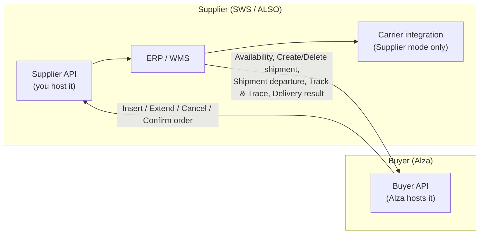

### Two order channels between Alza and SWS

SWS receives orders from Alza in two independent ways. The order number prefix tells them apart:

| | Standard order (EDI) | Dropshipping order (Trade API) |
|---|---|---|
| Order number prefix | **`OB…`** (e.g. `OB26238498`) | **`DD…`** (e.g. `DD26068181`) |
| Delivered to | Alza warehouse (e.g. `CZLC4` Chrášťany, GLN `8594177950173`) | End customer, AlzaBox or Alza branch |
| Order arrives via | EDI **ORDERS** through EDIStore | Trade API – Insert / Extend / Cancel / Confirm (this cookbook) |
| Shipping information to Alza | EDI **DESADV** | Trade API – Shipment departure, Delivery result |
| Invoice to Alza | EDI **INVOIC** | EDI **INVOIC** |
| DESADV sent | Yes | **No** |

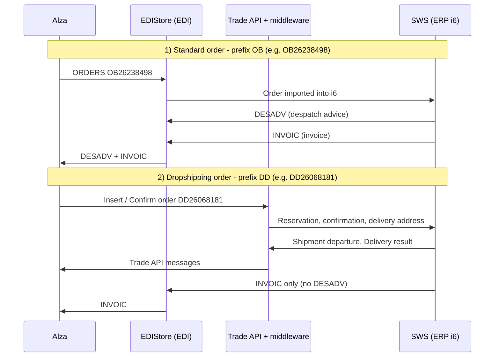

The rest of this cookbook describes the **dropshipping channel**. The EDI invoice for a dropshipping order is described in 9.18, a standard EDI ORDERS (`OB26238498`) in 9.19.

### Product data: how Alza gets stock and prices from SWS

Alza gets SWS's stock and prices in two ways – one for each order channel:

| | 1) WebService export (pull) | 2) Trade API Availability (push) |
|---|---|---|
| Who starts it | **Alza downloads** the data from the SWS WebService | **SWS sends** the data to Alza |
| Used for | Standard purchasing – Alza then orders via EDI (`OB…`) | Dropshipping offer on alza.cz – Alza then orders via Trade API (`DD…`) |
| Endpoint | `https://terminal.sws.cz/i6ws/Default.asmx/GetResult?resultType=X-StoItemQtyFreeRealX` and `…=X-StoItemQtyFreeRealX2` | `POST https://trade-api.alza.cz/api/v1/availability` |
| Format | XML (`items` / `item` with `Pricing`, `Storage`, `Product`) | JSON (`productList[]`) |
| Content | All products (≈ 35 600) | `Update` = only changed products; `PartialFull` = all products in stock, every night |

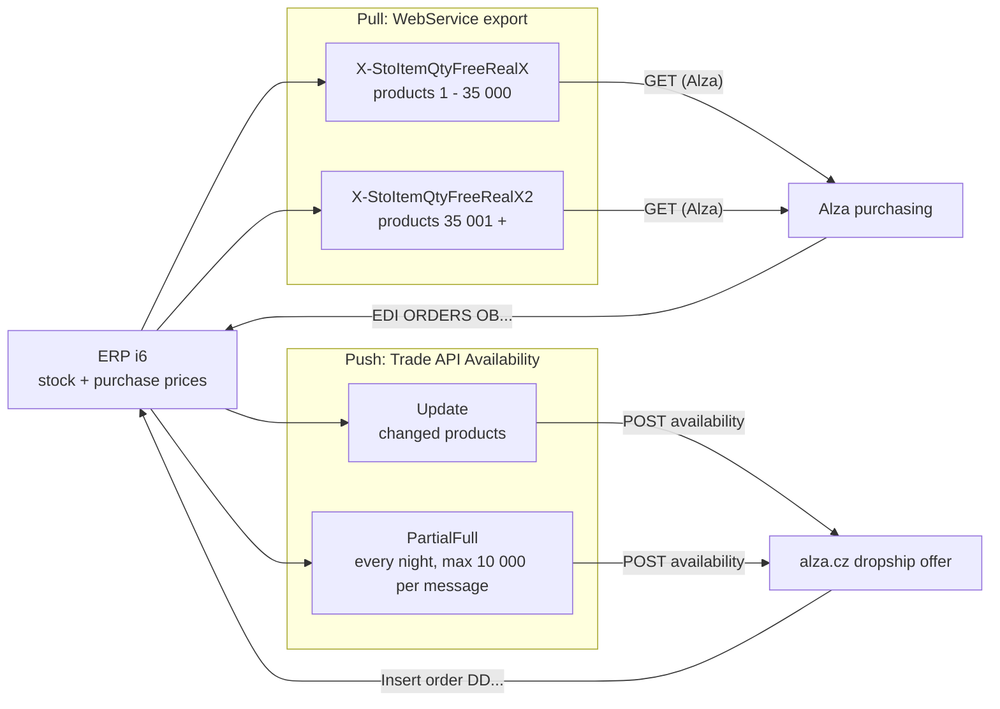

#### 1) WebService exports `X-StoItemQtyFreeRealX` and `X-StoItemQtyFreeRealX2`

A feed made to Alza's requirements (details in the SWS WebService documentation, chapter 5.2.42–5.2.43 / 6.1).

- **Two parts because of Alza's 5-minute download timeout:** `X-StoItemQtyFreeRealX` returns the first 35 000 products (`TOP 35000`), `X-StoItemQtyFreeRealX2` the rest (sorted by `StiId`, `OFFSET 35000`). Alza calls both with `GetResult`.
- **Stock** = free quantity of warehouse `29` (`QtyFree` + `QtyFree2`), reduced by order blocks.
- **Price** = dealer (purchase) price for Alza; with and without recycling / copyright fee, currency `CZK`.
- Visible only to companies `0`, `6336` and `7993` (`7993` = Alza).

```xml
<items>
  <item>
    <Pricing>
      <PriceWithFee>3889.7600</PriceWithFee>
      <PriceWithoutFee>3889.0000</PriceWithoutFee>
      <RecycleFee>0.7600</RecycleFee>
      <CopyrightFee>0.0000</CopyrightFee>
      <Currency>CZK</Currency>
    </Pricing>
    <Storage>
      <StoredQuantity>44</StoredQuantity>
    </Storage>
    <Product>
      <Name>Lenovo ThinkPad USB4 Dock 5000 - 65W - EU</Name>
      <DealerCode>LNM01353</DealerCode>
      <PartNumber>40BF0100EU</PartNumber>
      <Ean>0195892132486</Ean>
    </Product>
  </item>
</items>
```

| Group | Field | Meaning |
|---|---|---|
| `Pricing` | `PriceWithFee` | Purchase price of one piece incl. fees |
| `Pricing` | `PriceWithoutFee`, `RecycleFee`, `CopyrightFee`, `Currency` | Price without fees, the fees, currency |
| `Storage` | `StoredQuantity` | Pieces in stock |
| `Product` | `Name`, `DealerCode`, `PartNumber`, `Ean` | Name, SWS product code, manufacturer part number, EAN |

#### 2) Trade API Availability – `Update` and `PartialFull`

SWS pushes stock and prices for the dropshipping offer. The SWS job calls the middleware (`alzaavail`), which builds and sends the message (9.9).

| Type | When | What is sent | Rules from the Alza documentation |
|---|---|---|---|
| **`Update`** | Checked every 10 minutes (`alzaavail?type=0`); sent only when something changed | Only products whose stock or price changed | Changes accumulated for at least 10 minutes and sent at least every hour; never the whole range at once |
| **`PartialFull`** | Every night at ~03:32 (`alzaavail?type=2`) | All products **in stock** (quantity > 0), split into messages of max. 10 000 products (e.g. 10 000 + ≈ 3 770) | Only 00:00–06:00; at least one per night, otherwise Alza clears the offer; values older than ≈ 36 h count as unavailable |
| `Full` (deprecated) | Every night at ~01:32 (`alzaavail?type=1`) | All ≈ 35 600 products, 8.7 MB | Replaced by `PartialFull` – still sent by SWS |

The product list uses the **legacy price mode** (`price`, `priceWithFee`, `fee`, `vat`; Alza recommends `countryPrices`). Example of an `Update`:

```json
{"supplierId":200,"supplierBranchId":235,"timestamp":"2026-11-16T02:52:59.850","importType":"Update","currency":"CZK",
 "productList":[{"code":"847010","ean":"0617885021244","quantity":78,"price":309.6,"vat":21,"priceWithFee":312.96,"fee":3.36}]}
```

The price sent here is the price Alza later sends back in Insert order (`purchasePriceWithoutFees`); SWS checks it against the last sent availability (9.3, 9.9).

**Basic rules (all required by Alza):**

- HTTPS with a commonly trusted certificate, TLS 1.2+.
- JSON, `Content-Type: application/json; charset=utf-8`, `User-Agent` header filled.
- 23 h/day availability, maintenance window max. 1 h between 22:00 and 03:00.
- Authentication: HMAC-SHA1 token, Base64 + URL-encoded (see *Authentication token* in the Alza docs).
- `timestamp` must always be current – also when a message is re-sent.
- Messages must be **idempotent**: the receiver must accept the same message repeated within a short time (only `timestamp` changes).
- All times are **CET**.

---

## 3. End-to-end order lifecycle

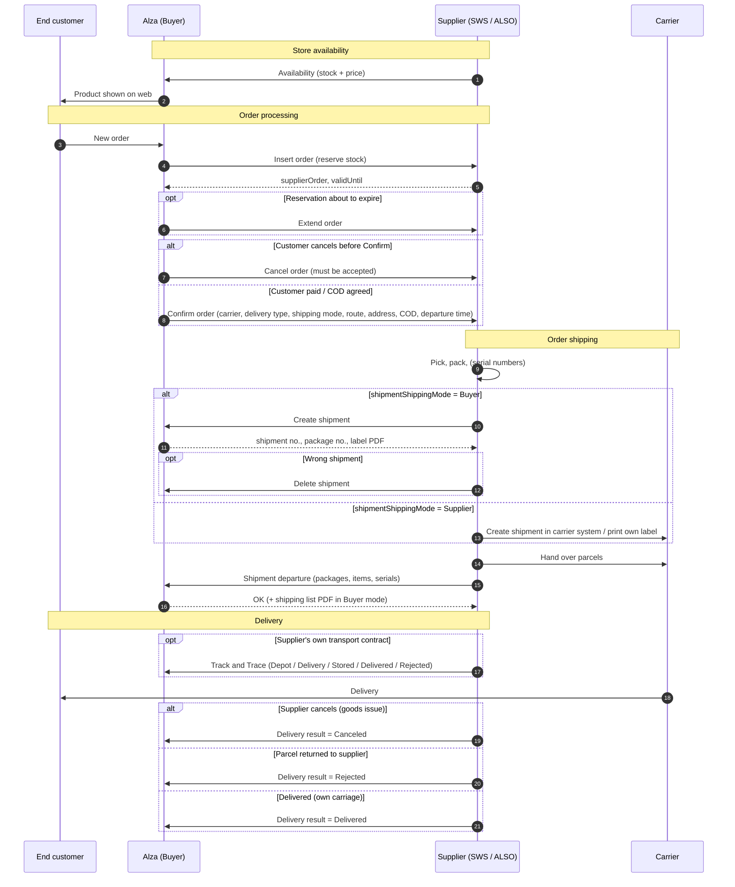

### Order states (supplier side)

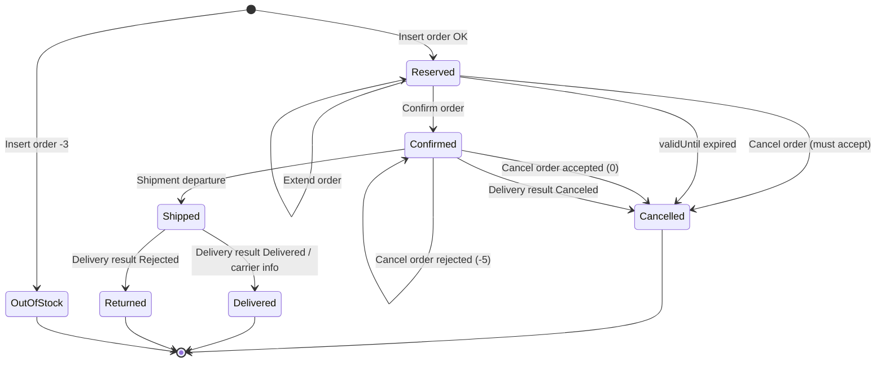

Key rules:

- **Cancel before Confirm** → must be accepted immediately (`-5` is **not** allowed).
- **Cancel after Confirm, before departure** → you may reject with `-5` (e.g. "Order was sent"). If you do not know yet, answer `-5` and later send `Delivery result = Canceled` if you managed to stop it.
- **After `Shipment departure`** → the order can no longer be cancelled.
- `shipmentDepartureTime` (formerly `demandedExpeditionDate`) in `Confirm order` is binding – the shipment must not leave **earlier or later**.

---

## 4. Shipping modes

Shipping mode defines **who handles the shipment number, package numbers, shipping list, shipping labels and carrier data**. It is sent per order in `Confirm order` → `shipmentShippingMode`. Modes can be combined – one supplier can get orders in both modes.

| | **Supplier mode – DSMD** | **Supplier mode – DSMA** | **Buyer mode – ASM** |
|---|---|---|---|
| `shipmentShippingMode` | `Supplier` | `Supplier` | `Buyer` |
| Transport contract | Supplier's | Alza's | Alza's |
| Shipment number | Supplier | Supplier | **Alza** (`Create shipment`) |
| Package numbers | Supplier / carrier | Supplier / carrier | **Alza** (`Create shipment`) |
| Shipping label | Supplier (carrier system) | Supplier (carrier system or own label for `ALZA` routes) | **Alza** – PDF from `Create shipment` |
| Shipping list (handover protocol) | Supplier | Supplier | **Alza** – PDF in `Shipment departure` response |
| Track and Trace message | **Required** | Not required | Not required |
| Typical use | Supplier already has carrier integrations | Supplier has integrations, Alza's prices / Alza's own transport | Supplier has no carrier integration |

> **Note:** DSMD / DSMA / ASM are Alza's internal names. Which contract (yours or Alza's) applies to which carrier is agreed with Alza during onboarding – it is **not** sent in the API. **[TODO – SWS]** confirm how this is set up for SWS (see [open points](#12-open-points)).

### Supplier mode (DSM) – shipping phase

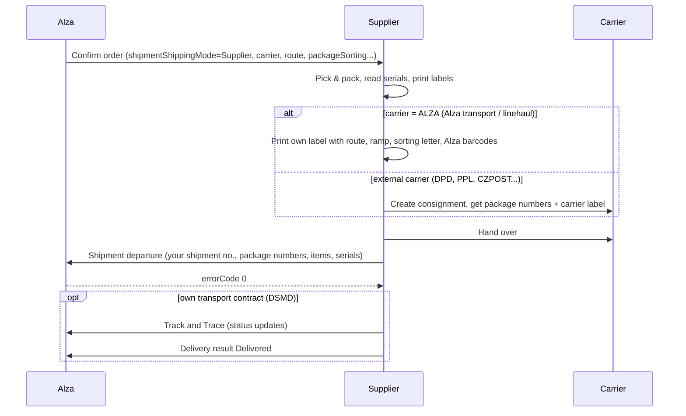

### Buyer mode (ASM) – shipping phase

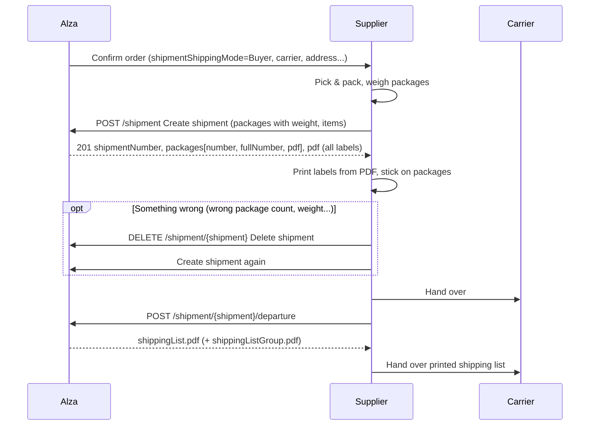

---

## 5. Which API messages are needed in each mode

Legend: **R** = required, **C** = conditional, **–** = not used. Direction: A→S = Alza calls you, S→A = you call Alza.

| API message | Dir. | DSMD (Supplier, own contract) | DSMA (Supplier, Alza contract) | ASM (Buyer) | Notes |
|---|---|---|---|---|---|
| `POST /availability` | S→A | R | R | R | Stock + price. Update every ≥10 min (changes only), `PartialFull` at night 00:00–06:00. |
| `POST /order/{order}` Insert order | A→S | R | R | R | Reserve stock. Return `supplierOrder`, `validUntil`. `-3` = out of stock. |
| `POST /order/{order}/extend` Extend order | A→S | R | R | R | Return `-5` if you don't want to extend → Alza cancels. |
| `DELETE /order/{order}` Cancel order | A→S | R | R | R | See cancellation rules in chapter 3. |
| `POST /order/{order}/confirm` Confirm order | A→S | R | R | R | **The shipping instruction.** Store everything. |
| `POST /shipment` Create shipment | S→A | – | – | **R** | Returns shipment no., package no., label PDFs. |
| `DELETE /shipment/{shipment}` Delete shipment | S→A | – | – | C | Only before departure, to fix a wrong shipment. |
| `POST /shipment/{shipment}/departure` Shipment departure | S→A | R | R | R | `{shipment}` = your number (DSM) or Alza's number from Create shipment (ASM). Returns shipping list in ASM. |
| `POST /track` Track and Trace | S→A | **R** | – | – | Required with supplier's own contract. ParcelShop: send `Stored` before `Delivered`. |
| `POST /order/{order}/delivery` Delivery result | S→A | R | C | C | `Delivered` – own carriage only. `Canceled` / `Rejected` – any mode. |

### Fields that differ by mode in the shipping messages

| Field | Create shipment (ASM) | Shipment departure – DSM | Shipment departure – ASM |
|---|---|---|---|
| `shippingCarrier.shippingCarrierCode` | required, same as in Confirm | required for new suppliers | required for new suppliers |
| `shippingCarrier.shippingCarrierDeliveryType` | real type, **`Supplier` forbidden** | real type, or `Supplier` = you deliver yourself | real type, **`Supplier` forbidden** |
| `parcelShop` | required if it was in Confirm | required if it was in Confirm | required if it was in Confirm |
| `packages[]` | `packageId` (your temp id) + `weight` | `number` (+ `fullNumber`, `ttUrl`, `weight`) | numbers returned by Create shipment |
| `items[]` | `order`, `orderItemId`, `packageId`, `quantity` | `order`, `orderItemId`, `packageNumber`, `quantity`, `serials` | same as DSM |
| Response | `shipment.pdf`, `packages[].pdf` | `errorCode` | `shipment.shippingList.pdf`, `shippingListGroup.pdf` |

**One product in two packages** (FAQ from Alza): the first package carries `quantity: 1`, the second one the same `orderItemId` with `quantity: 0`.

**Serial numbers:** if `serialNumbersRequired = true` in Insert order, `items[].serials` in Shipment departure is mandatory. If only `serialNumbersExpected = true`, send them when you have them.

---

## 6. Delivery types, carriers and consolidation

### `shipmentDeliveryType` (in Confirm order)

| Value | Meaning | Consolidation of several orders in one shipment |
|---|---|---|
| `B2C` | End customer address | Not allowed |
| `B2B` | Business customer address | Not allowed |
| `Branch` | Alza branch / warehouse (`deliveryBranchId` filled) | **Required** – group orders going to the same branch into consolidated packages |
| `ParcelShop` | Parcel shop / AlzaBox (`parcelShop` object filled) | Not allowed |

In all cases **one order must go in one shipment** (no splitting of an order across shipments).

### Carrier codes and delivery types

`shippingCarrierCode`: `ALZA, CZPOST, DHL, DPD, DPDSK, DPDHU, FOFR, GebruderWeiss, GEISPARCEL, GEISCARGO, GLS, GO, HELICAR, MagyarPOST, Najbert, PPL, RHENUS, SKPOST, SKYNET, TOPTRANS, UPS, WEDO, ZASILKOVNA, ZavolejSiKuryra`

`shippingCarrierDeliveryType` (selection): `COURIER, ALZABRANCH, ALZABOX, CZPOSTD, CZPOSTP, CZPOSTB, DPD, DPDALZABOX, DPDBOX, DPDPARCELSHOP, PPL, PPLPARCELSHOP, GLS, ZASILKOVNA, …` and the special value **`Supplier`**.

**The special value `Supplier`** in Confirm order:

- `shippingCarrierCode` filled (e.g. `CZPOST`) + delivery type `Supplier` → **you choose** the concrete delivery type for that carrier (e.g. `CZPOSTD`) and send it back in Create shipment / Shipment departure.
- `shippingCarrierCode` empty + delivery type `Supplier` → **you deliver yourself**; send back `Supplier`.

### Package sorting

`Confirm order` → `packageSorting.packageSortingGroup` = `RegularDirect` (default) | `Linehaul` | `CrossLC`. **Packages from different groups must not be physically mixed** during shipping. In Supplier mode, print `packageSortingPrint` (e.g. `L`, `C`) on the label.

---

## 7. Label creation

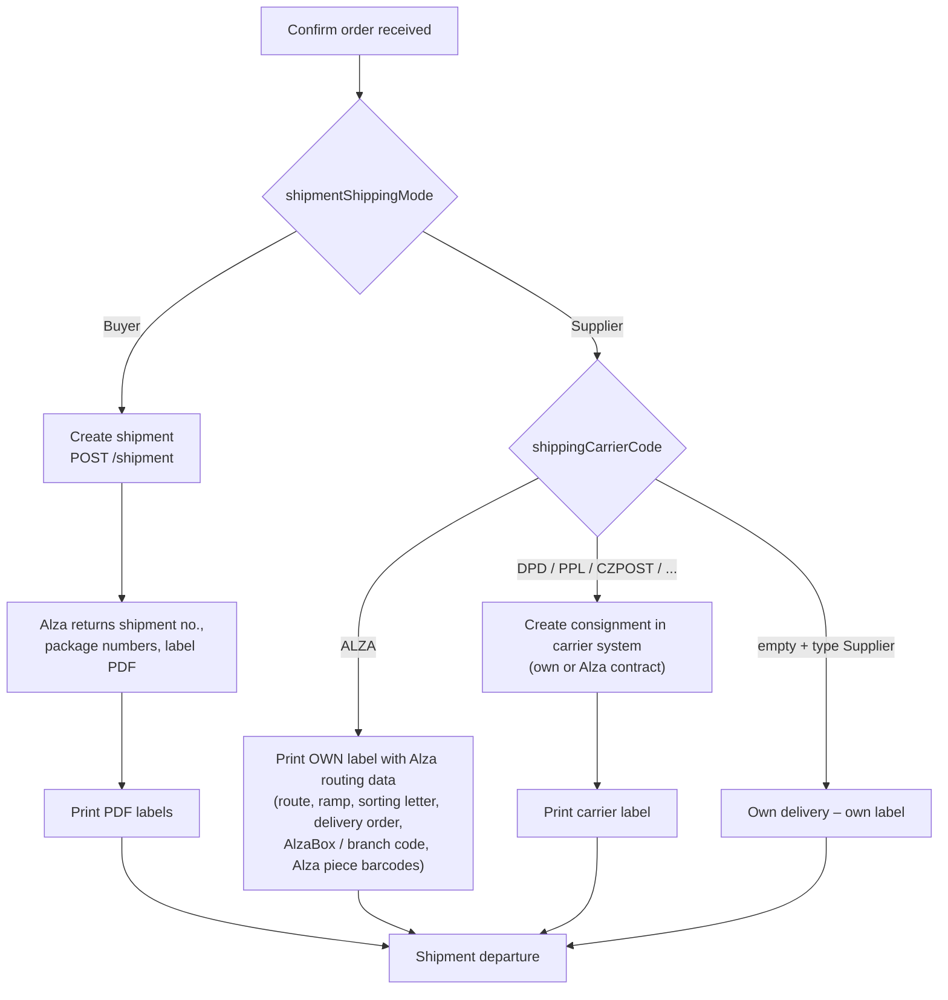

### 7.1 Buyer mode (ASM) – Alza creates the label

1. Pack the order, weigh each package.
2. `POST /shipment` with `packages[]` (`packageId`, `weight`, optional `volume`) and `items[]` (which `orderItemId` is in which `packageId`).
3. Response `201`: `shipment.shipmentNumber`, `shipment.packages[]` (`packageId`, `number`, `fullNumber`, `pdf`), `shipment.pdf` (all labels in one PDF).
4. Download and print the PDF, stick labels. **Store** shipment number and package numbers – you need them for departure.
5. If anything changes (number of packages, weights) → `DELETE /shipment/{shipment}` and create again. Not possible after departure.
6. `POST /shipment/{shipmentNumber}/departure` → response contains the **shipping list** PDF to hand over to the driver.

### 7.2 Supplier mode with an external carrier (DPD, PPL, CZPOST, …)

The label comes from **your carrier integration** exactly as for any other shipment of yours. Alza only needs the result in `Shipment departure`:

- `packages[].number` – package number (short),
- `packages[].fullNumber` – the full barcode from the label (substring is usually the tracking number),
- `packages[].ttUrl` – tracking URL (preferred way to give Alza correct tracking),
- `shippingCarrier` – real carrier code and delivery type.

For parcel shop deliveries use `parcelShop.parcelShopBranchCode` from Confirm order as the pick-up point in the carrier system.

### 7.3 Supplier mode with Alza's own transport (`shippingCarrierCode = ALZA`)

Alza picks up from the supplier's warehouse and moves parcels through its hubs (linehaul). The supplier prints **its own label** with the data from `Confirm order`. The three label samples below show the same AlzaBox order in the three sorting groups; the arrows show which JSON field goes where.

#### Label layout (AlzaBox, CZ)

| # | Position on the label | Content | Source |
|---|---|---|---|
| 1 | Top left – *Odesilatel* (sender) | Supplier code + country, e.g. `koddodavatele01 CZ` | First part of `route.routeName` (before the first `->`) |
| 2 | Top right – box | Sorting letter `C` / `L`; **empty box** for `RegularDirect` | `packageSorting.packageSortingPrint` |
| 3 | *Příjemce* (recipient), large | AlzaBox / branch name | `deliveryAddress.companyName` |
| 4 | Recipient – lines 2–4 | Street, ZIP + city, phone | `deliveryAddress.streetWithNumber`, `zip` + `city`, `phone` |
| 5 | *Č.obj.* | Supplier's order number | Supplier ERP (SWS: `OrdCode` = `supplierOrder`) |
| 6 | *Č.fakt.* | Supplier's invoice number | Supplier ERP |
| 7 | *Č.ext.obj.* | Alza order number, e.g. `DD20351220` | Alza order number (`{order}` in the URL). In the samples it equals `paymentVS`; SWS prints `OrdCodeO` (see 7.4). The API also has `shipmentExternalOrderNumber` *"required for label printing"* |
| 8 | Barcode + number above it | Package number, e.g. `1553076346` | Supplier – the same number is later sent in Shipment departure as `packages[].number` |
| 9 | Route line | Route without the sender part, e.g. `CZLC1 → CZLC4 → ZápadD 12` | `route.routeName` |
| 10 | Stop lines | One line per stop: hub + ramp, e.g. `CZLC1  L10`, `CZLC4  L69` | `route.routeStops[].branchName` + `ramp` |
| 11 | `1 / 1` | Package number / number of packages in the shipment | Supplier |
| 12 | Bottom right – box | Delivery order, e.g. `9` | `route.routeDeliveryOrder` |

Not printed: `addressName` (customer name), `email`, `parcelShopBranchCode` (`AB505`), COD (0 in the samples).

#### The three sorting variants

| Variant | `packageSortingGroup` | `packageSortingPrint` | Route stops | Box top right |
|---|---|---|---|---|
| **Direct** | `RegularDirect` | – (not sent) | 1 (`CZTC1 / L10`) | empty |
| **Linehaul** | `Linehaul` | `L` | 1 (`CZTC1 / L10`) | `L` |
| **Cross** | `CrossLC` | `C` | 2 (`CZTC1 / L10`, `CZLC4 / L69`) – via cross-dock | `C` |

Packages from different groups must not be mixed physically (see chapter 6).

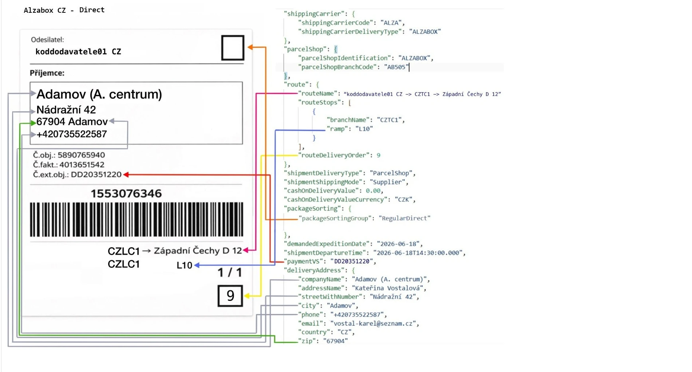

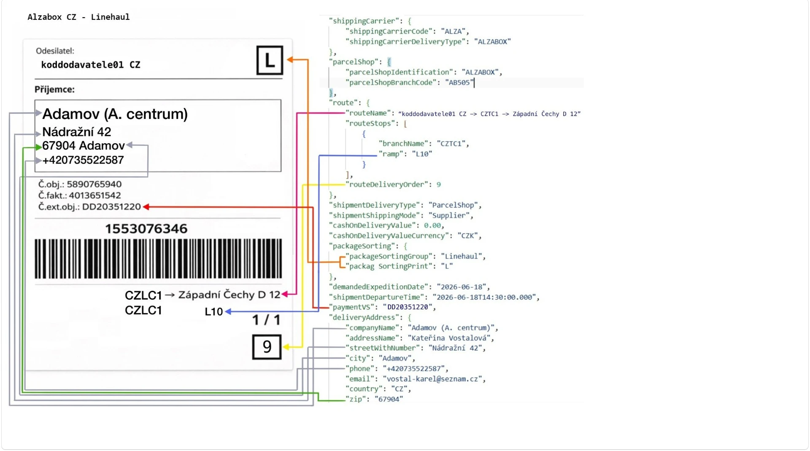


> **Note:** in the samples the JSON says hub `CZTC1`, while the printed label shows `CZLC1`. Print exactly what Alza sends in `routeName` / `routeStops`.

For **Branch** deliveries Alza also sends `orderItems[].alzaBarCodes` in **Insert order** – one barcode per piece (e.g. `BCX3489207239`). **Print them (Code-128) on each piece.** The count equals the ordered quantity.

> **[TODO – SWS]** Which i6 report / template prints the `ALZA` label and the Alza piece stickers.

### 7.4 Real SWS labels (16.11.2026)

Photos from the SWS warehouse, taken on 16.11.2026. The matching messages from the log are in [9.16](#916-real-orders-end-to-end-1516112026).

| Label | Order | What is on it | Differences from the Alza sample (7.3) |
|---|---|---|---|
| AlzaBox – Linehaul | `DD26102128` | Sender `SWS`; box `L`; recipient = `companyName`, street, ZIP + city, phone; *C.obj* `OP26189264` (= `supplierOrder`), *C.fakt* `26163784`, *C.ext.obj* `DD26102128`; package barcode `55002350085113`; route line = whole `routeName`; `1/1`; box `14` = `routeDeliveryOrder` | Route stops / ramps (`CZTC1 L17`) are **not** printed; route line includes `SWS CZ01 ->`; no diacritics (printer font) |
| Branch – Cross | `DD26104004` | Box `C`; recipient Alza.cz Brno; *C.obj* `OP26189329`, *C.fakt* `26163825`, *C.ext.obj* `DD26104004`; package `55002355016300`; route `SWS CZ01 -> CZTC1 -> SKLC3 -> Brno`; `1/1`; bottom box **empty** (Branch has no `routeDeliveryOrder`) | Ramps `L01` / `L54` not printed; **phone `+420 725 255 800`** comes from the branch address stored in i6 (`ComShipTo` found by `deliveryBranchId = 2`), not from the message (`+420 225 340 111`) |
| Alza piece sticker | `DD26104004` | One sticker per piece – Code-128 barcode `BCX37053037664` + product name (*Dell Multimediální klávesnice KB216*); 4 stickers for 4 pieces of `241837` | – |
| DPD (B2C) | `DD26068181` | Printed by i6 through the DPD integration (*16/11/26 12:58 … STO i6*): sender **Alza a.s. – SWS**, Dostihová 1, 763 15 Slušovice; recipient from `deliveryAddress`; *Vaše obj* `1520784885` = `paymentVS`; 0.4 kg; parcel number `13825096178983` (+ check letter `K`); service `D-B2C`; DPD routing `CZ-DPD-2360`, `327-CZ-40747`, `204B`; bottom barcode `0040747 13825096178983 327 203` | Parcel number = `packages[].number`, bottom barcode = `fullNumber` `%004074713825096178983327203` in Shipment departure |

**What the SWS label prints as *C.ext.obj*:** the Alza order number (`{order}` from the URL, stored as `OrdCodeO`) – not `paymentVS`.

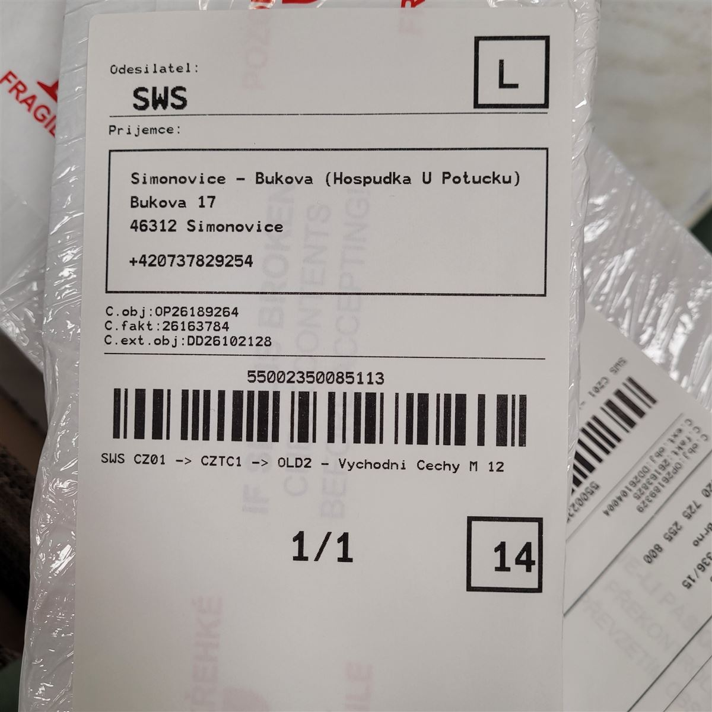

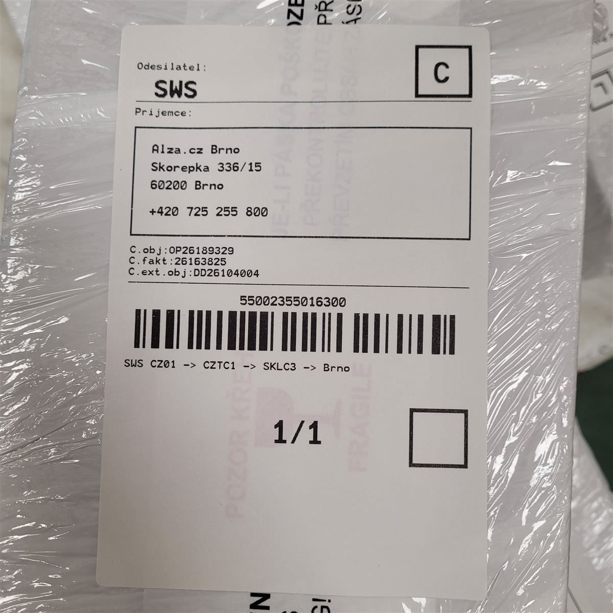

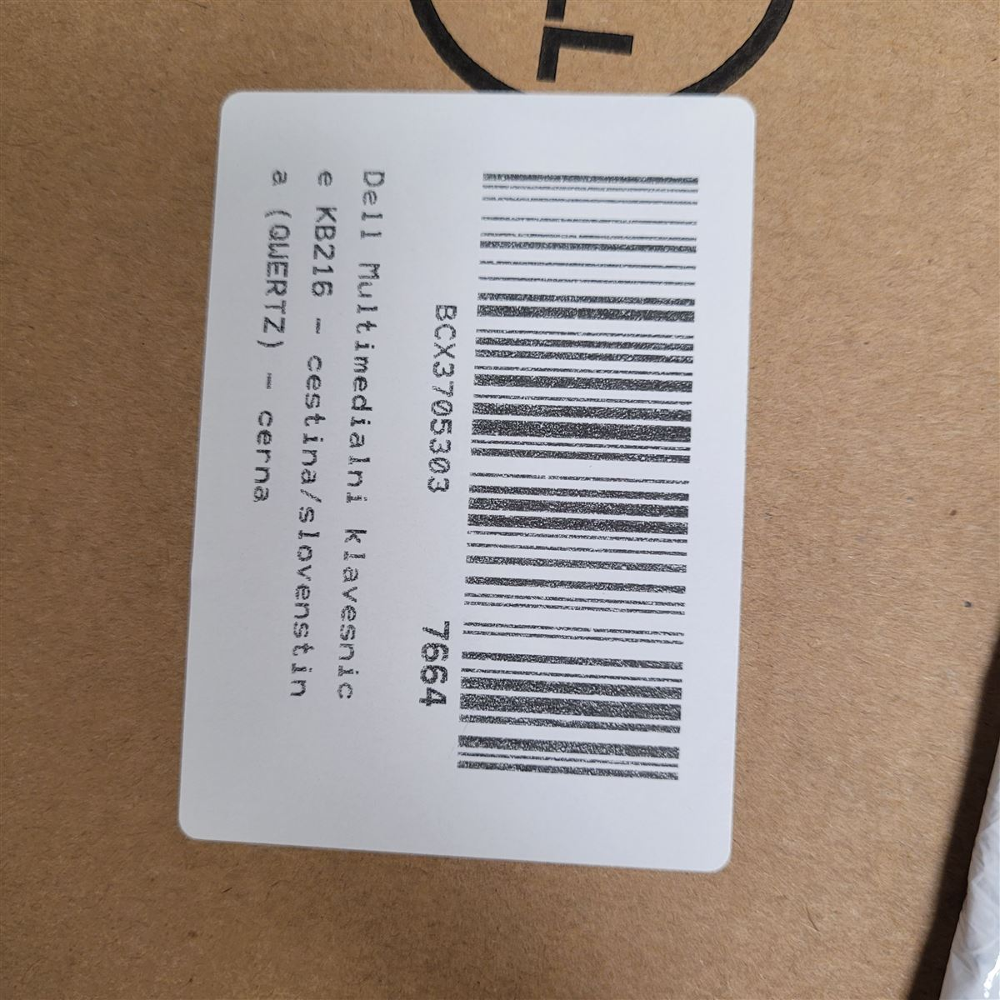

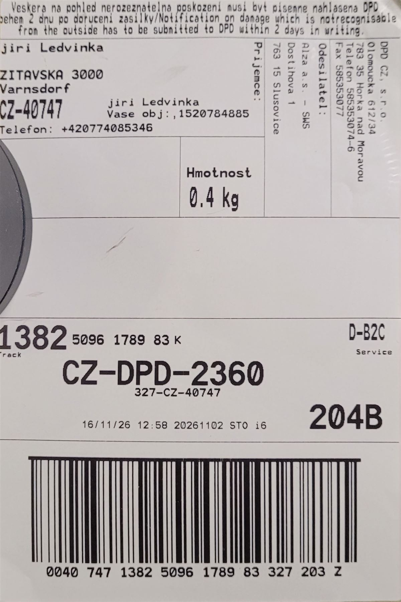

---

## 8. What data you need to store

Everything below is needed either to answer later messages, to build labels, or to resolve disputes with Alza.

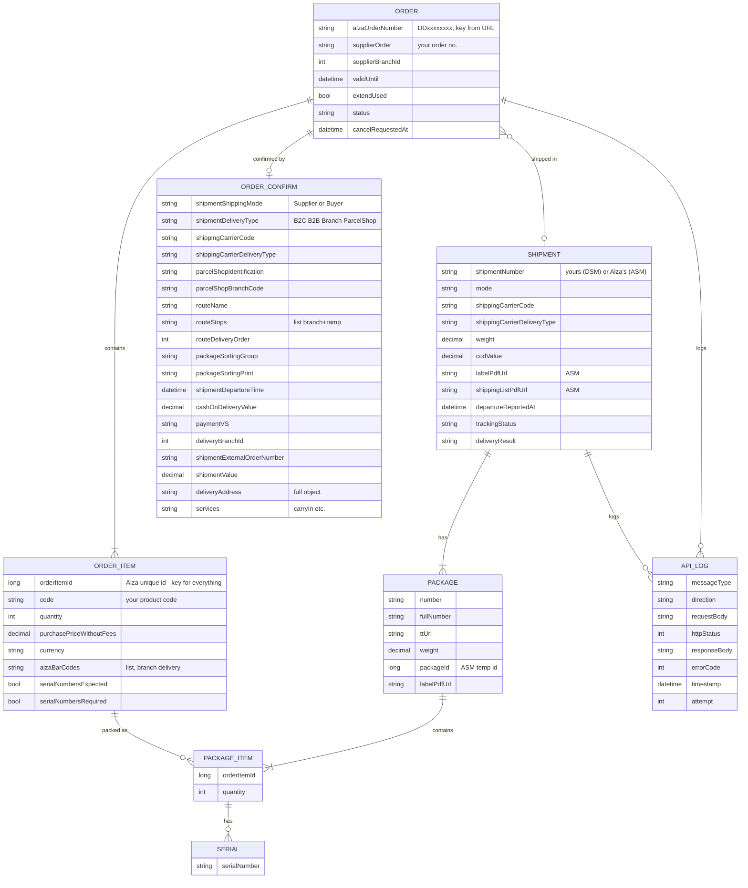

### Minimum checklist

| Store | Why |
|---|---|
| Alza order number (`DD…`) ↔ your order number | Key in all Alza URLs; you return `supplierOrder` in Insert. |
| `orderItemId` per line | Preferred item identification in Create shipment / Departure; **required for Branch delivery**. |
| `alzaBarCodes` | Must be printed on each piece for Branch delivery. |
| `serialNumbersExpected/Required` | Decides whether serials are mandatory in departure. |
| `validUntil`, extend counter | Reservation expiry, handling of repeated Extend. |
| **The whole Confirm order payload** | It is the shipping instruction (carrier, mode, address, route, COD, departure time). Keep the raw JSON too. |
| Shipment number, package numbers, full numbers, tracking URL | Sent in departure; needed for T&T and support. ASM: returned by Alza. |
| Package ↔ item ↔ quantity ↔ serials | Content of departure `items[]`. |
| Label PDF / shipping list PDF URLs (ASM) | Re-print. |
| Raw log of every request + response + HTTP status | Retries, idempotency, disputes with Alza (Alza support asks for it). |

> **SWS data model:** how SWS stores all of this in ERP i6 (tables, columns, parameter ids) is described in [9.4](#94-where-the-data-is-stored-in-i6).

---

## 9. How SWS does it (as-is)

*Based on the production SQL procedures in database `I6SWS` (ERP i6, state 15.11.2026) and the message log. Object names, IDs and data are real and unmodified. Points that are read from the code but not yet confirmed by SWS are marked "(to confirm)".*

### 9.1 Architecture

- SWS runs **Supplier shipping mode** – it creates shipment numbers, package numbers and labels itself.
- Carriers in production: **`ALZA`** (Alza's own transport from SWS warehouse `CZ01` via hub `CZTC1`, for AlzaBoxes and Alza branches) and **`DPD`**.
- A middleware **`wsdrop-alza`** (`https://terminal.sws.cz/wsdrop-alza/sws1.ashx`) receives Alza's JSON, converts it to XML and calls the SQL procedure. Outgoing messages are built by SQL procedures as JSON fragments and sent by the middleware.
- Production Alza endpoint used by the middleware: `https://trade-api.alza.cz/api/v1/`. The middleware writes every message (original JSON, both directions) to a daily log `msg_YYYYMMDD.jsonl` – see 9.16.
- IDs: Alza = company **`ComId 7993`** in i6; `supplierId 200`, `supplierBranchId 235`; all automatic actions run as i6 user **`270` / `DDD`**.
- Every dropship order carries the parameter **`ConParSet 434 / 3501`** – that is how all procedures recognise dropship orders.

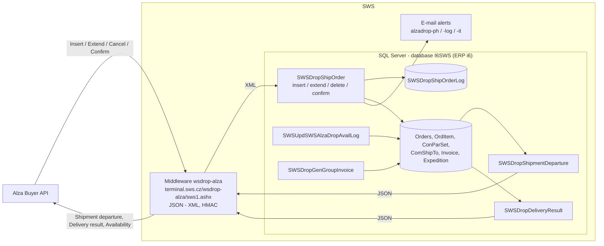

### 9.2 Database objects

| Object | Type | Purpose |
|---|---|---|
| `SWSDropShipOrder` | procedure | Handles all incoming Supplier API messages (`insert`, `extend`, `delete`, `confirm`). |
| `SWSDropShipmentDeparture` | procedure | Builds Shipment departure messages for shipped orders. |
| `SWSDropDeliveryResult` | procedure | Builds Delivery result messages (Canceled / Rejected). |
| `SWSDropGenGroupInvoice` | procedure | Merges temporary dropship invoices to Alza into one group invoice. |
| `SWSUpdSWSAlzaDropAvailLog` | procedure | After availability is sent, stores the "last sent" snapshot used by price checks in Insert order. |
| `SWSDropShipOrderLog` | table | Log of every incoming message (columns `Sdal…`). |
| `SWSAlzaDropAvailLog1` | table | Current offer prepared for Alza (`LStiId, LQtyFree, LSipPriceOrd, LStiCode, LStiEAN, LTaxRate, LSndStatus`). |
| `SWSAlzaDropAvailLog` | table | Snapshot of the availability last sent to Alza. |

### 9.3 Incoming messages – `SWSDropShipOrder`

Parameters: `@typ` (`insert` / `extend` / `delete` / `confirm`), `@OrdCodeO` (Alza order number `DD…`), `@ComId` (7993), `@xml` (message converted to XML), `@HTTPRespStatus`, `@HTTPResponse`.

#### Logging and idempotency (all message types)

1. Every call inserts a row into `SWSDropShipOrderLog`; `SdalResult` is pre-set to `-1, || Unspecified error`.
2. The procedure looks for an **earlier identical message** (same type + order + XML, ignoring `timestamp` via `dbo.SWSRemoveXMLTag`). Earlier attempts that ended with deadlock / timeout (HTTP 500) or "Previous request still running" are ignored.
   - earlier one still running (no HTTP status yet) → `-1 Previous request still running`,
   - earlier one finished → **the same result is returned again** (repeat-safe, as Alza requires).
3. At the end `SdalResult` = `<errorCode>, <message>||<internal error text>`.
4. The middleware calls the procedure **a second time** with `@HTTPRespStatus` + `@HTTPResponse`; that call only stores what was actually returned to Alza into `SdalHTTPRespStatus` / `SdalHTTPResponse` (max. 500 characters).

| Log column | Meaning |
|---|---|
| `SdalId` | Log id |
| `SdalComId` | Alza in i6 – `7993` |
| `SdalType` | `insert`, `extend`, `delete`, `confirm` |
| `SdalCode` | Alza order number (`DD…`) |
| `SdalXML` | Request converted to XML |
| `SdalResult` | `errorCode, message\|\|internal error` |
| `SdalC` | Created (date/time) |
| `SdalHTTPRespStatus` | HTTP status returned to Alza |
| `SdalHTTPResponse` | JSON body returned to Alza |

#### Insert order

| # | Check | Response |
|---|---|---|
| 1 | Order `DD…` already exists in i6 and there is no earlier identical message | `-1 Invalid Order Number - already exists` |
| 2 | Product missing in current offer (`SWSAlzaDropAvailLog1`) or current price higher than Alza's price | `-3 Out of stock`, `errorProducts[].quantity = 0` |
| 3 | Product missing in last sent availability (`SWSAlzaDropAvailLog`) | `-2 Bad product code` |
| 4 | Code not paired with an i6 product (`StoItem` + `CompanyPrice` for Alza) | `-2 Bad product code in pairing` |
| 5 | Price ≠ last sent price | `-4 Bad product price` |
| 6 | Reservation order created, stock blocked (`OrdBlock`); blocked qty ≠ ordered qty | rollback, `-3 Out of stock` with the really blocked quantity |
| 7 | Number of `alzaBarCodes` ≠ quantity | rollback, `-1 Ordered quantity is not same as count AlzaBarCodes` |
| 8 | OK | `0`, `supplierOrder` = `OrdCode` (e.g. `OP26132530`), `validUntil` = today + 7 days 23:59 |

What is created in i6:

- `Orders`: `OrdCodeO` = Alza order number, `OrdCode` = new number from numeration "O", `OrdYSetId = 3` (reservation order), `OrdDelTo` = validUntil, `OrdNotCheck = 1`, `OrdNoteExt = 'Dropshipment rezervacni objednavka'`.
- `ConParSet 434 / 3501` on the order (dropship marker).
- `OrdItem` per line (price = Alza price = price from availability).
- Parameter `879` on each item: `CpsTag` = Alza `orderItemId`, `CpsTagI` = `serialNumbersRequired`.
- Parameter `880` on each item: one row per Alza barcode (`CpsTag` = barcode, `CpsTagI` = index 0…n).
- If contact parameter `1048` is set, stock is first taken over from other (non-dropship) Alza reservation orders (re-blocking, recorded in parameter `964 / 3228`).

#### Extend order

| Check | Response |
|---|---|
| Order not found | `-5 Order number not found` |
| Order already invoiced | `-5 Order was sent` |
| Order closed (reservation expired) | `-5 Reservation expired.` |
| New `validUntil` in the past | `-5 untilValid is the past` |
| New `validUntil` later than today + 9 days | `-5 untilValid is too long` |
| Already extended once (`WSREQEXTEND` in `OrdNoteExt`) or order has `!DDR!` | `-5 only once extend is allowed` |
| OK | `OrdDelTo` = new validUntil, `WSREQEXTEND <time>` added to `OrdNoteExt` → `0` + `validUntil` |

#### Cancel order (`delete`)

| Situation | Response | What happens |
|---|---|---|
| Order not found | `-5 Order number not found` | |
| Order already invoiced (confirmed and processed) | `-5 Order was sent` | E-mail to dispatch: stop the shipment if possible and send Delivery result Canceled; if Shipment departure was already sent, keep `!DSD!` and send Delivery result Rejected. |
| Order closed | `0 Order is closed` | `WSREQDELETE <time>` written to `OrdNoteExt` |
| Confirm arrived earlier but invoice does not exist yet | `0` | Order switched back to reservation, `DELETE po CONFIRM` in `OrdNoteInt`, e-mail "do not invoice". |
| Standard (reservation) | `0` | `OrdDelTo` = yesterday, `WSREQDELETE <time>` in `OrdNoteExt`, `OrdYSetId3Cancel` releases the reservation. |
| Duplicate `DD…` number in i6 | `0` | E-mail to IT. |

#### Confirm order

| Situation | Response |
|---|---|
| Order unknown and never inserted | `-1 Order number not found, CONFIRM without INSERT` |
| Order unknown, but insert is in the log | `-5 Order number not found` |
| Already invoiced (repeated confirm) | `0` |
| Order has `!DDR!` (cancelled by SWS) | `0 Order is marked as DDR` – flag removed |
| Order closed, reservation expired | `0 attempt confirm expired reservation` |
| Order closed | `0 Order is closed` |
| Previous confirm failed half-way | `0 previous confirm ended with some error` – manual invoicing |
| Not all items blocked any more | `0 Order was inserted with -3, out of stock or reservation was unblocked, delivery result - canceled` – items cancelled, Delivery result Canceled follows |
| Delivery type not configured in i6 | `-5 Contractually unsupported shipping code <code>` |
| `shipmentShippingMode` not `Supplier` / `Buyer` | `-5 Contractually unsupported shipping mode` |
| COD in a currency other than CZK / EUR | `-5 Contractually unsupported currency code` |
| ZIP not 5 digits for CZ / SK | `-5 Delivery Address Error` |
| OK | `0` |

What a successful Confirm does:

1. **Carrier mapping** (see 9.5): `shippingCarrierDeliveryType` → i6 delivery mode (`DelivMode`). Value `Supplier` → `ALZABRANCH` when `shippingCarrierCode = ALZA`, otherwise `DPD`.
2. **Delivery address** (`ComShipTo`):
   - `Branch` + `deliveryBranchId` → existing address with `CstId2` = branch id is reused,
   - parcel-shop delivery modes → parcel shop looked up / created in `DemTOPlace` by `parcelShopBranchCode`, address generated from it (`GenCstFromDtp`),
   - otherwise a new address; `CstId2` = branch id or delivery type, `CstId3` = GLN `8594177950111`; `@` is removed from ZIP (Alza sometimes sends it).
3. **Order** updated: `OrdYSetId = 0` (normal order), confirmed by 270/DDD, `OrdCstId`, `OrdDemId`, `OrdDelFrom` = demanded date, `OrdTagD` = `shipmentDepartureTime`, `OrdTag2` = `shipmentDeliveryType`.
4. **Non-branch orders** (B2C / B2B / ParcelShop): switched to B2C (`OrdAsB2C`), COD price of items set to 0.01 and a correction item **`DROPSHIPKOREKCE`** (StiId `498094`) added so that the COD total equals `cashOnDeliveryValue`; COD variant of the delivery mode set (`OrdZDemIdO`).
5. **Parameters** stored on the order (see 9.4).
6. **Invoice** created immediately (`InvAutoCreate`, type 73); for non-branch orders `InvZVal` = COD. Contact parameter `945` controls group invoicing (value `3822` → temporary invoices under user `97573`, merged later by `SWSDropGenGroupInvoice`). Items with conditional sale (`OriSalePerm`) are not invoiced – error is logged.

> **Note:** `shipmentShippingMode = Buyer` is accepted, but SWS has no Create shipment logic – such an order would be processed like Supplier mode. **[TODO – SWS]** confirm that Alza never sends `Buyer` to SWS.

### 9.4 Where the data is stored in i6

`ConParSet` is the generic i6 parameter table: `CpsConId` = id of the record (order, item, delivery mode, invoice), `CpsCpaId` = parameter id, `CpsCpvId` = value id from a list, `CpsTag` = text value, `CpsTagI` = integer value.

| API field | i6 storage |
|---|---|
| Alza order number (`{order}`, `DD…`) | `Orders.OrdCodeO` |
| `supplierOrder` | `Orders.OrdCode` |
| `validUntil` | `Orders.OrdDelTo` |
| Dropship marker | `ConParSet` 434 / value 3501 on the order |
| `orderItemId`, `serialNumbersRequired` | `ConParSet` 879 on `OrdItem` (`CpsTag`, `CpsTagI`) |
| `alzaBarCodes[]` | `ConParSet` 880 on `OrdItem`, one row per barcode (`CpsTagI` = index) |
| `code`, `quantity`, price | `OrdItem.OriStiCode`, `OriQty`, `OriPrcCur` |
| `shipmentDeliveryType` | `Orders.OrdTag2` |
| `shipmentDepartureTime` | `Orders.OrdTagD` |
| `demandedExpeditionDate` | `Orders.OrdDelFrom` |
| `shippingCarrier` | `Orders.OrdDemId` (COD variant `OrdZDemIdO`) |
| `deliveryAddress`, `deliveryBranchId` | `ComShipTo` via `Orders.OrdCstId` (`CstId2` = branch id) |
| `parcelShop.parcelShopBranchCode` | `DemTOPlace.DtpCode` |
| `paymentVS` | `ConParSet` 888 (`CpsTag`) |
| `shipmentValue` + currency | `ConParSet` 889, format `value\|currency` |
| `cashOnDeliveryValue` + currency | `ConParSet` 890, format `value\|currency`; also `Invoice.InvZVal` |
| `route.routeName` | `ConParSet` 1186 |
| `route.routeStops[]` | `ConParSet` 1187, format `branch\|ramp\|\|branch\|ramp` |
| `route.routeDeliveryOrder` | parameter `DRO` "RouteDeliveryOrder" (group ALZ) |
| `packageSorting` | parameter `DPG` "DropPackSortGroup" (group ALZ): `CpvValue` = group, `CpvCode` = print letter |
| Message log | `SWSDropShipOrderLog` |
| Status flags | `Orders.OrdTag`, `OrdNoteExt`, `OrdNoteInt`, `Expedition.ExpNoteInt` (see 9.8) |
| Packages | `Expedition` (`ExpCodeO` parcel number, `ExpCodeS` DPD short number, `ExpWeight`, `ExpDateS` shipped) linked via `ExpDocuments` to the delivery note (type 68) or invoice (type 73) |
| Serial numbers | `Warranty` (per expedition and product), read by `dbo.SWSGetWarSerialNoForOrderAndExpedition` |

**Not stored today:** `shipmentExternalOrderNumber`, `shipmentDeliveryServices`, `parcelShopIdentification` (only the branch code), `regNo` / `vatNo`. The raw JSON is kept only in the middleware log files `msg_YYYYMMDD.jsonl` (see 9.16), not in the database.

### 9.5 Carrier mapping

- i6 delivery modes (`DelivMode`) are linked to Alza codes by `ConParSet` **900**: `CpsTag` = Alza `shippingCarrierDeliveryType`.
- For each code there is a standard mode (`DemType = 0`), a COD variant (`DemType = 2`) and optionally a branch variant (`CpsTagI = -1`, used for `Branch`).
- In Shipment departure `DemNameE` is sent as `shippingCarrierCode` and `CpsTag` of parameter 900 as `shippingCarrierDeliveryType`.
- `DemDtp = 1` = parcel-shop delivery mode (uses `DemTOPlace`).
- Codes that are not configured are rejected with `-5 Contractually unsupported shipping code`.

> **[TODO – SWS]** List of configured delivery modes – result of:
> `SELECT DemId, DemCode, DemNameE, DemType, DemDtp, DemMaxWeight, CpsTag, CpsTagI FROM DelivMode JOIN ConParSet ON DemId = CpsConId AND CpsCpaId = 900`

### 9.6 Shipment departure – `SWSDropShipmentDeparture`

**Selection:** dropship orders that are closed (`OrdClosed = 1`), have an expedition with a parcel number (`ExpCodeO`), are shipped (`ExpDateS` filled, `ExpDateC` empty), have no `!DSD!` yet and are not cancelled (`!DDR!`). The expedition is found via the delivery note (68) or the invoice (73).

**Shipment number** (`{shipment}` in the URL):

| Format | When |
|---|---|
| `<OrdId>x<lowest ExpId>A` | Standard – one shipment per order with all its packages |
| `<OrdId>x<ExpId>B` | Branch – one shipment per expedition (consolidated), items of all orders in it |
| `<OrdId>x<ExpId>C` | Branch order split over several expeditions – each sent separately |
| suffix `AAy` / `By` | Manual resend for one order (`@OrdId`), e.g. `6955290x8715633AAy` |

**Package number:**

| Carrier | `packages[].number` | `packages[].fullNumber` |
|---|---|---|
| DPD (`DemCode` 1) | `ExpCodeS` | `ExpCodeO` |
| Zásilkovna (`DemCode` 29) | `ExpCodeO` without the first character | `ExpCodeO` |
| Others (ALZA, …) | `ExpCodeO` | `ExpCodeO` |

**Other fields:**

- `shippingCarrier` = `DemNameE` + parameter 900.
- `cashOnDeliveryValue` / `shipmentValue` from parameters 890 / 889 (type A). For B / C COD = 0 and **`shipmentValue` is never sent** (the calculation in the code is dead – `CASE WHEN NULL IS NULL`), and `packages[].weight` is sent as a string (see 9.16).
- `shipmentWeight` = `ExpWeight`, capped by `DemMaxWeight`.
- `items[]`: `order`, `packageNumber`, `quantity` (`Warranty.WarQty`), `orderItemId` (parameter 879), `code`, `serials` (from `Warranty`; if the serial is shorter than 4 characters or equals "Fuser unit 230V", **the order number is sent as the serial**). The correction item is excluded.
- Not sent: `expectedDeliveryDate`, `ttUrl`, `deliveryAddress`, `shipmentVolume`.
- The rule "not before `shipmentDepartureTime`" is **switched off** in the code (comment: agreed with Alza, and it collided with branch consolidation).
- After a successful send the flag `!DSD!` is set in `OrdTag` (Branch: in `Expedition.ExpNoteInt`) – by the middleware (to confirm).

**Hard-coded exceptions** in the procedure (one-off fixes of individual orders): ExpId `6867391`, `7080553`, `8571708`, `8770543`, `8781021`; OrdId `5136469`, `6808692`, `7010557`, `7021326`. They should not be carried over into a new implementation.

### 9.7 Delivery result – `SWSDropDeliveryResult`

SWS sends only **Canceled** and **Rejected** – never Delivered.

| Case | Condition | `status` | `errorReason` |
|---|---|---|---|
| Stock lost / reservation expired | Dropship order with items not fully blocked and not shipped, not cancelled by Alza (`WSREQDELETE`), not being re-blocked (`!DROP!` in `OrdNoteInt`), older than 10 min | Canceled | `expired reservation` (still a reservation) or `poslední poškozený kus` (last damaged piece) |
| Parcel returned | Return receipt (`LMPurchase`, `PurXPusId = 6`) whose code matches the shipped parcel (`ExpCodeO` / `ExpCodeS`; DPD: substring from position 8 or 9) | Rejected | `zakaznik neprevzal` (customer did not collect) |
| Cancelled after departure | Alza cancel (`WSREQDELETE`) after `!DSD!` was sent | Rejected | `send DELETE after CONFIRM` |
| Manual call (`@OrdId`, `@Type`) | 1 / 2 / 3 / 4 | Canceled / Canceled / Rejected / Canceled | `expired reservation` / `poslední poškozený kus` / `zakaznik neprevzal` / `chyba pri confirm` |

`paymentVS` comes from parameter 888. After sending, `!DDR!` is set in `OrdTag`. Real examples (Canceled `DD26073359`, Rejected `DD25313597`) are in 9.16.

### 9.8 Status flags on the order

| Flag | Where | Meaning |
|---|---|---|
| `OrdYSetId = 3` | `Orders` | Reservation order (after Insert, before Confirm) |
| `OrdYSetId = 0` | `Orders` | Normal order (after Confirm) |
| `!DSD!` | `OrdTag` / `Expedition.ExpNoteInt` (Branch) | Shipment departure sent |
| `!DDR!` | `OrdTag` | Delivery result sent |
| `!E!DDR!` | `OrdTag` | Delivery result error (to confirm) |
| `WSREQEXTEND <time>` | `OrdNoteExt` | Extend accepted (only once) |
| `WSREQDELETE <time>` | `OrdNoteExt` | Cancel received from Alza |
| `DELETE po CONFIRM` | `OrdNoteInt` | Cancel arrived after Confirm, before the invoice |
| `!DROP!` | `OrdNoteInt` | Re-blocking in progress – no Delivery result |
| `Branch`, `B2C`, … | `OrdTag2` | `shipmentDeliveryType` |

### 9.9 Availability

- `SWSAlzaDropAvailLog1` = current offer for Alza (free quantity, purchase price, code, EAN, VAT rate, `LSndStatus`).
- In the live logs (11.–17.11.2026) SWS sends every night a `Full` import (~01:32) **and** a `PartialFull` (~03:32, in parts of 10 000), plus a few single-product `Update` messages at night – all in the legacy price mode. See 9.16.
- After sending, `SWSUpdSWSAlzaDropAvailLog` copies rows with `LSndStatus ≤ 1` to `SWSAlzaDropAvailLog` (the table is truncated first unless rows with status 4 exist) and adds 3 to their status (= sent).
- Insert order compares Alza's price with both tables (see 9.3).

> **[TODO – SWS]** The procedure that fills `SWSAlzaDropAvailLog1` (stock and price calculation), the message builder and the meaning of the `LSndStatus` values.

### 9.10 Invoicing

- Confirm creates an invoice (type 73) per order.
- The invoice is sent to Alza via **EDI** (INVOIC through EDIStore) – not via the Trade API. No DESADV is sent for dropshipping orders. Example in 9.18.
- `SWSDropGenGroupInvoice` (Alza `ComId 7993`) takes temporary invoices (`InvNumTmp = 1`) of dropship orders whose stock items are all delivered, gives the newest one a real number (`NumUpd`, `InvCodeO` = variable symbol), merges the others into it (`InvJoin`), deletes the empty ones, sets parameter `944 / 3600` and `InvState = 1`. Result: **one group invoice to Alza**.

### 9.11 E-mail alerts

Sent via Database Mail (profile `DataSQL IBM`) to `alzadrop-ph@SWS.cz; alzadrop-log@SWS.cz`, copy `alzadrop-it@SWS.cz`:

- Cancel for an order that is already invoiced – stop the shipment manually / send Delivery result.
- Cancel after Confirm without invoice – "do not invoice".
- Duplicate `DD…` number on cancel / extend / confirm.

### 9.12 Known issues and technical debt

- Hard-coded order / expedition IDs in `SWSDropShipmentDeparture` (one-off fixes).
- Order number sent as serial number when no valid serial exists.
- `shipmentDepartureTime` not enforced.
- `Buyer` mode accepted but not implemented (no Create shipment).
- No Track and Trace, no Delivery result Delivered, no `ttUrl` in departure.
- New Alza fields not used: `shipmentExternalOrderNumber`, `shipmentDeliveryServices`, upcoming `shipmentDeliveryAddress`, `glnList`.
- Hard-coded constants: `ComId 7993`, user `270 / DDD`, parameter ids, GLN `8594177950111`, correction item `498094`, e-mail addresses.
- Issues found in the logs (bad-ZIP loop, endless Delivery result loops, duplicated Branch shipments, HMAC token in the log) are described in 9.20.
- Availability uses the deprecated `Full` import type and the legacy price mode (`price`, `priceWithFee`, `fee`, `vat`).
- Branch departure (type B / C): `shipmentValue` missing, package weight sent as a string.

### 9.13 Example – AlzaBox via Alza transport

`Confirm order` (as XML after SWS conversion, log record 592251, order `DD23779989`):

```xml
<orders>
  <timestamp>2026-08-18T20:44:01.303</timestamp>
  <customerId>7993</customerId><supplierId>200</supplierId><supplierBranchId>235</supplierBranchId>
  <regNo>27082440</regNo><vatNo>CZ27082440</vatNo>
  <shippingCarrier>
    <shippingCarrierCode>ALZA</shippingCarrierCode>
    <shippingCarrierDeliveryType>ALZABOX</shippingCarrierDeliveryType>
  </shippingCarrier>
  <parcelShop>
    <parcelShopIdentification>ALZABOX</parcelShopIdentification>
    <parcelShopBranchCode>AB3478</parcelShopBranchCode>
  </parcelShop>
  <route>
    <routeName>SWS CZ01 -&gt; CZTC1 -&gt; Východní Čechy L 12*</routeName>
    <routeStops><branchName>CZTC1</branchName><ramp>L17</ramp></routeStops>
    <routeDeliveryOrder>6</routeDeliveryOrder>
  </route>
  <shipmentDeliveryType>ParcelShop</shipmentDeliveryType>
  <shipmentShippingMode>Supplier</shipmentShippingMode>
  <cashOnDeliveryValue>0</cashOnDeliveryValue><cashOnDeliveryValueCurrency>CZK</cashOnDeliveryValueCurrency>
  <packageSorting><packageSortingGroup>Linehaul</packageSortingGroup><packageSortingPrint>L</packageSortingPrint></packageSorting>
  <demandedExpeditionDate>2026-08-19</demandedExpeditionDate>
  <shipmentDepartureTime>2026-08-19T14:30:00</shipmentDepartureTime>
  <paymentVS>1504853468</paymentVS>
  <deliveryAddress>
    <companyName>Liberec - Staré Pavlovice - Hrdinů</companyName>
    <addressName>Filip Frýba</addressName>
    <streetWithNumber>Hrdinů 34/30</streetWithNumber><city>Liberec</city>
    <phone>+420775146569</phone><email>filipfryba0@gmail.com</email>
    <country>CZ</country><zip>46001</zip>
  </deliveryAddress>
  <shipmentValue>1782</shipmentValue><shipmentValueCurrency>CZK</shipmentValueCurrency>
</orders>
```

→ SWS prints its own label with route `CZTC1 / L17`, delivery order `6`, sorting letter `L`, AlzaBox `AB3478`.

### 9.14 Example – Alza branch via Alza transport (consolidated)

`Confirm order` for `DD23764935` (log record 591993):

```xml
<orders>
  <timestamp>2026-08-18T11:25:21.76</timestamp>
  <customerId>7993</customerId><supplierId>200</supplierId><supplierBranchId>235</supplierBranchId>
  <regNo>27082440</regNo><vatNo>CZ27082440</vatNo>
  <shippingCarrier><shippingCarrierCode>ALZA</shippingCarrierCode><shippingCarrierDeliveryType>Supplier</shippingCarrierDeliveryType></shippingCarrier>
  <route>
    <routeName>SWS CZ01 -&gt; CZTC1 -&gt; CZLC4 -&gt; Čakovice</routeName>
    <routeStops><branchName>CZTC1</branchName><ramp>L05</ramp></routeStops>
    <routeStops><branchName>CZLC4</branchName><ramp>L53</ramp></routeStops>
  </route>
  <shipmentDeliveryType>Branch</shipmentDeliveryType>
  <shipmentShippingMode>Supplier</shipmentShippingMode>
  <cashOnDeliveryValue>0</cashOnDeliveryValue><cashOnDeliveryValueCurrency>CZK</cashOnDeliveryValueCurrency>
  <packageSorting><packageSortingGroup>CrossLC</packageSortingGroup><packageSortingPrint>C</packageSortingPrint></packageSorting>
  <demandedExpeditionDate>2026-08-19</demandedExpeditionDate>
  <shipmentDepartureTime>2026-08-19T14:30:00</shipmentDepartureTime>
  <paymentVS>1504752017</paymentVS>
  <deliveryAddress>
    <companyName>alza.cz Čakovice</companyName><addressName></addressName>
    <streetWithNumber>Kostelecká 823/77</streetWithNumber><city>Praha</city>
    <phone>+420 225 340 111</phone><email>sales.cakovice@alza.cz</email>
    <country>CZ</country><zip>19600</zip>
  </deliveryAddress>
  <deliveryBranchId>4255</deliveryBranchId>
  <shipmentValue>74750</shipmentValue><shipmentValueCurrency>CZK</shipmentValueCurrency>
</orders>
```

`shippingCarrierDeliveryType = Supplier` + carrier `ALZA` → SWS maps it to `ALZABRANCH`. The matching Insert order carried 25 pieces of `DLS01306` with 25 `alzaBarCodes` (`BCX35076959731` … `BCX350769597325`) – one sticker per piece. The later Cancel (record 592168) was rejected with `-5 Order was sent`.

### 9.15 Example – Shipment departure via DPD (manual resend)

Logged call of the middleware endpoint `shipdep` (it forwards the message to Alza's `POST /shipment/{shipment}/departure` – to confirm) for order `DD23334255` (i6 `OrdId 6955290`). The shipment number ends with `AAy` = manual resend; according to the comment in `SWSDropShipmentDeparture` it was a one-off on 7.8.2026 to confirm only product `848007` = package `13825096221168`.

```text
POST https://terminal.sws.cz/wsdrop-alza/sws1.ashx/shipdep?shipment=6955290x8715633AAy
```

```json
{
  "shippingCarrier": { "shippingCarrierCode": "DPD", "shippingCarrierDeliveryType": "DPD" },
  "cashOnDeliveryValue": 0.00, "cashOnDeliveryValueCurrency": "CZK",
  "shipmentValue": 3032.00, "shipmentValueCurrency": "CZK",
  "shipmentWeight": 0.80000,
  "packages": [
    { "number": "13825096221168", "weight": 0.80000, "fullNumber": "%007030013825096221168327203" }
  ],
  "items": [
    { "order": "DD23334255", "packageNumber": "13825096221168", "quantity": 1,
      "orderItemId": 3471466988, "code": "848007", "serials": ["201040003001V00EMR"] }
  ]
}
```

Response from Alza: `200 {"errorCode":0,"errorMessage":""}`.

### 9.16 Real orders end to end (15.–16.11.2026)

Source: the middleware message log `msg_20261115.jsonl`, `msg_20261116.jsonl` (one JSON line per message). Unlike the SQL log it contains the **original JSON** and also what the middleware sends to Alza.

| Log field | Meaning |
|---|---|
| `time` | Time of the message |
| `exchangeId` | Pairs a request with its response |
| `direction` | `in` = received by the middleware, `out` = sent by the middleware |
| `partner` | `client` = whoever calls the middleware (Alza for order messages, the SWS job for `shipdep` / `delivr` / `alzaavail`); `alza` = calls to `https://trade-api.alza.cz/api/v1/` |
| `operation`, `url`, `query` | Endpoint |
| `httpStatus`, `body` | Response status and body |

#### Timeline of the three photographed shipments

| Time | Order | Message | Direction | Result |
|---|---|---|---|---|
| 15.11. 12:34:47 | `DD26068181` | Insert – `LNC01121` × 1 | A→S | `0`, `OP26188783`, valid until 22.11. 23:59 |
| 15.11. 12:55:41 | `DD26068181` | Confirm – `DPD` / `DPD`, `B2C`, `RegularDirect`, departure 16.11. 23:30 | A→S | `0` (13 s) |
| 16.11. 10:49:02 | `DD26102128` | Insert – `653979` × 1 | A→S | `0`, `OP26189264`, valid until 23.11. 23:59 |
| 16.11. 11:10:18 | `DD26102128` | Confirm – `ALZA` / `ALZABOX` `AB4136`, `Linehaul` `L`, delivery order 14, departure 18.11. 14:00 | A→S | `0` (12 s) |
| 16.11. 11:42:09 | `DD26104004` | Insert – `241837` × 4 with 4 `alzaBarCodes` | A→S | `0`, `OP26189329`, valid until 23.11. 23:59 |
| 16.11. 11:43:17 | `DD26104004` | Confirm – `ALZA` / `Supplier` (→ `ALZABRANCH`), `Branch` id 2 Brno, `CrossLC` `C`, departure 18.11. 14:00 | A→S | `0` (12 s) |
| 16.11. ~12:50 | all three | Labels printed, photos taken | – | |
| 16.11. 13:16:07 | `DD26068181` | Shipment departure `7032719x8792565A` | S→A | `200`, `0` |
| 16.11. 13:23 | `DD26102128`, `DD26104004` | EDI INVOIC `FV26163784` + `FV26163825` via EDIStore, interchanges `8307924`, `8307931` (delivery notes `DV26226106`, `DV26226152`) | S→A | Status `A` in EDIStore (inserted 13:26:15–16), see 9.18 |
| 16.11. 15:00:33 | `DD26102128` | Shipment departure `7033242x8792555A` | S→A | `200`, `0` |
| 16.11. 15:06:30 | `DD26104004` | Shipment departure `7033321x8792554B` | S→A | `200`, `0` |

What the log shows:

- **Departure is sent when the parcel leaves SWS, not at `shipmentDepartureTime`.** The two `ALZA` shipments were reported on 16.11. although Alza asked for 18.11. 14:00 – Alza accepted it (see 9.6).
- **Confirm takes 12–13 s** (address, invoice) – well within Alza's 80 s timeout. Insert takes 1–3 s.
- **Shipment number** = `<OrdId>x<ExpId>` + `A` (one order) / `B` (Branch, consolidated).
- **Branch departure (type B):** `packages[].weight` is sent as a **string** (`"2.40000"`) and `shipmentValue` is **missing** although Confirm contained `1504` – Alza accepted both.
- **Middleware flow for outgoing messages:** the SWS job posts the JSON fragment from the SQL procedure to `sws1.ashx/shipdep?shipment=…` as `{"shpdep": "…"}`; the middleware adds `supplierId`, `supplierBranchId`, `timestamp`, posts it to `https://trade-api.alza.cz/api/v1/shipment/{shipment}/departure` and returns Alza's answer to the job.

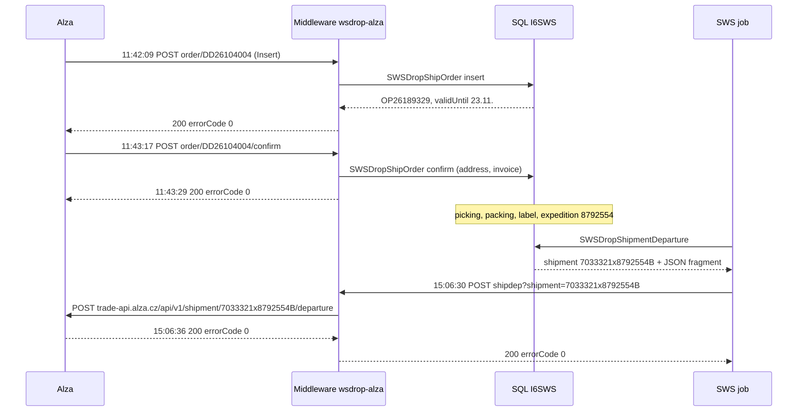

#### Order `DD26104004` – Branch Brno, CrossLC (complete messages)

Insert order – request from Alza:

```json
{"timestamp":"2026-11-16T11:42:09.333","customerId":7993,"supplierId":200,"supplierBranchId":235,
 "regNo":"27082440","vatNo":"CZ27082440","itemsPriceCurrency":"CZK",
 "orderItems":[{"orderItemId":3705303766,"code":"241837","quantity":4,"unitPrice":235.57,"purchasePriceWithoutFees":235.57,
   "alzaBarCodes":["BCX37053037661","BCX37053037662","BCX37053037663","BCX37053037664"],
   "serialNumbersExpected":false,"serialNumbersRequired":false}]}
```

Response from SWS (`200`):

```json
{"errorCode":0,"errorMessage":"","supplierOrder":"OP26189329","validUntil":"2026-11-23T23:59:00.000"}
```

Confirm order – request from Alza (response `200 {"errorCode":0,"errorMessage":""}`):

```json
{"timestamp":"2026-11-16T11:43:17.357","customerId":7993,"supplierId":200,"supplierBranchId":235,
 "regNo":"27082440","vatNo":"CZ27082440",
 "shippingCarrier":{"shippingCarrierCode":"ALZA","shippingCarrierDeliveryType":"Supplier"},
 "route":{"routeName":"SWS CZ01 -> CZTC1 -> SKLC3 -> Brno",
          "routeStops":[{"branchName":"CZTC1","ramp":"L01"},{"branchName":"SKLC3","ramp":"L54"}]},
 "shipmentDeliveryType":"Branch","shipmentShippingMode":"Supplier",
 "cashOnDeliveryValue":0.0,"cashOnDeliveryValueCurrency":"CZK",
 "packageSorting":{"packageSortingGroup":"CrossLC","packageSortingPrint":"C"},
 "demandedExpeditionDate":"2026-11-18","shipmentDepartureTime":"2026-11-18T14:00:00.000","paymentVS":"1521022333",
 "deliveryAddress":{"companyName":"Alza.cz Brno","addressName":"Skála","streetWithNumber":"Skořepka 336/15","city":"Brno",
                    "phone":"+420 225 340 111","email":"sales.brno@alza.cz","country":"CZ","zip":"60200"},
 "deliveryBranchId":2,"shipmentValue":1504.0,"shipmentValueCurrency":"CZK"}
```

Shipment departure – sent by the middleware to Alza (response `200 {"errorCode":0,"errorMessage":""}`):

```text
POST https://trade-api.alza.cz/api/v1/shipment/7033321x8792554B/departure
```

```json
{"supplierId":200,"supplierBranchId":235,"timestamp":"2026-11-16T15:06:30.594",
 "shippingCarrier":{"shippingCarrierCode":"ALZA","shippingCarrierDeliveryType":"ALZABRANCH"},
 "cashOnDeliveryValue":0.0,"cashOnDeliveryValueCurrency":"CZK","shipmentWeight":2.4,
 "packages":[{"number":"55002355016300","weight":"2.40000","fullNumber":"55002355016300"}],
 "items":[{"order":"DD26104004","packageNumber":"55002355016300","quantity":4,"orderItemId":3705303766,"code":"241837"}]}
```

#### Order `DD26102128` – AlzaBox AB4136, Linehaul

Confirm order – request from Alza (Insert: `653979` × 1 → `OP26189264`):

```json
{"timestamp":"2026-11-16T11:10:17.467","customerId":7993,"supplierId":200,"supplierBranchId":235,
 "regNo":"27082440","vatNo":"CZ27082440",
 "shippingCarrier":{"shippingCarrierCode":"ALZA","shippingCarrierDeliveryType":"ALZABOX"},
 "parcelShop":{"parcelShopIdentification":"ALZABOX","parcelShopBranchCode":"AB4136"},
 "route":{"routeName":"SWS CZ01 -> CZTC1 -> OLD2 - Východní Čechy M 12",
          "routeStops":[{"branchName":"CZTC1","ramp":"L17"}],"routeDeliveryOrder":14},
 "shipmentDeliveryType":"ParcelShop","shipmentShippingMode":"Supplier",
 "cashOnDeliveryValue":0.0,"cashOnDeliveryValueCurrency":"CZK",
 "packageSorting":{"packageSortingGroup":"Linehaul","packageSortingPrint":"L"},
 "demandedExpeditionDate":"2026-11-18","shipmentDepartureTime":"2026-11-18T14:00:00.000","paymentVS":"1521013923",
 "deliveryAddress":{"companyName":"Šimonovice - Buková (Hospůdka U Potůčku)","addressName":"Štěpán Hanuš",
                    "streetWithNumber":"Buková 17","city":"Šimonovice","phone":"+420737829254",
                    "email":"hanus.stepan@gmail.com","country":"CZ","zip":"46312"},
 "shipmentValue":1074.0,"shipmentValueCurrency":"CZK"}
```

Shipment departure to Alza – `POST …/shipment/7033242x8792555A/departure`:

```json
{"supplierId":200,"supplierBranchId":235,"timestamp":"2026-11-16T15:00:33.270",
 "shippingCarrier":{"shippingCarrierCode":"ALZA","shippingCarrierDeliveryType":"ALZABOX"},
 "cashOnDeliveryValue":0.0,"cashOnDeliveryValueCurrency":"CZK","shipmentValue":1074.0,"shipmentValueCurrency":"CZK",
 "shipmentWeight":0.1,
 "packages":[{"number":"55002350085113","weight":0.1,"fullNumber":"55002350085113"}],
 "items":[{"order":"DD26102128","packageNumber":"55002350085113","quantity":1,"orderItemId":3705169209,"code":"653979"}]}
```

#### Order `DD26068181` – DPD, B2C

Confirm order – request from Alza (Insert: `LNC01121` × 1 → `OP26188783`). Note that for DPD `routeName` contains only the sender (`SWS CZ01`):

```json
{"timestamp":"2026-11-15T12:55:40.203","customerId":7993,"supplierId":200,"supplierBranchId":235,
 "regNo":"27082440","vatNo":"CZ27082440",
 "shippingCarrier":{"shippingCarrierCode":"DPD","shippingCarrierDeliveryType":"DPD"},
 "route":{"routeName":"SWS CZ01"},
 "shipmentDeliveryType":"B2C","shipmentShippingMode":"Supplier",
 "cashOnDeliveryValue":0.0,"cashOnDeliveryValueCurrency":"CZK",
 "packageSorting":{"packageSortingGroup":"RegularDirect"},
 "demandedExpeditionDate":"2026-11-16","shipmentDepartureTime":"2026-11-16T23:30:00.000","paymentVS":"1520784885",
 "deliveryAddress":{"companyName":"","addressName":"jiri Ledvinka","streetWithNumber":"ZITAVSKA 3000","city":"Varnsdorf",
                    "phone":"+420774085346","email":"jirka1236@seznam.cz","country":"CZ","zip":"40747"},
 "shipmentValue":699.0,"shipmentValueCurrency":"CZK"}
```

Shipment departure to Alza – `POST …/shipment/7032719x8792565A/departure`:

```json
{"supplierId":200,"supplierBranchId":235,"timestamp":"2026-11-16T13:16:07.681",
 "shippingCarrier":{"shippingCarrierCode":"DPD","shippingCarrierDeliveryType":"DPD"},
 "cashOnDeliveryValue":0.0,"cashOnDeliveryValueCurrency":"CZK","shipmentValue":699.0,"shipmentValueCurrency":"CZK",
 "shipmentWeight":0.4,
 "packages":[{"number":"13825096178983","weight":0.4,"fullNumber":"%004074713825096178983327203"}],
 "items":[{"order":"DD26068181","packageNumber":"13825096178983","quantity":1,"orderItemId":3702664480,"code":"LNC01121"}]}
```

#### Other messages on 16.11.2026

| Operation | Who calls whom | Count |
|---|---|---|
| `alzaavail` | SWS job → middleware (asks for availability changes; answer `{nic k aktualizaci}` = nothing to send) | 37 441 |
| `availability` | Middleware → Alza (`Full` at 01:33, 2× `Update`, `PartialFull` at 03:32 in 2 parts) | 5 |
| `order/{DD}` (Insert) | Alza → SWS | 270 |
| `order/{DD}/confirm` | Alza → SWS | 246 |
| `order/{DD}/extend` | Alza → SWS | 8 |
| `shipdep` → `shipment/{s}/departure` | SWS job → middleware → Alza | 452 |
| `delivr` → `order/{DD}/delivery` | SWS job → middleware → Alza | 130 |
| Cancel, Create / Delete shipment, Track and Trace | – | 0 |

Delivery result example (order `DD26073359`, `POST https://trade-api.alza.cz/api/v1/order/DD26073359/delivery`, answer `200 {"errorCode":0,"errorMessage":""}`):

```json
{"supplierId":200,"supplierBranchId":235,"timestamp":"2026-11-16T08:34:08.169",
 "status":"Canceled","statusTimestamp":"2026-11-16T08:26:03.170","errorReason":"poslední poškozený kus","paymentVS":"1520822927"}
```

Delivery result **Rejected** example – parcel returned, customer did not collect it (order `DD25313597`). The SWS job calls the middleware, the middleware forwards it to Alza:

```text
POST /wsdrop-alza/sws1.ashx/delivr?order=DD25313597                       13:34:14.791  (SWS job → middleware)
POST https://trade-api.alza.cz/api/v1/order/DD25313597/delivery          13:34:14.791  (middleware → Alza)
200 {"errorCode":0,"errorMessage":""}                                    13:34:19.931  (Alza → middleware)
```

```json
{"supplierId":200,"supplierBranchId":235,"timestamp":"2026-11-16T13:34:14.791",
 "status":"Rejected","statusTimestamp":"2026-11-16T13:26:03.140",
 "errorReason":"zakaznik neprevzal","paymentVS":"1515532933"}
```

`statusTimestamp` (13:26:03) is the time the SWS job evaluated the return (`GETDATE()` in `SWSDropDeliveryResult`); the message was sent 8 minutes later. The earlier messages of this order (Insert, Confirm, departure) are older than the available logs (11.–17.11.2026).

Availability `Update` example (`POST https://trade-api.alza.cz/api/v1/availability`, 02:52:59, answer `200`):

```json
{"supplierId":200,"supplierBranchId":235,"timestamp":"2026-11-16T02:52:59.850","importType":"Update","currency":"CZK",
 "productList":[{"code":"847010","ean":"0617885021244","quantity":78,"price":309.6,"vat":21,"priceWithFee":312.96,"fee":3.36}]}
```

SWS still uses the **deprecated** `Full` import type and the **legacy price mode** (`price`, `priceWithFee`, `fee`, `vat`); Alza recommends `PartialFull` and `countryPrices`.


### 9.17 Orders `DD26102128`, `DD26104004` and `DD26068181` in ERP i6

How the three photographed orders from 9.16 look in i6 after Confirm. The parameters are on the order's parameter tab (storage see 9.4). Parameter names are shown as in i6, with an English description.

**Document numbers:**

| Item | `DD26102128` (AlzaBox, Linehaul) | `DD26104004` (Branch Brno, Cross) | `DD26068181` (DPD, B2C) | Where it comes from |
|---|---|---|---|---|
| Alza order number | `DD26102128` | `DD26104004` | `DD26068181` | `{order}` in the URL → `Orders.OrdCodeO` |
| i6 order number | `OP26189264` | `OP26189329` | `OP26188783` | `Orders.OrdCode`, returned as `supplierOrder` |
| i6 order id | `7033242` | `7033321` | `7032719` | `Orders.OrdId` – first part of the shipment number |
| Expedition id | `8792555` | `8792554` | `8792565` | `Expedition.ExpId` – second part of the shipment number |
| Shipment number | `7033242x8792555A` | `7033321x8792554B` | `7032719x8792565A` | Sent in Shipment departure (`A` = one order, `B` = Branch) |
| Package number | `55002350085113` | `55002355016300` | `13825096178983` (DPD) | `Expedition.ExpCodeO` (DPD: `ExpCodeS`), barcode on the label |
| Invoice | `FV26163784` | `FV26163825` | – (not provided) | Invoice type 73, created by Confirm (label shows the number without `FV`) |
| Delivery note | `DV26226106` | `DV26226152` | – (not provided) | Referenced in the EDI invoice (`RFF+DQ`); no DESADV is sent for dropshipping (9.18) |

**Order parameters (ERP i6 screenshots, 16.11.2026):**

| i6 parameter | English description | `DD26102128` | `DD26104004` | `DD26068181` | API field (Confirm order) | Storage |
|---|---|---|---|---|---|---|
| `Rezervace` | Reservation type = dropship marker | – (not in the screenshot) | `Alza DropShipment` | `Alza DropShipment` | – (set by Insert) | `ConParSet` 434 / value 3501 |
| `Externí poznámka` | External note (processing state) | – (not in the screenshot) | `(2) Nezpracovaná` = *(2) Unprocessed* | – | – | (to confirm) |
| `DropPackSortGroup` | Package sorting group | `Linehaul` (print letter `L`) | `CrossLC` (print letter `C`) | `RegularDirect` (no letter) | `packageSorting` | parameter `DPG` |
| `RouteDeliveryOrder` | Route delivery order | `14` | – (Branch has none) | – | `route.routeDeliveryOrder` | parameter `DRO` |
| `DropRouteName` | Route name | `SWS CZ01 -> CZTC1 -> OLD2 - Východní Čechy M 12` | `SWS CZ01 -> CZTC1 -> SKLC3 -> Brno` | `SWS CZ01` (sender only) | `route.routeName` | `ConParSet` 1186 |
| `DropRouteStops` | Route stops (`branch\|ramp\|\|branch\|ramp`) | `CZTC1\|L17` | `CZTC1\|L01\|\|SKLC3\|L54` | – (no stops for DPD) | `route.routeStops[]` | `ConParSet` 1187 |
| `InvZCode` (*požadovaný kód B2C faktury*) | Requested B2C invoice code = payment variable symbol | `1521013923` | `1521022333` | `1520784885` (printed on the DPD label as *Vaše obj*) | `paymentVS` | `ConParSet` 888 |
| `DropShipValue` | Shipment value (`value\|currency`) | `1074.00\|CZK` | `1504.00\|CZK` | `699.00\|CZK` | `shipmentValue` + currency | `ConParSet` 889 |
| `DropCashDelivValue` | Cash on delivery (`value\|currency`) | `0.00\|CZK` | `0.00\|CZK` | `0.00\|CZK` | `cashOnDeliveryValue` + currency | `ConParSet` 890 |

Parameters are stored only when the value is filled in Confirm – that is why the DPD order has no route stops and no delivery order, and the Branch order has no delivery order.

`shipmentValue` is the value of the goods for the end customer (1 074 / 1 504 / 699 CZK). The invoice to Alza (9.18) is based on the purchase price: 847.58 / 1 146.26 CZK incl. VAT.

### 9.18 EDI – invoice to Alza (INVOIC)

The Trade API does not carry invoices. SWS invoices Alza separately via **EDI** – EANCOM **INVOIC D.01B (EAN011)** – through the EDI provider **EDIStore** (portal with the sections Orders, Despatch Adv, Invoices, Receiving Adv, Returns Ann, Interchanges, Order Rsp). Each dropship order gets its own **invoice** (`FV…`). The delivery note (`DV…`) is only referenced in the invoice – **no DESADV is sent for dropshipping orders** (DESADV is used only for standard `OB…` orders, see chapter 2).

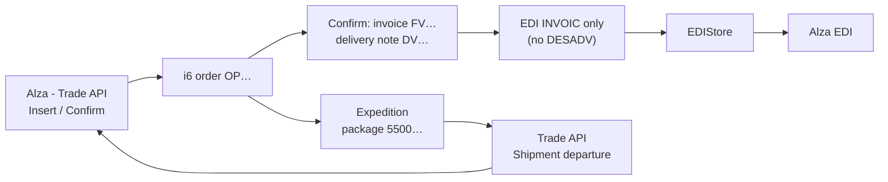

**Records in EDIStore (Invoices):**

| Field | `DD26102128` | `DD26104004` |
|---|---|---|
| Status | `A` | `A` |
| Invoice number | `FV26163784` | `FV26163825` |
| DTS (date of taxable supply) | 16.11.2026 | 16.11.2026 |
| Supplier / Buyer | SWS a.s. / Alza.cz a.s. | SWS a.s. / Alza.cz a.s. |
| Insert date | 16.11.2026 13:26:15 | 16.11.2026 13:26:16 |
| Buyer's CIN | `27082440` | `27082440` |
| Issue date | 16.11.2026 | 16.11.2026 |
| Document type | INVOICE | INVOICE |
| Total | 847.58 CZK | 1 146.26 CZK |
| Interchange number | `8307924` | `8307931` |
| GLN delivery place | `8594177950111` | `8594177950111` |
| Order number | `DD26102128` | `DD26104004` |
| DESADV number (delivery note reference only) | `DV26226106` | `DV26226152` |

Both invoices were sent in the same run (UNB 16.11.2026 13:23) – before the parcels physically left (Shipment departure 15:00 / 15:06).

**Message structure (segment by segment):**

| Segment | `DD26102128` | `DD26104004` | Meaning |
|---|---|---|---|
| `UNB` | ref. `8307924` | ref. `8307931` | Interchange `8594157000003` (SWS) → `8594177950005` (Alza), 16.11.2026 13:23; reference = EDIStore interchange number |
| `UNH` | `863491` | `863498` | Message header `INVOIC:D:01B:UN:EAN011` |
| `USH`, `USA`, `USC` … `UST`, `USR` | | | Electronic signature, certificate `0161CC0C` of *Jaroslav Tomášek* |
| `BGM` | `FV26163784` | `FV26163825` | `380` commercial invoice, `9` original |
| `DTM+137` / `+325` / `+35` | 20261116 | 20261116 | Document date / tax point date / delivery date |
| `PAI` | `::42` | `::42` | Payment by bank transfer |
| `FTX+AAI` | | | *Firma je zapsána v OR vedeném KS v Brně, odd. B, vl. 1773* (company register note) |
| `RFF+ON` | `DD26102128` | `DD26104004` | **Buyer's order number = Alza order** |
| `RFF+VN` | `OP26189264` | `OP26189329` | Supplier's order number (i6) |
| `RFF+DQ` | `DV26226106` | `DV26226152` | Delivery note number – reference only, no DESADV is sent for dropshipping |
| `NAD+BY` | | | Buyer `8594177950005` Alza.cz a.s., Jankovcova 1522/53, Praha – Holešovice, 17000; VAT `CZ27082440`, CIN `27082440` |
| `NAD+DP` | | | Delivery place `8594177950111` – the same GLN that i6 writes to `ComShipTo.CstId3` (9.3) |
| `NAD+IV` | | | Invoicee `8594177950005` |
| `NAD+SU` | | | Supplier `8594157000003` SWS a.s., Dostihová 1, Slušovice, 763 15; VAT `CZ699000207`, CIN `63485826` |
| `FII+RB` | VS `26163784` | VS `26163825` | Account `1000490200/3500`, ING `INGBCZPP`, IBAN `CZ8435000000001000490200` |
| `NAD+SF` | | | Ship-from `8594157000003` |
| `CUX` | `CZK` | `CZK` | Currency |
| `PAT` + `DTM+13` | 15.01.2027 | 15.01.2027 | Payment due date |
| `LIN 1` | EAN `0191200521539`, `653979` *Lenovo adaptér ThinkPad 65W AC USB-C Standard*, 1 pc | EAN `5397184820964`, `241837` *Dell Multimediální klávesnice KB216 – čeština/slovenština (QWERTZ)*, 4 pcs | Item |
| `PRI+AAB` | 699.72 | 235.57 | Unit price = Alza purchase price from Insert (`purchasePriceWithoutFees`) |
| `ALC` + `MOA+8` | 0.76 | 5.04 (4 × 1.26) | Recycling fee (*RECYKLACNI POPLATEK*) |
| `PRI+AAA` / `MOA+203` | 700.48 / 700.48 | 236.83 / 947.32 | Unit price incl. fee / line amount, VAT 21 % |
| `LIN 2` | `DROPSHIPKOREKCE`, 1 pc, 0.00, VAT 0 % | – | Correction item added by Confirm for **non-branch** orders only (9.3) – invoiced with zero value |
| `CNT+2` | 2 | 1 | Number of lines |
| `MOA+79` / `+125` | 700.48 | 947.32 | Lines total / taxable amount |
| `MOA+176` / `+124` | 147.10 | 198.94 | VAT amount (21 %) |
| `MOA+86` / `+9` | **847.58** | **1 146.26** | Invoice total / amount due |
| `UNT` | 73 segments | 62 segments | Message trailer |
| `UNZ` | `8307924` | `8307931` | Interchange trailer |

#### Complete message – `DD26102128` (FV26163784)

```text
UNB+UNOD:3+8594157000003:14+8594177950005:14+261116:1323+8307924++INVOIC+++EANCOM'
UNH+863491+INVOIC:D:01B:UN:EAN011'
USH+94W+1+01+1+1+2+2+1+++863491+1:20261116:132333'
USA+1:0:1:48:1'
USC+0161CC0C+3:Jaroslav Tomášek:8594157000003'
BGM+380+FV26163784+9'
DTM+137:20261116:102'
DTM+325:20261116:102'
DTM+35:20261116:102'
PAI+::42'
FTX+AAI+++Firma je zapsána v OR vedeném KS v Brne, odd.B, vl.1773'
RFF+ON:DD26102128'
DTM+171:20261116:102'
RFF+VN:OP26189264'
RFF+DQ:DV26226106'
DTM+171:20261116:102'
NAD+BY+8594177950005::9++Alza.cz a.s.+Jankovcova 1522/53+Praha - Holešovice++17000+CZ'
RFF+VA:CZ27082440'
RFF+GN:27082440'
NAD+DP+8594177950111::9+++++++CZ'
NAD+IV+8594177950005::9'
NAD+SU+8594157000003::9++SWS a.s.+Dostihová 1+Slušovice++763 15+CZ'
FII+RB+1000490200:0008:26163784+3500:::INGBCZPP::::CZ8435000000001000490200'
RFF+VA:CZ699000207'
RFF+GN:63485826'
NAD+SF+8594157000003::9'
CUX+2:CZK:4'
PAT+3'
DTM+13:20270115:102'
LIN+1++0191200521539:SRV::9'
PIA+1+653979:SA'
IMD+F++:::Z'
IMD+E+ANM+:::Lenovo adaptér ThinkPad 65W AC USB-C Standard'
QTY+47:1:PCE'
MOA+203:700.48'
PRI+AAB:699.72'
PRI+AAA:700.48'
RFF+ON:DD26102128'
RFF+DQ:DV26226106'
TAX+7+VAT+++:::21'
ALC+C+RECYKLACNI POPLATEK++1+AEO'
MOA+8:0.76'
LIN+2++:SRV::9'
PIA+1+DROPSHIPKOREKCE:SA'
IMD+F++:::S'
IMD+E+ANM+:::Korekce celkové cástky pro DropShip/WS obj'
QTY+47:1:PCE'
MOA+203:0'
PRI+AAB:0'
PRI+AAA:0'
RFF+ON:DD26102128'
RFF+DQ:DV26226106'
TAX+7+VAT+++:::0'
UNS+S'
CNT+2:2'
MOA+86:847.58'
MOA+79:700.48'
MOA+125:700.48'
MOA+74:0'
RFF+ZZZ:0'
MOA+113:0'
MOA+176:147.1'
MOA+9:847.58'
MOA+165:0'
TAX+7+VAT+++0:::0'
MOA+125:0'
TAX+7+VAT+++2:::21'
MOA+125:700.48'
MOA+124:147.1'
TAX+7+EXC'
MOA+176:0'
UST+01'
USR+20D229AA3E847D1C8B9232E1ADB8858B1A775B267F29798A2F61CDCC4812719925ECF56915572A96E736F2EC2AC17CBA6600996BDB464EF93F7653B2635B 173D89BF1DF7052DC1A73CBB75CA4A3F35C5B7A14BA5C5E14D6E97728F479432239E83BC13AE34E8B51480443A0CF6E3181583D841530D614CBAA7FCCA7E4258 6F778740A8548D911CE3B62E6CB9DF0F57E013476887DDF2F10AC139958ECA5A490AC7736FC286AA31E57CF7C76D93037DE2282A8BADC99DB6513A86523DFB99 AA16AD057808AD5D91E8B104003747A883893E36119AB80F950AC11C1F477CB8EA93E268F781B3F002BAC66DD0458F1C3C631290991945100E5F99ED2F62AE7C 12C350B5A57D2105033AFF09076CD7721179D415C0097B1A9081B44AED22CA675BD0F1875D649C77D7957E5631349CE46D13453CD55FAE18737B08CC5A5D1D81 EE127080C45C927AAD04C855C40C9F5E8C504297160DB7603082EB00E51A7E8DA1A5C535C8B6A47CEECC312B42769145C224D70B1CA6C670D1F16DE85C5B0ABF 9E2F054EFFB446F23D87C2ADF1C4C9376F788E6D0A2C2904DE956219013B815BAC820E00835D09205A002A0687DC57B357B1FD9BB0800CF4CEB9F19F08FF61AA 46D122BFCDF871CBD4F5C4AA0C67ECBB1B43891A8F5D2FAA7E732F4FCC94516A34B42C43030AAFB6801446AE9E49AB1F51DDC30805AD2A96F4BE5DF21CB7FDD4 F547'
UNT+73+863491'
UNZ+1+8307924'
```

#### Complete message – `DD26104004` (FV26163825)

```text
UNB+UNOD:3+8594157000003:14+8594177950005:14+261116:1323+8307931++INVOIC+++EANCOM'
UNH+863498+INVOIC:D:01B:UN:EAN011'
USH+94W+1+01+1+1+2+2+1+++863498+1:20261116:132335'
USA+1:0:1:48:1'
USC+0161CC0C+3:Jaroslav Tomášek:8594157000003'
BGM+380+FV26163825+9'
DTM+137:20261116:102'
DTM+325:20261116:102'
DTM+35:20261116:102'
PAI+::42'
FTX+AAI+++Firma je zapsána v OR vedeném KS v Brne, odd.B, vl.1773'
RFF+ON:DD26104004'
DTM+171:20261116:102'
RFF+VN:OP26189329'
RFF+DQ:DV26226152'
DTM+171:20261116:102'
NAD+BY+8594177950005::9++Alza.cz a.s.+Jankovcova 1522/53+Praha - Holešovice++17000+CZ'
RFF+VA:CZ27082440'
RFF+GN:27082440'
NAD+DP+8594177950111::9+++++++CZ'
NAD+IV+8594177950005::9'
NAD+SU+8594157000003::9++SWS a.s.+Dostihová 1+Slušovice++763 15+CZ'
FII+RB+1000490200:0008:26163825+3500:::INGBCZPP::::CZ8435000000001000490200'
RFF+VA:CZ699000207'
RFF+GN:63485826'
NAD+SF+8594157000003::9'
CUX+2:CZK:4'
PAT+3'
DTM+13:20270115:102'
LIN+1++5397184820964:SRV::9'
PIA+1+241837:SA'
IMD+F++:::Z'
IMD+E+ANM+:::Dell Multimediální klávesnice KB216 - ceština/slovenština (QWERTZ) - c'
QTY+47:4:PCE'
MOA+203:947.32'
PRI+AAB:235.57'
PRI+AAA:236.83'
RFF+ON:DD26104004'
RFF+DQ:DV26226152'
TAX+7+VAT+++:::21'
ALC+C+RECYKLACNI POPLATEK++1+AEO'
MOA+8:5.04'
UNS+S'
CNT+2:1'
MOA+86:1146.26'
MOA+79:947.32'
MOA+125:947.32'
MOA+74:0'
RFF+ZZZ:0'
MOA+113:0'
MOA+176:198.94'
MOA+9:1146.26'
MOA+165:0'
TAX+7+VAT+++0:::0'
MOA+125:0'
TAX+7+VAT+++2:::21'
MOA+125:947.32'
MOA+124:198.94'
TAX+7+EXC'
MOA+176:0'
UST+01'
USR+787E9F8248F512912D9D69DFE94FED9FF94841AC429ACD6F10BDABF2E2B2A1235BED6E3E0DA654D815F9DA5B2F60ACE8E593B82A831AAB29C5A126E8FF98 9C74F6893ABE088708CF540B1CB5A6DEB769A933BC0FACFE777B3A96C061F65A97063CD5C3C40B88F1EE94663E71F685782E44B5A7A983F5ED7B62D7D7BF30F9 0964CD0F88F4CD8C772E27B8CDD8BACB73257C64B8AF891130B5F7B82596580ADA1639CB59991DB033567AA92873ACBD857B8B4D8FBF78F4C7A87AE3C70B8E56 286ADC8ACDD449975A8FD6C9B5F20BA2764216ACA7E93337DC7705210946154AFBC685B9B636C92492B7BB504D5A6E263941BAD4A3D8F0F13A076E8B80DE194D 05FA51A04FFA8CC4475A69526BEF08C859329239C379F76595AC9E643F8A86B714C0210E56A83A34C5E1D21199EEE7D290A03311DE75D782ACE099257D938D94 29D2A79C003A290C37D3CD1E8C73AA6A6B4959C230F15A03EE396CCD2E74F216778C38645895A7E5E29BAA9D479A73BF4CC1E8CD8F3F3E4EB4918782B2DED40A 985C9A7A59F01E50ADD1F86A57D535915E3AD7EE0C0998A1679E1E54FE35632B33B66E1F1AF34962E10D69C6E861D841B8FB11EDC4561547544A718E6B6BBFCE DEFB56C3BEBC14C3FCADEBC5B662336E271EAD91F31EF794F4B73A112E4AF4773F3FA246A98652AEC156A19FB8B1A9E7349BFB4FF701172D567572FD53383F52 A34A'
UNT+62+863498'
UNZ+1+8307931'
```

### 9.19 EDI – standard order `OB26238498` (ORDERS)

For comparison with the dropshipping channel: a standard Alza purchase order that arrives via **EDI ORDERS** (EANCOM **ORDERS D.01B, EAN010**) through EDIStore (see chapter 2). SWS answers it with DESADV and INVOIC – samples still to be added (open point 15).

**Summary:**

| Item | Value |
|---|---|
| Order number | `OB26238498` |
| Order date | 16.11.2026 |
| Requested delivery date | 23.11.2026 |
| Received | 17.11.2026 14:59 (interchange `661313343`) |
| Buyer | Alza.cz a.s., GLN `8594177950005`, buyer contact Lukáš Plško |
| Delivery place | **Alza.cz CZLC4**, Severní 255, 252 19 Chrášťany, GLN `8594177950173` – Alza warehouse (the same `CZLC4` as in the Trade API routes) |
| Supplier | SWS a.s., GLN `8594157000003` |
| Lines | 4 lines, 20 pcs, information price 191 CZK / pc (3 820 CZK) |

**Message structure (segment by segment):**

| Segment | Content | Meaning |
|---|---|---|
| `UNB` | `8594177950005` → `8594157000003`, 17.11.2026 14:59, ref. `661313343`, `ORDERS` | Interchange from Alza to SWS |
| `UNH` | `588704362`, `ORDERS:D:01B:UN:EAN010` | Message header |
| `BGM` | `220`, `OB26238498`, `9` | Purchase order, number, original |
| `DTM+137` | 20261116 | Order date |
| `DTM+2` | 20261123 | Requested delivery date |
| `FTX+PUR` | *AOR, Fujifilm INSTAX - PLu, AOSOD621686, Lukáš Plško* | Purchasing note (category / buyer / internal reference) |
| `NAD+BY` + `RFF+VA` / `RFF+GN` | `8594177950005` Alza.cz a.s., Jankovcova 1522/53, Praha 7, 17000; VAT `CZ27082440`, CIN `27082440` | Buyer |
| `CTA+OC` + `COM` | *Sales and Purcha: Lukáš Plško*, `+420778766749`, `Lukas.Plsko@alza.cz` | Buyer's contact (`?+` = escaped `+`) |
| `NAD+DP` | `8594177950173` Alza.cz CZLC4, Severní 255, Chrášťany, 25219, CZ | **Delivery place – Alza warehouse** |
| `CTA+OC` + `COM` | *Sklad: Kontakt*, `+420 778 957 526`, `expedice.chrastany@alza.cz` | Warehouse contact |
| `NAD+IV` | `8594177950005` Alza.cz a.s. | Invoicee |
| `NAD+SU` + `RFF` | `8594157000003` SWS a.s., Dostihová 1, Slušovice, 76315; VAT `CZ699000207`, CIN `63485826` | Supplier |
| `CTA+OC` + `COM` | *Sklad: Kontakt*, `+420577640111`, `region4@sws.cz` | Supplier's warehouse contact |
| `NAD+OB` | `8594177950005` | Ordered by |
| `CUX` | `CZK` (`9` = order currency) | Currency |
| `LIN` | EAN | Line, item identified by EAN |
| `PIA+5 …:SA` | e.g. `FJF00124` | **Supplier's article number = SWS product code** (same kind of code as `code` in the Trade API) |
| `PIA+5 …:IN` | e.g. `OF245a13a13` | Buyer's (Alza's) article number |
| `IMD+E` | Product name | Description |
| `QTY+21` | e.g. 7 PCE | Ordered quantity |
| `DTM+2` | 20261123 | Requested delivery date of the line |
| `PRI+INF` | 191 | Information price per unit |
| `UNS`, `UNT`, `UNZ` | 54 segments, `661313343` | Section separator, message / interchange trailer |

**Order lines:**

| # | EAN | SWS code (`SA`) | Alza code (`IN`) | Product | Qty | Price |
|---|---|---|---|---|---|---|
| 1 | `8720094754659` | `FJF00124` | `OF245a13a13` | Fotoalbum Fujifilm instax mini 13 PHOTO ALBUM – Candy Pink | 7 | 191 |
| 2 | `8720094754642` | `FJF00123` | `OF245a13a12` | Fotoalbum Fujifilm instax mini 13 PHOTO ALBUM – Lagoon Green | 3 | 191 |
| 3 | `8720094754666` | `FJF00125` | `OF245a13a14` | Fotoalbum Fujifilm instax mini 13 PHOTO ALBUM – Dreamy Purple | 5 | 191 |
| 4 | `8720094754673` | `FJF00126` | `OF245a13a15` | Fotoalbum Fujifilm instax mini 13 PHOTO ALBUM – Clay White | 5 | 191 |

**Differences from a dropshipping order:**

| | `OB…` (EDI ORDERS) | `DD…` (Trade API) |
|---|---|---|
| Delivered to | Alza warehouse (`NAD+DP`, here CZLC4 Chrášťany, GLN `8594177950173`) | End customer, AlzaBox or Alza branch (`deliveryAddress`) |
| Reservation / cancel / extend | – | Insert, Extend, Cancel |
| Shipping instruction | Requested delivery date only (`DTM+2`) | Confirm: carrier, route, sorting, departure time |
| Product identification | EAN + SWS code + Alza code | SWS `code` + Alza `orderItemId` |
| Price | Information price (`PRI+INF`) | Purchase price from Availability (`purchasePriceWithoutFees`) |
| Answer to Alza | DESADV + INVOIC (EDI) | Shipment departure, Delivery result (Trade API) + INVOIC (EDI) |
| Delivery place GLN on the invoice | Alza warehouse | `8594177950111` (9.18) |

Complete message:

```text
UNB+UNOD:3+8594177950005:14+8594157000003:14+261117:1459+661313343++ORDERS+++EANCOM'
UNH+588704362+ORDERS:D:01B:UN:EAN010'
BGM+220+OB26238498+9'
DTM+137:20261116:102'
DTM+2:20261123:102'
FTX+PUR+++AOR, Fujifilm INSTAX - PLu, AOSOD621686, Lukáš Plško '
NAD+BY+8594177950005::9++Alza.cz a.s.+Jankovcova 1522/53+Praha 7++17000'
RFF+VA:CZ27082440'
RFF+GN:27082440'
CTA+OC+Sales and Purcha:Lukáš Plško'
COM+?+420778766749:TE'
COM+Lukas.Plsko@alza.cz:EM'
NAD+DP+8594177950173::9++Alza.cz CZLC4+Severní 255+Chrášťany++25219+CZ'
CTA+OC+Sklad:Kontakt'
COM+?+420 778 957 526:TE'
COM+expedice.chrastany@alza.cz:EM'
NAD+IV+8594177950005::9++Alza.cz a.s.'
NAD+SU+8594157000003::9++SWS a.s.+Dostihová 1+Slušovice++76315'
RFF+VA:CZ699000207'
RFF+GN:63485826'
CTA+OC+Sklad:Kontakt'
COM+?+420577640111:TE'
COM+region4@sws.cz:EM'
NAD+OB+8594177950005::9'
CUX+2:CZK:9'
LIN+1++8720094754659:SRV'
PIA+5+FJF00124:SA'
PIA+5+OF245a13a13:IN'
IMD+E+ANM::9+:::Fotoalbum Fujifilm instax mini 13 PHOTO ALBUM – Candy Pink'
QTY+21:7:PCE'
DTM+2:20261123:102'
PRI+INF:191'
LIN+2++8720094754642:SRV'
PIA+5+FJF00123:SA'
PIA+5+OF245a13a12:IN'
IMD+E+ANM::9+:::Fotoalbum Fujifilm instax mini 13 PHOTO ALBUM – Lagoon Green'
QTY+21:3:PCE'
DTM+2:20261123:102'
PRI+INF:191'
LIN+3++8720094754666:SRV'
PIA+5+FJF00125:SA'
PIA+5+OF245a13a14:IN'
IMD+E+ANM::9+:::Fotoalbum Fujifilm instax mini 13 PHOTO ALBUM – Dreamy Purple'
QTY+21:5:PCE'
DTM+2:20261123:102'
PRI+INF:191'
LIN+4++8720094754673:SRV'
PIA+5+FJF00126:SA'
PIA+5+OF245a13a15:IN'
IMD+E+ANM::9+:::Fotoalbum Fujifilm instax mini 13 PHOTO ALBUM – Clay White'
QTY+21:5:PCE'
DTM+2:20261123:102'
PRI+INF:191'
UNS+S'
UNT+54+588704362'
UNZ+1+661313343'
```


### 9.20 All communication in the logs (11.–17.11.2026)

A full pass over the middleware logs `msg_20261111.jsonl` … `msg_20261117.jsonl` (≈ 1.26 million lines). This chapter lists **every type of message that occurred**, every answer that was seen, and the incidents and oddities found.

**Log coverage:**

| File | Period | Lines | Note |
|---|---|---|---|
| `msg_20261111.jsonl` | 11.11. 07:46 – 13:28 | 1 360 | Logging started on 11.11.; nothing after 13:28 |
| `msg_20261112.jsonl` | 12.11. 00:00 – 23:58 | 209 911 | |
| `msg_20261113.jsonl` | 13.11. 00:06 – 23:59 | 215 468 | |
| `msg_20261114.jsonl` | 14.11. 00:06 – 23:59 | 404 612 | Mostly `alzaavail` polling |
| `msg_20261115.jsonl` | 15.11. 00:00 – 20:06 | 242 897 | Log stops at 20:06 – the last request (Cancel `DD26074147`) has no answer |
| `msg_20261116.jsonl` | 16.11. 00:06 – 23:56 | 78 268 | |
| `msg_20261117.jsonl` | 17.11. 00:00 – 21:09 | 105 030 | |

#### Catalogue of all message types

| # | Message | Direction | Endpoint | Count | Answers seen |
|---|---|---|---|---|---|
| 1 | Insert order | A→S | `POST sws1.ashx/order/{DD}` | 1 799 | `200` / `0` (1 134); `400` / `-3` *Out of stock* (32); `500` SQL timeout / deadlock (499); **no answer** (134) |
| 2 | Confirm order | A→S | `POST sws1.ashx/order/{DD}/confirm` | 1 846 | `200` / `0` (1 078, incl. *previous confirm ended with some error* 2×, *attempt confirm expired reservation* 1×); `400` / `-5` *Delivery Address Error – Bad Post Code* (327); `400` / `-1` *Previous request still running* (177); `500` (249); no answer (15) |
| 3 | Extend order | A→S | `POST sws1.ashx/order/{DD}/extend` | 44 | `200` / `0` + `validUntil` (16); `400` / `-5` *only once extend is allowed* (24); `500` deadlock (4) |
| 4 | Cancel order | A→S | `DELETE sws1.ashx/order/{DD}` | 90 | `200` / `0` (70); `400` / `-5` *Order was sent* (19); no answer (1) |
| 5 | Shipment departure | S→A | job → `sws1.ashx/shipdep` → `trade-api…/shipment/{s}/departure` | 1 116 | `200` (1 098); `400` / `-2` *Unexpected high quantity.* (7); `400` / `-2` *Serial number … is with the customer. Cannot be reused!* (1); `500` / `-1` *Internal SQL Server error. Please resend…* (Alza side, 6); `403` HTML page (1); `520`, `525` Cloudflare (1 + 1); network error (1) |
| 6 | Delivery result | S→A | job → `sws1.ashx/delivr` → `trade-api…/order/{DD}/delivery` | 210 | `200` (87); `400` / `-5` *Can't reject delivered order!* (61); `400` / `-5` *Can´t rejected claimed order!. Contact AlzaTrade support!* (55); `400` / `-5` *Invalid order state for delivery result!* (7) |
| 7 | Availability | S→A | middleware → `trade-api…/availability` | 25 | `200` / `0` (all) |
| 8 | `alzaavail` (internal trigger) | job → middleware | `GET sws1.ashx/alzaavail?type=0/1/2` | 622 392 | `200` *{nic k aktualizaci}* (nothing to send) or the availability message is sent (row 7) |
| – | Create shipment, Delete shipment, Track and Trace | – | – | **0** | Not used by SWS |
| – | Error codes `-4`, `-6`, `-7`, HTTP `429` | – | – | **0** | Never occurred |

**HTTP status deviations of SWS (the middleware) from the API rules:** a successful Insert is answered with `200` (the API expects `201`); `-3` *Out of stock* is answered with `400` (API prefers `200`, accepts both); SQL errors are answered with `500` and the raw SQL error text in the body – Alza treats them as "not delivered" and resends.

#### Variants of Confirm order seen (1 070 distinct orders)

| Carrier / delivery type | `shipmentDeliveryType` | Orders | Of which SK |
|---|---|---|---|
| `ALZA` / `ALZABOX` | `ParcelShop` | 813 | 192 |
| `DPD` / `DPD` | `B2B` | 100 | 23 |
| `ALZA` / `Supplier` (→ `ALZABRANCH`) | `Branch` | 90 | 18 |
| `DPD` / `DPD` | `B2C` | 53 | 8 |
| `GebruderWeiss` / `GebruderWeissStandard` | `B2B` | 7 | 4 |
| `GebruderWeiss` / `GebruderWeissStandard` | `B2C` | 4 | 3 |
| `ZASILKOVNA` / `ZASILKOVNA` | `ParcelShop` | 3 | – |

- **Countries:** CZ 822, **SK 248**. For SK the COD currency is `EUR`, but `shipmentValue` stays in `CZK`.
- **Package sorting:** `CrossLC` 471, `RegularDirect` 415, `Linehaul` 184.
- **Cash on delivery > 0:** 12 orders, all DPD (e.g. 747 CZK).
- **Optional fields:** `shipmentExternalOrderNumber` in 451 Confirms (mostly DPD) – **not stored by SWS**; delivery `note` 422; `routeDeliveryOrder` 969; `deliveryBranchId` 188. `shipmentDeliveryServices`, `glnList`, `buyerAddress`, `shipmentDeliveryAddress`, `taxNo` never appeared.
- **Insert order:** `serialNumbersRequired = true` 51×, `serialNumbersExpected = true` 388×, `alzaBarCodes` 167×, more than one item 229×, `fees` never.

#### Carriers and cases not shown before

Gebrüder Weiss – order `DD25870226` (SK, B2B). Confirm (shortened):

```json
{"shippingCarrier":{"shippingCarrierCode":"GebruderWeiss","shippingCarrierDeliveryType":"GebruderWeissStandard"},
 "route":{"routeName":"SWS CZ01"},"shipmentDeliveryType":"B2B","shipmentShippingMode":"Supplier",
 "cashOnDeliveryValue":0.0,"cashOnDeliveryValueCurrency":"EUR","packageSorting":{"packageSortingGroup":"RegularDirect"},
 "shipmentDepartureTime":"2026-11-13T23:30:00.000","paymentVS":"1519359662",
 "deliveryAddress":{"companyName":"Súkromná základná umelecká škola","addressName":"Peter Vrbinčík","streetWithNumber":"Zohorská 980/33",
                    "city":"Lozorno","phone":"+421905961824","email":"liana.spodniakova@gmail.com","country":"SK","zip":"90055"},
 "shipmentValue":1288.0,"shipmentValueCurrency":"CZK"}
```

Shipment departure `7027656x8791106A` – package number `695002530001001` (Gebrüder Weiss), 7 kg:

```json
{"shippingCarrier":{"shippingCarrierCode":"GebruderWeiss","shippingCarrierDeliveryType":"GebruderWeissStandard"},
 "cashOnDeliveryValue":0.0,"cashOnDeliveryValueCurrency":"EUR","shipmentValue":1288.0,"shipmentValueCurrency":"CZK","shipmentWeight":7.0,
 "packages":[{"number":"695002530001001","weight":7.0,"fullNumber":"695002530001001"}],
 "items":[{"order":"DD25870226","packageNumber":"695002530001001","quantity":1,"orderItemId":3686380734,"code":"573621"}]}
```

Zásilkovna – order `DD25983556`. Confirm carries the pick-up point `9116` and `shipmentExternalOrderNumber`:

```json
{"shippingCarrier":{"shippingCarrierCode":"ZASILKOVNA","shippingCarrierDeliveryType":"ZASILKOVNA"},
 "parcelShop":{"parcelShopIdentification":"ZASILKOVNA","parcelShopBranchCode":"9116"},
 "route":{"routeName":"SWS CZ01"},"shipmentDeliveryType":"ParcelShop","packageSorting":{"packageSortingGroup":"RegularDirect"},
 "paymentVS":"1520311217","shipmentExternalOrderNumber":"202690-SM0329",
 "deliveryAddress":{"companyName":"Nábytek Šubrt","addressName":"MILETA A.S.","streetWithNumber":"Husova 161","city":"Hořice",
                    "phone":"+420735793946","email":"simona.mackova@mileta.cz","country":"CZ","zip":"50801","note":"C50-166-9116"},
 "shipmentValue":1569.0,"shipmentValueCurrency":"CZK"}
```

Departure `7031630x8791512A` – `number` = Zásilkovna barcode without the leading `Z`, `fullNumber` = full barcode (9.6), with a serial number:

```json
{"packages":[{"number":"3670903756","weight":0.4,"fullNumber":"Z3670903756"}],
 "items":[{"order":"DD25983556","packageNumber":"3670903756","quantity":1,"orderItemId":3695646734,"code":"AVC00021","serials":["5073744"]}]}
```

Cash on delivery (DPD, B2C) – order `DD26035169`: COD **747 CZK** is higher than `shipmentValue` **609 CZK** (COD includes the delivery fee). DPD `fullNumber` contains service `329` (COD) instead of `327`:

```json
{"shippingCarrier":{"shippingCarrierCode":"DPD","shippingCarrierDeliveryType":"DPD"},
 "cashOnDeliveryValue":747.0,"cashOnDeliveryValueCurrency":"CZK","shipmentValue":609.0,"shipmentValueCurrency":"CZK","shipmentWeight":0.4,
 "packages":[{"number":"13825096222491","weight":0.4,"fullNumber":"%004712413825096222491329203"}],
 "items":[{"order":"DD26035169","packageNumber":"13825096222491","quantity":1,"orderItemId":3700110005,"code":"847010"}]}
```

Extend order – Alza asks for the next day 12:00 (`{"…","validUntil":"2026-11-12T12:00:00.000"}`); SWS allows it once, a second Extend gets `-5 only once extend is allowed` and Alza then cancels the order. Out of stock on Insert: `400 {"errorCode":-3,"errorMessage":"Out of stock","errorProducts":[{"code":"765997","quantity":0}]}`.

#### Incidents and oddities

**1. Bad ZIP loop – order `DD25761075`** (SK, B2B, DPD, `"zip":"91930@"`). Confirm was rejected with `-5 Delivery Address Error – Bad Post Code` every ~5 minutes for more than 33 hours (327×). Meanwhile the reservation expired and the job sent Delivery result `Canceled` / `expired reservation` every 30 minutes – Alza refused it with `-5 Invalid order state for delivery result!` (7×). On 13.11. 09:13 SWS answered the Confirm with `0 attempt confirm expired reservation`. The fix in `SWSDropShipOrder` (comment *13.11.26 – remove `@` from ZIP*) comes from this case.

**2. Delivery result loops refused by Alza.** Because the middleware returns `500` to the job, `!DDR!` is never set and the job resends every 30 minutes **forever**:

| Order | Sent | Alza answer | Attempts |
|---|---|---|---|
| `DD25388394` | `Rejected` / `zakaznik neprevzal` | `-5 Can't reject delivered order!` | 61 (16.11. 09:34 → 17.11. 21:03, still running) |
| `DD25651998` | `Rejected` / `zakaznik neprevzal` | `-5 Can´t rejected claimed order!. Contact AlzaTrade support!` | 55 (16.11. 12:34 → 17.11. 21:03, still running) |
| `DD25761075` | `Canceled` / `expired reservation` | `-5 Invalid order state for delivery result!` | 7 |

**3. Consolidated Branch shipment sent several times.** Expedition `8792458` contained 3 orders. `SWSDropShipmentDeparture` created one `B` shipment **per order** (`7032604x8792458B`, `7032664x8792458B`, `7032749x8792458B`), each with the items of all three orders. Alza accepted the first and refused the others with `-2 Unexpected high quantity.` Same pattern on 11.11. (expedition `8788980`, 4×). Cause: the `B` branch of the procedure groups by `OrdId` as well. Harmless (the first one is correct), but it should not be copied.

**4. Serial number reused.** 12.11. departure `7030476x8790416A` refused: *Serial number "1700000175" is with the customer. Cannot be reused! (order DD25954272, code TPL00100)*.

**5. Errors on the Alza side.** Departure answered with Alza `500` *Internal SQL Server error. Please resend the message according to the documentation.* (6×, typically around 20:17), a `403` HTML page (WAF), Cloudflare `520` / `525` and one network error. The job resent them later.

**6. HMAC token in the log.** On a network error the middleware writes the full Alza URL including `?token=…` into the log (redacted here). The logs therefore contain authentication data and must be protected.

**7. Alza resend intervals observed:** Confirm about every 5 minutes, the SWS job resends Delivery result every 30 minutes.

---

## 10. Error handling, retries, timeouts

### Error codes

| Code | Meaning | Data accepted |
|---|---|---|
| `0` | Success | Yes |
| `-1` | Generic error (see `errorMessage`) | No |
| `-2` | Invalid input data | No |
| `-3` | Out of stock (Insert order) | Yes |
| `-4` | Invalid price | No |
| `-5` | Operation rejected (Extend, Cancel after Confirm, Availability limit) | Yes |
| `-6` | Bad response | Yes |
| `-7` | Resend limit violated | No |

If data is **not** accepted, the sender must resend until it is. Always fill `errorMessage` on errors. HTTP `429` (no body) = rate limit → resend per intervals. Any HTTP status other than the documented 200/201/400 = not delivered → resend.

### Resend intervals (minutes)

| Message | Short | Default | Observed range | Subject |
|---|---|---|---|---|
| Insert / Extend / Cancel / Confirm order | 1 | 10 | 60 | Order |
| Create / Delete shipment, Shipment departure, Track and Trace | 1 | 15 (temporarily 5) | 60 | Shipment |
| Delivery result | 5 | 30 | 60 | Order |
| Availability – Update / PartialFull / Full | 1/1/10 | 10/1/10 | 30/60/60 | Branch |

*Short* applies when ≤ 2 other messages are in the observed range, otherwise *Default*.

### Timeouts (seconds) – sender must wait longer than receiver

| Message | Alza timeout | Supplier timeout |
|---|---|---|
| Insert / Extend / Cancel / Confirm order | 80 | 60 |
| Create / Delete shipment, Departure, T&T, Delivery result | 60 | 80 |
| Availability | 280 | 300 |

Max. **5 parallel requests** of the same type per supplier.

---

## 11. Implementation checklist

1. Get from Alza: `supplierId`, `supplierBranchId`(s), HMAC secret, test/production URLs; give Alza your Supplier API URL and your `customerId` for Alza.
2. Implement Supplier API: Insert, Extend, Cancel, Confirm – idempotent, logged, response within 60 s.
3. Decide which shipping modes you will run (Supplier / Buyer) and which carrier contracts (yours / Alza's) – agree with Alza.
4. Map Confirm order → your ERP shipping order (carrier, delivery type, parcel shop, route, sorting, COD, departure time).
5. Labels: carrier integration (DSM), own label for `ALZA` routes incl. Alza piece barcodes, or Create shipment PDF (ASM).
6. Shipment departure with packages, items, serials – exactly at `shipmentDepartureTime`.
7. Track and Trace (own contract) + Delivery result (Canceled / Rejected / Delivered).
8. Availability: Update (changes only, 10 min–1 h), PartialFull at night.
9. Retry engine with resend intervals, `-7` / `429` handling, full request/response log.
10. Test with **Testing Buyer API** (`/trade-test/v2/...`) and **Invoke Supplier API** (Alza calls your API with test scenarios, e.g. `invokeInsertOrder`) – then switch to production.

---

## 12. Open points

**Received:** SQL procedures `SWSDropShipOrder`, `SWSDropShipmentDeparture`, `SWSDropDeliveryResult`, `SWSDropGenGroupInvoice`, `SWSUpdSWSAlzaDropAvailLog` (15.11.2026) – processed in chapter 9.

**Still needed:**

| # | What | Why / where it goes | Owner |
|---|---|---|---|
| 1 | Middleware `wsdrop-alza` (`sws1.ashx`) – source code or description: JSON ⇄ XML, HMAC token, which procedure per endpoint, sending of outgoing messages, retries, where `!DSD!` / `!DDR!` are set | 9.1 – the only part of the chain not described yet; the project `SWS-WSDropa` (sws1.ashx, sws-wsdrop.cs, MsgLog.cs) has been found and can be processed next | SWS |
| 2 | Schedule – SQL Agent jobs / tasks that run departure, delivery result, group invoice and availability, and how often | 9.6, 9.7, 9.9, 9.10 | SWS |
| 3 | Availability – the procedure that fills `SWSAlzaDropAvailLog1` (stock and price calculation), message builder, meaning of `LSndStatus`, timing of Update / PartialFull | 9.9 | SWS |
| 4 | Helper objects – `dbo.SWSGetWarSerialNoForOrderAndExpedition`, `dbo.SWSRemoveXMLTag`, `SWSSetConParSet`, `OrdBlock`, `OrdYSetId3Cancel`, `InvAutoCreate`, `GenCstFromDtp`, `OrdAsB2C`, `InvJoin`: which are i6 standard, which are SWS custom (custom → source code) | 9.3, 9.6 | SWS |
| 5 | Table definitions (DDL) of `SWSDropShipOrderLog`, `SWSAlzaDropAvailLog`, `SWSAlzaDropAvailLog1` | 9.2 | SWS |
| 6 | Delivery-mode mapping – result of the query in 9.5 | 9.5 | SWS |
| 7 | Labels – where and how i6 prints the label for `ALZA` routes (report / template, which parameters it reads), how the Alza piece barcodes (parameter 880) are printed; label samples for **Branch** and **DPD** (AlzaBox received 15.11.2026) | 7.3 | SWS |
| 8 | ERP i6 screenshots – Alza order in the order list (reservation vs. confirmed), order detail with parameters, picking / packing, expedition with parcel numbers, return receipt, group invoice | 9 | SWS |
| 9 | DPD for Alza – SWS contract (DSMD) or Alza contract (DSMA)? Is it OK for Alza that SWS sends no Track and Trace and no Delivery result Delivered? The real DPD label shows sender *Alza a.s. – SWS* (7.4). | 4, 7.4, 9.7 | SWS |
| 10 | Confirm that Alza never sends `shipmentShippingMode = Buyer` to SWS | 9.3 | SWS |
| 11 | Meaning of: `ExpDateC`, `!E!DDR!`, parameters `1048` / `964` (re-blocking), parameter `945` values `3821` / `3822` (group invoicing) | 9.3, 9.6, 9.8, 9.10 | SWS |
| 12 | Hard-coded exceptions in `SWSDropShipmentDeparture` – still needed, or can they be dropped? | 9.6, 9.12 | SWS |
| 13 | **Done** – Delivery result examples Canceled (`DD26073359`) and Rejected (`DD25313597`) and Availability are in 9.16 | 9.7, 9.16 | – |
| 14 | Contacts – who at SWS owns which part (mailboxes `alzadrop-ph`, `alzadrop-log`, `alzadrop-it`), contacts at Alza | handover | SWS |
| 15 | EDI – invoice for the DPD order `DD26068181`; DESADV and INVOIC for the standard order `OB26238498` (ORDERS is in 9.19), other EDI messages used with Alza (ORDRSP, RECADV, RETANN?), who operates EDIStore and when invoices are generated | 9.18, 9.19 | SWS |
| 16 | Upcoming Alza changes 2026: `CompanyAddress`, `ShipmentAddress` (`shipmentDeliveryAddress` may differ from `deliveryAddress`), `glnList`, `taxNo`, `vatNo` max. 30 chars | plan for it | ALSO |
| 17 | Stop the Delivery result loops for `DD25388394` and `DD25651998` (Alza refuses them – contact AlzaTrade support) and set `!DDR!` manually | 9.20 | SWS |
| 18 | The middleware log contains the HMAC token on network errors – protect / clean the logs before handover | 9.20 | SWS |
| 19 | How often Alza downloads `X-StoItemQtyFreeRealX` / `X-StoItemQtyFreeRealX2`; whether the Trade API availability uses the same stock (warehouse `29`) and prices as the WebService export | 2 | SWS |
