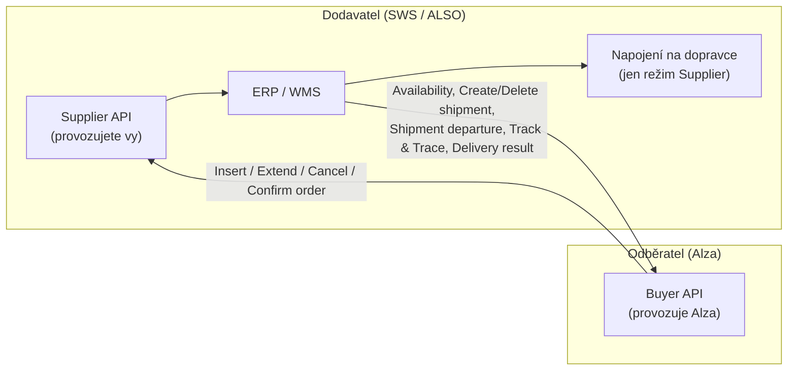
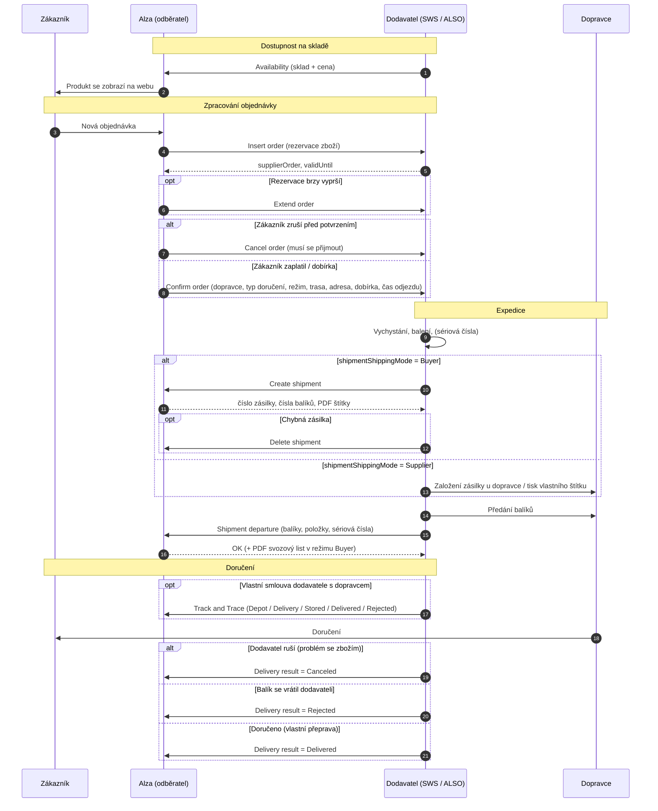
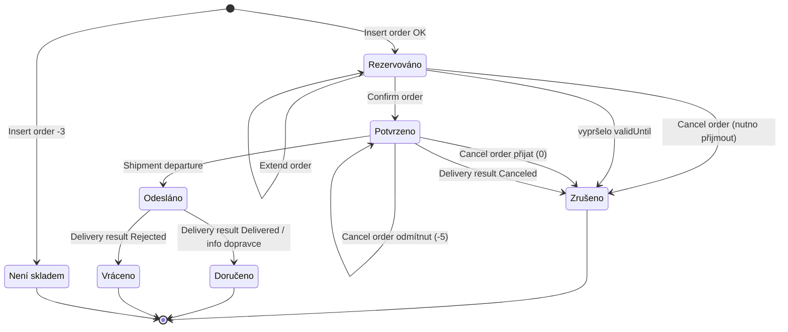
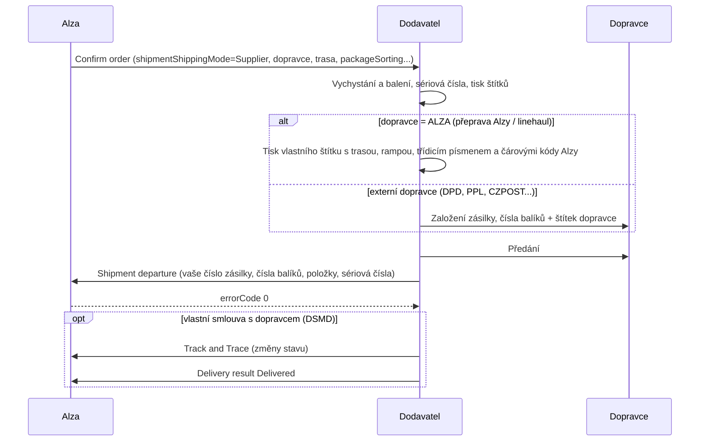
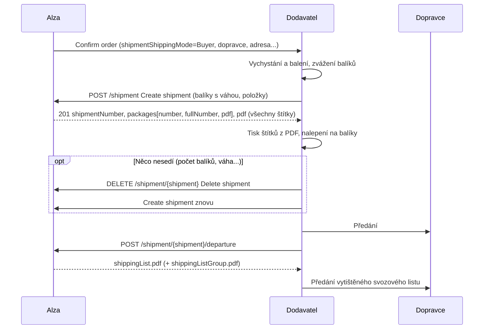
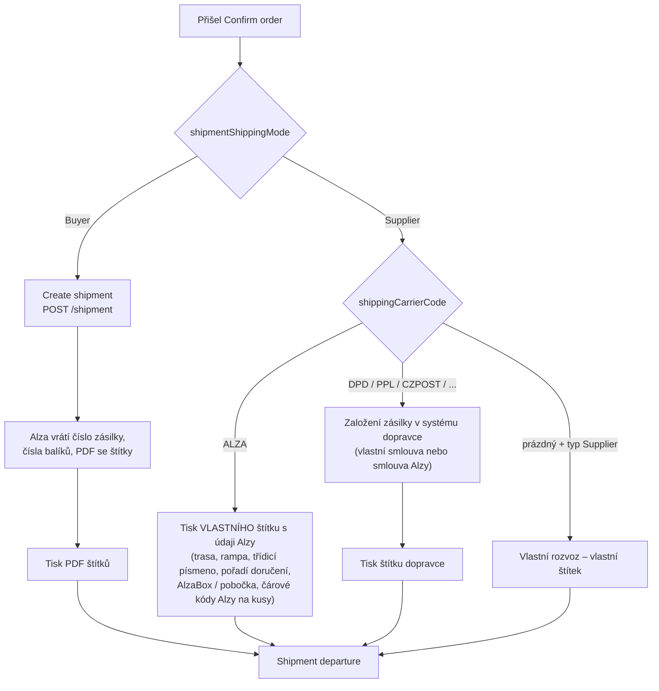
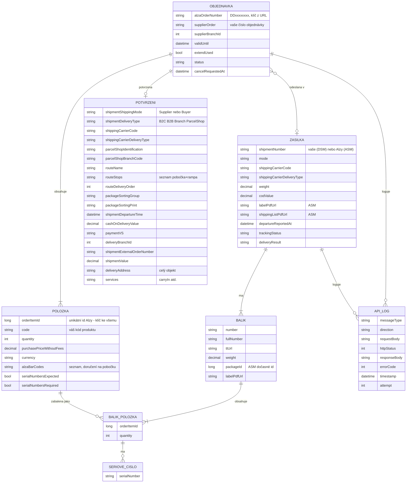
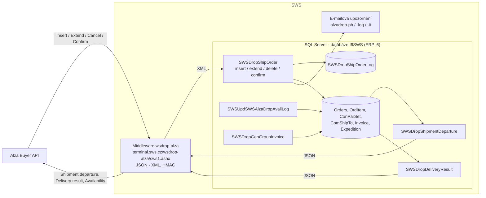

# Alza Dropshipment – Kuchařka přepravy

*Jak funguje komunikace o zásilkách s Alzou, jak se tvoří štítky, které API zprávy jsou potřeba v jednotlivých režimech přepravy a jaká data je nutné ukládat – sepsáno z pohledu dodavatele (SWS), který integraci provozuje v ostrém provozu.*

| | |
|---|---|
| **Pro koho** | ALSO – implementační tým |
| **Zdroj pravdy** | Alza Trade API – <https://trade-api-docs.alza.cz/> (verze **1.185**, 20.10.2026). Stará stránka na Apiary (`dropa.docs.apiary.io`) už jen přesměrovává sem. |
| **Reálná data** | Produkční data SWS – log zpráv (srpen 2026) a SQL procedury z databáze `I6SWS` (15.11.2026). Neupravená, včetně údajů zákazníků. |
| **Stav** | KONCEPT – části označené **[TODO – SWS]** se ještě doplňují (middleware, dostupnost, štítky, screenshoty z ERP). |

---

## 1. TL;DR – odpovědi na vaše otázky

**„Jak funguje komunikace o zásilkách s Alzou?“**
Alza (*Buyer*, odběratel) posílá objednávky vám (*Supplier*, dodavatel) – `Insert` → (`Extend`) → `Confirm` / `Cancel`. Zpráva `Confirm order` vám říká, **kam**, **jak** a **kdy** zásilka pojede (dopravce, typ doručení, režim přepravy, trasa, čas odjezdu, dobírka, adresa). Jakmile balík fyzicky opustí váš sklad, nahlásíte to zprávou `Shipment departure`. Potom posíláte sledování zásilky (`Track and Trace`, jen při vlastní smlouvě s dopravcem) a konečný výsledek (`Delivery result`).

**„Jak se tvoří štítky?“**
Záleží na **režimu přepravy**, který přijde v `Confirm order` → `shipmentShippingMode`:

| `shipmentShippingMode` | Kdo vytváří číslo zásilky, čísla balíků a štítek | Jak |
|---|---|---|
| `Supplier` (DSM) | **Vy** | Vaše vlastní napojení na dopravce (DPD, PPL, …) **nebo** – u vlastní přepravy Alzy (`shippingCarrierCode = ALZA`) – váš vlastní štítek vytištěný z údajů o trase, které Alza pošle v `Confirm order`. |
| `Buyer` (ASM) | **Alza** | Zavoláte `Create shipment` a Alza vrátí číslo zásilky, čísla balíků a **PDF se štítky dopravce**. Svozový list (předávací protokol) přijde v odpovědi na `Shipment departure`. |

**„Které API zprávy jsou potřeba pro jednotlivé režimy?“** → viz [matice v kapitole 5](#5-které-api-zprávy-jsou-potřeba-v-jednotlivých-režimech).

**„Jaké informace musíme ukládat?“** → viz [kapitola 8](#8-jaká-data-je-potřeba-ukládat). Stručně: číslo objednávky Alzy + vaše číslo objednávky, každé `orderItemId`, kompletní obsah `Confirm order`, čísla zásilek a balíků, která hlásíte, sériová čísla a úplný log všech požadavků a odpovědí.

---

## 2. Role, endpointy a základní pravidla

| Pojem v API | Kdo | Implementuje |
|---|---|---|
| **Buyer** (odběratel) | Alza | **Buyer API** – volá ho dodavatel (`Availability`, `Create shipment`, `Delete shipment`, `Shipment departure`, `Track and Trace`, `Delivery result`) |
| **Supplier** (dodavatel) | SWS / ALSO | **Supplier API** – volá ho Alza (`Insert order`, `Extend order`, `Cancel order`, `Confirm order`) |
| **End customer** | Zákazník Alzy | – |



**Základní pravidla (vše povinné podle Alzy):**

- HTTPS s obecně důvěryhodným certifikátem, TLS 1.2 a vyšší.
- JSON, hlavička `Content-Type: application/json; charset=utf-8`, vyplněná hlavička `User-Agent`.
- Dostupnost 23 h denně, servisní okno max. 1 h mezi 22:00 a 03:00.
- Autentizace: HMAC-SHA1 token, kódovaný Base64 + URL encode (viz *Authentication token* v dokumentaci Alzy).
- `timestamp` musí být vždy aktuální – i při opakovaném odeslání zprávy.
- Zprávy musí být **idempotentní**: příjemce musí bez chyby přijmout stejnou zprávu opakovanou v krátkém čase (mění se jen `timestamp`).
- Všechny časy jsou v **CET**.

---

## 3. Životní cyklus objednávky



### Stavy objednávky (na straně dodavatele)



Klíčová pravidla:

- **Zrušení před Confirm** → musíte okamžitě přijmout (`-5` **není** povoleno).
- **Zrušení po Confirm, před odjezdem** → můžete odmítnout kódem `-5` (např. „Order was sent“). Pokud to ještě nevíte, odpovězte `-5` a pokud se zásilku podaří zastavit, pošlete později `Delivery result = Canceled`.
- **Po `Shipment departure`** → objednávku už nelze zrušit.
- `shipmentDepartureTime` (dříve `demandedExpeditionDate`) v `Confirm order` je závazný – zásilka nesmí odjet **dříve ani později**.

---

## 4. Režimy přepravy (shipping modes)

Režim přepravy určuje, **kdo zajišťuje číslo zásilky, čísla balíků, svozový list, přepravní štítky a data pro dopravce**. Posílá se u každé objednávky v `Confirm order` → `shipmentShippingMode`. Režimy lze kombinovat – jeden dodavatel může dostávat objednávky v obou režimech.

| | **Režim Supplier – DSMD** | **Režim Supplier – DSMA** | **Režim Buyer – ASM** |
|---|---|---|---|
| `shipmentShippingMode` | `Supplier` | `Supplier` | `Buyer` |
| Smlouva s dopravcem | Dodavatele | Alzy | Alzy |
| Číslo zásilky | Dodavatel | Dodavatel | **Alza** (`Create shipment`) |
| Čísla balíků | Dodavatel / dopravce | Dodavatel / dopravce | **Alza** (`Create shipment`) |
| Přepravní štítek | Dodavatel (systém dopravce) | Dodavatel (systém dopravce nebo vlastní štítek pro trasy `ALZA`) | **Alza** – PDF z `Create shipment` |
| Svozový list (předávací protokol) | Dodavatel | Dodavatel | **Alza** – PDF v odpovědi na `Shipment departure` |
| Zpráva Track and Trace | **Povinná** | Není potřeba | Není potřeba |
| Typické použití | Dodavatel už má napojení na dopravce | Dodavatel má napojení, ale jede za ceny Alzy / vlastní přepravou Alzy | Dodavatel nemá napojení na dopravce |

> **Poznámka:** DSMD / DSMA / ASM jsou interní názvy Alzy. Která smlouva (vaše nebo Alzy) platí pro kterého dopravce, se domlouvá s Alzou při zavádění – v API se **neposílá**. **[TODO – SWS]** potvrdit, jak je to nastavené u SWS (viz [otevřené body](#12-otevřené-body)).

### Režim Supplier (DSM) – expedice



### Režim Buyer (ASM) – expedice



---

## 5. Které API zprávy jsou potřeba v jednotlivých režimech

Směr: A→S = Alza volá vás, S→A = vy voláte Alzu.

| API zpráva | Směr | DSMD (Supplier, vlastní smlouva) | DSMA (Supplier, smlouva Alzy) | ASM (Buyer) | Poznámka |
|---|---|---|---|---|---|
| `POST /availability` | S→A | Povinné | Povinné | Povinné | Sklad + cena. Update po ≥10 min (jen změny), `PartialFull` v noci 00:00–06:00. |
| `POST /order/{order}` Insert order | A→S | Povinné | Povinné | Povinné | Rezervace zboží. Vracíte `supplierOrder`, `validUntil`. `-3` = není skladem. |
| `POST /order/{order}/extend` Extend order | A→S | Povinné | Povinné | Povinné | Vraťte `-5`, pokud prodloužit nechcete → Alza objednávku zruší. |
| `DELETE /order/{order}` Cancel order | A→S | Povinné | Povinné | Povinné | Pravidla rušení viz kapitola 3. |
| `POST /order/{order}/confirm` Confirm order | A→S | Povinné | Povinné | Povinné | **Pokyn k expedici.** Uložte vše. |
| `POST /shipment` Create shipment | S→A | – | – | Povinné | Vrací číslo zásilky, čísla balíků a PDF štítky. |
| `DELETE /shipment/{shipment}` Delete shipment | S→A | – | – | Podmíněné | Jen před odjezdem, k opravě chybné zásilky. |
| `POST /shipment/{shipment}/departure` Shipment departure | S→A | Povinné | Povinné | Povinné | `{shipment}` = vaše číslo (DSM) nebo číslo Alzy z Create shipment (ASM). V ASM vrací svozový list. |
| `POST /track` Track and Trace | S→A | Povinné | – | – | Povinné při vlastní smlouvě dodavatele. ParcelShop: poslat `Stored` před `Delivered`. |
| `POST /order/{order}/delivery` Delivery result | S→A | Povinné | Podmíněné | Podmíněné | `Delivered` – jen při vlastní přepravě. `Canceled` / `Rejected` – v jakémkoli režimu. |

### Pole, která se liší podle režimu

| Pole | Create shipment (ASM) | Shipment departure – DSM | Shipment departure – ASM |
|---|---|---|---|
| `shippingCarrier.shippingCarrierCode` | povinné, stejné jako v Confirm | povinné pro nové dodavatele | povinné pro nové dodavatele |
| `shippingCarrier.shippingCarrierDeliveryType` | skutečný typ, **`Supplier` zakázán** | skutečný typ, nebo `Supplier` = doručujete sami | skutečný typ, **`Supplier` zakázán** |
| `parcelShop` | povinné, pokud bylo v Confirm | povinné, pokud bylo v Confirm | povinné, pokud bylo v Confirm |
| `packages[]` | `packageId` (vaše dočasné id) + `weight` | `number` (+ `fullNumber`, `ttUrl`, `weight`) | čísla vrácená z Create shipment |
| `items[]` | `order`, `orderItemId`, `packageId`, `quantity` | `order`, `orderItemId`, `packageNumber`, `quantity`, `serials` | stejně jako DSM |
| Odpověď | `shipment.pdf`, `packages[].pdf` | `errorCode` | `shipment.shippingList.pdf`, `shippingListGroup.pdf` |

**Jeden kus zboží ve dvou balících** (FAQ Alzy): první balík nese `quantity: 1`, druhý stejné `orderItemId` s `quantity: 0`.

**Sériová čísla:** pokud v Insert order přišlo `serialNumbersRequired = true`, je `items[].serials` v Shipment departure povinné. Pokud jen `serialNumbersExpected = true`, pošlete je, pokud je máte.

---

## 6. Typy doručení, dopravci a konsolidace

### `shipmentDeliveryType` (v Confirm order)

| Hodnota | Význam | Konsolidace více objednávek do jedné zásilky |
|---|---|---|
| `B2C` | Adresa koncového zákazníka | Ne |
| `B2B` | Adresa firemního zákazníka | Ne |
| `Branch` | Pobočka / sklad Alzy (vyplněno `deliveryBranchId`) | **Povinná** – objednávky na stejnou pobočku seskupit do společných balíků |
| `ParcelShop` | Výdejní místo / AlzaBox (vyplněn objekt `parcelShop`) | Ne |

Ve všech případech platí: **jedna objednávka = jedna zásilka** (objednávku nelze rozdělit do více zásilek).

### Kódy dopravců a typy doručení

`shippingCarrierCode`: `ALZA, CZPOST, DHL, DPD, DPDSK, DPDHU, FOFR, GebruderWeiss, GEISPARCEL, GEISCARGO, GLS, GO, HELICAR, MagyarPOST, Najbert, PPL, RHENUS, SKPOST, SKYNET, TOPTRANS, UPS, WEDO, ZASILKOVNA, ZavolejSiKuryra`

`shippingCarrierDeliveryType` (výběr): `COURIER, ALZABRANCH, ALZABOX, CZPOSTD, CZPOSTP, CZPOSTB, DPD, DPDALZABOX, DPDBOX, DPDPARCELSHOP, PPL, PPLPARCELSHOP, GLS, ZASILKOVNA, …` a speciální hodnota **`Supplier`**.

**Speciální hodnota `Supplier`** v Confirm order:

- vyplněný `shippingCarrierCode` (např. `CZPOST`) + typ doručení `Supplier` → konkrétní typ doručení pro daného dopravce **vybíráte vy** (např. `CZPOSTD`) a pošlete ho zpět v Create shipment / Shipment departure.
- prázdný `shippingCarrierCode` + typ doručení `Supplier` → **doručujete sami**; zpět pošlete `Supplier`.

### Třídění balíků

`Confirm order` → `packageSorting.packageSortingGroup` = `RegularDirect` (výchozí) | `Linehaul` | `CrossLC`. **Balíky z různých skupin se při přepravě nesmí fyzicky míchat.** V režimu Supplier vytiskněte `packageSortingPrint` (např. `L`, `C`) na štítek.

---

## 7. Tvorba štítků



### 7.1 Režim Buyer (ASM) – štítek vytváří Alza

1. Zabalte objednávku, zvažte každý balík.
2. `POST /shipment` s `packages[]` (`packageId`, `weight`, volitelně `volume`) a `items[]` (které `orderItemId` je ve kterém `packageId`).
3. Odpověď `201`: `shipment.shipmentNumber`, `shipment.packages[]` (`packageId`, `number`, `fullNumber`, `pdf`), `shipment.pdf` (všechny štítky v jednom PDF).
4. Stáhněte a vytiskněte PDF, nalepte štítky. **Uložte** číslo zásilky a čísla balíků – budete je potřebovat pro departure.
5. Když se něco změní (počet balíků, váhy) → `DELETE /shipment/{shipment}` a založit znovu. Po odjezdu už to nejde.
6. `POST /shipment/{shipmentNumber}/departure` → odpověď obsahuje PDF **svozového listu**, který předáte řidiči.

### 7.2 Režim Supplier s externím dopravcem (DPD, PPL, CZPOST, …)

Štítek vzniká ve **vašem napojení na dopravce** stejně jako u jakékoli jiné vaší zásilky. Alza potřebuje jen výsledek v `Shipment departure`:

- `packages[].number` – číslo balíku (krátké),
- `packages[].fullNumber` – celý čárový kód ze štítku (jeho část je obvykle sledovací číslo),
- `packages[].ttUrl` – odkaz na sledování zásilky (preferovaný způsob, jak dát Alze správné sledování),
- `shippingCarrier` – skutečný kód dopravce a typ doručení.

U doručení na výdejní místo použijte jako výdejní místo v systému dopravce `parcelShop.parcelShopBranchCode` z Confirm order.

### 7.3 Režim Supplier s vlastní přepravou Alzy (`shippingCarrierCode = ALZA`)

Alza si zboží vyzvedne ve skladu dodavatele a vozí ho přes svá překladiště (linehaul). Dodavatel tiskne **vlastní štítek** s údaji z `Confirm order`. Tři ukázky níže ukazují stejnou objednávku do AlzaBoxu ve třech třídicích skupinách; šipky ukazují, které pole JSON kam patří.

#### Rozložení štítku (AlzaBox, CZ)

| # | Místo na štítku | Obsah | Zdroj |
|---|---|---|---|
| 1 | Vlevo nahoře – *Odesilatel* | Kód dodavatele + země, např. `koddodavatele01 CZ` | První část `route.routeName` (před prvním `->`) |
| 2 | Vpravo nahoře – rámeček | Třídicí písmeno `C` / `L`; u `RegularDirect` **prázdný rámeček** | `packageSorting.packageSortingPrint` |
| 3 | *Příjemce*, velkým písmem | Název AlzaBoxu / pobočky | `deliveryAddress.companyName` |
| 4 | Příjemce – řádky 2–4 | Ulice, PSČ + město, telefon | `deliveryAddress.streetWithNumber`, `zip` + `city`, `phone` |
| 5 | *Č.obj.* | Číslo objednávky dodavatele | ERP dodavatele (SWS: `OrdCode` = `supplierOrder`) |
| 6 | *Č.fakt.* | Číslo faktury dodavatele | ERP dodavatele |
| 7 | *Č.ext.obj.* | Číslo objednávky Alzy, např. `DD20351220` | V ukázkách `paymentVS` (rovná se číslu objednávky Alzy); API má nově i `shipmentExternalOrderNumber` *„povinné pro tisk štítku“* |
| 8 | Čárový kód + číslo nad ním | Číslo balíku, např. `1553076346` | Dodavatel – stejné číslo se pak posílá v Shipment departure jako `packages[].number` |
| 9 | Řádek trasy | Trasa bez části odesílatele, např. `CZLC1 → CZLC4 → ZápadD 12` | `route.routeName` |
| 10 | Řádky zastávek | Jeden řádek na zastávku: překladiště + rampa, např. `CZLC1  L10`, `CZLC4  L69` | `route.routeStops[].branchName` + `ramp` |
| 11 | `1 / 1` | Pořadí balíku / počet balíků v zásilce | Dodavatel |
| 12 | Vpravo dole – rámeček | Pořadí doručení, např. `9` | `route.routeDeliveryOrder` |

Netiskne se: `addressName` (jméno zákazníka), `email`, `parcelShopBranchCode` (`AB505`), dobírka (v ukázkách 0).

#### Tři varianty třídění

| Varianta | `packageSortingGroup` | `packageSortingPrint` | Zastávky trasy | Rámeček vpravo nahoře |
|---|---|---|---|---|
| **Direct** | `RegularDirect` | – (neposílá se) | 1 (`CZTC1 / L10`) | prázdný |
| **Linehaul** | `Linehaul` | `L` | 1 (`CZTC1 / L10`) | `L` |
| **Cross** | `CrossLC` | `C` | 2 (`CZTC1 / L10`, `CZLC4 / L69`) – přes cross-dock | `C` |

Balíky z různých skupin se nesmí fyzicky míchat (viz kapitola 6).


> **Poznámka:** v ukázkách je v JSON překladiště `CZTC1`, ale na vytištěném štítku `CZLC1`. Tiskněte přesně to, co Alza pošle v `routeName` / `routeStops`.

U doručení na **pobočku** (Branch) posílá Alza navíc v **Insert order** `orderItems[].alzaBarCodes` – jeden čárový kód na každý kus (např. `BCX3489207239`). **Vytiskněte je (Code-128) a nalepte na každý kus.** Počet kódů odpovídá objednanému množství.

> **[TODO – SWS]** Štítek pro doručení na **pobočku** (s čárovými kódy Alzy na kusy), štítek **DPD** a která sestava / šablona v i6 tiskne štítek `ALZA`.

---

## 8. Jaká data je potřeba ukládat

Vše níže je potřeba buď k odpovědi na pozdější zprávy, ke tvorbě štítků, nebo k řešení reklamací a sporů s Alzou.



### Minimální checklist

| Co uložit | Proč |
|---|---|
| Číslo objednávky Alzy (`DD…`) ↔ vaše číslo objednávky | Klíč ve všech URL Alzy; v Insert vracíte `supplierOrder`. |
| `orderItemId` u každé položky | Preferovaná identifikace položky v Create shipment / Departure; **povinné při doručení na pobočku**. |
| `alzaBarCodes` | Při doručení na pobočku se musí vytisknout na každý kus. |
| `serialNumbersExpected/Required` | Rozhoduje, zda jsou sériová čísla v departure povinná. |
| `validUntil`, počítadlo prodloužení | Vypršení rezervace, obsluha opakovaného Extend. |
| **Celý obsah Confirm order** | Je to pokyn k expedici (dopravce, režim, adresa, trasa, dobírka, čas odjezdu). Ukládejte i surový JSON. |
| Číslo zásilky, čísla balíků, plná čísla, odkaz na sledování | Posílají se v departure; potřeba pro T&T a podporu. ASM: vrací je Alza. |
| Balík ↔ položka ↔ množství ↔ sériová čísla | Obsah `items[]` v departure. |
| URL PDF štítků / svozového listu (ASM) | Opakovaný tisk. |
| Surový log každého požadavku + odpovědi + HTTP status | Opakování, idempotence, spory s Alzou (podpora Alzy ho vyžaduje). |

> **Datový model SWS:** jak to všechno SWS ukládá v ERP i6 (tabulky, sloupce, id parametrů), popisuje kapitola [9.4](#94-kde-jsou-data-uložená-v-i6).

---

## 9. Jak to dělá SWS (současný stav)

*Podle produkčních SQL procedur v databázi `I6SWS` (ERP i6, stav k 15.11.2026) a logu zpráv. Názvy objektů, ID i data jsou skutečná a neupravená. Věci vyčtené z kódu, které SWS zatím nepotvrdilo, jsou označené „(ověřit)“.*

### 9.1 Architektura

- SWS jede v **režimu Supplier** – čísla zásilek, čísla balíků i štítky si vytváří samo.
- Dopravci v ostrém provozu: **`ALZA`** (vlastní přeprava Alzy ze skladu SWS `CZ01` přes překladiště `CZTC1`, pro AlzaBoxy a pobočky Alzy) a **`DPD`**.
- Middleware **`wsdrop-alza`** (`https://terminal.sws.cz/wsdrop-alza/sws1.ashx`) přijímá JSON od Alzy, převádí ho na XML a volá SQL proceduru. Odchozí zprávy skládají SQL procedury jako JSON a odesílá je middleware.
- ID: Alza = firma **`ComId 7993`** v i6; `supplierId 200`, `supplierBranchId 235`; všechny automatické akce běží pod uživatelem i6 **`270` / `DDD`**.
- Každá dropship objednávka má parametr **`ConParSet 434 / 3501`** – podle něj všechny procedury poznají dropship objednávky.



### 9.2 Databázové objekty

| Objekt | Typ | Účel |
|---|---|---|
| `SWSDropShipOrder` | procedura | Zpracuje všechny příchozí zprávy Supplier API (`insert`, `extend`, `delete`, `confirm`). |
| `SWSDropShipmentDeparture` | procedura | Skládá zprávy Shipment departure pro odeslané objednávky. |
| `SWSDropDeliveryResult` | procedura | Skládá zprávy Delivery result (Canceled / Rejected). |
| `SWSDropGenGroupInvoice` | procedura | Slučuje dočasné dropship faktury pro Alzu do jedné souhrnné faktury. |
| `SWSUpdSWSAlzaDropAvailLog` | procedura | Po odeslání dostupnosti uloží snímek „naposledy odesláno“, podle kterého Insert order kontroluje ceny. |
| `SWSDropShipOrderLog` | tabulka | Log každé příchozí zprávy (sloupce `Sdal…`). |
| `SWSAlzaDropAvailLog1` | tabulka | Aktuální nabídka připravená pro Alzu (`LStiId, LQtyFree, LSipPriceOrd, LStiCode, LStiEAN, LTaxRate, LSndStatus`). |
| `SWSAlzaDropAvailLog` | tabulka | Snímek dostupnosti naposledy odeslané Alze. |

### 9.3 Příchozí zprávy – `SWSDropShipOrder`

Parametry: `@typ` (`insert` / `extend` / `delete` / `confirm`), `@OrdCodeO` (číslo objednávky Alzy `DD…`), `@ComId` (7993), `@xml` (zpráva převedená na XML), `@HTTPRespStatus`, `@HTTPResponse`.

#### Logování a idempotence (všechny typy zpráv)

1. Každé volání vloží řádek do `SWSDropShipOrderLog`; `SdalResult` je předvyplněný `-1, || Unspecified error`.
2. Procedura hledá **dřívější stejnou zprávu** (stejný typ + objednávka + XML bez `timestamp`, přes `dbo.SWSRemoveXMLTag`). Dřívější pokusy, které skončily deadlockem / timeoutem (HTTP 500) nebo „Previous request still running“, se ignorují.
   - dřívější ještě běží (zatím bez HTTP statusu) → `-1 Previous request still running`,
   - dřívější je dokončená → **vrátí se znovu stejný výsledek** (bezpečné opakování, jak Alza vyžaduje).
3. Na konci `SdalResult` = `<errorCode>, <zpráva>||<interní text chyby>`.
4. Middleware volá proceduru **podruhé** s `@HTTPRespStatus` + `@HTTPResponse`; toto volání jen uloží, co se Alze skutečně vrátilo, do `SdalHTTPRespStatus` / `SdalHTTPResponse` (max. 500 znaků).

| Sloupec logu | Význam |
|---|---|
| `SdalId` | Id záznamu |
| `SdalComId` | Alza v i6 – `7993` |
| `SdalType` | `insert`, `extend`, `delete`, `confirm` |
| `SdalCode` | Číslo objednávky Alzy (`DD…`) |
| `SdalXML` | Požadavek převedený na XML |
| `SdalResult` | `errorCode, zpráva\|\|interní chyba` |
| `SdalC` | Vytvořeno (datum/čas) |
| `SdalHTTPRespStatus` | HTTP status vrácený Alze |
| `SdalHTTPResponse` | JSON tělo vrácené Alze |

#### Insert order

| # | Kontrola | Odpověď |
|---|---|---|
| 1 | Objednávka `DD…` už v i6 existuje a neexistuje dřívější stejná zpráva | `-1 Invalid Order Number - already exists` |
| 2 | Produkt chybí v aktuální nabídce (`SWSAlzaDropAvailLog1`) nebo je aktuální cena vyšší než cena Alzy | `-3 Out of stock`, `errorProducts[].quantity = 0` |
| 3 | Produkt chybí v naposledy odeslané dostupnosti (`SWSAlzaDropAvailLog`) | `-2 Bad product code` |
| 4 | Kód není spárovaný s produktem i6 (`StoItem` + `CompanyPrice` pro Alzu) | `-2 Bad product code in pairing` |
| 5 | Cena ≠ naposledy odeslaná cena | `-4 Bad product price` |
| 6 | Založí se rezervační objednávka a zablokuje se zboží (`OrdBlock`); zablokované množství ≠ objednané | rollback, `-3 Out of stock` se skutečně zablokovaným množstvím |
| 7 | Počet `alzaBarCodes` ≠ množství | rollback, `-1 Ordered quantity is not same as count AlzaBarCodes` |
| 8 | OK | `0`, `supplierOrder` = `OrdCode` (např. `OP26132530`), `validUntil` = dnes + 7 dní 23:59 |

Co vznikne v i6:

- `Orders`: `OrdCodeO` = číslo objednávky Alzy, `OrdCode` = nové číslo z číselné řady „O“, `OrdYSetId = 3` (rezervační objednávka), `OrdDelTo` = validUntil, `OrdNotCheck = 1`, `OrdNoteExt = 'Dropshipment rezervacni objednavka'`.
- `ConParSet 434 / 3501` na objednávce (značka dropship).
- `OrdItem` za každý řádek (cena = cena Alzy = cena z dostupnosti).
- Parametr `879` na každé položce: `CpsTag` = `orderItemId` Alzy, `CpsTagI` = `serialNumbersRequired`.
- Parametr `880` na každé položce: jeden řádek na každý čárový kód Alzy (`CpsTag` = kód, `CpsTagI` = pořadí 0…n).
- Pokud je nastavený parametr kontaktu `1048`, zboží se nejdřív přebere z jiných (ne-dropship) rezervačních objednávek Alzy (přeblokování, zapisuje se do parametru `964 / 3228`).

#### Extend order

| Kontrola | Odpověď |
|---|---|
| Objednávka nenalezena | `-5 Order number not found` |
| Objednávka už je vyfakturovaná | `-5 Order was sent` |
| Objednávka uzavřená (rezervace vypršela) | `-5 Reservation expired.` |
| Nové `validUntil` je v minulosti | `-5 untilValid is the past` |
| Nové `validUntil` je později než dnes + 9 dní | `-5 untilValid is too long` |
| Už jednou prodlouženo (`WSREQEXTEND` v `OrdNoteExt`) nebo má objednávka `!DDR!` | `-5 only once extend is allowed` |
| OK | `OrdDelTo` = nové validUntil, do `OrdNoteExt` se přidá `WSREQEXTEND <čas>` → `0` + `validUntil` |

#### Cancel order (`delete`)

| Situace | Odpověď | Co se stane |
|---|---|---|
| Objednávka nenalezena | `-5 Order number not found` | |
| Objednávka už je vyfakturovaná (potvrzená a zpracovaná) | `-5 Order was sent` | E-mail expedici: pokud to jde, zastavit zásilku a poslat Delivery result Canceled; pokud už odešel Shipment departure, ponechat `!DSD!` a poslat Delivery result Rejected. |
| Objednávka uzavřená | `0 Order is closed` | Do `OrdNoteExt` se zapíše `WSREQDELETE <čas>` |
| Confirm přišel dřív, ale faktura ještě neexistuje | `0` | Objednávka se vrátí na rezervační, do `OrdNoteInt` `DELETE po CONFIRM`, e-mail „nefakturujte“. |
| Standardně (rezervace) | `0` | `OrdDelTo` = včera, `WSREQDELETE <čas>` v `OrdNoteExt`, `OrdYSetId3Cancel` uvolní rezervaci. |
| Duplicitní číslo `DD…` v i6 | `0` | E-mail na IT. |

#### Confirm order

| Situace | Odpověď |
|---|---|
| Objednávka neznámá a nikdy nepřišel Insert | `-1 Order number not found, CONFIRM without INSERT` |
| Objednávka neznámá, ale Insert je v logu | `-5 Order number not found` |
| Už vyfakturováno (opakovaný confirm) | `0` |
| Objednávka má `!DDR!` (zrušeno ze strany SWS) | `0 Order is marked as DDR` – značka se odstraní |
| Objednávka uzavřená, rezervace vypršela | `0 attempt confirm expired reservation` |
| Objednávka uzavřená | `0 Order is closed` |
| Předchozí confirm spadl v půlce | `0 previous confirm ended with some error` – nutná ruční fakturace |
| Ne všechny položky jsou zablokované | `0 Order was inserted with -3, out of stock or reservation was unblocked, delivery result - canceled` – položky se stornují, následuje Delivery result Canceled |
| Typ doručení není v i6 nastavený | `-5 Contractually unsupported shipping code <kód>` |
| `shipmentShippingMode` není `Supplier` / `Buyer` | `-5 Contractually unsupported shipping mode` |
| Dobírka v jiné měně než CZK / EUR | `-5 Contractually unsupported currency code` |
| PSČ pro CZ / SK nemá 5 číslic | `-5 Delivery Address Error` |
| OK | `0` |

Co udělá úspěšný Confirm:

1. **Mapování dopravce** (viz 9.5): `shippingCarrierDeliveryType` → způsob dopravy i6 (`DelivMode`). Hodnota `Supplier` → `ALZABRANCH`, pokud je `shippingCarrierCode = ALZA`, jinak `DPD`.
2. **Doručovací adresa** (`ComShipTo`):
   - `Branch` + `deliveryBranchId` → použije se existující adresa s `CstId2` = id pobočky,
   - výdejní místa → výdejní místo se dohledá / založí v `DemTOPlace` podle `parcelShopBranchCode` a adresa se z něj vygeneruje (`GenCstFromDtp`),
   - jinak nová adresa; `CstId2` = id pobočky nebo typ doručení, `CstId3` = GLN `8594177950111`; z PSČ se odstraní `@` (Alza ho občas posílá).
3. **Objednávka** se upraví: `OrdYSetId = 0` (běžná objednávka), potvrzuje 270/DDD, `OrdCstId`, `OrdDemId`, `OrdDelFrom` = požadované datum, `OrdTagD` = `shipmentDepartureTime`, `OrdTag2` = `shipmentDeliveryType`.
4. **Objednávky mimo pobočky** (B2C / B2B / ParcelShop): přepnou se na B2C (`OrdAsB2C`), dobírková cena položek se nastaví na 0,01 a přidá se korekční položka **`DROPSHIPKOREKCE`** (StiId `498094`), aby součet dobírky odpovídal `cashOnDeliveryValue`; nastaví se dobírková varianta dopravy (`OrdZDemIdO`).
5. Na objednávku se uloží **parametry** (viz 9.4).
6. Hned se vytvoří **faktura** (`InvAutoCreate`, typ 73); u objednávek mimo pobočky `InvZVal` = dobírka. Parametr kontaktu `945` řídí souhrnnou fakturaci (hodnota `3822` → dočasné faktury pod uživatelem `97573`, které později sloučí `SWSDropGenGroupInvoice`). Položky s podmíněným prodejem (`OriSalePerm`) se nefakturují – zapíše se chyba.

> **Poznámka:** `shipmentShippingMode = Buyer` se přijme, ale SWS nemá logiku pro Create shipment – taková objednávka by se zpracovala jako režim Supplier. **[TODO – SWS]** potvrdit, že Alza SWS nikdy `Buyer` neposílá.

### 9.4 Kde jsou data uložená v i6

`ConParSet` je obecná tabulka parametrů v i6: `CpsConId` = id záznamu (objednávka, položka, způsob dopravy, faktura), `CpsCpaId` = id parametru, `CpsCpvId` = id hodnoty z číselníku, `CpsTag` = textová hodnota, `CpsTagI` = celé číslo.

| Pole API | Uložení v i6 |
|---|---|
| Číslo objednávky Alzy (`{order}`, `DD…`) | `Orders.OrdCodeO` |
| `supplierOrder` | `Orders.OrdCode` |
| `validUntil` | `Orders.OrdDelTo` |
| Značka dropship | `ConParSet` 434 / hodnota 3501 na objednávce |
| `orderItemId`, `serialNumbersRequired` | `ConParSet` 879 na `OrdItem` (`CpsTag`, `CpsTagI`) |
| `alzaBarCodes[]` | `ConParSet` 880 na `OrdItem`, jeden řádek na kód (`CpsTagI` = pořadí) |
| `code`, `quantity`, cena | `OrdItem.OriStiCode`, `OriQty`, `OriPrcCur` |
| `shipmentDeliveryType` | `Orders.OrdTag2` |
| `shipmentDepartureTime` | `Orders.OrdTagD` |
| `demandedExpeditionDate` | `Orders.OrdDelFrom` |
| `shippingCarrier` | `Orders.OrdDemId` (dobírková varianta `OrdZDemIdO`) |
| `deliveryAddress`, `deliveryBranchId` | `ComShipTo` přes `Orders.OrdCstId` (`CstId2` = id pobočky) |
| `parcelShop.parcelShopBranchCode` | `DemTOPlace.DtpCode` |
| `paymentVS` | `ConParSet` 888 (`CpsTag`) |
| `shipmentValue` + měna | `ConParSet` 889, formát `hodnota\|měna` |
| `cashOnDeliveryValue` + měna | `ConParSet` 890, formát `hodnota\|měna`; také `Invoice.InvZVal` |
| `route.routeName` | `ConParSet` 1186 |
| `route.routeStops[]` | `ConParSet` 1187, formát `pobočka\|rampa\|\|pobočka\|rampa` |
| `route.routeDeliveryOrder` | parametr `DRO` „RouteDeliveryOrder“ (skupina ALZ) |
| `packageSorting` | parametr `DPG` „DropPackSortGroup“ (skupina ALZ): `CpvValue` = skupina, `CpvCode` = tiskové písmeno |
| Log zpráv | `SWSDropShipOrderLog` |
| Stavové značky | `Orders.OrdTag`, `OrdNoteExt`, `OrdNoteInt`, `Expedition.ExpNoteInt` (viz 9.8) |
| Balíky | `Expedition` (`ExpCodeO` číslo balíku, `ExpCodeS` krátké číslo DPD, `ExpWeight`, `ExpDateS` odesláno), přes `ExpDocuments` napojené na dodací list (typ 68) nebo fakturu (typ 73) |
| Sériová čísla | `Warranty` (za expedici a produkt), čte je `dbo.SWSGetWarSerialNoForOrderAndExpedition` |

**Dnes se neukládá:** `shipmentExternalOrderNumber`, `shipmentDeliveryServices`, `parcelShopIdentification` (jen kód pobočky), `regNo` / `vatNo`, surový JSON (v logu je jen XML).

### 9.5 Mapování dopravců

- Způsoby dopravy i6 (`DelivMode`) jsou s kódy Alzy propojené parametrem `ConParSet` **900**: `CpsTag` = `shippingCarrierDeliveryType` Alzy.
- Pro každý kód existuje běžná doprava (`DemType = 0`), dobírková varianta (`DemType = 2`) a případně varianta pro pobočky (`CpsTagI = -1`, použije se pro `Branch`).
- V Shipment departure se jako `shippingCarrierCode` posílá `DemNameE` a jako `shippingCarrierDeliveryType` hodnota `CpsTag` parametru 900.
- `DemDtp = 1` = doprava na výdejní místa (používá `DemTOPlace`).
- Nenastavené kódy se odmítnou s `-5 Contractually unsupported shipping code`.

> **[TODO – SWS]** Seznam nastavených způsobů dopravy – výsledek dotazu:
> `SELECT DemId, DemCode, DemNameE, DemType, DemDtp, DemMaxWeight, CpsTag, CpsTagI FROM DelivMode JOIN ConParSet ON DemId = CpsConId AND CpsCpaId = 900`

### 9.6 Shipment departure – `SWSDropShipmentDeparture`

**Výběr:** dropship objednávky, které jsou uzavřené (`OrdClosed = 1`), mají expedici s číslem balíku (`ExpCodeO`), jsou odeslané (`ExpDateS` vyplněné, `ExpDateC` prázdné), ještě nemají `!DSD!` a nejsou zrušené (`!DDR!`). Expedice se dohledá přes dodací list (68) nebo fakturu (73).

**Číslo zásilky** (`{shipment}` v URL):

| Formát | Kdy |
|---|---|
| `<OrdId>x<nejnižší ExpId>A` | Standardně – jedna zásilka na objednávku se všemi balíky |
| `<OrdId>x<ExpId>B` | Pobočka – jedna zásilka na expedici (konsolidace), položky všech objednávek v ní |
| `<OrdId>x<ExpId>C` | Objednávka na pobočku rozdělená do více expedic – každá se posílá zvlášť |
| přípona `AAy` / `By` | Ruční doposlání pro jednu objednávku (`@OrdId`), např. `6955290x8715633AAy` |

**Číslo balíku:**

| Dopravce | `packages[].number` | `packages[].fullNumber` |
|---|---|---|
| DPD (`DemCode` 1) | `ExpCodeS` | `ExpCodeO` |
| Zásilkovna (`DemCode` 29) | `ExpCodeO` bez prvního znaku | `ExpCodeO` |
| Ostatní (ALZA, …) | `ExpCodeO` | `ExpCodeO` |

**Další pole:**

- `shippingCarrier` = `DemNameE` + parametr 900.
- `cashOnDeliveryValue` / `shipmentValue` z parametrů 890 / 889 (typ A); u B / C je dobírka 0 a hodnota se počítá z cen položek faktury.
- `shipmentWeight` = `ExpWeight`, omezené `DemMaxWeight`.
- `items[]`: `order`, `packageNumber`, `quantity` (`Warranty.WarQty`), `orderItemId` (parametr 879), `code`, `serials` (z `Warranty`; pokud je sériové číslo kratší než 4 znaky nebo je „Fuser unit 230V“, **posílá se místo něj číslo objednávky**). Korekční položka se vynechává.
- Neposílá se: `expectedDeliveryDate`, `ttUrl`, `deliveryAddress`, `shipmentVolume`.
- Pravidlo „ne před `shipmentDepartureTime`“ je v kódu **vypnuté** (komentář: dohoda s Alzou a kolize s konsolidací na pobočky).
- Po úspěšném odeslání se nastaví `!DSD!` v `OrdTag` (u poboček v `Expedition.ExpNoteInt`) – dělá to middleware (ověřit).

**Natvrdo zadané výjimky** v proceduře (jednorázové opravy konkrétních objednávek): ExpId `6867391`, `7080553`, `8571708`, `8770543`, `8781021`; OrdId `5136469`, `6808692`, `7010557`, `7021326`. Do nové implementace by se přenášet neměly.

### 9.7 Delivery result – `SWSDropDeliveryResult`

SWS posílá jen **Canceled** a **Rejected** – nikdy Delivered.

| Případ | Podmínka | `status` | `errorReason` |
|---|---|---|---|
| Zboží chybí / rezervace vypršela | Dropship objednávka s položkami, které nejsou plně zablokované ani odeslané, nezrušená Alzou (`WSREQDELETE`), neprobíhá přeblokování (`!DROP!` v `OrdNoteInt`), starší než 10 min | Canceled | `expired reservation` (pořád rezervace) nebo `poslední poškozený kus` |
| Balík se vrátil | Příjemka vratky (`LMPurchase`, `PurXPusId = 6`), jejíž kód odpovídá odeslanému balíku (`ExpCodeO` / `ExpCodeS`; DPD: podřetězec od 8. nebo 9. znaku) | Rejected | `zakaznik neprevzal` |
| Zrušeno po odjezdu | Cancel od Alzy (`WSREQDELETE`) poté, co už odešel `!DSD!` | Rejected | `send DELETE after CONFIRM` |
| Ruční volání (`@OrdId`, `@Type`) | 1 / 2 / 3 / 4 | Canceled / Canceled / Rejected / Canceled | `expired reservation` / `poslední poškozený kus` / `zakaznik neprevzal` / `chyba pri confirm` |

`paymentVS` se bere z parametru 888. Po odeslání se nastaví `!DDR!` v `OrdTag`.

### 9.8 Stavové značky na objednávce

| Značka | Kde | Význam |
|---|---|---|
| `OrdYSetId = 3` | `Orders` | Rezervační objednávka (po Insert, před Confirm) |
| `OrdYSetId = 0` | `Orders` | Běžná objednávka (po Confirm) |
| `!DSD!` | `OrdTag` / `Expedition.ExpNoteInt` (pobočky) | Shipment departure odeslán |
| `!DDR!` | `OrdTag` | Delivery result odeslán |
| `!E!DDR!` | `OrdTag` | Chyba Delivery result (ověřit) |
| `WSREQEXTEND <čas>` | `OrdNoteExt` | Extend přijat (jen jednou) |
| `WSREQDELETE <čas>` | `OrdNoteExt` | Přišel Cancel od Alzy |
| `DELETE po CONFIRM` | `OrdNoteInt` | Cancel přišel po Confirm, před fakturou |
| `!DROP!` | `OrdNoteInt` | Probíhá přeblokování – neposílat Delivery result |
| `Branch`, `B2C`, … | `OrdTag2` | `shipmentDeliveryType` |

### 9.9 Dostupnost

- `SWSAlzaDropAvailLog1` = aktuální nabídka pro Alzu (volné množství, nákupní cena, kód, EAN, sazba DPH, `LSndStatus`).
- Po odeslání `SWSUpdSWSAlzaDropAvailLog` zkopíruje řádky s `LSndStatus ≤ 1` do `SWSAlzaDropAvailLog` (tabulka se předtím vyprázdní, pokud neexistují řádky se stavem 4) a stav jim zvýší o 3 (= odesláno).
- Insert order porovnává cenu Alzy s oběma tabulkami (viz 9.3).

> **[TODO – SWS]** Procedura, která plní `SWSAlzaDropAvailLog1` (výpočet skladu a ceny), skládání zprávy a význam hodnot `LSndStatus`.

### 9.10 Fakturace

- Confirm vytvoří fakturu (typ 73) ke každé objednávce.
- `SWSDropGenGroupInvoice` (Alza `ComId 7993`) vezme dočasné faktury (`InvNumTmp = 1`) dropship objednávek, jejichž skladové položky jsou všechny vydané, nejnovější přidělí ostré číslo (`NumUpd`, `InvCodeO` = variabilní symbol), ostatní do ní sloučí (`InvJoin`), prázdné smaže, nastaví parametr `944 / 3600` a `InvState = 1`. Výsledek: **jedna souhrnná faktura pro Alzu**.

### 9.11 E-mailová upozornění

Odesílá Database Mail (profil `DataSQL IBM`) na `alzadrop-ph@SWS.cz; alzadrop-log@SWS.cz`, v kopii `alzadrop-it@SWS.cz`:

- Cancel u objednávky, která už je vyfakturovaná – ručně zastavit zásilku / poslat Delivery result.
- Cancel po Confirm bez faktury – „nefakturujte“.
- Duplicitní číslo `DD…` u cancel / extend / confirm.

### 9.12 Známé problémy a technický dluh

- Natvrdo zadaná ID objednávek / expedic v `SWSDropShipmentDeparture` (jednorázové opravy).
- Číslo objednávky posílané jako sériové číslo, když platné sériové číslo chybí.
- `shipmentDepartureTime` se nevynucuje.
- Režim `Buyer` se přijme, ale není implementovaný (žádný Create shipment).
- Žádný Track and Trace, žádný Delivery result Delivered, v departure chybí `ttUrl`.
- Nevyužívaná nová pole Alzy: `shipmentExternalOrderNumber`, `shipmentDeliveryServices`, chystané `shipmentDeliveryAddress`, `glnList`.
- Natvrdo zadané konstanty: `ComId 7993`, uživatel `270 / DDD`, id parametrů, GLN `8594177950111`, korekční položka `498094`, e-mailové adresy.

### 9.13 Příklad – AlzaBox přes přepravu Alzy

`Confirm order` (jako XML po převodu v SWS, záznam logu 592251, objednávka `DD23779989`):

```xml
<orders>
  <timestamp>2026-08-18T20:44:01.303</timestamp>
  <customerId>7993</customerId><supplierId>200</supplierId><supplierBranchId>235</supplierBranchId>
  <regNo>27082440</regNo><vatNo>CZ27082440</vatNo>
  <shippingCarrier>
    <shippingCarrierCode>ALZA</shippingCarrierCode>
    <shippingCarrierDeliveryType>ALZABOX</shippingCarrierDeliveryType>
  </shippingCarrier>
  <parcelShop>
    <parcelShopIdentification>ALZABOX</parcelShopIdentification>
    <parcelShopBranchCode>AB3478</parcelShopBranchCode>
  </parcelShop>
  <route>
    <routeName>SWS CZ01 -&gt; CZTC1 -&gt; Východní Čechy L 12*</routeName>
    <routeStops><branchName>CZTC1</branchName><ramp>L17</ramp></routeStops>
    <routeDeliveryOrder>6</routeDeliveryOrder>
  </route>
  <shipmentDeliveryType>ParcelShop</shipmentDeliveryType>
  <shipmentShippingMode>Supplier</shipmentShippingMode>
  <cashOnDeliveryValue>0</cashOnDeliveryValue><cashOnDeliveryValueCurrency>CZK</cashOnDeliveryValueCurrency>
  <packageSorting><packageSortingGroup>Linehaul</packageSortingGroup><packageSortingPrint>L</packageSortingPrint></packageSorting>
  <demandedExpeditionDate>2026-08-19</demandedExpeditionDate>
  <shipmentDepartureTime>2026-08-19T14:30:00</shipmentDepartureTime>
  <paymentVS>1504853468</paymentVS>
  <deliveryAddress>
    <companyName>Liberec - Staré Pavlovice - Hrdinů</companyName>
    <addressName>Filip Frýba</addressName>
    <streetWithNumber>Hrdinů 34/30</streetWithNumber><city>Liberec</city>
    <phone>+420775146569</phone><email>filipfryba0@gmail.com</email>
    <country>CZ</country><zip>46001</zip>
  </deliveryAddress>
  <shipmentValue>1782</shipmentValue><shipmentValueCurrency>CZK</shipmentValueCurrency>
</orders>
```

→ SWS vytiskne vlastní štítek s trasou `CZTC1 / L17`, pořadím doručení `6`, třídicím písmenem `L` a AlzaBoxem `AB3478`.

### 9.14 Příklad – pobočka Alzy přes přepravu Alzy (konsolidace)

`Confirm order` pro `DD23764935` (záznam logu 591993):

```xml
<orders>
  <timestamp>2026-08-18T11:25:21.76</timestamp>
  <customerId>7993</customerId><supplierId>200</supplierId><supplierBranchId>235</supplierBranchId>
  <regNo>27082440</regNo><vatNo>CZ27082440</vatNo>
  <shippingCarrier><shippingCarrierCode>ALZA</shippingCarrierCode><shippingCarrierDeliveryType>Supplier</shippingCarrierDeliveryType></shippingCarrier>
  <route>
    <routeName>SWS CZ01 -&gt; CZTC1 -&gt; CZLC4 -&gt; Čakovice</routeName>
    <routeStops><branchName>CZTC1</branchName><ramp>L05</ramp></routeStops>
    <routeStops><branchName>CZLC4</branchName><ramp>L53</ramp></routeStops>
  </route>
  <shipmentDeliveryType>Branch</shipmentDeliveryType>
  <shipmentShippingMode>Supplier</shipmentShippingMode>
  <cashOnDeliveryValue>0</cashOnDeliveryValue><cashOnDeliveryValueCurrency>CZK</cashOnDeliveryValueCurrency>
  <packageSorting><packageSortingGroup>CrossLC</packageSortingGroup><packageSortingPrint>C</packageSortingPrint></packageSorting>
  <demandedExpeditionDate>2026-08-19</demandedExpeditionDate>
  <shipmentDepartureTime>2026-08-19T14:30:00</shipmentDepartureTime>
  <paymentVS>1504752017</paymentVS>
  <deliveryAddress>
    <companyName>alza.cz Čakovice</companyName><addressName></addressName>
    <streetWithNumber>Kostelecká 823/77</streetWithNumber><city>Praha</city>
    <phone>+420 225 340 111</phone><email>sales.cakovice@alza.cz</email>
    <country>CZ</country><zip>19600</zip>
  </deliveryAddress>
  <deliveryBranchId>4255</deliveryBranchId>
  <shipmentValue>74750</shipmentValue><shipmentValueCurrency>CZK</shipmentValueCurrency>
</orders>
```

`shippingCarrierDeliveryType = Supplier` + dopravce `ALZA` → SWS to převede na `ALZABRANCH`. Odpovídající Insert order obsahoval 25 kusů `DLS01306` s 25 kódy `alzaBarCodes` (`BCX35076959731` … `BCX350769597325`) – jedna nálepka na každý kus. Pozdější Cancel (záznam 592168) byl odmítnut s `-5 Order was sent`.

### 9.15 Příklad – Shipment departure přes DPD (ruční doposlání)

Zalogované volání endpointu middleware `shipdep` (ten zprávu předá na `POST /shipment/{shipment}/departure` Alzy – ověřit) pro objednávku `DD23334255` (v i6 `OrdId 6955290`). Číslo zásilky končí na `AAy` = ruční doposlání; podle komentáře v `SWSDropShipmentDeparture` šlo o jednorázovou akci 7.8.2026, kdy se potvrzoval jen produkt `848007` = balík `13825096221168`.

```text
POST https://terminal.sws.cz/wsdrop-alza/sws1.ashx/shipdep?shipment=6955290x8715633AAy
```

```json
{
  "shippingCarrier": { "shippingCarrierCode": "DPD", "shippingCarrierDeliveryType": "DPD" },
  "cashOnDeliveryValue": 0.00, "cashOnDeliveryValueCurrency": "CZK",
  "shipmentValue": 3032.00, "shipmentValueCurrency": "CZK",
  "shipmentWeight": 0.80000,
  "packages": [
    { "number": "13825096221168", "weight": 0.80000, "fullNumber": "%007030013825096221168327203" }
  ],
  "items": [
    { "order": "DD23334255", "packageNumber": "13825096221168", "quantity": 1,
      "orderItemId": 3471466988, "code": "848007", "serials": ["201040003001V00EMR"] }
  ]
}
```

Odpověď Alzy: `200 {"errorCode":0,"errorMessage":""}`.

---

## 10. Chyby, opakování, timeouty

### Chybové kódy

| Kód | Význam | Data přijata |
|---|---|---|
| `0` | Úspěch | Ano |
| `-1` | Obecná chyba (detail v `errorMessage`) | Ne |
| `-2` | Neplatná vstupní data | Ne |
| `-3` | Není skladem (Insert order) | Ano |
| `-4` | Neplatná cena | Ne |
| `-5` | Operace odmítnuta (Extend, Cancel po Confirm, limit Availability) | Ano |
| `-6` | Chybná odpověď | Ano |
| `-7` | Porušen limit pro opakované odeslání | Ne |

Pokud data **nejsou** přijata, odesílatel musí zprávu posílat znovu, dokud nejsou. U chyb vždy vyplňte `errorMessage`. HTTP `429` (bez těla) = překročen rate limit → poslat znovu podle intervalů. Jakýkoli jiný HTTP status než zdokumentované 200/201/400 = nedoručeno → poslat znovu.

### Intervaly opakování (minuty)

| Zpráva | Krátký | Výchozí | Sledované období | Předmět |
|---|---|---|---|---|
| Insert / Extend / Cancel / Confirm order | 1 | 10 | 60 | Objednávka |
| Create / Delete shipment, Shipment departure, Track and Trace | 1 | 15 (dočasně 5) | 60 | Zásilka |
| Delivery result | 5 | 30 | 60 | Objednávka |
| Availability – Update / PartialFull / Full | 1/1/10 | 10/1/10 | 30/60/60 | Pobočka |

*Krátký* limit platí, když jsou ve sledovaném období max. 2 další zprávy, jinak platí *výchozí*.

### Timeouty (sekundy) – odesílatel musí čekat déle než příjemce

| Zpráva | Timeout Alzy | Timeout dodavatele |
|---|---|---|
| Insert / Extend / Cancel / Confirm order | 80 | 60 |
| Create / Delete shipment, Departure, T&T, Delivery result | 60 | 80 |
| Availability | 280 | 300 |

Max. **5 paralelních požadavků** stejného typu od jednoho dodavatele.

---

## 11. Checklist implementace

1. Od Alzy získat: `supplierId`, `supplierBranchId`(s), HMAC tajemství, testovací/produkční URL; Alze dát URL vašeho Supplier API a váš `customerId` pro Alzu.
2. Implementovat Supplier API: Insert, Extend, Cancel, Confirm – idempotentně, s logováním, odpověď do 60 s.
3. Rozhodnout, které režimy přepravy poběží (Supplier / Buyer) a jaké smlouvy s dopravci (vaše / Alzy) – domluvit s Alzou.
4. Namapovat Confirm order → expediční příkaz ve vašem ERP (dopravce, typ doručení, výdejní místo, trasa, třídění, dobírka, čas odjezdu).
5. Štítky: napojení na dopravce (DSM), vlastní štítek pro trasy `ALZA` včetně čárových kódů Alzy na kusy, nebo PDF z Create shipment (ASM).
6. Shipment departure s balíky, položkami a sériovými čísly – přesně v `shipmentDepartureTime`.
7. Track and Trace (vlastní smlouva) + Delivery result (Canceled / Rejected / Delivered).
8. Availability: Update (jen změny, 10 min–1 h), PartialFull v noci.
9. Mechanismus opakování podle intervalů, obsluha `-7` / `429`, kompletní log požadavků a odpovědí.
10. Otestovat přes **Testing Buyer API** (`/trade-test/v2/...`) a **Invoke Supplier API** (Alza volá vaše API s testovacími scénáři, např. `invokeInsertOrder`) – pak přepnout na produkci.

---

## 12. Otevřené body

**Dodáno:** SQL procedury `SWSDropShipOrder`, `SWSDropShipmentDeparture`, `SWSDropDeliveryResult`, `SWSDropGenGroupInvoice`, `SWSUpdSWSAlzaDropAvailLog` (15.11.2026) – zpracováno v kapitole 9.

**Ještě chybí:**

| # | Co | Proč / kam to patří | Kdo |
|---|---|---|---|
| 1 | Middleware `wsdrop-alza` (`sws1.ashx`) – zdrojový kód nebo popis: JSON ⇄ XML, HMAC token, která procedura pro který endpoint, odesílání odchozích zpráv, opakování, kde se nastavuje `!DSD!` / `!DDR!` | 9.1 – jediná část řetězce, která ještě není popsaná | SWS |
| 2 | Plánování – SQL Agent joby / úlohy, které spouští departure, delivery result, souhrnnou fakturu a dostupnost, a jak často | 9.6, 9.7, 9.9, 9.10 | SWS |
| 3 | Dostupnost – procedura, která plní `SWSAlzaDropAvailLog1` (výpočet skladu a ceny), skládání zprávy, význam `LSndStatus`, časování Update / PartialFull | 9.9 | SWS |
| 4 | Pomocné objekty – `dbo.SWSGetWarSerialNoForOrderAndExpedition`, `dbo.SWSRemoveXMLTag`, `SWSSetConParSet`, `OrdBlock`, `OrdYSetId3Cancel`, `InvAutoCreate`, `GenCstFromDtp`, `OrdAsB2C`, `InvJoin`: které jsou standard i6 a které vlastní SWS (vlastní → zdrojový kód) | 9.3, 9.6 | SWS |
| 5 | Definice tabulek (DDL) `SWSDropShipOrderLog`, `SWSAlzaDropAvailLog`, `SWSAlzaDropAvailLog1` | 9.2 | SWS |
| 6 | Mapování způsobů dopravy – výsledek dotazu z 9.5 | 9.5 | SWS |
| 7 | Štítky – kde a jak i6 tiskne štítek pro trasy `ALZA` (sestava / šablona, které parametry čte), jak se tisknou čárové kódy Alzy na kusy (parametr 880); ukázky štítků pro **pobočku** a **DPD** (AlzaBox dodáno 15.11.2026) | 7.3 | SWS |
| 8 | Screenshoty z ERP i6 – objednávka Alzy v seznamu (rezervační vs. potvrzená), detail objednávky s parametry, vychystání / balení, expedice s čísly balíků, příjemka vratky, souhrnná faktura | 9 | SWS |
| 9 | DPD pro Alzu – smlouva SWS (DSMD), nebo smlouva Alzy (DSMA)? Vadí Alze, že SWS neposílá Track and Trace ani Delivery result Delivered? | 4, 9.7 | SWS |
| 10 | Potvrdit, že Alza SWS nikdy neposílá `shipmentShippingMode = Buyer` | 9.3 | SWS |
| 11 | Význam: `ExpDateC`, `!E!DDR!`, parametry `1048` / `964` (přeblokování), hodnoty `3821` / `3822` parametru `945` (souhrnná fakturace) | 9.3, 9.6, 9.8, 9.10 | SWS |
| 12 | Natvrdo zadané výjimky v `SWSDropShipmentDeparture` – jsou ještě potřeba, nebo se dají zrušit? | 9.6, 9.12 | SWS |
| 13 | Příklady z logu – Delivery result (Canceled i Rejected) a Availability požadavek / odpověď | 9.7, 9.9 | SWS |
| 14 | Kontakty – kdo v SWS má kterou část na starosti (schránky `alzadrop-ph`, `alzadrop-log`, `alzadrop-it`), kontakty na Alzu | předání | SWS |
| 15 | Chystané změny Alzy 2026: `CompanyAddress`, `ShipmentAddress` (`shipmentDeliveryAddress` se může lišit od `deliveryAddress`), `glnList`, `taxNo`, `vatNo` max. 30 znaků | počítat s tím | ALSO |
