# Alza Dropshipment – Kuchařka přepravy

*Jak funguje komunikace o zásilkách s Alzou, jak se tvoří štítky, které API zprávy jsou potřeba v jednotlivých režimech přepravy a jaká data je nutné ukládat – sepsáno z pohledu dodavatele (SWS), který integraci provozuje v ostrém provozu.*

| | |
|---|---|
| **Pro koho** | ALSO – implementační tým |
| **Zdroj pravdy** | Alza Trade API – <https://trade-api-docs.alza.cz/> (verze **1.185**, 20.10.2026). Stará stránka na Apiary (`dropa.docs.apiary.io`) už jen přesměrovává sem. |
| **Reálná data** | Produkční data SWS – log zpráv (srpen 2026) a SQL procedury z databáze `I6SWS` (15.11.2026). Neupravená, včetně údajů zákazníků. |
| **Stav** | KONCEPT – části označené **[TODO – SWS]** se ještě doplňují (middleware, dostupnost, štítky, screenshoty z ERP). |

---

## 1. TL;DR – odpovědi na vaše otázky

**„Jak funguje komunikace o zásilkách s Alzou?“**
Alza (*Buyer*, odběratel) posílá objednávky vám (*Supplier*, dodavatel) – `Insert` → (`Extend`) → `Confirm` / `Cancel`. Zpráva `Confirm order` vám říká, **kam**, **jak** a **kdy** zásilka pojede (dopravce, typ doručení, režim přepravy, trasa, čas odjezdu, dobírka, adresa). Jakmile balík fyzicky opustí váš sklad, nahlásíte to zprávou `Shipment departure`. Potom posíláte sledování zásilky (`Track and Trace`, jen při vlastní smlouvě s dopravcem) a konečný výsledek (`Delivery result`).

**„Jak se tvoří štítky?“**
Záleží na **režimu přepravy**, který přijde v `Confirm order` → `shipmentShippingMode`:

| `shipmentShippingMode` | Kdo vytváří číslo zásilky, čísla balíků a štítek | Jak |
|---|---|---|
| `Supplier` (DSM) | **Vy** | Vaše vlastní napojení na dopravce (DPD, PPL, …) **nebo** – u vlastní přepravy Alzy (`shippingCarrierCode = ALZA`) – váš vlastní štítek vytištěný z údajů o trase, které Alza pošle v `Confirm order`. |
| `Buyer` (ASM) | **Alza** | Zavoláte `Create shipment` a Alza vrátí číslo zásilky, čísla balíků a **PDF se štítky dopravce**. Svozový list (předávací protokol) přijde v odpovědi na `Shipment departure`. |

**„Které API zprávy jsou potřeba pro jednotlivé režimy?“** → viz [matice v kapitole 5](#5-které-api-zprávy-jsou-potřeba-v-jednotlivých-režimech).

**„Jaké informace musíme ukládat?“** → viz [kapitola 8](#8-jaká-data-je-potřeba-ukládat). Stručně: číslo objednávky Alzy + vaše číslo objednávky, každé `orderItemId`, kompletní obsah `Confirm order`, čísla zásilek a balíků, která hlásíte, sériová čísla a úplný log všech požadavků a odpovědí.

---

## 2. Role, endpointy a základní pravidla

| Pojem v API | Kdo | Implementuje |
|---|---|---|
| **Buyer** (odběratel) | Alza | **Buyer API** – volá ho dodavatel (`Availability`, `Create shipment`, `Delete shipment`, `Shipment departure`, `Track and Trace`, `Delivery result`) |
| **Supplier** (dodavatel) | SWS / ALSO | **Supplier API** – volá ho Alza (`Insert order`, `Extend order`, `Cancel order`, `Confirm order`) |
| **End customer** | Zákazník Alzy | – |

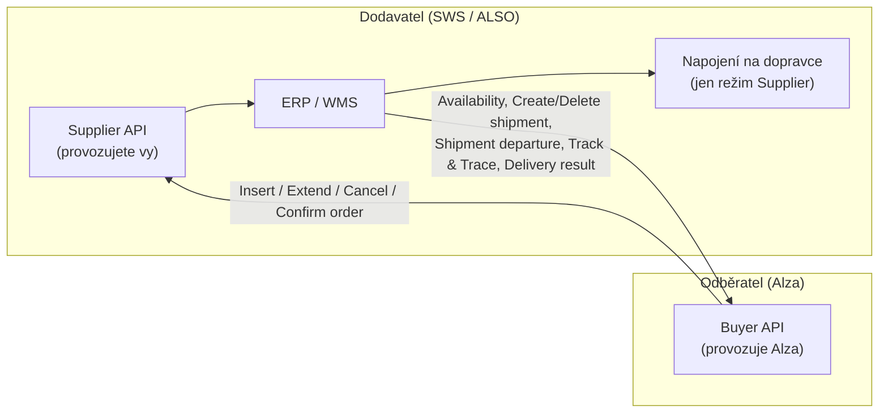

### Dva kanály objednávek mezi Alzou a SWS

SWS dostává od Alzy objednávky dvěma nezávislými cestami. Rozliší se podle prefixu čísla objednávky:

| | Standardní objednávka (EDI) | Dropshipping objednávka (Trade API) |
|---|---|---|
| Prefix čísla objednávky | **`OB…`** (např. `OB26238498`) | **`DD…`** (např. `DD26068181`) |
| Kam se dodává | Sklad Alzy (např. `CZLC4` Chrášťany, GLN `8594177950173`) | Koncový zákazník, AlzaBox nebo pobočka Alzy |
| Objednávka přichází přes | EDI **ORDERS** přes EDIStore | Trade API – Insert / Extend / Cancel / Confirm (tato kuchařka) |
| Informace o odeslání Alze | EDI **DESADV** | Trade API – Shipment departure, Delivery result |
| Faktura Alze | EDI **INVOIC** | EDI **INVOIC** |
| Posílá se DESADV | Ano | **Ne** |

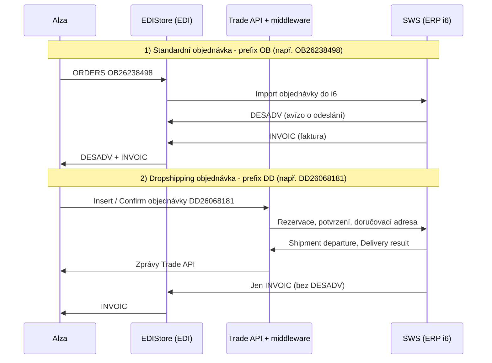

Zbytek kuchařky popisuje **dropshippingový kanál**. EDI faktura k dropshipping objednávce je popsaná v 9.18, standardní EDI ORDERS (`OB26238498`) v 9.19.

### Produktová data: jak Alza dostává od SWS sklad a ceny

Alza dostává sklad a ceny SWS dvěma cestami – pro každý kanál objednávek jednou:

| | 1) Export z WebService (pull) | 2) Trade API Availability (push) |
|---|---|---|
| Kdo to spouští | **Alza si data stahuje** z WebService SWS | **SWS data posílá** Alze |
| K čemu slouží | Standardní nákup – Alza pak objednává přes EDI (`OB…`) | Dropshipping nabídka na alza.cz – Alza pak objednává přes Trade API (`DD…`) |
| Endpoint | `https://terminal.sws.cz/i6ws/Default.asmx/GetResult?resultType=X-StoItemQtyFreeRealX` a `…=X-StoItemQtyFreeRealX2` | `POST https://trade-api.alza.cz/api/v1/availability` |
| Formát | XML (`items` / `item` se skupinami `Pricing`, `Storage`, `Product`) | JSON (`productList[]`) |
| Obsah | Všechny produkty (≈ 35 600) | `Update` = jen změněné produkty; `PartialFull` = všechny produkty skladem, každou noc |

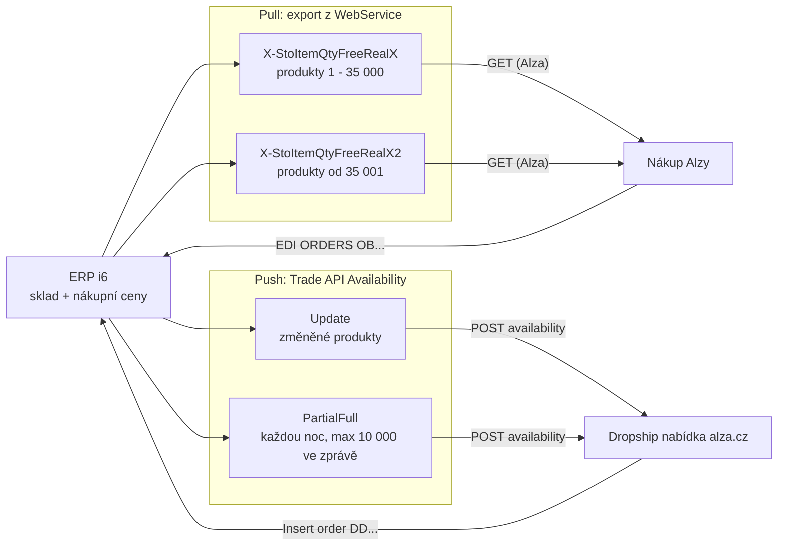

#### 1) Exporty z WebService `X-StoItemQtyFreeRealX` a `X-StoItemQtyFreeRealX2`

Feed připravený podle požadavků Alzy (podrobnosti v dokumentaci WebService SWS, kapitola 5.2.42–5.2.43 / 6.1).

- **Dvě části kvůli 5minutovému timeoutu stahování na straně Alzy:** `X-StoItemQtyFreeRealX` vrací prvních 35 000 produktů (`TOP 35000`), `X-StoItemQtyFreeRealX2` zbytek (seřazeno podle `StiId`, `OFFSET 35000`). Alza volá obě části přes `GetResult`.
- **Sklad** = volné množství skladu `29` (`QtyFree` + `QtyFree2`), ponížené o blokace objednávek.
- **Cena** = dealerská (nákupní) cena pro Alzu; s recyklačním / autorským poplatkem i bez něj, měna `CZK`.
- Export vidí jen firmy `0`, `6336` a `7993` (`7993` = Alza).

```xml
<items>
  <item>
    <Pricing>
      <PriceWithFee>3889.7600</PriceWithFee>
      <PriceWithoutFee>3889.0000</PriceWithoutFee>
      <RecycleFee>0.7600</RecycleFee>
      <CopyrightFee>0.0000</CopyrightFee>
      <Currency>CZK</Currency>
    </Pricing>
    <Storage>
      <StoredQuantity>44</StoredQuantity>
    </Storage>
    <Product>
      <Name>Lenovo ThinkPad USB4 Dock 5000 - 65W - EU</Name>
      <DealerCode>LNM01353</DealerCode>
      <PartNumber>40BF0100EU</PartNumber>
      <Ean>0195892132486</Ean>
    </Product>
  </item>
</items>
```

| Skupina | Pole | Význam |
|---|---|---|
| `Pricing` | `PriceWithFee` | Nákupní cena za kus včetně poplatků |
| `Pricing` | `PriceWithoutFee`, `RecycleFee`, `CopyrightFee`, `Currency` | Cena bez poplatků, poplatky, měna |
| `Storage` | `StoredQuantity` | Počet kusů skladem |
| `Product` | `Name`, `DealerCode`, `PartNumber`, `Ean` | Název, kód produktu SWS, kód výrobce, EAN |

#### 2) Trade API Availability – `Update` a `PartialFull`

SWS posílá sklad a ceny pro dropshippingovou nabídku. Job SWS volá middleware (`alzaavail`), který zprávu sestaví a odešle (9.9).

| Typ | Kdy | Co se posílá | Pravidla podle dokumentace Alzy |
|---|---|---|---|
| **`Update`** | Kontrola každých 10 minut (`alzaavail?type=0`); odešle se jen při změně | Jen produkty, u kterých se změnil sklad nebo cena | Změny se sbírají aspoň 10 minut a posílají aspoň jednou za hodinu; nikdy celý sortiment najednou |
| **`PartialFull`** | Každou noc kolem 03:32 (`alzaavail?type=2`) | Všechny produkty **skladem** (množství > 0), rozdělené do zpráv po max. 10 000 produktech (např. 10 000 + ≈ 3 770) | Jen 00:00–06:00; aspoň jednou za noc, jinak Alza nabídku vyčistí; hodnoty starší než ≈ 36 h se berou jako nedostupné |
| `Full` (zastaralý) | Každou noc kolem 01:32 (`alzaavail?type=1`) | Všech ≈ 35 600 produktů, 8,7 MB | Nahrazen `PartialFull` – SWS ho pořád posílá |

Seznam produktů používá **starý cenový režim** (`price`, `priceWithFee`, `fee`, `vat`; Alza doporučuje `countryPrices`). Příklad `Update`:

```json
{"supplierId":200,"supplierBranchId":235,"timestamp":"2026-11-16T02:52:59.850","importType":"Update","currency":"CZK",
 "productList":[{"code":"847010","ean":"0617885021244","quantity":78,"price":309.6,"vat":21,"priceWithFee":312.96,"fee":3.36}]}
```

Cena, která se tu pošle, je cena, kterou Alza později vrací v Insert order (`purchasePriceWithoutFees`); SWS ji kontroluje proti naposledy odeslané dostupnosti (9.3, 9.9).

**Základní pravidla (vše povinné podle Alzy):**

- HTTPS s obecně důvěryhodným certifikátem, TLS 1.2 a vyšší.
- JSON, hlavička `Content-Type: application/json; charset=utf-8`, vyplněná hlavička `User-Agent`.
- Dostupnost 23 h denně, servisní okno max. 1 h mezi 22:00 a 03:00.
- Autentizace: HMAC-SHA1 token, kódovaný Base64 + URL encode (viz *Authentication token* v dokumentaci Alzy).
- `timestamp` musí být vždy aktuální – i při opakovaném odeslání zprávy.
- Zprávy musí být **idempotentní**: příjemce musí bez chyby přijmout stejnou zprávu opakovanou v krátkém čase (mění se jen `timestamp`).
- Všechny časy jsou v **CET**.

---

## 3. Životní cyklus objednávky

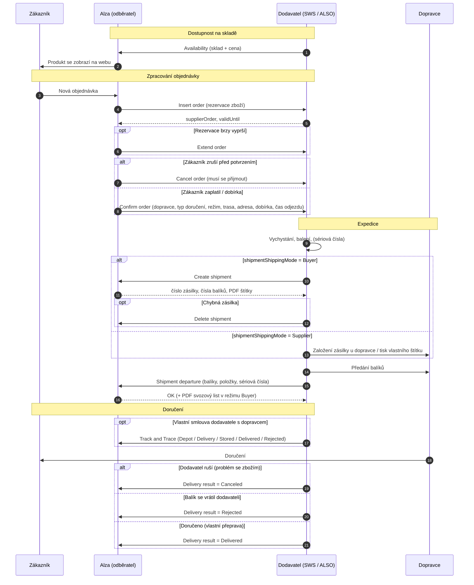

### Stavy objednávky (na straně dodavatele)

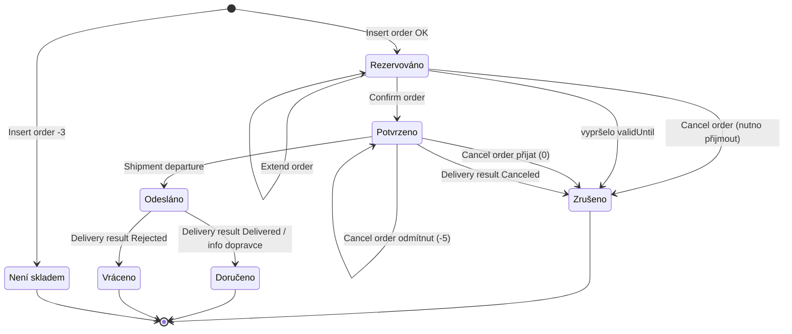

Klíčová pravidla:

- **Zrušení před Confirm** → musíte okamžitě přijmout (`-5` **není** povoleno).
- **Zrušení po Confirm, před odjezdem** → můžete odmítnout kódem `-5` (např. „Order was sent“). Pokud to ještě nevíte, odpovězte `-5` a pokud se zásilku podaří zastavit, pošlete později `Delivery result = Canceled`.
- **Po `Shipment departure`** → objednávku už nelze zrušit.
- `shipmentDepartureTime` (dříve `demandedExpeditionDate`) v `Confirm order` je závazný – zásilka nesmí odjet **dříve ani později**.

---

## 4. Režimy přepravy (shipping modes)

Režim přepravy určuje, **kdo zajišťuje číslo zásilky, čísla balíků, svozový list, přepravní štítky a data pro dopravce**. Posílá se u každé objednávky v `Confirm order` → `shipmentShippingMode`. Režimy lze kombinovat – jeden dodavatel může dostávat objednávky v obou režimech.

| | **Režim Supplier – DSMD** | **Režim Supplier – DSMA** | **Režim Buyer – ASM** |
|---|---|---|---|
| `shipmentShippingMode` | `Supplier` | `Supplier` | `Buyer` |
| Smlouva s dopravcem | Dodavatele | Alzy | Alzy |
| Číslo zásilky | Dodavatel | Dodavatel | **Alza** (`Create shipment`) |
| Čísla balíků | Dodavatel / dopravce | Dodavatel / dopravce | **Alza** (`Create shipment`) |
| Přepravní štítek | Dodavatel (systém dopravce) | Dodavatel (systém dopravce nebo vlastní štítek pro trasy `ALZA`) | **Alza** – PDF z `Create shipment` |
| Svozový list (předávací protokol) | Dodavatel | Dodavatel | **Alza** – PDF v odpovědi na `Shipment departure` |
| Zpráva Track and Trace | **Povinná** | Není potřeba | Není potřeba |
| Typické použití | Dodavatel už má napojení na dopravce | Dodavatel má napojení, ale jede za ceny Alzy / vlastní přepravou Alzy | Dodavatel nemá napojení na dopravce |

> **Poznámka:** DSMD / DSMA / ASM jsou interní názvy Alzy. Která smlouva (vaše nebo Alzy) platí pro kterého dopravce, se domlouvá s Alzou při zavádění – v API se **neposílá**. **[TODO – SWS]** potvrdit, jak je to nastavené u SWS (viz [otevřené body](#12-otevřené-body)).

### Režim Supplier (DSM) – expedice

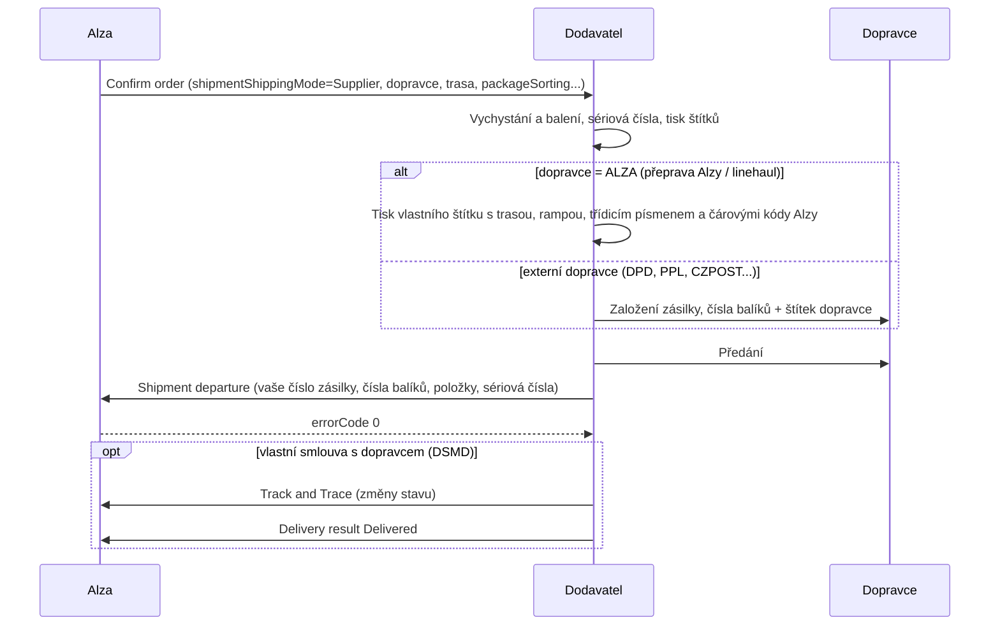

### Režim Buyer (ASM) – expedice

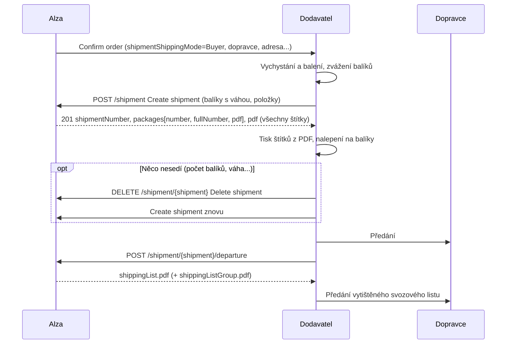

---

## 5. Které API zprávy jsou potřeba v jednotlivých režimech

Směr: A→S = Alza volá vás, S→A = vy voláte Alzu.

| API zpráva | Směr | DSMD (Supplier, vlastní smlouva) | DSMA (Supplier, smlouva Alzy) | ASM (Buyer) | Poznámka |
|---|---|---|---|---|---|
| `POST /availability` | S→A | Povinné | Povinné | Povinné | Sklad + cena. Update po ≥10 min (jen změny), `PartialFull` v noci 00:00–06:00. |
| `POST /order/{order}` Insert order | A→S | Povinné | Povinné | Povinné | Rezervace zboží. Vracíte `supplierOrder`, `validUntil`. `-3` = není skladem. |
| `POST /order/{order}/extend` Extend order | A→S | Povinné | Povinné | Povinné | Vraťte `-5`, pokud prodloužit nechcete → Alza objednávku zruší. |
| `DELETE /order/{order}` Cancel order | A→S | Povinné | Povinné | Povinné | Pravidla rušení viz kapitola 3. |
| `POST /order/{order}/confirm` Confirm order | A→S | Povinné | Povinné | Povinné | **Pokyn k expedici.** Uložte vše. |
| `POST /shipment` Create shipment | S→A | – | – | Povinné | Vrací číslo zásilky, čísla balíků a PDF štítky. |
| `DELETE /shipment/{shipment}` Delete shipment | S→A | – | – | Podmíněné | Jen před odjezdem, k opravě chybné zásilky. |
| `POST /shipment/{shipment}/departure` Shipment departure | S→A | Povinné | Povinné | Povinné | `{shipment}` = vaše číslo (DSM) nebo číslo Alzy z Create shipment (ASM). V ASM vrací svozový list. |
| `POST /track` Track and Trace | S→A | Povinné | – | – | Povinné při vlastní smlouvě dodavatele. ParcelShop: poslat `Stored` před `Delivered`. |
| `POST /order/{order}/delivery` Delivery result | S→A | Povinné | Podmíněné | Podmíněné | `Delivered` – jen při vlastní přepravě. `Canceled` / `Rejected` – v jakémkoli režimu. |

### Pole, která se liší podle režimu

| Pole | Create shipment (ASM) | Shipment departure – DSM | Shipment departure – ASM |
|---|---|---|---|
| `shippingCarrier.shippingCarrierCode` | povinné, stejné jako v Confirm | povinné pro nové dodavatele | povinné pro nové dodavatele |
| `shippingCarrier.shippingCarrierDeliveryType` | skutečný typ, **`Supplier` zakázán** | skutečný typ, nebo `Supplier` = doručujete sami | skutečný typ, **`Supplier` zakázán** |
| `parcelShop` | povinné, pokud bylo v Confirm | povinné, pokud bylo v Confirm | povinné, pokud bylo v Confirm |
| `packages[]` | `packageId` (vaše dočasné id) + `weight` | `number` (+ `fullNumber`, `ttUrl`, `weight`) | čísla vrácená z Create shipment |
| `items[]` | `order`, `orderItemId`, `packageId`, `quantity` | `order`, `orderItemId`, `packageNumber`, `quantity`, `serials` | stejně jako DSM |
| Odpověď | `shipment.pdf`, `packages[].pdf` | `errorCode` | `shipment.shippingList.pdf`, `shippingListGroup.pdf` |

**Jeden kus zboží ve dvou balících** (FAQ Alzy): první balík nese `quantity: 1`, druhý stejné `orderItemId` s `quantity: 0`.

**Sériová čísla:** pokud v Insert order přišlo `serialNumbersRequired = true`, je `items[].serials` v Shipment departure povinné. Pokud jen `serialNumbersExpected = true`, pošlete je, pokud je máte.

---

## 6. Typy doručení, dopravci a konsolidace

### `shipmentDeliveryType` (v Confirm order)

| Hodnota | Význam | Konsolidace více objednávek do jedné zásilky |
|---|---|---|
| `B2C` | Adresa koncového zákazníka | Ne |
| `B2B` | Adresa firemního zákazníka | Ne |
| `Branch` | Pobočka / sklad Alzy (vyplněno `deliveryBranchId`) | **Povinná** – objednávky na stejnou pobočku seskupit do společných balíků |
| `ParcelShop` | Výdejní místo / AlzaBox (vyplněn objekt `parcelShop`) | Ne |

Ve všech případech platí: **jedna objednávka = jedna zásilka** (objednávku nelze rozdělit do více zásilek).

### Kódy dopravců a typy doručení

`shippingCarrierCode`: `ALZA, CZPOST, DHL, DPD, DPDSK, DPDHU, FOFR, GebruderWeiss, GEISPARCEL, GEISCARGO, GLS, GO, HELICAR, MagyarPOST, Najbert, PPL, RHENUS, SKPOST, SKYNET, TOPTRANS, UPS, WEDO, ZASILKOVNA, ZavolejSiKuryra`

`shippingCarrierDeliveryType` (výběr): `COURIER, ALZABRANCH, ALZABOX, CZPOSTD, CZPOSTP, CZPOSTB, DPD, DPDALZABOX, DPDBOX, DPDPARCELSHOP, PPL, PPLPARCELSHOP, GLS, ZASILKOVNA, …` a speciální hodnota **`Supplier`**.

**Speciální hodnota `Supplier`** v Confirm order:

- vyplněný `shippingCarrierCode` (např. `CZPOST`) + typ doručení `Supplier` → konkrétní typ doručení pro daného dopravce **vybíráte vy** (např. `CZPOSTD`) a pošlete ho zpět v Create shipment / Shipment departure.
- prázdný `shippingCarrierCode` + typ doručení `Supplier` → **doručujete sami**; zpět pošlete `Supplier`.

### Třídění balíků

`Confirm order` → `packageSorting.packageSortingGroup` = `RegularDirect` (výchozí) | `Linehaul` | `CrossLC`. **Balíky z různých skupin se při přepravě nesmí fyzicky míchat.** V režimu Supplier vytiskněte `packageSortingPrint` (např. `L`, `C`) na štítek.

---

## 7. Tvorba štítků

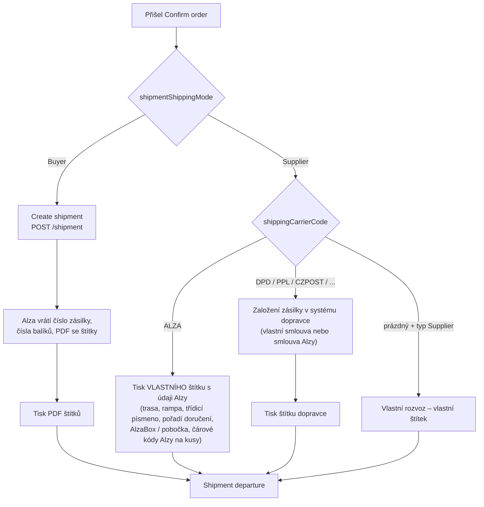

### 7.1 Režim Buyer (ASM) – štítek vytváří Alza

1. Zabalte objednávku, zvažte každý balík.
2. `POST /shipment` s `packages[]` (`packageId`, `weight`, volitelně `volume`) a `items[]` (které `orderItemId` je ve kterém `packageId`).
3. Odpověď `201`: `shipment.shipmentNumber`, `shipment.packages[]` (`packageId`, `number`, `fullNumber`, `pdf`), `shipment.pdf` (všechny štítky v jednom PDF).
4. Stáhněte a vytiskněte PDF, nalepte štítky. **Uložte** číslo zásilky a čísla balíků – budete je potřebovat pro departure.
5. Když se něco změní (počet balíků, váhy) → `DELETE /shipment/{shipment}` a založit znovu. Po odjezdu už to nejde.
6. `POST /shipment/{shipmentNumber}/departure` → odpověď obsahuje PDF **svozového listu**, který předáte řidiči.

### 7.2 Režim Supplier s externím dopravcem (DPD, PPL, CZPOST, …)

Štítek vzniká ve **vašem napojení na dopravce** stejně jako u jakékoli jiné vaší zásilky. Alza potřebuje jen výsledek v `Shipment departure`:

- `packages[].number` – číslo balíku (krátké),
- `packages[].fullNumber` – celý čárový kód ze štítku (jeho část je obvykle sledovací číslo),
- `packages[].ttUrl` – odkaz na sledování zásilky (preferovaný způsob, jak dát Alze správné sledování),
- `shippingCarrier` – skutečný kód dopravce a typ doručení.

U doručení na výdejní místo použijte jako výdejní místo v systému dopravce `parcelShop.parcelShopBranchCode` z Confirm order.

### 7.3 Režim Supplier s vlastní přepravou Alzy (`shippingCarrierCode = ALZA`)

Alza si zboží vyzvedne ve skladu dodavatele a vozí ho přes svá překladiště (linehaul). Dodavatel tiskne **vlastní štítek** s údaji z `Confirm order`. Tři ukázky níže ukazují stejnou objednávku do AlzaBoxu ve třech třídicích skupinách; šipky ukazují, které pole JSON kam patří.

#### Rozložení štítku (AlzaBox, CZ)

| # | Místo na štítku | Obsah | Zdroj |
|---|---|---|---|
| 1 | Vlevo nahoře – *Odesilatel* | Kód dodavatele + země, např. `koddodavatele01 CZ` | První část `route.routeName` (před prvním `->`) |
| 2 | Vpravo nahoře – rámeček | Třídicí písmeno `C` / `L`; u `RegularDirect` **prázdný rámeček** | `packageSorting.packageSortingPrint` |
| 3 | *Příjemce*, velkým písmem | Název AlzaBoxu / pobočky | `deliveryAddress.companyName` |
| 4 | Příjemce – řádky 2–4 | Ulice, PSČ + město, telefon | `deliveryAddress.streetWithNumber`, `zip` + `city`, `phone` |
| 5 | *Č.obj.* | Číslo objednávky dodavatele | ERP dodavatele (SWS: `OrdCode` = `supplierOrder`) |
| 6 | *Č.fakt.* | Číslo faktury dodavatele | ERP dodavatele |
| 7 | *Č.ext.obj.* | Číslo objednávky Alzy, např. `DD20351220` | Číslo objednávky Alzy (`{order}` v URL). V ukázkách se rovná `paymentVS`; SWS tiskne `OrdCodeO` (viz 7.4). API má také `shipmentExternalOrderNumber` *„povinné pro tisk štítku“* |
| 8 | Čárový kód + číslo nad ním | Číslo balíku, např. `1553076346` | Dodavatel – stejné číslo se pak posílá v Shipment departure jako `packages[].number` |
| 9 | Řádek trasy | Trasa bez části odesílatele, např. `CZLC1 → CZLC4 → ZápadD 12` | `route.routeName` |
| 10 | Řádky zastávek | Jeden řádek na zastávku: překladiště + rampa, např. `CZLC1  L10`, `CZLC4  L69` | `route.routeStops[].branchName` + `ramp` |
| 11 | `1 / 1` | Pořadí balíku / počet balíků v zásilce | Dodavatel |
| 12 | Vpravo dole – rámeček | Pořadí doručení, např. `9` | `route.routeDeliveryOrder` |

Netiskne se: `addressName` (jméno zákazníka), `email`, `parcelShopBranchCode` (`AB505`), dobírka (v ukázkách 0).

#### Tři varianty třídění

| Varianta | `packageSortingGroup` | `packageSortingPrint` | Zastávky trasy | Rámeček vpravo nahoře |
|---|---|---|---|---|
| **Direct** | `RegularDirect` | – (neposílá se) | 1 (`CZTC1 / L10`) | prázdný |
| **Linehaul** | `Linehaul` | `L` | 1 (`CZTC1 / L10`) | `L` |
| **Cross** | `CrossLC` | `C` | 2 (`CZTC1 / L10`, `CZLC4 / L69`) – přes cross-dock | `C` |

Balíky z různých skupin se nesmí fyzicky míchat (viz kapitola 6).


> **Poznámka:** v ukázkách je v JSON překladiště `CZTC1`, ale na vytištěném štítku `CZLC1`. Tiskněte přesně to, co Alza pošle v `routeName` / `routeStops`.

U doručení na **pobočku** (Branch) posílá Alza navíc v **Insert order** `orderItems[].alzaBarCodes` – jeden čárový kód na každý kus (např. `BCX3489207239`). **Vytiskněte je (Code-128) a nalepte na každý kus.** Počet kódů odpovídá objednanému množství.

> **[TODO – SWS]** Která sestava / šablona v i6 tiskne štítek `ALZA` a nálepky Alzy na kusy.

### 7.4 Skutečné štítky SWS (16.11.2026)

Fotky ze skladu SWS pořízené 16.11.2026. Odpovídající zprávy z logu jsou v kapitole [9.16](#916-skutečné-objednávky-od-začátku-do-konce-1516112026).

| Štítek | Objednávka | Co na něm je | Rozdíly proti ukázce Alzy (7.3) |
|---|---|---|---|
| AlzaBox – Linehaul | `DD26102128` | Odesílatel `SWS`; rámeček `L`; příjemce = `companyName`, ulice, PSČ + město, telefon; *C.obj* `OP26189264` (= `supplierOrder`), *C.fakt* `26163784`, *C.ext.obj* `DD26102128`; čárový kód balíku `55002350085113`; řádek trasy = celé `routeName`; `1/1`; rámeček `14` = `routeDeliveryOrder` | Zastávky / rampy (`CZTC1 L17`) se **netisknou**; řádek trasy obsahuje i `SWS CZ01 ->`; bez diakritiky (font tiskárny) |
| Pobočka – Cross | `DD26104004` | Rámeček `C`; příjemce Alza.cz Brno; *C.obj* `OP26189329`, *C.fakt* `26163825`, *C.ext.obj* `DD26104004`; balík `55002355016300`; trasa `SWS CZ01 -> CZTC1 -> SKLC3 -> Brno`; `1/1`; spodní rámeček **prázdný** (pobočka nemá `routeDeliveryOrder`) | Rampy `L01` / `L54` se netisknou; **telefon `+420 725 255 800`** je z adresy pobočky uložené v i6 (`ComShipTo` dohledaná podle `deliveryBranchId = 2`), ne ze zprávy (`+420 225 340 111`) |
| Nálepka Alzy na kus | `DD26104004` | Jedna nálepka na každý kus – čárový kód Code-128 `BCX37053037664` + název produktu (*Dell Multimediální klávesnice KB216*); 4 nálepky na 4 kusy `241837` | – |
| DPD (B2C) | `DD26068181` | Tiskne i6 přes napojení na DPD (*16/11/26 12:58 … STO i6*): odesílatel **Alza a.s. – SWS**, Dostihová 1, 763 15 Slušovice; příjemce z `deliveryAddress`; *Vaše obj* `1520784885` = `paymentVS`; 0,4 kg; číslo balíku `13825096178983` (+ kontrolní znak `K`); služba `D-B2C`; směrování DPD `CZ-DPD-2360`, `327-CZ-40747`, `204B`; spodní čárový kód `0040747 13825096178983 327 203` | Číslo balíku = `packages[].number`, spodní čárový kód = `fullNumber` `%004074713825096178983327203` v Shipment departure |

**Co SWS tiskne jako *C.ext.obj*:** číslo objednávky Alzy (`{order}` z URL, uložené v `OrdCodeO`) – ne `paymentVS`.


---

## 8. Jaká data je potřeba ukládat

Vše níže je potřeba buď k odpovědi na pozdější zprávy, ke tvorbě štítků, nebo k řešení reklamací a sporů s Alzou.

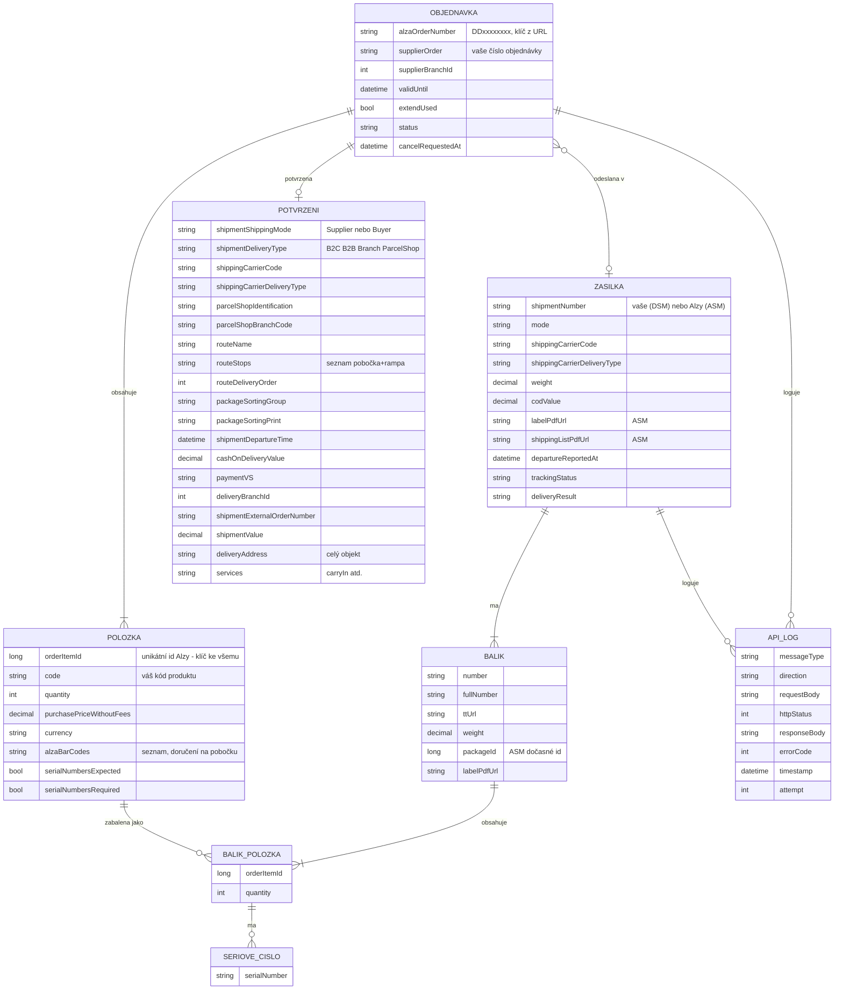

### Minimální checklist

| Co uložit | Proč |
|---|---|
| Číslo objednávky Alzy (`DD…`) ↔ vaše číslo objednávky | Klíč ve všech URL Alzy; v Insert vracíte `supplierOrder`. |
| `orderItemId` u každé položky | Preferovaná identifikace položky v Create shipment / Departure; **povinné při doručení na pobočku**. |
| `alzaBarCodes` | Při doručení na pobočku se musí vytisknout na každý kus. |
| `serialNumbersExpected/Required` | Rozhoduje, zda jsou sériová čísla v departure povinná. |
| `validUntil`, počítadlo prodloužení | Vypršení rezervace, obsluha opakovaného Extend. |
| **Celý obsah Confirm order** | Je to pokyn k expedici (dopravce, režim, adresa, trasa, dobírka, čas odjezdu). Ukládejte i surový JSON. |
| Číslo zásilky, čísla balíků, plná čísla, odkaz na sledování | Posílají se v departure; potřeba pro T&T a podporu. ASM: vrací je Alza. |
| Balík ↔ položka ↔ množství ↔ sériová čísla | Obsah `items[]` v departure. |
| URL PDF štítků / svozového listu (ASM) | Opakovaný tisk. |
| Surový log každého požadavku + odpovědi + HTTP status | Opakování, idempotence, spory s Alzou (podpora Alzy ho vyžaduje). |

> **Datový model SWS:** jak to všechno SWS ukládá v ERP i6 (tabulky, sloupce, id parametrů), popisuje kapitola [9.4](#94-kde-jsou-data-uložená-v-i6).

---

## 9. Jak to dělá SWS (současný stav)

*Podle produkčních SQL procedur v databázi `I6SWS` (ERP i6, stav k 15.11.2026) a logu zpráv. Názvy objektů, ID i data jsou skutečná a neupravená. Věci vyčtené z kódu, které SWS zatím nepotvrdilo, jsou označené „(ověřit)“.*

### 9.1 Architektura

- SWS jede v **režimu Supplier** – čísla zásilek, čísla balíků i štítky si vytváří samo.
- Dopravci v ostrém provozu: **`ALZA`** (vlastní přeprava Alzy ze skladu SWS `CZ01` přes překladiště `CZTC1`, pro AlzaBoxy a pobočky Alzy) a **`DPD`**.
- Middleware **`wsdrop-alza`** (`https://terminal.sws.cz/wsdrop-alza/sws1.ashx`) přijímá JSON od Alzy, převádí ho na XML a volá SQL proceduru. Odchozí zprávy skládají SQL procedury jako JSON a odesílá je middleware.
- Produkční endpoint Alzy, který middleware volá: `https://trade-api.alza.cz/api/v1/`. Middleware zapisuje každou zprávu (původní JSON, oba směry) do denního logu `msg_RRRRMMDD.jsonl` – viz 9.16.
- ID: Alza = firma **`ComId 7993`** v i6; `supplierId 200`, `supplierBranchId 235`; všechny automatické akce běží pod uživatelem i6 **`270` / `DDD`**.
- Každá dropship objednávka má parametr **`ConParSet 434 / 3501`** – podle něj všechny procedury poznají dropship objednávky.

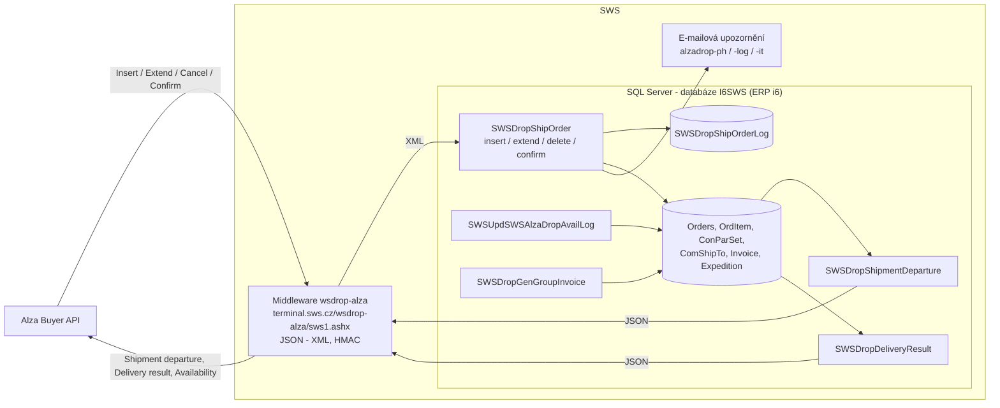

### 9.2 Databázové objekty

| Objekt | Typ | Účel |
|---|---|---|
| `SWSDropShipOrder` | procedura | Zpracuje všechny příchozí zprávy Supplier API (`insert`, `extend`, `delete`, `confirm`). |
| `SWSDropShipmentDeparture` | procedura | Skládá zprávy Shipment departure pro odeslané objednávky. |
| `SWSDropDeliveryResult` | procedura | Skládá zprávy Delivery result (Canceled / Rejected). |
| `SWSDropGenGroupInvoice` | procedura | Slučuje dočasné dropship faktury pro Alzu do jedné souhrnné faktury. |
| `SWSUpdSWSAlzaDropAvailLog` | procedura | Po odeslání dostupnosti uloží snímek „naposledy odesláno“, podle kterého Insert order kontroluje ceny. |
| `SWSDropShipOrderLog` | tabulka | Log každé příchozí zprávy (sloupce `Sdal…`). |
| `SWSAlzaDropAvailLog1` | tabulka | Aktuální nabídka připravená pro Alzu (`LStiId, LQtyFree, LSipPriceOrd, LStiCode, LStiEAN, LTaxRate, LSndStatus`). |
| `SWSAlzaDropAvailLog` | tabulka | Snímek dostupnosti naposledy odeslané Alze. |

### 9.3 Příchozí zprávy – `SWSDropShipOrder`

Parametry: `@typ` (`insert` / `extend` / `delete` / `confirm`), `@OrdCodeO` (číslo objednávky Alzy `DD…`), `@ComId` (7993), `@xml` (zpráva převedená na XML), `@HTTPRespStatus`, `@HTTPResponse`.

#### Logování a idempotence (všechny typy zpráv)

1. Každé volání vloží řádek do `SWSDropShipOrderLog`; `SdalResult` je předvyplněný `-1, || Unspecified error`.
2. Procedura hledá **dřívější stejnou zprávu** (stejný typ + objednávka + XML bez `timestamp`, přes `dbo.SWSRemoveXMLTag`). Dřívější pokusy, které skončily deadlockem / timeoutem (HTTP 500) nebo „Previous request still running“, se ignorují.
   - dřívější ještě běží (zatím bez HTTP statusu) → `-1 Previous request still running`,
   - dřívější je dokončená → **vrátí se znovu stejný výsledek** (bezpečné opakování, jak Alza vyžaduje).
3. Na konci `SdalResult` = `<errorCode>, <zpráva>||<interní text chyby>`.
4. Middleware volá proceduru **podruhé** s `@HTTPRespStatus` + `@HTTPResponse`; toto volání jen uloží, co se Alze skutečně vrátilo, do `SdalHTTPRespStatus` / `SdalHTTPResponse` (max. 500 znaků).

| Sloupec logu | Význam |
|---|---|
| `SdalId` | Id záznamu |
| `SdalComId` | Alza v i6 – `7993` |
| `SdalType` | `insert`, `extend`, `delete`, `confirm` |
| `SdalCode` | Číslo objednávky Alzy (`DD…`) |
| `SdalXML` | Požadavek převedený na XML |
| `SdalResult` | `errorCode, zpráva\|\|interní chyba` |
| `SdalC` | Vytvořeno (datum/čas) |
| `SdalHTTPRespStatus` | HTTP status vrácený Alze |
| `SdalHTTPResponse` | JSON tělo vrácené Alze |

#### Insert order

| # | Kontrola | Odpověď |
|---|---|---|
| 1 | Objednávka `DD…` už v i6 existuje a neexistuje dřívější stejná zpráva | `-1 Invalid Order Number - already exists` |
| 2 | Produkt chybí v aktuální nabídce (`SWSAlzaDropAvailLog1`) nebo je aktuální cena vyšší než cena Alzy | `-3 Out of stock`, `errorProducts[].quantity = 0` |
| 3 | Produkt chybí v naposledy odeslané dostupnosti (`SWSAlzaDropAvailLog`) | `-2 Bad product code` |
| 4 | Kód není spárovaný s produktem i6 (`StoItem` + `CompanyPrice` pro Alzu) | `-2 Bad product code in pairing` |
| 5 | Cena ≠ naposledy odeslaná cena | `-4 Bad product price` |
| 6 | Založí se rezervační objednávka a zablokuje se zboží (`OrdBlock`); zablokované množství ≠ objednané | rollback, `-3 Out of stock` se skutečně zablokovaným množstvím |
| 7 | Počet `alzaBarCodes` ≠ množství | rollback, `-1 Ordered quantity is not same as count AlzaBarCodes` |
| 8 | OK | `0`, `supplierOrder` = `OrdCode` (např. `OP26132530`), `validUntil` = dnes + 7 dní 23:59 |

Co vznikne v i6:

- `Orders`: `OrdCodeO` = číslo objednávky Alzy, `OrdCode` = nové číslo z číselné řady „O“, `OrdYSetId = 3` (rezervační objednávka), `OrdDelTo` = validUntil, `OrdNotCheck = 1`, `OrdNoteExt = 'Dropshipment rezervacni objednavka'`.
- `ConParSet 434 / 3501` na objednávce (značka dropship).
- `OrdItem` za každý řádek (cena = cena Alzy = cena z dostupnosti).
- Parametr `879` na každé položce: `CpsTag` = `orderItemId` Alzy, `CpsTagI` = `serialNumbersRequired`.
- Parametr `880` na každé položce: jeden řádek na každý čárový kód Alzy (`CpsTag` = kód, `CpsTagI` = pořadí 0…n).
- Pokud je nastavený parametr kontaktu `1048`, zboží se nejdřív přebere z jiných (ne-dropship) rezervačních objednávek Alzy (přeblokování, zapisuje se do parametru `964 / 3228`).

#### Extend order

| Kontrola | Odpověď |
|---|---|
| Objednávka nenalezena | `-5 Order number not found` |
| Objednávka už je vyfakturovaná | `-5 Order was sent` |
| Objednávka uzavřená (rezervace vypršela) | `-5 Reservation expired.` |
| Nové `validUntil` je v minulosti | `-5 untilValid is the past` |
| Nové `validUntil` je později než dnes + 9 dní | `-5 untilValid is too long` |
| Už jednou prodlouženo (`WSREQEXTEND` v `OrdNoteExt`) nebo má objednávka `!DDR!` | `-5 only once extend is allowed` |
| OK | `OrdDelTo` = nové validUntil, do `OrdNoteExt` se přidá `WSREQEXTEND <čas>` → `0` + `validUntil` |

#### Cancel order (`delete`)

| Situace | Odpověď | Co se stane |
|---|---|---|
| Objednávka nenalezena | `-5 Order number not found` | |
| Objednávka už je vyfakturovaná (potvrzená a zpracovaná) | `-5 Order was sent` | E-mail expedici: pokud to jde, zastavit zásilku a poslat Delivery result Canceled; pokud už odešel Shipment departure, ponechat `!DSD!` a poslat Delivery result Rejected. |
| Objednávka uzavřená | `0 Order is closed` | Do `OrdNoteExt` se zapíše `WSREQDELETE <čas>` |
| Confirm přišel dřív, ale faktura ještě neexistuje | `0` | Objednávka se vrátí na rezervační, do `OrdNoteInt` `DELETE po CONFIRM`, e-mail „nefakturujte“. |
| Standardně (rezervace) | `0` | `OrdDelTo` = včera, `WSREQDELETE <čas>` v `OrdNoteExt`, `OrdYSetId3Cancel` uvolní rezervaci. |
| Duplicitní číslo `DD…` v i6 | `0` | E-mail na IT. |

#### Confirm order

| Situace | Odpověď |
|---|---|
| Objednávka neznámá a nikdy nepřišel Insert | `-1 Order number not found, CONFIRM without INSERT` |
| Objednávka neznámá, ale Insert je v logu | `-5 Order number not found` |
| Už vyfakturováno (opakovaný confirm) | `0` |
| Objednávka má `!DDR!` (zrušeno ze strany SWS) | `0 Order is marked as DDR` – značka se odstraní |
| Objednávka uzavřená, rezervace vypršela | `0 attempt confirm expired reservation` |
| Objednávka uzavřená | `0 Order is closed` |
| Předchozí confirm spadl v půlce | `0 previous confirm ended with some error` – nutná ruční fakturace |
| Ne všechny položky jsou zablokované | `0 Order was inserted with -3, out of stock or reservation was unblocked, delivery result - canceled` – položky se stornují, následuje Delivery result Canceled |
| Typ doručení není v i6 nastavený | `-5 Contractually unsupported shipping code <kód>` |
| `shipmentShippingMode` není `Supplier` / `Buyer` | `-5 Contractually unsupported shipping mode` |
| Dobírka v jiné měně než CZK / EUR | `-5 Contractually unsupported currency code` |
| PSČ pro CZ / SK nemá 5 číslic | `-5 Delivery Address Error` |
| OK | `0` |

Co udělá úspěšný Confirm:

1. **Mapování dopravce** (viz 9.5): `shippingCarrierDeliveryType` → způsob dopravy i6 (`DelivMode`). Hodnota `Supplier` → `ALZABRANCH`, pokud je `shippingCarrierCode = ALZA`, jinak `DPD`.
2. **Doručovací adresa** (`ComShipTo`):
   - `Branch` + `deliveryBranchId` → použije se existující adresa s `CstId2` = id pobočky,
   - výdejní místa → výdejní místo se dohledá / založí v `DemTOPlace` podle `parcelShopBranchCode` a adresa se z něj vygeneruje (`GenCstFromDtp`),
   - jinak nová adresa; `CstId2` = id pobočky nebo typ doručení, `CstId3` = GLN `8594177950111`; z PSČ se odstraní `@` (Alza ho občas posílá).
3. **Objednávka** se upraví: `OrdYSetId = 0` (běžná objednávka), potvrzuje 270/DDD, `OrdCstId`, `OrdDemId`, `OrdDelFrom` = požadované datum, `OrdTagD` = `shipmentDepartureTime`, `OrdTag2` = `shipmentDeliveryType`.
4. **Objednávky mimo pobočky** (B2C / B2B / ParcelShop): přepnou se na B2C (`OrdAsB2C`), dobírková cena položek se nastaví na 0,01 a přidá se korekční položka **`DROPSHIPKOREKCE`** (StiId `498094`), aby součet dobírky odpovídal `cashOnDeliveryValue`; nastaví se dobírková varianta dopravy (`OrdZDemIdO`).
5. Na objednávku se uloží **parametry** (viz 9.4).
6. Hned se vytvoří **faktura** (`InvAutoCreate`, typ 73); u objednávek mimo pobočky `InvZVal` = dobírka. Parametr kontaktu `945` řídí souhrnnou fakturaci (hodnota `3822` → dočasné faktury pod uživatelem `97573`, které později sloučí `SWSDropGenGroupInvoice`). Položky s podmíněným prodejem (`OriSalePerm`) se nefakturují – zapíše se chyba.

> **Poznámka:** `shipmentShippingMode = Buyer` se přijme, ale SWS nemá logiku pro Create shipment – taková objednávka by se zpracovala jako režim Supplier. **[TODO – SWS]** potvrdit, že Alza SWS nikdy `Buyer` neposílá.

### 9.4 Kde jsou data uložená v i6

`ConParSet` je obecná tabulka parametrů v i6: `CpsConId` = id záznamu (objednávka, položka, způsob dopravy, faktura), `CpsCpaId` = id parametru, `CpsCpvId` = id hodnoty z číselníku, `CpsTag` = textová hodnota, `CpsTagI` = celé číslo.

| Pole API | Uložení v i6 |
|---|---|
| Číslo objednávky Alzy (`{order}`, `DD…`) | `Orders.OrdCodeO` |
| `supplierOrder` | `Orders.OrdCode` |
| `validUntil` | `Orders.OrdDelTo` |
| Značka dropship | `ConParSet` 434 / hodnota 3501 na objednávce |
| `orderItemId`, `serialNumbersRequired` | `ConParSet` 879 na `OrdItem` (`CpsTag`, `CpsTagI`) |
| `alzaBarCodes[]` | `ConParSet` 880 na `OrdItem`, jeden řádek na kód (`CpsTagI` = pořadí) |
| `code`, `quantity`, cena | `OrdItem.OriStiCode`, `OriQty`, `OriPrcCur` |
| `shipmentDeliveryType` | `Orders.OrdTag2` |
| `shipmentDepartureTime` | `Orders.OrdTagD` |
| `demandedExpeditionDate` | `Orders.OrdDelFrom` |
| `shippingCarrier` | `Orders.OrdDemId` (dobírková varianta `OrdZDemIdO`) |
| `deliveryAddress`, `deliveryBranchId` | `ComShipTo` přes `Orders.OrdCstId` (`CstId2` = id pobočky) |
| `parcelShop.parcelShopBranchCode` | `DemTOPlace.DtpCode` |
| `paymentVS` | `ConParSet` 888 (`CpsTag`) |
| `shipmentValue` + měna | `ConParSet` 889, formát `hodnota\|měna` |
| `cashOnDeliveryValue` + měna | `ConParSet` 890, formát `hodnota\|měna`; také `Invoice.InvZVal` |
| `route.routeName` | `ConParSet` 1186 |
| `route.routeStops[]` | `ConParSet` 1187, formát `pobočka\|rampa\|\|pobočka\|rampa` |
| `route.routeDeliveryOrder` | parametr `DRO` „RouteDeliveryOrder“ (skupina ALZ) |
| `packageSorting` | parametr `DPG` „DropPackSortGroup“ (skupina ALZ): `CpvValue` = skupina, `CpvCode` = tiskové písmeno |
| Log zpráv | `SWSDropShipOrderLog` |
| Stavové značky | `Orders.OrdTag`, `OrdNoteExt`, `OrdNoteInt`, `Expedition.ExpNoteInt` (viz 9.8) |
| Balíky | `Expedition` (`ExpCodeO` číslo balíku, `ExpCodeS` krátké číslo DPD, `ExpWeight`, `ExpDateS` odesláno), přes `ExpDocuments` napojené na dodací list (typ 68) nebo fakturu (typ 73) |
| Sériová čísla | `Warranty` (za expedici a produkt), čte je `dbo.SWSGetWarSerialNoForOrderAndExpedition` |

**Dnes se neukládá:** `shipmentExternalOrderNumber`, `shipmentDeliveryServices`, `parcelShopIdentification` (jen kód pobočky), `regNo` / `vatNo`. Surový JSON je jen v souborových logech middleware `msg_RRRRMMDD.jsonl` (viz 9.16), ne v databázi.

### 9.5 Mapování dopravců

- Způsoby dopravy i6 (`DelivMode`) jsou s kódy Alzy propojené parametrem `ConParSet` **900**: `CpsTag` = `shippingCarrierDeliveryType` Alzy.
- Pro každý kód existuje běžná doprava (`DemType = 0`), dobírková varianta (`DemType = 2`) a případně varianta pro pobočky (`CpsTagI = -1`, použije se pro `Branch`).
- V Shipment departure se jako `shippingCarrierCode` posílá `DemNameE` a jako `shippingCarrierDeliveryType` hodnota `CpsTag` parametru 900.
- `DemDtp = 1` = doprava na výdejní místa (používá `DemTOPlace`).
- Nenastavené kódy se odmítnou s `-5 Contractually unsupported shipping code`.

> **[TODO – SWS]** Seznam nastavených způsobů dopravy – výsledek dotazu:
> `SELECT DemId, DemCode, DemNameE, DemType, DemDtp, DemMaxWeight, CpsTag, CpsTagI FROM DelivMode JOIN ConParSet ON DemId = CpsConId AND CpsCpaId = 900`

### 9.6 Shipment departure – `SWSDropShipmentDeparture`

**Výběr:** dropship objednávky, které jsou uzavřené (`OrdClosed = 1`), mají expedici s číslem balíku (`ExpCodeO`), jsou odeslané (`ExpDateS` vyplněné, `ExpDateC` prázdné), ještě nemají `!DSD!` a nejsou zrušené (`!DDR!`). Expedice se dohledá přes dodací list (68) nebo fakturu (73).

**Číslo zásilky** (`{shipment}` v URL):

| Formát | Kdy |
|---|---|
| `<OrdId>x<nejnižší ExpId>A` | Standardně – jedna zásilka na objednávku se všemi balíky |
| `<OrdId>x<ExpId>B` | Pobočka – jedna zásilka na expedici (konsolidace), položky všech objednávek v ní |
| `<OrdId>x<ExpId>C` | Objednávka na pobočku rozdělená do více expedic – každá se posílá zvlášť |
| přípona `AAy` / `By` | Ruční doposlání pro jednu objednávku (`@OrdId`), např. `6955290x8715633AAy` |

**Číslo balíku:**

| Dopravce | `packages[].number` | `packages[].fullNumber` |
|---|---|---|
| DPD (`DemCode` 1) | `ExpCodeS` | `ExpCodeO` |
| Zásilkovna (`DemCode` 29) | `ExpCodeO` bez prvního znaku | `ExpCodeO` |
| Ostatní (ALZA, …) | `ExpCodeO` | `ExpCodeO` |

**Další pole:**

- `shippingCarrier` = `DemNameE` + parametr 900.
- `cashOnDeliveryValue` / `shipmentValue` z parametrů 890 / 889 (typ A). U B / C je dobírka 0 a **`shipmentValue` se nikdy neposílá** (výpočet v kódu je mrtvý – `CASE WHEN NULL IS NULL`) a `packages[].weight` se posílá jako text (viz 9.16).
- `shipmentWeight` = `ExpWeight`, omezené `DemMaxWeight`.
- `items[]`: `order`, `packageNumber`, `quantity` (`Warranty.WarQty`), `orderItemId` (parametr 879), `code`, `serials` (z `Warranty`; pokud je sériové číslo kratší než 4 znaky nebo je „Fuser unit 230V“, **posílá se místo něj číslo objednávky**). Korekční položka se vynechává.
- Neposílá se: `expectedDeliveryDate`, `ttUrl`, `deliveryAddress`, `shipmentVolume`.
- Pravidlo „ne před `shipmentDepartureTime`“ je v kódu **vypnuté** (komentář: dohoda s Alzou a kolize s konsolidací na pobočky).
- Po úspěšném odeslání se nastaví `!DSD!` v `OrdTag` (u poboček v `Expedition.ExpNoteInt`) – dělá to middleware (ověřit).

**Natvrdo zadané výjimky** v proceduře (jednorázové opravy konkrétních objednávek): ExpId `6867391`, `7080553`, `8571708`, `8770543`, `8781021`; OrdId `5136469`, `6808692`, `7010557`, `7021326`. Do nové implementace by se přenášet neměly.

### 9.7 Delivery result – `SWSDropDeliveryResult`

SWS posílá jen **Canceled** a **Rejected** – nikdy Delivered.

| Případ | Podmínka | `status` | `errorReason` |
|---|---|---|---|
| Zboží chybí / rezervace vypršela | Dropship objednávka s položkami, které nejsou plně zablokované ani odeslané, nezrušená Alzou (`WSREQDELETE`), neprobíhá přeblokování (`!DROP!` v `OrdNoteInt`), starší než 10 min | Canceled | `expired reservation` (pořád rezervace) nebo `poslední poškozený kus` |
| Balík se vrátil | Příjemka vratky (`LMPurchase`, `PurXPusId = 6`), jejíž kód odpovídá odeslanému balíku (`ExpCodeO` / `ExpCodeS`; DPD: podřetězec od 8. nebo 9. znaku) | Rejected | `zakaznik neprevzal` |
| Zrušeno po odjezdu | Cancel od Alzy (`WSREQDELETE`) poté, co už odešel `!DSD!` | Rejected | `send DELETE after CONFIRM` |
| Ruční volání (`@OrdId`, `@Type`) | 1 / 2 / 3 / 4 | Canceled / Canceled / Rejected / Canceled | `expired reservation` / `poslední poškozený kus` / `zakaznik neprevzal` / `chyba pri confirm` |

`paymentVS` se bere z parametru 888. Po odeslání se nastaví `!DDR!` v `OrdTag`. Skutečné příklady (Canceled `DD26073359`, Rejected `DD25313597`) jsou v 9.16.

### 9.8 Stavové značky na objednávce

| Značka | Kde | Význam |
|---|---|---|
| `OrdYSetId = 3` | `Orders` | Rezervační objednávka (po Insert, před Confirm) |
| `OrdYSetId = 0` | `Orders` | Běžná objednávka (po Confirm) |
| `!DSD!` | `OrdTag` / `Expedition.ExpNoteInt` (pobočky) | Shipment departure odeslán |
| `!DDR!` | `OrdTag` | Delivery result odeslán |
| `!E!DDR!` | `OrdTag` | Chyba Delivery result (ověřit) |
| `WSREQEXTEND <čas>` | `OrdNoteExt` | Extend přijat (jen jednou) |
| `WSREQDELETE <čas>` | `OrdNoteExt` | Přišel Cancel od Alzy |
| `DELETE po CONFIRM` | `OrdNoteInt` | Cancel přišel po Confirm, před fakturou |
| `!DROP!` | `OrdNoteInt` | Probíhá přeblokování – neposílat Delivery result |
| `Branch`, `B2C`, … | `OrdTag2` | `shipmentDeliveryType` |

### 9.9 Dostupnost

- `SWSAlzaDropAvailLog1` = aktuální nabídka pro Alzu (volné množství, nákupní cena, kód, EAN, sazba DPH, `LSndStatus`).
- V živých logech (11.–17.11.2026) posílá SWS každou noc import `Full` (~01:32) **i** `PartialFull` (~03:32, po 10 000 produktech) a pár jednopoložkových zpráv `Update` v noci – vše ve starém cenovém režimu. Viz 9.16.
- Po odeslání `SWSUpdSWSAlzaDropAvailLog` zkopíruje řádky s `LSndStatus ≤ 1` do `SWSAlzaDropAvailLog` (tabulka se předtím vyprázdní, pokud neexistují řádky se stavem 4) a stav jim zvýší o 3 (= odesláno).
- Insert order porovnává cenu Alzy s oběma tabulkami (viz 9.3).

> **[TODO – SWS]** Procedura, která plní `SWSAlzaDropAvailLog1` (výpočet skladu a ceny), skládání zprávy a význam hodnot `LSndStatus`.

### 9.10 Fakturace

- Confirm vytvoří fakturu (typ 73) ke každé objednávce.
- Faktura jde Alze přes **EDI** (INVOIC přes EDIStore) – ne přes Trade API. U dropshipping objednávek se DESADV neposílá. Příklad v 9.18.
- `SWSDropGenGroupInvoice` (Alza `ComId 7993`) vezme dočasné faktury (`InvNumTmp = 1`) dropship objednávek, jejichž skladové položky jsou všechny vydané, nejnovější přidělí ostré číslo (`NumUpd`, `InvCodeO` = variabilní symbol), ostatní do ní sloučí (`InvJoin`), prázdné smaže, nastaví parametr `944 / 3600` a `InvState = 1`. Výsledek: **jedna souhrnná faktura pro Alzu**.

### 9.11 E-mailová upozornění

Odesílá Database Mail (profil `DataSQL IBM`) na `alzadrop-ph@SWS.cz; alzadrop-log@SWS.cz`, v kopii `alzadrop-it@SWS.cz`:

- Cancel u objednávky, která už je vyfakturovaná – ručně zastavit zásilku / poslat Delivery result.
- Cancel po Confirm bez faktury – „nefakturujte“.
- Duplicitní číslo `DD…` u cancel / extend / confirm.

### 9.12 Známé problémy a technický dluh

- Natvrdo zadaná ID objednávek / expedic v `SWSDropShipmentDeparture` (jednorázové opravy).
- Číslo objednávky posílané jako sériové číslo, když platné sériové číslo chybí.
- `shipmentDepartureTime` se nevynucuje.
- Režim `Buyer` se přijme, ale není implementovaný (žádný Create shipment).
- Žádný Track and Trace, žádný Delivery result Delivered, v departure chybí `ttUrl`.
- Nevyužívaná nová pole Alzy: `shipmentExternalOrderNumber`, `shipmentDeliveryServices`, chystané `shipmentDeliveryAddress`, `glnList`.
- Natvrdo zadané konstanty: `ComId 7993`, uživatel `270 / DDD`, id parametrů, GLN `8594177950111`, korekční položka `498094`, e-mailové adresy.
- Problémy nalezené v logech (smyčka kvůli PSČ, nekonečné smyčky Delivery result, zdvojené zásilky na pobočky, HMAC token v logu) popisuje 9.20.
- Dostupnost používá zastaralý import `Full` a starý cenový režim (`price`, `priceWithFee`, `fee`, `vat`).
- Departure na pobočku (typ B / C): chybí `shipmentValue`, váha balíku se posílá jako text.

### 9.13 Příklad – AlzaBox přes přepravu Alzy

`Confirm order` (jako XML po převodu v SWS, záznam logu 592251, objednávka `DD23779989`):

```xml
<orders>
  <timestamp>2026-08-18T20:44:01.303</timestamp>
  <customerId>7993</customerId><supplierId>200</supplierId><supplierBranchId>235</supplierBranchId>
  <regNo>27082440</regNo><vatNo>CZ27082440</vatNo>
  <shippingCarrier>
    <shippingCarrierCode>ALZA</shippingCarrierCode>
    <shippingCarrierDeliveryType>ALZABOX</shippingCarrierDeliveryType>
  </shippingCarrier>
  <parcelShop>
    <parcelShopIdentification>ALZABOX</parcelShopIdentification>
    <parcelShopBranchCode>AB3478</parcelShopBranchCode>
  </parcelShop>
  <route>
    <routeName>SWS CZ01 -&gt; CZTC1 -&gt; Východní Čechy L 12*</routeName>
    <routeStops><branchName>CZTC1</branchName><ramp>L17</ramp></routeStops>
    <routeDeliveryOrder>6</routeDeliveryOrder>
  </route>
  <shipmentDeliveryType>ParcelShop</shipmentDeliveryType>
  <shipmentShippingMode>Supplier</shipmentShippingMode>
  <cashOnDeliveryValue>0</cashOnDeliveryValue><cashOnDeliveryValueCurrency>CZK</cashOnDeliveryValueCurrency>
  <packageSorting><packageSortingGroup>Linehaul</packageSortingGroup><packageSortingPrint>L</packageSortingPrint></packageSorting>
  <demandedExpeditionDate>2026-08-19</demandedExpeditionDate>
  <shipmentDepartureTime>2026-08-19T14:30:00</shipmentDepartureTime>
  <paymentVS>1504853468</paymentVS>
  <deliveryAddress>
    <companyName>Liberec - Staré Pavlovice - Hrdinů</companyName>
    <addressName>Filip Frýba</addressName>
    <streetWithNumber>Hrdinů 34/30</streetWithNumber><city>Liberec</city>
    <phone>+420775146569</phone><email>filipfryba0@gmail.com</email>
    <country>CZ</country><zip>46001</zip>
  </deliveryAddress>
  <shipmentValue>1782</shipmentValue><shipmentValueCurrency>CZK</shipmentValueCurrency>
</orders>
```

→ SWS vytiskne vlastní štítek s trasou `CZTC1 / L17`, pořadím doručení `6`, třídicím písmenem `L` a AlzaBoxem `AB3478`.

### 9.14 Příklad – pobočka Alzy přes přepravu Alzy (konsolidace)

`Confirm order` pro `DD23764935` (záznam logu 591993):

```xml
<orders>
  <timestamp>2026-08-18T11:25:21.76</timestamp>
  <customerId>7993</customerId><supplierId>200</supplierId><supplierBranchId>235</supplierBranchId>
  <regNo>27082440</regNo><vatNo>CZ27082440</vatNo>
  <shippingCarrier><shippingCarrierCode>ALZA</shippingCarrierCode><shippingCarrierDeliveryType>Supplier</shippingCarrierDeliveryType></shippingCarrier>
  <route>
    <routeName>SWS CZ01 -&gt; CZTC1 -&gt; CZLC4 -&gt; Čakovice</routeName>
    <routeStops><branchName>CZTC1</branchName><ramp>L05</ramp></routeStops>
    <routeStops><branchName>CZLC4</branchName><ramp>L53</ramp></routeStops>
  </route>
  <shipmentDeliveryType>Branch</shipmentDeliveryType>
  <shipmentShippingMode>Supplier</shipmentShippingMode>
  <cashOnDeliveryValue>0</cashOnDeliveryValue><cashOnDeliveryValueCurrency>CZK</cashOnDeliveryValueCurrency>
  <packageSorting><packageSortingGroup>CrossLC</packageSortingGroup><packageSortingPrint>C</packageSortingPrint></packageSorting>
  <demandedExpeditionDate>2026-08-19</demandedExpeditionDate>
  <shipmentDepartureTime>2026-08-19T14:30:00</shipmentDepartureTime>
  <paymentVS>1504752017</paymentVS>
  <deliveryAddress>
    <companyName>alza.cz Čakovice</companyName><addressName></addressName>
    <streetWithNumber>Kostelecká 823/77</streetWithNumber><city>Praha</city>
    <phone>+420 225 340 111</phone><email>sales.cakovice@alza.cz</email>
    <country>CZ</country><zip>19600</zip>
  </deliveryAddress>
  <deliveryBranchId>4255</deliveryBranchId>
  <shipmentValue>74750</shipmentValue><shipmentValueCurrency>CZK</shipmentValueCurrency>
</orders>
```

`shippingCarrierDeliveryType = Supplier` + dopravce `ALZA` → SWS to převede na `ALZABRANCH`. Odpovídající Insert order obsahoval 25 kusů `DLS01306` s 25 kódy `alzaBarCodes` (`BCX35076959731` … `BCX350769597325`) – jedna nálepka na každý kus. Pozdější Cancel (záznam 592168) byl odmítnut s `-5 Order was sent`.

### 9.15 Příklad – Shipment departure přes DPD (ruční doposlání)

Zalogované volání endpointu middleware `shipdep` (ten zprávu předá na `POST /shipment/{shipment}/departure` Alzy – ověřit) pro objednávku `DD23334255` (v i6 `OrdId 6955290`). Číslo zásilky končí na `AAy` = ruční doposlání; podle komentáře v `SWSDropShipmentDeparture` šlo o jednorázovou akci 7.8.2026, kdy se potvrzoval jen produkt `848007` = balík `13825096221168`.

```text
POST https://terminal.sws.cz/wsdrop-alza/sws1.ashx/shipdep?shipment=6955290x8715633AAy
```

```json
{
  "shippingCarrier": { "shippingCarrierCode": "DPD", "shippingCarrierDeliveryType": "DPD" },
  "cashOnDeliveryValue": 0.00, "cashOnDeliveryValueCurrency": "CZK",
  "shipmentValue": 3032.00, "shipmentValueCurrency": "CZK",
  "shipmentWeight": 0.80000,
  "packages": [
    { "number": "13825096221168", "weight": 0.80000, "fullNumber": "%007030013825096221168327203" }
  ],
  "items": [
    { "order": "DD23334255", "packageNumber": "13825096221168", "quantity": 1,
      "orderItemId": 3471466988, "code": "848007", "serials": ["201040003001V00EMR"] }
  ]
}
```

Odpověď Alzy: `200 {"errorCode":0,"errorMessage":""}`.

### 9.16 Skutečné objednávky od začátku do konce (15.–16.11.2026)

Zdroj: log zpráv middleware `msg_20261115.jsonl`, `msg_20261116.jsonl` (jeden řádek JSON na zprávu). Na rozdíl od SQL logu obsahuje **původní JSON** a také to, co middleware posílá Alze.

| Pole logu | Význam |
|---|---|
| `time` | Čas zprávy |
| `exchangeId` | Páruje požadavek s odpovědí |
| `direction` | `in` = middleware přijal, `out` = middleware odeslal |
| `partner` | `client` = kdo volá middleware (Alza u objednávkových zpráv, job SWS u `shipdep` / `delivr` / `alzaavail`); `alza` = volání `https://trade-api.alza.cz/api/v1/` |
| `operation`, `url`, `query` | Endpoint |
| `httpStatus`, `body` | Status a tělo odpovědi |

#### Časová osa tří vyfocených zásilek

| Čas | Objednávka | Zpráva | Směr | Výsledek |
|---|---|---|---|---|
| 15.11. 12:34:47 | `DD26068181` | Insert – `LNC01121` × 1 | A→S | `0`, `OP26188783`, platí do 22.11. 23:59 |
| 15.11. 12:55:41 | `DD26068181` | Confirm – `DPD` / `DPD`, `B2C`, `RegularDirect`, odjezd 16.11. 23:30 | A→S | `0` (13 s) |
| 16.11. 10:49:02 | `DD26102128` | Insert – `653979` × 1 | A→S | `0`, `OP26189264`, platí do 23.11. 23:59 |
| 16.11. 11:10:18 | `DD26102128` | Confirm – `ALZA` / `ALZABOX` `AB4136`, `Linehaul` `L`, pořadí doručení 14, odjezd 18.11. 14:00 | A→S | `0` (12 s) |
| 16.11. 11:42:09 | `DD26104004` | Insert – `241837` × 4 se 4 `alzaBarCodes` | A→S | `0`, `OP26189329`, platí do 23.11. 23:59 |
| 16.11. 11:43:17 | `DD26104004` | Confirm – `ALZA` / `Supplier` (→ `ALZABRANCH`), `Branch` id 2 Brno, `CrossLC` `C`, odjezd 18.11. 14:00 | A→S | `0` (12 s) |
| 16.11. ~12:50 | všechny tři | Vytištěné štítky, fotky | – | |
| 16.11. 13:16:07 | `DD26068181` | Shipment departure `7032719x8792565A` | S→A | `200`, `0` |
| 16.11. 13:23 | `DD26102128`, `DD26104004` | EDI INVOIC `FV26163784` + `FV26163825` přes EDIStore, interchange `8307924`, `8307931` (dodací listy `DV26226106`, `DV26226152`) | S→A | Status `A` v EDIStore (vloženo 13:26:15–16), viz 9.18 |
| 16.11. 15:00:33 | `DD26102128` | Shipment departure `7033242x8792555A` | S→A | `200`, `0` |
| 16.11. 15:06:30 | `DD26104004` | Shipment departure `7033321x8792554B` | S→A | `200`, `0` |

Co z logu vyplývá:

- **Departure se posílá, když balík opustí SWS, ne v `shipmentDepartureTime`.** Obě zásilky `ALZA` byly nahlášené 16.11., přestože Alza chtěla 18.11. 14:00 – Alza to přijala (viz 9.6).
- **Confirm trvá 12–13 s** (adresa, faktura) – hluboko pod timeoutem Alzy 80 s. Insert trvá 1–3 s.
- **Číslo zásilky** = `<OrdId>x<ExpId>` + `A` (jedna objednávka) / `B` (pobočka, konsolidace).
- **Departure na pobočku (typ B):** `packages[].weight` se posílá jako **text** (`"2.40000"`) a **chybí `shipmentValue`**, přestože Confirm obsahoval `1504` – Alza obojí přijala.
- **Tok odchozích zpráv přes middleware:** job SWS pošle JSON fragment ze SQL procedury na `sws1.ashx/shipdep?shipment=…` jako `{"shpdep": "…"}`; middleware doplní `supplierId`, `supplierBranchId`, `timestamp`, pošle to na `https://trade-api.alza.cz/api/v1/shipment/{shipment}/departure` a odpověď Alzy vrátí jobu.

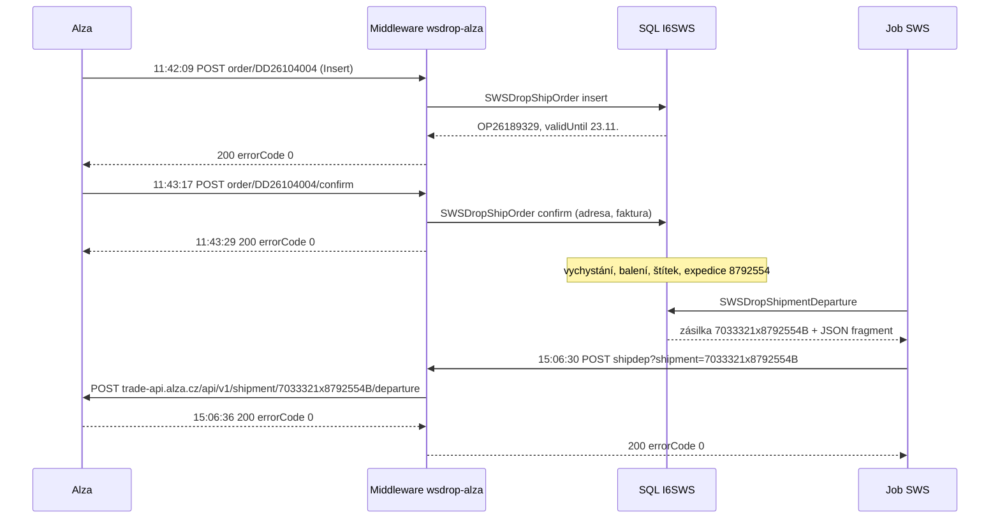

#### Objednávka `DD26104004` – pobočka Brno, CrossLC (kompletní zprávy)

Insert order – požadavek od Alzy:

```json
{"timestamp":"2026-11-16T11:42:09.333","customerId":7993,"supplierId":200,"supplierBranchId":235,
 "regNo":"27082440","vatNo":"CZ27082440","itemsPriceCurrency":"CZK",
 "orderItems":[{"orderItemId":3705303766,"code":"241837","quantity":4,"unitPrice":235.57,"purchasePriceWithoutFees":235.57,
   "alzaBarCodes":["BCX37053037661","BCX37053037662","BCX37053037663","BCX37053037664"],
   "serialNumbersExpected":false,"serialNumbersRequired":false}]}
```

Odpověď SWS (`200`):

```json
{"errorCode":0,"errorMessage":"","supplierOrder":"OP26189329","validUntil":"2026-11-23T23:59:00.000"}
```

Confirm order – požadavek od Alzy (odpověď `200 {"errorCode":0,"errorMessage":""}`):

```json
{"timestamp":"2026-11-16T11:43:17.357","customerId":7993,"supplierId":200,"supplierBranchId":235,
 "regNo":"27082440","vatNo":"CZ27082440",
 "shippingCarrier":{"shippingCarrierCode":"ALZA","shippingCarrierDeliveryType":"Supplier"},
 "route":{"routeName":"SWS CZ01 -> CZTC1 -> SKLC3 -> Brno",
          "routeStops":[{"branchName":"CZTC1","ramp":"L01"},{"branchName":"SKLC3","ramp":"L54"}]},
 "shipmentDeliveryType":"Branch","shipmentShippingMode":"Supplier",
 "cashOnDeliveryValue":0.0,"cashOnDeliveryValueCurrency":"CZK",
 "packageSorting":{"packageSortingGroup":"CrossLC","packageSortingPrint":"C"},
 "demandedExpeditionDate":"2026-11-18","shipmentDepartureTime":"2026-11-18T14:00:00.000","paymentVS":"1521022333",
 "deliveryAddress":{"companyName":"Alza.cz Brno","addressName":"Skála","streetWithNumber":"Skořepka 336/15","city":"Brno",
                    "phone":"+420 225 340 111","email":"sales.brno@alza.cz","country":"CZ","zip":"60200"},
 "deliveryBranchId":2,"shipmentValue":1504.0,"shipmentValueCurrency":"CZK"}
```

Shipment departure – middleware posílá Alze (odpověď `200 {"errorCode":0,"errorMessage":""}`):

```text
POST https://trade-api.alza.cz/api/v1/shipment/7033321x8792554B/departure
```

```json
{"supplierId":200,"supplierBranchId":235,"timestamp":"2026-11-16T15:06:30.594",
 "shippingCarrier":{"shippingCarrierCode":"ALZA","shippingCarrierDeliveryType":"ALZABRANCH"},
 "cashOnDeliveryValue":0.0,"cashOnDeliveryValueCurrency":"CZK","shipmentWeight":2.4,
 "packages":[{"number":"55002355016300","weight":"2.40000","fullNumber":"55002355016300"}],
 "items":[{"order":"DD26104004","packageNumber":"55002355016300","quantity":4,"orderItemId":3705303766,"code":"241837"}]}
```

#### Objednávka `DD26102128` – AlzaBox AB4136, Linehaul

Confirm order – požadavek od Alzy (Insert: `653979` × 1 → `OP26189264`):

```json
{"timestamp":"2026-11-16T11:10:17.467","customerId":7993,"supplierId":200,"supplierBranchId":235,
 "regNo":"27082440","vatNo":"CZ27082440",
 "shippingCarrier":{"shippingCarrierCode":"ALZA","shippingCarrierDeliveryType":"ALZABOX"},
 "parcelShop":{"parcelShopIdentification":"ALZABOX","parcelShopBranchCode":"AB4136"},
 "route":{"routeName":"SWS CZ01 -> CZTC1 -> OLD2 - Východní Čechy M 12",
          "routeStops":[{"branchName":"CZTC1","ramp":"L17"}],"routeDeliveryOrder":14},
 "shipmentDeliveryType":"ParcelShop","shipmentShippingMode":"Supplier",
 "cashOnDeliveryValue":0.0,"cashOnDeliveryValueCurrency":"CZK",
 "packageSorting":{"packageSortingGroup":"Linehaul","packageSortingPrint":"L"},
 "demandedExpeditionDate":"2026-11-18","shipmentDepartureTime":"2026-11-18T14:00:00.000","paymentVS":"1521013923",
 "deliveryAddress":{"companyName":"Šimonovice - Buková (Hospůdka U Potůčku)","addressName":"Štěpán Hanuš",
                    "streetWithNumber":"Buková 17","city":"Šimonovice","phone":"+420737829254",
                    "email":"hanus.stepan@gmail.com","country":"CZ","zip":"46312"},
 "shipmentValue":1074.0,"shipmentValueCurrency":"CZK"}
```

Shipment departure Alze – `POST …/shipment/7033242x8792555A/departure`:

```json
{"supplierId":200,"supplierBranchId":235,"timestamp":"2026-11-16T15:00:33.270",
 "shippingCarrier":{"shippingCarrierCode":"ALZA","shippingCarrierDeliveryType":"ALZABOX"},
 "cashOnDeliveryValue":0.0,"cashOnDeliveryValueCurrency":"CZK","shipmentValue":1074.0,"shipmentValueCurrency":"CZK",
 "shipmentWeight":0.1,
 "packages":[{"number":"55002350085113","weight":0.1,"fullNumber":"55002350085113"}],
 "items":[{"order":"DD26102128","packageNumber":"55002350085113","quantity":1,"orderItemId":3705169209,"code":"653979"}]}
```

#### Objednávka `DD26068181` – DPD, B2C

Confirm order – požadavek od Alzy (Insert: `LNC01121` × 1 → `OP26188783`). U DPD obsahuje `routeName` jen odesílatele (`SWS CZ01`):

```json
{"timestamp":"2026-11-15T12:55:40.203","customerId":7993,"supplierId":200,"supplierBranchId":235,
 "regNo":"27082440","vatNo":"CZ27082440",
 "shippingCarrier":{"shippingCarrierCode":"DPD","shippingCarrierDeliveryType":"DPD"},
 "route":{"routeName":"SWS CZ01"},
 "shipmentDeliveryType":"B2C","shipmentShippingMode":"Supplier",
 "cashOnDeliveryValue":0.0,"cashOnDeliveryValueCurrency":"CZK",
 "packageSorting":{"packageSortingGroup":"RegularDirect"},
 "demandedExpeditionDate":"2026-11-16","shipmentDepartureTime":"2026-11-16T23:30:00.000","paymentVS":"1520784885",
 "deliveryAddress":{"companyName":"","addressName":"jiri Ledvinka","streetWithNumber":"ZITAVSKA 3000","city":"Varnsdorf",
                    "phone":"+420774085346","email":"jirka1236@seznam.cz","country":"CZ","zip":"40747"},
 "shipmentValue":699.0,"shipmentValueCurrency":"CZK"}
```

Shipment departure Alze – `POST …/shipment/7032719x8792565A/departure`:

```json
{"supplierId":200,"supplierBranchId":235,"timestamp":"2026-11-16T13:16:07.681",
 "shippingCarrier":{"shippingCarrierCode":"DPD","shippingCarrierDeliveryType":"DPD"},
 "cashOnDeliveryValue":0.0,"cashOnDeliveryValueCurrency":"CZK","shipmentValue":699.0,"shipmentValueCurrency":"CZK",
 "shipmentWeight":0.4,
 "packages":[{"number":"13825096178983","weight":0.4,"fullNumber":"%004074713825096178983327203"}],
 "items":[{"order":"DD26068181","packageNumber":"13825096178983","quantity":1,"orderItemId":3702664480,"code":"LNC01121"}]}
```

#### Ostatní zprávy 16.11.2026

| Operace | Kdo volá koho | Počet |
|---|---|---|
| `alzaavail` | Job SWS → middleware (ptá se na změny dostupnosti; odpověď `{nic k aktualizaci}` = není co posílat) | 37 441 |
| `availability` | Middleware → Alza (`Full` v 01:33, 2× `Update`, `PartialFull` v 03:32 ve 2 částech) | 5 |
| `order/{DD}` (Insert) | Alza → SWS | 270 |
| `order/{DD}/confirm` | Alza → SWS | 246 |
| `order/{DD}/extend` | Alza → SWS | 8 |
| `shipdep` → `shipment/{s}/departure` | Job SWS → middleware → Alza | 452 |
| `delivr` → `order/{DD}/delivery` | Job SWS → middleware → Alza | 130 |
| Cancel, Create / Delete shipment, Track and Trace | – | 0 |

Příklad Delivery result (objednávka `DD26073359`, `POST https://trade-api.alza.cz/api/v1/order/DD26073359/delivery`, odpověď `200 {"errorCode":0,"errorMessage":""}`):

```json
{"supplierId":200,"supplierBranchId":235,"timestamp":"2026-11-16T08:34:08.169",
 "status":"Canceled","statusTimestamp":"2026-11-16T08:26:03.170","errorReason":"poslední poškozený kus","paymentVS":"1520822927"}
```

Příklad Delivery result **Rejected** – balík se vrátil, zákazník ho nepřevzal (objednávka `DD25313597`). Job SWS volá middleware, middleware to předá Alze:

```text
POST /wsdrop-alza/sws1.ashx/delivr?order=DD25313597                       13:34:14.791  (job SWS → middleware)
POST https://trade-api.alza.cz/api/v1/order/DD25313597/delivery          13:34:14.791  (middleware → Alza)
200 {"errorCode":0,"errorMessage":""}                                    13:34:19.931  (Alza → middleware)
```

```json
{"supplierId":200,"supplierBranchId":235,"timestamp":"2026-11-16T13:34:14.791",
 "status":"Rejected","statusTimestamp":"2026-11-16T13:26:03.140",
 "errorReason":"zakaznik neprevzal","paymentVS":"1515532933"}
```

`statusTimestamp` (13:26:03) je čas, kdy job SWS vratku vyhodnotil (`GETDATE()` v `SWSDropDeliveryResult`); zpráva odešla o 8 minut později. Dřívější zprávy této objednávky (Insert, Confirm, departure) jsou starší než dostupné logy (11.–17.11.2026).

Příklad Availability `Update` (`POST https://trade-api.alza.cz/api/v1/availability`, 02:52:59, odpověď `200`):

```json
{"supplierId":200,"supplierBranchId":235,"timestamp":"2026-11-16T02:52:59.850","importType":"Update","currency":"CZK",
 "productList":[{"code":"847010","ean":"0617885021244","quantity":78,"price":309.6,"vat":21,"priceWithFee":312.96,"fee":3.36}]}
```

SWS pořád používá **zastaralý** import `Full` a **starý cenový režim** (`price`, `priceWithFee`, `fee`, `vat`); Alza doporučuje `PartialFull` a `countryPrices`.


### 9.17 Objednávky `DD26102128`, `DD26104004` a `DD26068181` v ERP i6

Jak vypadají tři vyfocené objednávky z 9.16 v i6 po Confirm. Parametry jsou na záložce parametrů objednávky (uložení viz 9.4). Názvy parametrů jsou uvedené tak, jak jsou v i6, s anglickým popisem.

**Čísla dokladů:**

| Položka | `DD26102128` (AlzaBox, Linehaul) | `DD26104004` (pobočka Brno, Cross) | `DD26068181` (DPD, B2C) | Odkud se bere |
|---|---|---|---|---|
| Alza order number | `DD26102128` | `DD26104004` | `DD26068181` | `{order}` v URL → `Orders.OrdCodeO` |
| i6 order number | `OP26189264` | `OP26189329` | `OP26188783` | `Orders.OrdCode`, vrací se jako `supplierOrder` |
| i6 order id | `7033242` | `7033321` | `7032719` | `Orders.OrdId` – první část čísla zásilky |
| Expedition id | `8792555` | `8792554` | `8792565` | `Expedition.ExpId` – druhá část čísla zásilky |
| Shipment number | `7033242x8792555A` | `7033321x8792554B` | `7032719x8792565A` | Posílá se v Shipment departure (`A` = jedna objednávka, `B` = pobočka) |
| Package number | `55002350085113` | `55002355016300` | `13825096178983` (DPD) | `Expedition.ExpCodeO` (DPD: `ExpCodeS`), čárový kód na štítku |
| Invoice | `FV26163784` | `FV26163825` | – (nedodáno) | Faktura typ 73, vytvoří ji Confirm (na štítku číslo bez `FV`) |
| Delivery note | `DV26226106` | `DV26226152` | – (nedodáno) | Odkaz v EDI faktuře (`RFF+DQ`); u dropshippingu se DESADV neposílá (9.18) |

**Parametry objednávek (screenshoty z ERP i6, 16.11.2026):**

| Parametr i6 | Popis (EN) | `DD26102128` | `DD26104004` | `DD26068181` | Pole API (Confirm order) | Uložení |
|---|---|---|---|---|---|---|
| `Rezervace` | Reservation type = dropship marker | – (není na screenshotu) | `Alza DropShipment` | `Alza DropShipment` | – (nastaví Insert) | `ConParSet` 434 / hodnota 3501 |
| `Externí poznámka` | External note (processing state) | – (není na screenshotu) | `(2) Nezpracovaná` = *(2) Unprocessed* | – | – | (ověřit) |
| `DropPackSortGroup` | Package sorting group | `Linehaul` (tiskové písmeno `L`) | `CrossLC` (tiskové písmeno `C`) | `RegularDirect` (bez písmena) | `packageSorting` | parametr `DPG` |
| `RouteDeliveryOrder` | Route delivery order | `14` | – (pobočka nemá) | – | `route.routeDeliveryOrder` | parametr `DRO` |
| `DropRouteName` | Route name | `SWS CZ01 -> CZTC1 -> OLD2 - Východní Čechy M 12` | `SWS CZ01 -> CZTC1 -> SKLC3 -> Brno` | `SWS CZ01` (jen odesílatel) | `route.routeName` | `ConParSet` 1186 |
| `DropRouteStops` | Route stops (`branch\|ramp\|\|branch\|ramp`) | `CZTC1\|L17` | `CZTC1\|L01\|\|SKLC3\|L54` | – (DPD nemá zastávky) | `route.routeStops[]` | `ConParSet` 1187 |
| `InvZCode` (*požadovaný kód B2C faktury*) | Requested B2C invoice code = payment variable symbol | `1521013923` | `1521022333` | `1520784885` (na štítku DPD jako *Vaše obj*) | `paymentVS` | `ConParSet` 888 |
| `DropShipValue` | Shipment value (`value\|currency`) | `1074.00\|CZK` | `1504.00\|CZK` | `699.00\|CZK` | `shipmentValue` + měna | `ConParSet` 889 |
| `DropCashDelivValue` | Cash on delivery (`value\|currency`) | `0.00\|CZK` | `0.00\|CZK` | `0.00\|CZK` | `cashOnDeliveryValue` + měna | `ConParSet` 890 |

Parametry se ukládají jen tehdy, když je hodnota v Confirm vyplněná – proto DPD objednávka nemá zastávky ani pořadí doručení a objednávka na pobočku nemá pořadí doručení.

`shipmentValue` je hodnota zboží pro koncového zákazníka (1 074 / 1 504 / 699 Kč). Faktura Alze (9.18) vychází z nákupní ceny: 847,58 / 1 146,26 Kč s DPH.

### 9.18 EDI – faktura Alze (INVOIC)

Trade API faktury nepřenáší. SWS fakturuje Alze zvlášť přes **EDI** – EANCOM **INVOIC D.01B (EAN011)** – přes EDI poskytovatele **EDIStore** (portál se sekcemi Orders, Despatch Adv, Invoices, Receiving Adv, Returns Ann, Interchanges, Order Rsp). Každá dropship objednávka má vlastní **fakturu** (`FV…`). Dodací list (`DV…`) je ve faktuře jen jako odkaz – **u dropshipping objednávek se DESADV neposílá** (DESADV se používá jen u standardních objednávek `OB…`, viz kapitola 2).

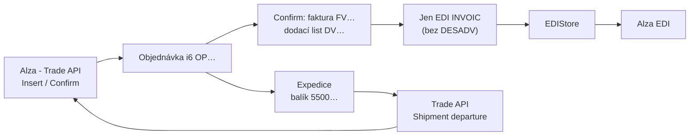

**Záznamy v EDIStore (Invoices):**

| Pole | `DD26102128` | `DD26104004` |
|---|---|---|
| Status | `A` | `A` |
| Invoice number | `FV26163784` | `FV26163825` |
| DTS (DUZP) | 16.11.2026 | 16.11.2026 |
| Supplier / Buyer | SWS a.s. / Alza.cz a.s. | SWS a.s. / Alza.cz a.s. |
| Insert date | 16.11.2026 13:26:15 | 16.11.2026 13:26:16 |
| Buyer's CIN (IČ odběratele) | `27082440` | `27082440` |
| Issue date | 16.11.2026 | 16.11.2026 |
| Document type | INVOICE | INVOICE |
| Total | 847,58 Kč | 1 146,26 Kč |
| Interchange number | `8307924` | `8307931` |
| GLN delivery place | `8594177950111` | `8594177950111` |
| Order number | `DD26102128` | `DD26104004` |
| DESADV number (jen odkaz na dodací list) | `DV26226106` | `DV26226152` |

Obě faktury odešly ve stejném běhu (UNB 16.11.2026 13:23) – dřív, než balíky fyzicky odjely (Shipment departure 15:00 / 15:06).

**Struktura zprávy (segment po segmentu):**

| Segment | `DD26102128` | `DD26104004` | Význam |
|---|---|---|---|
| `UNB` | ref. `8307924` | ref. `8307931` | Interchange `8594157000003` (SWS) → `8594177950005` (Alza), 16.11.2026 13:23; reference = číslo interchange v EDIStore |
| `UNH` | `863491` | `863498` | Hlavička zprávy `INVOIC:D:01B:UN:EAN011` |
| `USH`, `USA`, `USC` … `UST`, `USR` | | | Elektronický podpis, certifikát `0161CC0C` – *Jaroslav Tomášek* |
| `BGM` | `FV26163784` | `FV26163825` | `380` obchodní faktura, `9` originál |
| `DTM+137` / `+325` / `+35` | 20261116 | 20261116 | Datum dokladu / DUZP / datum dodání |
| `PAI` | `::42` | `::42` | Platba převodem |
| `FTX+AAI` | | | *Firma je zapsána v OR vedeném KS v Brně, odd. B, vl. 1773* |
| `RFF+ON` | `DD26102128` | `DD26104004` | **Číslo objednávky odběratele = objednávka Alzy** |
| `RFF+VN` | `OP26189264` | `OP26189329` | Číslo objednávky dodavatele (i6) |
| `RFF+DQ` | `DV26226106` | `DV26226152` | Číslo dodacího listu – jen odkaz, u dropshippingu se DESADV neposílá |
| `NAD+BY` | | | Odběratel `8594177950005` Alza.cz a.s., Jankovcova 1522/53, Praha – Holešovice, 17000; DIČ `CZ27082440`, IČ `27082440` |
| `NAD+DP` | | | Místo dodání `8594177950111` – stejný GLN, který i6 zapisuje do `ComShipTo.CstId3` (9.3) |
| `NAD+IV` | | | Příjemce faktury `8594177950005` |
| `NAD+SU` | | | Dodavatel `8594157000003` SWS a.s., Dostihová 1, Slušovice, 763 15; DIČ `CZ699000207`, IČ `63485826` |
| `FII+RB` | VS `26163784` | VS `26163825` | Účet `1000490200/3500`, ING `INGBCZPP`, IBAN `CZ8435000000001000490200` |
| `NAD+SF` | | | Místo odeslání `8594157000003` |
| `CUX` | `CZK` | `CZK` | Měna |
| `PAT` + `DTM+13` | 15.01.2027 | 15.01.2027 | Datum splatnosti |
| `LIN 1` | EAN `0191200521539`, `653979` *Lenovo adaptér ThinkPad 65W AC USB-C Standard*, 1 ks | EAN `5397184820964`, `241837` *Dell Multimediální klávesnice KB216 – čeština/slovenština (QWERTZ)*, 4 ks | Položka |
| `PRI+AAB` | 699,72 | 235,57 | Jednotková cena = nákupní cena Alzy z Insert (`purchasePriceWithoutFees`) |
| `ALC` + `MOA+8` | 0,76 | 5,04 (4 × 1,26) | Recyklační poplatek (*RECYKLACNI POPLATEK*) |
| `PRI+AAA` / `MOA+203` | 700,48 / 700,48 | 236,83 / 947,32 | Jednotková cena s poplatkem / částka řádku, DPH 21 % |
| `LIN 2` | `DROPSHIPKOREKCE`, 1 ks, 0,00, DPH 0 % | – | Korekční položka, kterou Confirm přidává **jen u objednávek mimo pobočky** (9.3) – fakturuje se s nulovou hodnotou |
| `CNT+2` | 2 | 1 | Počet řádků |
| `MOA+79` / `+125` | 700,48 | 947,32 | Součet řádků / základ daně |
| `MOA+176` / `+124` | 147,10 | 198,94 | DPH (21 %) |
| `MOA+86` / `+9` | **847,58** | **1 146,26** | Celkem faktura / k úhradě |
| `UNT` | 73 segmentů | 62 segmentů | Konec zprávy |
| `UNZ` | `8307924` | `8307931` | Konec interchange |

#### Kompletní zpráva – `DD26102128` (FV26163784)

```text
UNB+UNOD:3+8594157000003:14+8594177950005:14+261116:1323+8307924++INVOIC+++EANCOM'
UNH+863491+INVOIC:D:01B:UN:EAN011'
USH+94W+1+01+1+1+2+2+1+++863491+1:20261116:132333'
USA+1:0:1:48:1'
USC+0161CC0C+3:Jaroslav Tomášek:8594157000003'
BGM+380+FV26163784+9'
DTM+137:20261116:102'
DTM+325:20261116:102'
DTM+35:20261116:102'
PAI+::42'
FTX+AAI+++Firma je zapsána v OR vedeném KS v Brne, odd.B, vl.1773'
RFF+ON:DD26102128'
DTM+171:20261116:102'
RFF+VN:OP26189264'
RFF+DQ:DV26226106'
DTM+171:20261116:102'
NAD+BY+8594177950005::9++Alza.cz a.s.+Jankovcova 1522/53+Praha - Holešovice++17000+CZ'
RFF+VA:CZ27082440'
RFF+GN:27082440'
NAD+DP+8594177950111::9+++++++CZ'
NAD+IV+8594177950005::9'
NAD+SU+8594157000003::9++SWS a.s.+Dostihová 1+Slušovice++763 15+CZ'
FII+RB+1000490200:0008:26163784+3500:::INGBCZPP::::CZ8435000000001000490200'
RFF+VA:CZ699000207'
RFF+GN:63485826'
NAD+SF+8594157000003::9'
CUX+2:CZK:4'
PAT+3'
DTM+13:20270115:102'
LIN+1++0191200521539:SRV::9'
PIA+1+653979:SA'
IMD+F++:::Z'
IMD+E+ANM+:::Lenovo adaptér ThinkPad 65W AC USB-C Standard'
QTY+47:1:PCE'
MOA+203:700.48'
PRI+AAB:699.72'
PRI+AAA:700.48'
RFF+ON:DD26102128'
RFF+DQ:DV26226106'
TAX+7+VAT+++:::21'
ALC+C+RECYKLACNI POPLATEK++1+AEO'
MOA+8:0.76'
LIN+2++:SRV::9'
PIA+1+DROPSHIPKOREKCE:SA'
IMD+F++:::S'
IMD+E+ANM+:::Korekce celkové cástky pro DropShip/WS obj'
QTY+47:1:PCE'
MOA+203:0'
PRI+AAB:0'
PRI+AAA:0'
RFF+ON:DD26102128'
RFF+DQ:DV26226106'
TAX+7+VAT+++:::0'
UNS+S'
CNT+2:2'
MOA+86:847.58'
MOA+79:700.48'
MOA+125:700.48'
MOA+74:0'
RFF+ZZZ:0'
MOA+113:0'
MOA+176:147.1'
MOA+9:847.58'
MOA+165:0'
TAX+7+VAT+++0:::0'
MOA+125:0'
TAX+7+VAT+++2:::21'
MOA+125:700.48'
MOA+124:147.1'
TAX+7+EXC'
MOA+176:0'
UST+01'
USR+20D229AA3E847D1C8B9232E1ADB8858B1A775B267F29798A2F61CDCC4812719925ECF56915572A96E736F2EC2AC17CBA6600996BDB464EF93F7653B2635B 173D89BF1DF7052DC1A73CBB75CA4A3F35C5B7A14BA5C5E14D6E97728F479432239E83BC13AE34E8B51480443A0CF6E3181583D841530D614CBAA7FCCA7E4258 6F778740A8548D911CE3B62E6CB9DF0F57E013476887DDF2F10AC139958ECA5A490AC7736FC286AA31E57CF7C76D93037DE2282A8BADC99DB6513A86523DFB99 AA16AD057808AD5D91E8B104003747A883893E36119AB80F950AC11C1F477CB8EA93E268F781B3F002BAC66DD0458F1C3C631290991945100E5F99ED2F62AE7C 12C350B5A57D2105033AFF09076CD7721179D415C0097B1A9081B44AED22CA675BD0F1875D649C77D7957E5631349CE46D13453CD55FAE18737B08CC5A5D1D81 EE127080C45C927AAD04C855C40C9F5E8C504297160DB7603082EB00E51A7E8DA1A5C535C8B6A47CEECC312B42769145C224D70B1CA6C670D1F16DE85C5B0ABF 9E2F054EFFB446F23D87C2ADF1C4C9376F788E6D0A2C2904DE956219013B815BAC820E00835D09205A002A0687DC57B357B1FD9BB0800CF4CEB9F19F08FF61AA 46D122BFCDF871CBD4F5C4AA0C67ECBB1B43891A8F5D2FAA7E732F4FCC94516A34B42C43030AAFB6801446AE9E49AB1F51DDC30805AD2A96F4BE5DF21CB7FDD4 F547'
UNT+73+863491'
UNZ+1+8307924'
```

#### Kompletní zpráva – `DD26104004` (FV26163825)

```text
UNB+UNOD:3+8594157000003:14+8594177950005:14+261116:1323+8307931++INVOIC+++EANCOM'
UNH+863498+INVOIC:D:01B:UN:EAN011'
USH+94W+1+01+1+1+2+2+1+++863498+1:20261116:132335'
USA+1:0:1:48:1'
USC+0161CC0C+3:Jaroslav Tomášek:8594157000003'
BGM+380+FV26163825+9'
DTM+137:20261116:102'
DTM+325:20261116:102'
DTM+35:20261116:102'
PAI+::42'
FTX+AAI+++Firma je zapsána v OR vedeném KS v Brne, odd.B, vl.1773'
RFF+ON:DD26104004'
DTM+171:20261116:102'
RFF+VN:OP26189329'
RFF+DQ:DV26226152'
DTM+171:20261116:102'
NAD+BY+8594177950005::9++Alza.cz a.s.+Jankovcova 1522/53+Praha - Holešovice++17000+CZ'
RFF+VA:CZ27082440'
RFF+GN:27082440'
NAD+DP+8594177950111::9+++++++CZ'
NAD+IV+8594177950005::9'
NAD+SU+8594157000003::9++SWS a.s.+Dostihová 1+Slušovice++763 15+CZ'
FII+RB+1000490200:0008:26163825+3500:::INGBCZPP::::CZ8435000000001000490200'
RFF+VA:CZ699000207'
RFF+GN:63485826'
NAD+SF+8594157000003::9'
CUX+2:CZK:4'
PAT+3'
DTM+13:20270115:102'
LIN+1++5397184820964:SRV::9'
PIA+1+241837:SA'
IMD+F++:::Z'
IMD+E+ANM+:::Dell Multimediální klávesnice KB216 - ceština/slovenština (QWERTZ) - c'
QTY+47:4:PCE'
MOA+203:947.32'
PRI+AAB:235.57'
PRI+AAA:236.83'
RFF+ON:DD26104004'
RFF+DQ:DV26226152'
TAX+7+VAT+++:::21'
ALC+C+RECYKLACNI POPLATEK++1+AEO'
MOA+8:5.04'
UNS+S'
CNT+2:1'
MOA+86:1146.26'
MOA+79:947.32'
MOA+125:947.32'
MOA+74:0'
RFF+ZZZ:0'
MOA+113:0'
MOA+176:198.94'
MOA+9:1146.26'
MOA+165:0'
TAX+7+VAT+++0:::0'
MOA+125:0'
TAX+7+VAT+++2:::21'
MOA+125:947.32'
MOA+124:198.94'
TAX+7+EXC'
MOA+176:0'
UST+01'
USR+787E9F8248F512912D9D69DFE94FED9FF94841AC429ACD6F10BDABF2E2B2A1235BED6E3E0DA654D815F9DA5B2F60ACE8E593B82A831AAB29C5A126E8FF98 9C74F6893ABE088708CF540B1CB5A6DEB769A933BC0FACFE777B3A96C061F65A97063CD5C3C40B88F1EE94663E71F685782E44B5A7A983F5ED7B62D7D7BF30F9 0964CD0F88F4CD8C772E27B8CDD8BACB73257C64B8AF891130B5F7B82596580ADA1639CB59991DB033567AA92873ACBD857B8B4D8FBF78F4C7A87AE3C70B8E56 286ADC8ACDD449975A8FD6C9B5F20BA2764216ACA7E93337DC7705210946154AFBC685B9B636C92492B7BB504D5A6E263941BAD4A3D8F0F13A076E8B80DE194D 05FA51A04FFA8CC4475A69526BEF08C859329239C379F76595AC9E643F8A86B714C0210E56A83A34C5E1D21199EEE7D290A03311DE75D782ACE099257D938D94 29D2A79C003A290C37D3CD1E8C73AA6A6B4959C230F15A03EE396CCD2E74F216778C38645895A7E5E29BAA9D479A73BF4CC1E8CD8F3F3E4EB4918782B2DED40A 985C9A7A59F01E50ADD1F86A57D535915E3AD7EE0C0998A1679E1E54FE35632B33B66E1F1AF34962E10D69C6E861D841B8FB11EDC4561547544A718E6B6BBFCE DEFB56C3BEBC14C3FCADEBC5B662336E271EAD91F31EF794F4B73A112E4AF4773F3FA246A98652AEC156A19FB8B1A9E7349BFB4FF701172D567572FD53383F52 A34A'
UNT+62+863498'
UNZ+1+8307931'
```

### 9.19 EDI – standardní objednávka `OB26238498` (ORDERS)

Pro srovnání s dropshippingem: běžná nákupní objednávka Alzy, která přichází přes **EDI ORDERS** (EANCOM **ORDERS D.01B, EAN010**) přes EDIStore (viz kapitola 2). SWS na ni odpovídá zprávami DESADV a INVOIC – jejich ukázky se ještě doplní (otevřený bod 15).

**Shrnutí:**

| Položka | Hodnota |
|---|---|
| Číslo objednávky | `OB26238498` |
| Datum objednávky | 16.11.2026 |
| Požadované datum dodání | 23.11.2026 |
| Přijato | 17.11.2026 14:59 (interchange `661313343`) |
| Odběratel | Alza.cz a.s., GLN `8594177950005`, nákupčí Lukáš Plško |
| Místo dodání | **Alza.cz CZLC4**, Severní 255, 252 19 Chrášťany, GLN `8594177950173` – sklad Alzy (stejné `CZLC4` jako v trasách Trade API) |
| Dodavatel | SWS a.s., GLN `8594157000003` |
| Řádky | 4 řádky, 20 ks, informativní cena 191 Kč / ks (3 820 Kč) |

**Struktura zprávy (segment po segmentu):**

| Segment | Obsah | Význam |
|---|---|---|
| `UNB` | `8594177950005` → `8594157000003`, 17.11.2026 14:59, ref. `661313343`, `ORDERS` | Interchange od Alzy do SWS |
| `UNH` | `588704362`, `ORDERS:D:01B:UN:EAN010` | Hlavička zprávy |
| `BGM` | `220`, `OB26238498`, `9` | Objednávka, číslo, originál |
| `DTM+137` | 20261116 | Datum objednávky |
| `DTM+2` | 20261123 | Požadované datum dodání |
| `FTX+PUR` | *AOR, Fujifilm INSTAX - PLu, AOSOD621686, Lukáš Plško* | Poznámka nákupu (kategorie / nákupčí / interní reference) |
| `NAD+BY` + `RFF+VA` / `RFF+GN` | `8594177950005` Alza.cz a.s., Jankovcova 1522/53, Praha 7, 17000; DIČ `CZ27082440`, IČ `27082440` | Odběratel |
| `CTA+OC` + `COM` | *Sales and Purcha: Lukáš Plško*, `+420778766749`, `Lukas.Plsko@alza.cz` | Kontakt odběratele (`?+` = escapované `+`) |
| `NAD+DP` | `8594177950173` Alza.cz CZLC4, Severní 255, Chrášťany, 25219, CZ | **Místo dodání – sklad Alzy** |
| `CTA+OC` + `COM` | *Sklad: Kontakt*, `+420 778 957 526`, `expedice.chrastany@alza.cz` | Kontakt na sklad |
| `NAD+IV` | `8594177950005` Alza.cz a.s. | Příjemce faktury |
| `NAD+SU` + `RFF` | `8594157000003` SWS a.s., Dostihová 1, Slušovice, 76315; DIČ `CZ699000207`, IČ `63485826` | Dodavatel |
| `CTA+OC` + `COM` | *Sklad: Kontakt*, `+420577640111`, `region4@sws.cz` | Kontakt na sklad dodavatele |
| `NAD+OB` | `8594177950005` | Objednal |
| `CUX` | `CZK` (`9` = měna objednávky) | Měna |
| `LIN` | EAN | Řádek, zboží určené EAN |
| `PIA+5 …:SA` | např. `FJF00124` | **Číslo zboží dodavatele = kód produktu SWS** (stejný typ kódu jako `code` v Trade API) |
| `PIA+5 …:IN` | např. `OF245a13a13` | Číslo zboží odběratele (Alzy) |
| `IMD+E` | Název produktu | Popis |
| `QTY+21` | např. 7 PCE | Objednané množství |
| `DTM+2` | 20261123 | Požadované datum dodání řádku |
| `PRI+INF` | 191 | Informativní cena za kus |
| `UNS`, `UNT`, `UNZ` | 54 segmentů, `661313343` | Oddělovač, konec zprávy / interchange |

**Řádky objednávky:**

| # | EAN | Kód SWS (`SA`) | Kód Alzy (`IN`) | Produkt | Množství | Cena |
|---|---|---|---|---|---|---|
| 1 | `8720094754659` | `FJF00124` | `OF245a13a13` | Fotoalbum Fujifilm instax mini 13 PHOTO ALBUM – Candy Pink | 7 | 191 |
| 2 | `8720094754642` | `FJF00123` | `OF245a13a12` | Fotoalbum Fujifilm instax mini 13 PHOTO ALBUM – Lagoon Green | 3 | 191 |
| 3 | `8720094754666` | `FJF00125` | `OF245a13a14` | Fotoalbum Fujifilm instax mini 13 PHOTO ALBUM – Dreamy Purple | 5 | 191 |
| 4 | `8720094754673` | `FJF00126` | `OF245a13a15` | Fotoalbum Fujifilm instax mini 13 PHOTO ALBUM – Clay White | 5 | 191 |

**Rozdíly proti dropshipping objednávce:**

| | `OB…` (EDI ORDERS) | `DD…` (Trade API) |
|---|---|---|
| Kam se dodává | Sklad Alzy (`NAD+DP`, zde CZLC4 Chrášťany, GLN `8594177950173`) | Koncový zákazník, AlzaBox nebo pobočka Alzy (`deliveryAddress`) |
| Rezervace / zrušení / prodloužení | – | Insert, Extend, Cancel |
| Pokyn k expedici | Jen požadované datum dodání (`DTM+2`) | Confirm: dopravce, trasa, třídění, čas odjezdu |
| Identifikace zboží | EAN + kód SWS + kód Alzy | `code` SWS + `orderItemId` Alzy |
| Cena | Informativní cena (`PRI+INF`) | Nákupní cena z Availability (`purchasePriceWithoutFees`) |
| Odpověď Alze | DESADV + INVOIC (EDI) | Shipment departure, Delivery result (Trade API) + INVOIC (EDI) |
| GLN místa dodání na faktuře | Sklad Alzy | `8594177950111` (9.18) |

Kompletní zpráva:

```text
UNB+UNOD:3+8594177950005:14+8594157000003:14+261117:1459+661313343++ORDERS+++EANCOM'
UNH+588704362+ORDERS:D:01B:UN:EAN010'
BGM+220+OB26238498+9'
DTM+137:20261116:102'
DTM+2:20261123:102'
FTX+PUR+++AOR, Fujifilm INSTAX - PLu, AOSOD621686, Lukáš Plško '
NAD+BY+8594177950005::9++Alza.cz a.s.+Jankovcova 1522/53+Praha 7++17000'
RFF+VA:CZ27082440'
RFF+GN:27082440'
CTA+OC+Sales and Purcha:Lukáš Plško'
COM+?+420778766749:TE'
COM+Lukas.Plsko@alza.cz:EM'
NAD+DP+8594177950173::9++Alza.cz CZLC4+Severní 255+Chrášťany++25219+CZ'
CTA+OC+Sklad:Kontakt'
COM+?+420 778 957 526:TE'
COM+expedice.chrastany@alza.cz:EM'
NAD+IV+8594177950005::9++Alza.cz a.s.'
NAD+SU+8594157000003::9++SWS a.s.+Dostihová 1+Slušovice++76315'
RFF+VA:CZ699000207'
RFF+GN:63485826'
CTA+OC+Sklad:Kontakt'
COM+?+420577640111:TE'
COM+region4@sws.cz:EM'
NAD+OB+8594177950005::9'
CUX+2:CZK:9'
LIN+1++8720094754659:SRV'
PIA+5+FJF00124:SA'
PIA+5+OF245a13a13:IN'
IMD+E+ANM::9+:::Fotoalbum Fujifilm instax mini 13 PHOTO ALBUM – Candy Pink'
QTY+21:7:PCE'
DTM+2:20261123:102'
PRI+INF:191'
LIN+2++8720094754642:SRV'
PIA+5+FJF00123:SA'
PIA+5+OF245a13a12:IN'
IMD+E+ANM::9+:::Fotoalbum Fujifilm instax mini 13 PHOTO ALBUM – Lagoon Green'
QTY+21:3:PCE'
DTM+2:20261123:102'
PRI+INF:191'
LIN+3++8720094754666:SRV'
PIA+5+FJF00125:SA'
PIA+5+OF245a13a14:IN'
IMD+E+ANM::9+:::Fotoalbum Fujifilm instax mini 13 PHOTO ALBUM – Dreamy Purple'
QTY+21:5:PCE'
DTM+2:20261123:102'
PRI+INF:191'
LIN+4++8720094754673:SRV'
PIA+5+FJF00126:SA'
PIA+5+OF245a13a15:IN'
IMD+E+ANM::9+:::Fotoalbum Fujifilm instax mini 13 PHOTO ALBUM – Clay White'
QTY+21:5:PCE'
DTM+2:20261123:102'
PRI+INF:191'
UNS+S'
UNT+54+588704362'
UNZ+1+661313343'
```


### 9.20 Veškerá komunikace v logech (11.–17.11.2026)

Úplný průchod logy middleware `msg_20261111.jsonl` … `msg_20261117.jsonl` (≈ 1,26 milionu řádků). Kapitola uvádí **každý typ zprávy, který se vyskytl**, všechny odpovědi, které se objevily, a nalezené incidenty a zvláštnosti.

**Pokrytí logů:**

| Soubor | Období | Řádků | Poznámka |
|---|---|---|---|
| `msg_20261111.jsonl` | 11.11. 07:46 – 13:28 | 1 360 | Logování začalo 11.11.; po 13:28 nic |
| `msg_20261112.jsonl` | 12.11. 00:00 – 23:58 | 209 911 | |
| `msg_20261113.jsonl` | 13.11. 00:06 – 23:59 | 215 468 | |
| `msg_20261114.jsonl` | 14.11. 00:06 – 23:59 | 404 612 | Většinou dotazování `alzaavail` |
| `msg_20261115.jsonl` | 15.11. 00:00 – 20:06 | 242 897 | Log končí ve 20:06 – poslední požadavek (Cancel `DD26074147`) nemá odpověď |
| `msg_20261116.jsonl` | 16.11. 00:06 – 23:56 | 78 268 | |
| `msg_20261117.jsonl` | 17.11. 00:00 – 21:09 | 105 030 | |

#### Katalog všech typů zpráv

| # | Zpráva | Směr | Endpoint | Počet | Zjištěné odpovědi |
|---|---|---|---|---|---|
| 1 | Insert order | A→S | `POST sws1.ashx/order/{DD}` | 1 799 | `200` / `0` (1 134); `400` / `-3` *Out of stock* (32); `500` SQL timeout / deadlock (499); **bez odpovědi** (134) |
| 2 | Confirm order | A→S | `POST sws1.ashx/order/{DD}/confirm` | 1 846 | `200` / `0` (1 078, z toho *previous confirm ended with some error* 2×, *attempt confirm expired reservation* 1×); `400` / `-5` *Delivery Address Error – Bad Post Code* (327); `400` / `-1` *Previous request still running* (177); `500` (249); bez odpovědi (15) |
| 3 | Extend order | A→S | `POST sws1.ashx/order/{DD}/extend` | 44 | `200` / `0` + `validUntil` (16); `400` / `-5` *only once extend is allowed* (24); `500` deadlock (4) |
| 4 | Cancel order | A→S | `DELETE sws1.ashx/order/{DD}` | 90 | `200` / `0` (70); `400` / `-5` *Order was sent* (19); bez odpovědi (1) |
| 5 | Shipment departure | S→A | job → `sws1.ashx/shipdep` → `trade-api…/shipment/{s}/departure` | 1 116 | `200` (1 098); `400` / `-2` *Unexpected high quantity.* (7); `400` / `-2` *Serial number … is with the customer. Cannot be reused!* (1); `500` / `-1` *Internal SQL Server error. Please resend…* (na straně Alzy, 6); `403` HTML stránka (1); `520`, `525` Cloudflare (1 + 1); síťová chyba (1) |
| 6 | Delivery result | S→A | job → `sws1.ashx/delivr` → `trade-api…/order/{DD}/delivery` | 210 | `200` (87); `400` / `-5` *Can't reject delivered order!* (61); `400` / `-5` *Can´t rejected claimed order!. Contact AlzaTrade support!* (55); `400` / `-5` *Invalid order state for delivery result!* (7) |
| 7 | Availability | S→A | middleware → `trade-api…/availability` | 25 | `200` / `0` (všechny) |
| 8 | `alzaavail` (interní spouštěč) | job → middleware | `GET sws1.ashx/alzaavail?type=0/1/2` | 622 392 | `200` *{nic k aktualizaci}* nebo se odešle dostupnost (řádek 7) |
| – | Create shipment, Delete shipment, Track and Trace | – | – | **0** | SWS je nepoužívá |
| – | Chybové kódy `-4`, `-6`, `-7`, HTTP `429` | – | – | **0** | Nikdy se nevyskytly |

**Odchylky HTTP statusů SWS (middleware) od pravidel API:** úspěšný Insert dostane `200` (API čeká `201`); `-3` *Out of stock* se vrací s `400` (API preferuje `200`, přijme obojí); chyby SQL se vrací jako `500` se surovým textem chyby SQL – Alza je bere jako „nedoručeno“ a posílá znovu.

#### Varianty Confirm order v logu (1 070 různých objednávek)

| Dopravce / typ doručení | `shipmentDeliveryType` | Objednávek | Z toho SK |
|---|---|---|---|
| `ALZA` / `ALZABOX` | `ParcelShop` | 813 | 192 |
| `DPD` / `DPD` | `B2B` | 100 | 23 |
| `ALZA` / `Supplier` (→ `ALZABRANCH`) | `Branch` | 90 | 18 |
| `DPD` / `DPD` | `B2C` | 53 | 8 |
| `GebruderWeiss` / `GebruderWeissStandard` | `B2B` | 7 | 4 |
| `GebruderWeiss` / `GebruderWeissStandard` | `B2C` | 4 | 3 |
| `ZASILKOVNA` / `ZASILKOVNA` | `ParcelShop` | 3 | – |

- **Země:** CZ 822, **SK 248**. U SK je měna dobírky `EUR`, ale `shipmentValue` zůstává v `CZK`.
- **Třídění balíků:** `CrossLC` 471, `RegularDirect` 415, `Linehaul` 184.
- **Dobírka > 0:** 12 objednávek, všechny DPD (např. 747 Kč).
- **Volitelná pole:** `shipmentExternalOrderNumber` v 451 Confirmech (hlavně DPD) – **SWS ho neukládá**; poznámka k doručení `note` 422; `routeDeliveryOrder` 969; `deliveryBranchId` 188. `shipmentDeliveryServices`, `glnList`, `buyerAddress`, `shipmentDeliveryAddress`, `taxNo` se nevyskytly.
- **Insert order:** `serialNumbersRequired = true` 51×, `serialNumbersExpected = true` 388×, `alzaBarCodes` 167×, víc než jedna položka 229×, `fees` nikdy.

#### Dopravci a případy, které ještě nebyly ukázané

Gebrüder Weiss – objednávka `DD25870226` (SK, B2B). Confirm (zkráceno):

```json
{"shippingCarrier":{"shippingCarrierCode":"GebruderWeiss","shippingCarrierDeliveryType":"GebruderWeissStandard"},
 "route":{"routeName":"SWS CZ01"},"shipmentDeliveryType":"B2B","shipmentShippingMode":"Supplier",
 "cashOnDeliveryValue":0.0,"cashOnDeliveryValueCurrency":"EUR","packageSorting":{"packageSortingGroup":"RegularDirect"},
 "shipmentDepartureTime":"2026-11-13T23:30:00.000","paymentVS":"1519359662",
 "deliveryAddress":{"companyName":"Súkromná základná umelecká škola","addressName":"Peter Vrbinčík","streetWithNumber":"Zohorská 980/33",
                    "city":"Lozorno","phone":"+421905961824","email":"liana.spodniakova@gmail.com","country":"SK","zip":"90055"},
 "shipmentValue":1288.0,"shipmentValueCurrency":"CZK"}
```

Shipment departure `7027656x8791106A` – číslo balíku `695002530001001` (Gebrüder Weiss), 7 kg:

```json
{"shippingCarrier":{"shippingCarrierCode":"GebruderWeiss","shippingCarrierDeliveryType":"GebruderWeissStandard"},
 "cashOnDeliveryValue":0.0,"cashOnDeliveryValueCurrency":"EUR","shipmentValue":1288.0,"shipmentValueCurrency":"CZK","shipmentWeight":7.0,
 "packages":[{"number":"695002530001001","weight":7.0,"fullNumber":"695002530001001"}],
 "items":[{"order":"DD25870226","packageNumber":"695002530001001","quantity":1,"orderItemId":3686380734,"code":"573621"}]}
```

Zásilkovna – objednávka `DD25983556`. Confirm obsahuje výdejní místo `9116` a `shipmentExternalOrderNumber`:

```json
{"shippingCarrier":{"shippingCarrierCode":"ZASILKOVNA","shippingCarrierDeliveryType":"ZASILKOVNA"},
 "parcelShop":{"parcelShopIdentification":"ZASILKOVNA","parcelShopBranchCode":"9116"},
 "route":{"routeName":"SWS CZ01"},"shipmentDeliveryType":"ParcelShop","packageSorting":{"packageSortingGroup":"RegularDirect"},
 "paymentVS":"1520311217","shipmentExternalOrderNumber":"202690-SM0329",
 "deliveryAddress":{"companyName":"Nábytek Šubrt","addressName":"MILETA A.S.","streetWithNumber":"Husova 161","city":"Hořice",
                    "phone":"+420735793946","email":"simona.mackova@mileta.cz","country":"CZ","zip":"50801","note":"C50-166-9116"},
 "shipmentValue":1569.0,"shipmentValueCurrency":"CZK"}
```

Departure `7031630x8791512A` – `number` = čárový kód Zásilkovny bez úvodního `Z`, `fullNumber` = celý kód (9.6), se sériovým číslem:

```json
{"packages":[{"number":"3670903756","weight":0.4,"fullNumber":"Z3670903756"}],
 "items":[{"order":"DD25983556","packageNumber":"3670903756","quantity":1,"orderItemId":3695646734,"code":"AVC00021","serials":["5073744"]}]}
```

Dobírka (DPD, B2C) – objednávka `DD26035169`: dobírka **747 Kč** je vyšší než `shipmentValue` **609 Kč** (dobírka obsahuje i dopravné). `fullNumber` DPD obsahuje službu `329` (dobírka) místo `327`:

```json
{"shippingCarrier":{"shippingCarrierCode":"DPD","shippingCarrierDeliveryType":"DPD"},
 "cashOnDeliveryValue":747.0,"cashOnDeliveryValueCurrency":"CZK","shipmentValue":609.0,"shipmentValueCurrency":"CZK","shipmentWeight":0.4,
 "packages":[{"number":"13825096222491","weight":0.4,"fullNumber":"%004712413825096222491329203"}],
 "items":[{"order":"DD26035169","packageNumber":"13825096222491","quantity":1,"orderItemId":3700110005,"code":"847010"}]}
```

Extend order – Alza žádá prodloužení do dalšího dne 12:00 (`{"…","validUntil":"2026-11-12T12:00:00.000"}`); SWS ho povolí jednou, druhý Extend dostane `-5 only once extend is allowed` a Alza objednávku zruší. Out of stock u Insert: `400 {"errorCode":-3,"errorMessage":"Out of stock","errorProducts":[{"code":"765997","quantity":0}]}`.

#### Incidenty a zvláštnosti

**1. Smyčka kvůli chybnému PSČ – objednávka `DD25761075`** (SK, B2B, DPD, `"zip":"91930@"`). Confirm byl odmítán s `-5 Delivery Address Error – Bad Post Code` zhruba každých 5 minut déle než 33 hodin (327×). Mezitím vypršela rezervace a job posílal každých 30 minut Delivery result `Canceled` / `expired reservation` – Alza ho odmítla s `-5 Invalid order state for delivery result!` (7×). 13.11. v 09:13 SWS na Confirm odpověděl `0 attempt confirm expired reservation`. Oprava v `SWSDropShipOrder` (komentář *13.11.26 – odstranit `@` z PSČ*) vznikla kvůli tomuto případu.

**2. Smyčky Delivery result, které Alza odmítá.** Middleware vrací jobu `500`, takže se nikdy nenastaví `!DDR!` a job posílá zprávu každých 30 minut **pořád dokola**:

| Objednávka | Odesláno | Odpověď Alzy | Pokusů |
|---|---|---|---|
| `DD25388394` | `Rejected` / `zakaznik neprevzal` | `-5 Can't reject delivered order!` | 61 (16.11. 09:34 → 17.11. 21:03, stále běží) |
| `DD25651998` | `Rejected` / `zakaznik neprevzal` | `-5 Can´t rejected claimed order!. Contact AlzaTrade support!` | 55 (16.11. 12:34 → 17.11. 21:03, stále běží) |
| `DD25761075` | `Canceled` / `expired reservation` | `-5 Invalid order state for delivery result!` | 7 |

**3. Konsolidovaná zásilka na pobočku odeslaná víckrát.** Expedice `8792458` obsahovala 3 objednávky. `SWSDropShipmentDeparture` vytvořil zásilku `B` **za každou objednávku** (`7032604x8792458B`, `7032664x8792458B`, `7032749x8792458B`), každou s položkami všech tří objednávek. Alza přijala první a ostatní odmítla s `-2 Unexpected high quantity.` Stejný případ 11.11. (expedice `8788980`, 4×). Příčina: větev `B` v proceduře seskupuje i podle `OrdId`. Neškodí to (první zásilka je správná), ale nemělo by se to přebírat.

**4. Znovu použité sériové číslo.** 12.11. Alza odmítla departure `7030476x8790416A`: *Serial number "1700000175" is with the customer. Cannot be reused! (objednávka DD25954272, kód TPL00100)*.

**5. Chyby na straně Alzy.** Departure dostal od Alzy `500` *Internal SQL Server error. Please resend the message according to the documentation.* (6×, typicky kolem 20:17), stránku `403` (WAF), Cloudflare `520` / `525` a jednu síťovou chybu. Job je později poslal znovu.

**6. HMAC token v logu.** Při síťové chybě zapíše middleware do logu celou URL Alzy včetně `?token=…` (zde začerněno). Logy tedy obsahují autentizační údaje a musí se chránit.

**7. Zjištěné intervaly opakování:** Alza posílá Confirm znovu zhruba po 5 minutách, job SWS posílá Delivery result znovu po 30 minutách.

---

## 10. Chyby, opakování, timeouty

### Chybové kódy

| Kód | Význam | Data přijata |
|---|---|---|
| `0` | Úspěch | Ano |
| `-1` | Obecná chyba (detail v `errorMessage`) | Ne |
| `-2` | Neplatná vstupní data | Ne |
| `-3` | Není skladem (Insert order) | Ano |
| `-4` | Neplatná cena | Ne |
| `-5` | Operace odmítnuta (Extend, Cancel po Confirm, limit Availability) | Ano |
| `-6` | Chybná odpověď | Ano |
| `-7` | Porušen limit pro opakované odeslání | Ne |

Pokud data **nejsou** přijata, odesílatel musí zprávu posílat znovu, dokud nejsou. U chyb vždy vyplňte `errorMessage`. HTTP `429` (bez těla) = překročen rate limit → poslat znovu podle intervalů. Jakýkoli jiný HTTP status než zdokumentované 200/201/400 = nedoručeno → poslat znovu.

### Intervaly opakování (minuty)

| Zpráva | Krátký | Výchozí | Sledované období | Předmět |
|---|---|---|---|---|
| Insert / Extend / Cancel / Confirm order | 1 | 10 | 60 | Objednávka |
| Create / Delete shipment, Shipment departure, Track and Trace | 1 | 15 (dočasně 5) | 60 | Zásilka |
| Delivery result | 5 | 30 | 60 | Objednávka |
| Availability – Update / PartialFull / Full | 1/1/10 | 10/1/10 | 30/60/60 | Pobočka |

*Krátký* limit platí, když jsou ve sledovaném období max. 2 další zprávy, jinak platí *výchozí*.

### Timeouty (sekundy) – odesílatel musí čekat déle než příjemce

| Zpráva | Timeout Alzy | Timeout dodavatele |
|---|---|---|
| Insert / Extend / Cancel / Confirm order | 80 | 60 |
| Create / Delete shipment, Departure, T&T, Delivery result | 60 | 80 |
| Availability | 280 | 300 |

Max. **5 paralelních požadavků** stejného typu od jednoho dodavatele.

---

## 11. Checklist implementace

1. Od Alzy získat: `supplierId`, `supplierBranchId`(s), HMAC tajemství, testovací/produkční URL; Alze dát URL vašeho Supplier API a váš `customerId` pro Alzu.
2. Implementovat Supplier API: Insert, Extend, Cancel, Confirm – idempotentně, s logováním, odpověď do 60 s.
3. Rozhodnout, které režimy přepravy poběží (Supplier / Buyer) a jaké smlouvy s dopravci (vaše / Alzy) – domluvit s Alzou.
4. Namapovat Confirm order → expediční příkaz ve vašem ERP (dopravce, typ doručení, výdejní místo, trasa, třídění, dobírka, čas odjezdu).
5. Štítky: napojení na dopravce (DSM), vlastní štítek pro trasy `ALZA` včetně čárových kódů Alzy na kusy, nebo PDF z Create shipment (ASM).
6. Shipment departure s balíky, položkami a sériovými čísly – přesně v `shipmentDepartureTime`.
7. Track and Trace (vlastní smlouva) + Delivery result (Canceled / Rejected / Delivered).
8. Availability: Update (jen změny, 10 min–1 h), PartialFull v noci.
9. Mechanismus opakování podle intervalů, obsluha `-7` / `429`, kompletní log požadavků a odpovědí.
10. Otestovat přes **Testing Buyer API** (`/trade-test/v2/...`) a **Invoke Supplier API** (Alza volá vaše API s testovacími scénáři, např. `invokeInsertOrder`) – pak přepnout na produkci.

---

## 12. Otevřené body

**Dodáno:** SQL procedury `SWSDropShipOrder`, `SWSDropShipmentDeparture`, `SWSDropDeliveryResult`, `SWSDropGenGroupInvoice`, `SWSUpdSWSAlzaDropAvailLog` (15.11.2026) – zpracováno v kapitole 9.

**Ještě chybí:**

| # | Co | Proč / kam to patří | Kdo |
|---|---|---|---|
| 1 | Middleware `wsdrop-alza` (`sws1.ashx`) – zdrojový kód nebo popis: JSON ⇄ XML, HMAC token, která procedura pro který endpoint, odesílání odchozích zpráv, opakování, kde se nastavuje `!DSD!` / `!DDR!` | 9.1 – jediná část řetězce, která ještě není popsaná; projekt `SWS-WSDropa` (sws1.ashx, sws-wsdrop.cs, MsgLog.cs) je dohledaný a můžu ho zpracovat | SWS |
| 2 | Plánování – SQL Agent joby / úlohy, které spouští departure, delivery result, souhrnnou fakturu a dostupnost, a jak často | 9.6, 9.7, 9.9, 9.10 | SWS |
| 3 | Dostupnost – procedura, která plní `SWSAlzaDropAvailLog1` (výpočet skladu a ceny), skládání zprávy, význam `LSndStatus`, časování Update / PartialFull | 9.9 | SWS |
| 4 | Pomocné objekty – `dbo.SWSGetWarSerialNoForOrderAndExpedition`, `dbo.SWSRemoveXMLTag`, `SWSSetConParSet`, `OrdBlock`, `OrdYSetId3Cancel`, `InvAutoCreate`, `GenCstFromDtp`, `OrdAsB2C`, `InvJoin`: které jsou standard i6 a které vlastní SWS (vlastní → zdrojový kód) | 9.3, 9.6 | SWS |
| 5 | Definice tabulek (DDL) `SWSDropShipOrderLog`, `SWSAlzaDropAvailLog`, `SWSAlzaDropAvailLog1` | 9.2 | SWS |
| 6 | Mapování způsobů dopravy – výsledek dotazu z 9.5 | 9.5 | SWS |
| 7 | Štítky – kde a jak i6 tiskne štítek pro trasy `ALZA` (sestava / šablona, které parametry čte), jak se tisknou čárové kódy Alzy na kusy (parametr 880); ukázky štítků pro **pobočku** a **DPD** (AlzaBox dodáno 15.11.2026) | 7.3 | SWS |
| 8 | Screenshoty z ERP i6 – objednávka Alzy v seznamu (rezervační vs. potvrzená), detail objednávky s parametry, vychystání / balení, expedice s čísly balíků, příjemka vratky, souhrnná faktura | 9 | SWS |
| 9 | DPD pro Alzu – smlouva SWS (DSMD), nebo smlouva Alzy (DSMA)? Vadí Alze, že SWS neposílá Track and Trace ani Delivery result Delivered? Skutečný štítek DPD má odesílatele *Alza a.s. – SWS* (7.4). | 4, 7.4, 9.7 | SWS |
| 10 | Potvrdit, že Alza SWS nikdy neposílá `shipmentShippingMode = Buyer` | 9.3 | SWS |
| 11 | Význam: `ExpDateC`, `!E!DDR!`, parametry `1048` / `964` (přeblokování), hodnoty `3821` / `3822` parametru `945` (souhrnná fakturace) | 9.3, 9.6, 9.8, 9.10 | SWS |
| 12 | Natvrdo zadané výjimky v `SWSDropShipmentDeparture` – jsou ještě potřeba, nebo se dají zrušit? | 9.6, 9.12 | SWS |
| 13 | **Hotovo** – příklady Delivery result Canceled (`DD26073359`) a Rejected (`DD25313597`) a Availability jsou v 9.16 | 9.7, 9.16 | – |
| 14 | Kontakty – kdo v SWS má kterou část na starosti (schránky `alzadrop-ph`, `alzadrop-log`, `alzadrop-it`), kontakty na Alzu | předání | SWS |
| 15 | EDI – faktura k DPD objednávce `DD26068181`; DESADV a INVOIC ke standardní objednávce `OB26238498` (ORDERS je v 9.19), další EDI zprávy s Alzou (ORDRSP, RECADV, RETANN?), kdo provozuje EDIStore a kdy se faktury generují | 9.18, 9.19 | SWS |
| 16 | Chystané změny Alzy 2026: `CompanyAddress`, `ShipmentAddress` (`shipmentDeliveryAddress` se může lišit od `deliveryAddress`), `glnList`, `taxNo`, `vatNo` max. 30 znaků | počítat s tím | ALSO |
| 17 | Zastavit smyčky Delivery result u `DD25388394` a `DD25651998` (Alza je odmítá – kontaktovat podporu AlzaTrade) a ručně nastavit `!DDR!` | 9.20 | SWS |
| 18 | Log middleware obsahuje při síťových chybách HMAC token – před předáním logy ochránit / vyčistit | 9.20 | SWS |
| 19 | Jak často Alza stahuje `X-StoItemQtyFreeRealX` / `X-StoItemQtyFreeRealX2`; zda dostupnost přes Trade API používá stejný sklad (`29`) a ceny jako export z WebService | 2 | SWS |
