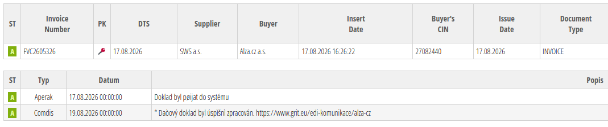
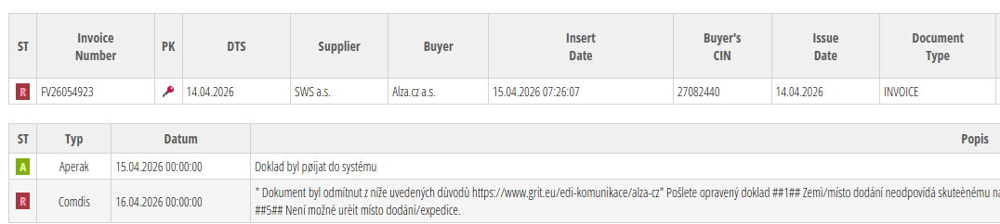

# COMDIS

## Co to je

**COMDIS** (Commercial Dispute) je zpráva, kterou **odběratel odpovídá na přijatou fakturu**.
Říká dodavateli, jak fakturu vyhodnotil poté, co ji spároval s objednávkou a dodávkou.

Přestože se jmenuje „dispute", nenese jen spory. V praxi má dva výsledky:

- **schváleno** — faktura je v pořádku a jde k proplacení
- **rozporováno** — faktura je odmítnuta, s kódem a popisem důvodu

COMDIS je tedy **konečný verdikt** nad fakturou. Do jeho přijetí dodavatel neví,
jestli mu odběratel fakturu uzná.

---

## Rozdíl proti APERAKu

- **APERAK** = „Máme to." Doklad je zaevidovaný, formát sedí.
- **COMDIS** = „Souhlasíme / nesouhlasíme." Faktura je schválená, nebo odmítnutá.

APERAK může přijít kladný a COMDIS přesto zamítavý — doklad byl technicky
v pořádku, ale obchodně neseděl (např. fakturována jiná cena, než byla potvrzena).

### Pořadí v toku

```
INVOIC (faktura)  ──►  odběratel
                          │
      APERAK  ◄───────────┤   „přijato do systému"      (technická rovina)
                          │
                    [ párování s objednávkou a příjmem ]
                          │
      COMDIS  ◄───────────┘   „schváleno / rozporováno"  (obchodní rovina)
```

---

## Reálné příklady

### A) Faktura prošla v pořádku

Faktura **FVC2605326**, dodavatel SWS a.s. → odběratel Alza.cz a.s.



Průběh:

| Kdy | Zpráva | ST | Text (CZ) | Text (EN) |
|---|---|---|---|---|
| 17. 8. | **APERAK** | A | Doklad byl přijat do systému | The document has been received into the system |
| 19. 8. | **COMDIS** | A | Daňový doklad byl úspěšně zpracován | The tax document has been processed successfully |


#### APERAK

```edifact
UNB+UNOD:3+8594177950005:14+8594157000003:14+260817:1800+642379663+++++EANCOM'
UNH+573200309+APERAK:D:01B:UN:EAN003'
BGM+305::9+35658768+6'
DTM+137:20260817:102'
RFF+IV:FVC2605326'
DTM+171:20260817:102'
NAD+BY+8594177950005::9'
NAD+SU+8594157000003::9'
ERC+0:ZZZ'
FTX+AAO+++Doklad byl přijat do systému'
UNT+10+573200309'
UNZ+1+642379663'
```

#### Rozpad hlášky z portálu

| Úroveň | Řádek | Text (CZ) | Text (EN) |
|---|---|---|---|
| hlavička | — | Doklad byl přijat do systému | The document has been received into the system |


#### COMDIS

```edifact
UNB+UNOD:3+8594177950005:14+8594157000003:14+260819:2030+642928725+++++EANCOM'
UNH+573637176+COMDIS:D:01B:UN:EAN003'
USH+94W+1+01+2+2+2+2+1+++573637176+1:20260819:203116'
USA+1:0:1:48:1'
USC+01643674+++++2+4'
BGM+67::9+35716714+9'
DTM+137:20260819:102'
NAD+BY+8594177950005::9++Alza.cz a.s.'
NAD+SU+8594157000003::9++SWS a.s.'
DOC+380+FVC2605326:1'
DTM+137:20260817:102'
AJT+ZZZ'
FTX+ACE++91+Daňový doklad byl úspěšně zpracován. https://www.grit.eu/edi-komunikace/alza-cz'
UST+01'
USR+C9A745FE20BDBB2499875D6D36178745D03F8E83...'
UNT+15+573637176'
UNZ+1+642928725'
```

#### Rozpad hlášky z portálu

| Úroveň | Řádek | Text (CZ) | Text (EN) |
|---|---|---|---|
| hlavička | — | Daňový doklad byl úspěšně zpracován | The tax document has been processed successfully |


---

### B) Faktura byla odmítnuta

Faktura **FV26054923**, dodavatel SWS a.s. → odběratel Alza.cz a.s.



Průběh:

| Kdy | Zpráva | ST | Text (CZ) | Text (EN) |
|---|---|---|---|---|
| 15. 4. | **APERAK** | A | Doklad byl přijat do systému | The document has been received into the system |
| 16. 4. | **COMDIS** | **R** | Dokument byl odmítnut z níže uvedených důvodů… | The document has been rejected for the reasons listed below… |


#### APERAK

```edifact
UNB+UNOD:3+8594177950005:14+8594157000003:14+260415:0840+618432646+++++EANCOM'
UNH+553318173+APERAK:D:01B:UN:EAN003'
BGM+305::9+33354184+6'
DTM+137:20260415:102'
RFF+IV:FV26054923'
DTM+171:20260414:102'
NAD+BY+8594177950005::9'
NAD+SU+8594157000003::9'
ERC+0:ZZZ'
FTX+AAO+++Doklad byl přijat do systému'
UNT+10+553318173'
UNZ+1+618432646'
```

#### Rozpad hlášky z portálu

| Úroveň | Řádek | Text (CZ) | Text (EN) |
|---|---|---|---|
| hlavička | — | Doklad byl přijat do systému | The document has been received into the system |


#### COMDIS

```edifact
UNB+UNOD:3+8594177950005:14+8594157000003:14+260416:1949+618849638+++++EANCOM'
UNH+553659671+COMDIS:D:01B:UN:EAN003'
USH+94W+1+01+2+2+2+2+1+++553659671+1:20260416:195001'
USA+1:0:1:48:1'
USC+01643674+++++2+4'
BGM+67::9+33396290+9'
DTM+137:20260416:102'
NAD+BY+8594177950005::9++Alza.cz a.s.'
NAD+SU+8594157000003::9++SWS a.s.'
DOC+380+FV26054923:8'
DTM+137:20260414:102'
AJT+ZZZ'
FTX+ACE++91+Dokument byl odmítnut z níže uvedených důvodů https://www.grit.eu/edi-komunikace/alza-cz'
INP+5+1:AD'
FTX+AAG++008+Pošlete opravený doklad'
DLI+1+1'
AJT+ZZZ'
FTX+ACE+++Země/místo dodání neodpovídá skutečnému naskladnění'
DLI+1+2'
AJT+ZZZ'
FTX+ACE+++Není možné určit místo dodání/expedice.'
DLI+1+3'
AJT+ZZZ'
FTX+ACE+++Není možné určit místo dodání/expedice.'
DLI+1+4'
AJT+ZZZ'
FTX+ACE+++Není možné určit místo dodání/expedice.'
DLI+1+5'
AJT+ZZZ'
FTX+ACE+++Není možné určit místo dodání/expedice.'
UST+01'
USR+9514B4017B4A665F515485B3222FFEB94B5AE5F2...'
UNT+32+553659671'
UNZ+1+618849638'
```

#### Rozpad hlášky z portálu

Portál slepí celý COMDIS do jednoho řetězce a čísla řádků faktury označí `##N##`:

> \* Dokument byl odmítnut z níže uvedených důvodů https://www.grit.eu/edi-komunikace/alza-cz
> \* Pošlete opravený doklad ##1## Země/místo dodání neodpovídá skutečnému naskladnění
> ##2## Není možné určit místo dodání/expedice. ##3## Není možné určit místo dodání/expedice.
> ##4## Není možné určit místo dodání/expedice. ##5## Není možné určit místo dodání/expedice.

Rozepsáno:

| Úroveň | Řádek | Text (CZ) | Text (EN) |
|---|---|---|---|
| hlavička | — | Dokument byl odmítnut z níže uvedených důvodů | The document has been rejected for the reasons listed below |
| instrukce | — | Pošlete opravený doklad | Please send a corrected document |
| položka | 1 | Země/místo dodání neodpovídá skutečnému naskladnění | Country/place of delivery does not match the actual goods receipt |
| položka | 2 | Není možné určit místo dodání/expedice. | The place of delivery/dispatch cannot be determined. |
| položka | 3 | Není možné určit místo dodání/expedice. | The place of delivery/dispatch cannot be determined. |
| položka | 4 | Není možné určit místo dodání/expedice. | The place of delivery/dispatch cannot be determined. |
| položka | 5 | Není možné určit místo dodání/expedice. | The place of delivery/dispatch cannot be determined. |

---

# SLSRPT

## Co to je

**SLSRPT** (Sales Data Report) je report **prodejů**, který posílá odběratel dodavateli.
Říká, kolik zboží se za dané období skutečně prodalo koncovému zákazníkovi — tedy
tzv. **sell-out**, ne to, co si odběratel objednal.


## Reálný příklad

Soubor `2229~2026_33_SLSRPT.xml` — **SWS a.s. → Samsung (`SECZ3`)**, týden 33/2026.

Pozor na směr: tady je **SWS v roli odběratele**. Nakupuje od Samsungu a hlásí mu,
komu zboží dál prodal. Není to EDIFACT, ale **vlastní XML formát**.

Název souboru: `2229` = pořadové číslo dávky, `2026_33` = rok a kalendářní týden.

```xml
<?xml version="1.0" encoding="UTF-8"?>
<salesout sender_id="0009218184" currency="CZK" partner_id="SWS" message_type="SLSRPT" recipient_id="SECZ3" bp_code="9218184" country="CZ" doc_number="26081600013">
<row id="1">
<date>2026-08-12</date>
<customer_id>18612</customer_id>
<vatid>CZ28623762</vatid>
<company>TD computer s.r.o.</company>
<address>Topolová 709/3</address>
<address2/>
<town>Olomouc</town>
<zip>78301 </zip>
<country>CZ </country>
<delivery_address>Werichova 721/1</delivery_address>
<delivery_address2/>
<delivery_town>Olomouc – Nové Sady</delivery_town>
<delivery_zip>779 00 </delivery_zip>
<delivery_country>CZ </delivery_country>
<pn>MUF-256BE4/APC</pn>
<serial/>
<sales_price>1138</sales_price>
<currency>CZK</currency>
<units>2</units>
<document_no>FV26112091</document_no>
</row>
<row id="2">
<date>2026-08-12</date>
<customer_id>14758</customer_id>
<vatid>CZ28274032</vatid>
<company>FLEXTRON electronic, s.r.o.</company>
<address>Růžová 1189/14</address>
<address2/>
<town>Kyjov</town>
<zip>697 01 </zip>
<country>CZ </country>
<delivery_address>Kostelec 54</delivery_address>
<delivery_address2/>
<delivery_town>Kostelec u Kyjova</delivery_town>
<delivery_zip>696 51 </delivery_zip>
<delivery_country>CZ </delivery_country>
<pn>MZ-V9S1T0BW</pn>
<serial>S7U4NU1YB36632</serial>
<sales_price>4384</sales_price>
<currency>CZK</currency>
<units>1</units>
<document_no>FV26112161</document_no>
</row>
<row id="3">
<date>2026-08-10</date>
<customer_id>8853</customer_id>
<vatid>CZ26375401</vatid>
<company>Ascendi spol. s r.o.</company>
<address>Barákova 557/71</address>
<address2/>
<town>Plzeň - Božkov</town>
<zip>326 00 </zip>
<country>CZ </country>
<delivery_address>Palackého nám. 28</delivery_address>
<delivery_address2/>
<delivery_town>PLzeň</delivery_town>
<delivery_zip>30100 </delivery_zip>
<delivery_country>CZ </delivery_country>
<pn>MZ-77E1T0B/EU</pn>
<serial>S8NBNS0L308139</serial>
<sales_price>5901</sales_price>
<currency>CZK</currency>
<units>1</units>
<document_no>FV26111031</document_no>
</row>
</salesout>
```


### Data v souboru

| # | Datum | Zákazník | Produkt | Sériové číslo | Ks | Cena | Faktura |
|---|---|---|---|---|---|---|---|
| 1 | 12. 8. | TD computer s.r.o. | MUF-256BE4/APC | — | 2 | 1 138 | FV26112091 |
| 2 | 12. 8. | FLEXTRON electronic, s.r.o. | MZ-V9S1T0BW | S7U4NU1YB36632 | 1 | 4 384 | FV26112161 |
| 3 | 10. 8. | Ascendi spol. s r.o. | MZ-77E1T0B/EU | S8NBNS0L308139 | 1 | 5 901 | FV26111031 |


---

# INVRPT

## Co to je

**INVRPT** (Inventory Report) je report **skladových zásob**. Odběratel v něm
dodavateli hlásí, kolik jeho zboží má aktuálně na skladě.


## Reálný příklad

Soubor `2228~2026_33_INVRPT.xml` — **SWS a.s. → Samsung (`SECZ3`)**, stav k 16. 8. 2026.
Posílá se ve stejné dávce jako SLSRPT (`2228` a `2229`), takže výrobce dostane
zároveň prodeje i zůstatek.

```xml
<?xml version="1.0" encoding="UTF-8"?>
<stock sender_id='0009218184' recipient_id='SECZ3' bp_code='9218184' country='CZ'
       message_type='INVRPT' date='2026-08-16' doc_number='26081600012'>
<row id='1'>
  <pn>MZ-77E1T0B/EU</pn>
  <units_stock>21</units_stock>
</row>
<row id='2'>
  <pn>MZ-77E2T0B/EU</pn>
  <units_stock>22</units_stock>
</row>
<row id='3'>
  <pn>MZ-V9S1T0BW</pn>
  <units_stock>1</units_stock>
</row>
</stock>
```


---

# Generování SLSRPT a INVRPT

## Jak to vzniká

Oba reporty pro Samsung generuje **plánovaná úloha „Report Samsung"**.
Úloha vytáhne data z databáze pomocí **SQL** a **VBS skript** z nich složí XML soubor.

Výstup se posílá **dvěma cestami zároveň**:

- **e-mailem**
- **do EDI** (kanál na Samsung)

```
[ SQL databáze ]
       │  dotaz
       ▼
[ VBS skript — plánovaná úloha „Report Samsung" ]
       │  generuje XML
       ▼
  ┌────┴─────┐
  ▼          ▼
e-mail     EDI  ──►  Samsung (SECZ3)
```

V jednom běhu vzniknou **oba soubory** — INVRPT i SLSRPT, s po sobě jdoucími
čísly dávky (`2228` a `2229`).

## Formát

**Nepoužívá se EDIFACT.** Přestože se zprávy jmenují SLSRPT a INVRPT, jde o
**vlastní XML formát**, který si nejspíš předepsal přímo Samsung. Standardní
názvy zpráv jsou tu použité jen jako označení typu obsahu.


---

# Modifikace

TODO

---

## Alza.cz a.s.


---

## HP Tronic

