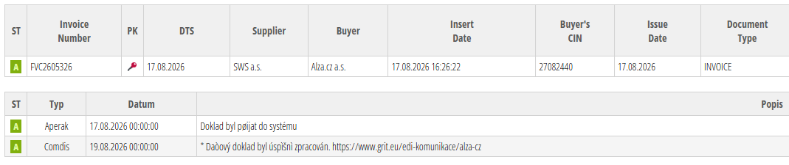
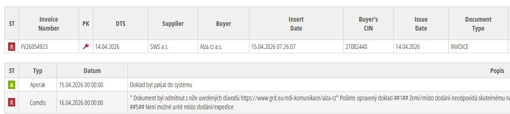

# COMDIS

## What it is

**COMDIS** (Commercial Dispute) is the message in which the **buyer responds to a
received invoice**. It tells the supplier how the invoice was evaluated after being
matched against the order and the delivery.

Despite the name "dispute", it does not carry only disputes. In practice it has two
outcomes:

- **approved** — the invoice is correct and goes for payment
- **disputed** — the invoice is rejected, with a code and a description of the reason

COMDIS is therefore the **final verdict** on the invoice. Until it arrives, the
supplier does not know whether the buyer will accept the invoice.

---

## Difference from APERAK

- **APERAK** = "We got it." The document is registered, the format is valid.
- **COMDIS** = "We agree / we do not agree." The invoice is approved or rejected.

APERAK can be positive and COMDIS still negative — the document was technically
correct, but did not match commercially (e.g. a different price was invoiced than
the one confirmed).

### Order in the flow

```
INVOIC (invoice)  ──►  buyer
                          │
      APERAK  ◄───────────┤   "received into the system"   (technical level)
                          │
                    [ matching against order and goods receipt ]
                          │
      COMDIS  ◄───────────┘   "approved / disputed"        (commercial level)
```

---

## Real examples

### A) Invoice passed successfully

Invoice **FVC2605326**, supplier SWS a.s. → buyer Alza.cz a.s.



Sequence:

| When | Message | ST | Text (CZ) | Text (EN) |
|---|---|---|---|---|
| 17 Aug | **APERAK** | A | Doklad byl přijat do systému | The document has been received into the system |
| 19 Aug | **COMDIS** | A | Daňový doklad byl úspěšně zpracován | The tax document has been processed successfully |


#### APERAK

```edifact
UNB+UNOD:3+8594177950005:14+8594157000003:14+260817:1800+642379663+++++EANCOM'
UNH+573200309+APERAK:D:01B:UN:EAN003'
BGM+305::9+35658768+6'
DTM+137:20260817:102'
RFF+IV:FVC2605326'
DTM+171:20260817:102'
NAD+BY+8594177950005::9'
NAD+SU+8594157000003::9'
ERC+0:ZZZ'
FTX+AAO+++Doklad byl přijat do systému'
UNT+10+573200309'
UNZ+1+642379663'
```

#### Message text breakdown

| Level | Line | Text (CZ) | Text (EN) |
|---|---|---|---|
| header | — | Doklad byl přijat do systému | The document has been received into the system |


#### COMDIS

```edifact
UNB+UNOD:3+8594177950005:14+8594157000003:14+260819:2030+642928725+++++EANCOM'
UNH+573637176+COMDIS:D:01B:UN:EAN003'
USH+94W+1+01+2+2+2+2+1+++573637176+1:20260819:203116'
USA+1:0:1:48:1'
USC+01643674+++++2+4'
BGM+67::9+35716714+9'
DTM+137:20260819:102'
NAD+BY+8594177950005::9++Alza.cz a.s.'
NAD+SU+8594157000003::9++SWS a.s.'
DOC+380+FVC2605326:1'
DTM+137:20260817:102'
AJT+ZZZ'
FTX+ACE++91+Daňový doklad byl úspěšně zpracován. https://www.grit.eu/edi-komunikace/alza-cz'
UST+01'
USR+C9A745FE20BDBB2499875D6D36178745D03F8E83...'
UNT+15+573637176'
UNZ+1+642928725'
```

#### Message text breakdown

| Level | Line | Text (CZ) | Text (EN) |
|---|---|---|---|
| header | — | Daňový doklad byl úspěšně zpracován | The tax document has been processed successfully |


---

### B) Invoice was rejected

Invoice **FV26054923**, supplier SWS a.s. → buyer Alza.cz a.s.



Sequence:

| When | Message | ST | Text (CZ) | Text (EN) |
|---|---|---|---|---|
| 15 Apr | **APERAK** | A | Doklad byl přijat do systému | The document has been received into the system |
| 16 Apr | **COMDIS** | **R** | Dokument byl odmítnut z níže uvedených důvodů… | The document has been rejected for the reasons listed below… |


#### APERAK

```edifact
UNB+UNOD:3+8594177950005:14+8594157000003:14+260415:0840+618432646+++++EANCOM'
UNH+553318173+APERAK:D:01B:UN:EAN003'
BGM+305::9+33354184+6'
DTM+137:20260415:102'
RFF+IV:FV26054923'
DTM+171:20260414:102'
NAD+BY+8594177950005::9'
NAD+SU+8594157000003::9'
ERC+0:ZZZ'
FTX+AAO+++Doklad byl přijat do systému'
UNT+10+553318173'
UNZ+1+618432646'
```

#### Message text breakdown

| Level | Line | Text (CZ) | Text (EN) |
|---|---|---|---|
| header | — | Doklad byl přijat do systému | The document has been received into the system |


#### COMDIS

```edifact
UNB+UNOD:3+8594177950005:14+8594157000003:14+260416:1949+618849638+++++EANCOM'
UNH+553659671+COMDIS:D:01B:UN:EAN003'
USH+94W+1+01+2+2+2+2+1+++553659671+1:20260416:195001'
USA+1:0:1:48:1'
USC+01643674+++++2+4'
BGM+67::9+33396290+9'
DTM+137:20260416:102'
NAD+BY+8594177950005::9++Alza.cz a.s.'
NAD+SU+8594157000003::9++SWS a.s.'
DOC+380+FV26054923:8'
DTM+137:20260414:102'
AJT+ZZZ'
FTX+ACE++91+Dokument byl odmítnut z níže uvedených důvodů https://www.grit.eu/edi-komunikace/alza-cz'
INP+5+1:AD'
FTX+AAG++008+Pošlete opravený doklad'
DLI+1+1'
AJT+ZZZ'
FTX+ACE+++Země/místo dodání neodpovídá skutečnému naskladnění'
DLI+1+2'
AJT+ZZZ'
FTX+ACE+++Není možné určit místo dodání/expedice.'
DLI+1+3'
AJT+ZZZ'
FTX+ACE+++Není možné určit místo dodání/expedice.'
DLI+1+4'
AJT+ZZZ'
FTX+ACE+++Není možné určit místo dodání/expedice.'
DLI+1+5'
AJT+ZZZ'
FTX+ACE+++Není možné určit místo dodání/expedice.'
UST+01'
USR+9514B4017B4A665F515485B3222FFEB94B5AE5F2...'
UNT+32+553659671'
UNZ+1+618849638'
```

#### Message text breakdown

The portal concatenates the whole COMDIS into a single string and marks the invoice
line numbers with `##N##`:

> \* Dokument byl odmítnut z níže uvedených důvodů https://www.grit.eu/edi-komunikace/alza-cz
> \* Pošlete opravený doklad ##1## Země/místo dodání neodpovídá skutečnému naskladnění
> ##2## Není možné určit místo dodání/expedice. ##3## Není možné určit místo dodání/expedice.
> ##4## Není možné určit místo dodání/expedice. ##5## Není možné určit místo dodání/expedice.

Broken down:

| Level | Line | Text (CZ) | Text (EN) |
|---|---|---|---|
| header | — | Dokument byl odmítnut z níže uvedených důvodů | The document has been rejected for the reasons listed below |
| instruction | — | Pošlete opravený doklad | Please send a corrected document |
| item | 1 | Země/místo dodání neodpovídá skutečnému naskladnění | Country/place of delivery does not match the actual goods receipt |
| item | 2 | Není možné určit místo dodání/expedice. | The place of delivery/dispatch cannot be determined. |
| item | 3 | Není možné určit místo dodání/expedice. | The place of delivery/dispatch cannot be determined. |
| item | 4 | Není možné určit místo dodání/expedice. | The place of delivery/dispatch cannot be determined. |
| item | 5 | Není možné určit místo dodání/expedice. | The place of delivery/dispatch cannot be determined. |

---

# SLSRPT

## What it is

**SLSRPT** (Sales Data Report) is a **sales report** sent by the buyer to the supplier.
It states how much goods were actually sold to the end customer in a given period —
i.e. **sell-out**, not what the buyer ordered.


## Real example

File `2229~2026_33_SLSRPT.xml` — **SWS a.s. → Samsung (`SECZ3`)**, week 33/2026.

Note the direction: here **SWS acts as the buyer**. It purchases from Samsung and
reports to whom it resold the goods. This is not EDIFACT, but a **proprietary XML
format**.

File name: `2229` = batch sequence number, `2026_33` = year and calendar week.

```xml
<?xml version="1.0" encoding="UTF-8"?>
<salesout sender_id="0009218184" currency="CZK" partner_id="SWS" message_type="SLSRPT" recipient_id="SECZ3" bp_code="9218184" country="CZ" doc_number="26081600013">
<row id="1">
<date>2026-08-12</date>
<customer_id>18612</customer_id>
<vatid>CZ28623762</vatid>
<company>TD computer s.r.o.</company>
<address>Topolová 709/3</address>
<address2/>
<town>Olomouc</town>
<zip>78301 </zip>
<country>CZ </country>
<delivery_address>Werichova 721/1</delivery_address>
<delivery_address2/>
<delivery_town>Olomouc – Nové Sady</delivery_town>
<delivery_zip>779 00 </delivery_zip>
<delivery_country>CZ </delivery_country>
<pn>MUF-256BE4/APC</pn>
<serial/>
<sales_price>1138</sales_price>
<currency>CZK</currency>
<units>2</units>
<document_no>FV26112091</document_no>
</row>
<row id="2">
<date>2026-08-12</date>
<customer_id>14758</customer_id>
<vatid>CZ28274032</vatid>
<company>FLEXTRON electronic, s.r.o.</company>
<address>Růžová 1189/14</address>
<address2/>
<town>Kyjov</town>
<zip>697 01 </zip>
<country>CZ </country>
<delivery_address>Kostelec 54</delivery_address>
<delivery_address2/>
<delivery_town>Kostelec u Kyjova</delivery_town>
<delivery_zip>696 51 </delivery_zip>
<delivery_country>CZ </delivery_country>
<pn>MZ-V9S1T0BW</pn>
<serial>S7U4NU1YB36632</serial>
<sales_price>4384</sales_price>
<currency>CZK</currency>
<units>1</units>
<document_no>FV26112161</document_no>
</row>
<row id="3">
<date>2026-08-10</date>
<customer_id>8853</customer_id>
<vatid>CZ26375401</vatid>
<company>Ascendi spol. s r.o.</company>
<address>Barákova 557/71</address>
<address2/>
<town>Plzeň - Božkov</town>
<zip>326 00 </zip>
<country>CZ </country>
<delivery_address>Palackého nám. 28</delivery_address>
<delivery_address2/>
<delivery_town>PLzeň</delivery_town>
<delivery_zip>30100 </delivery_zip>
<delivery_country>CZ </delivery_country>
<pn>MZ-77E1T0B/EU</pn>
<serial>S8NBNS0L308139</serial>
<sales_price>5901</sales_price>
<currency>CZK</currency>
<units>1</units>
<document_no>FV26111031</document_no>
</row>
</salesout>
```


### Data in the file

| # | Date | Customer | Product | Serial number | Qty | Price | Invoice |
|---|---|---|---|---|---|---|---|
| 1 | 12 Aug | TD computer s.r.o. | MUF-256BE4/APC | — | 2 | 1,138 | FV26112091 |
| 2 | 12 Aug | FLEXTRON electronic, s.r.o. | MZ-V9S1T0BW | S7U4NU1YB36632 | 1 | 4,384 | FV26112161 |
| 3 | 10 Aug | Ascendi spol. s r.o. | MZ-77E1T0B/EU | S8NBNS0L308139 | 1 | 5,901 | FV26111031 |


---

# INVRPT

## What it is

**INVRPT** (Inventory Report) is a **stock report**. In it the buyer reports to the
supplier how much of the supplier's goods it currently holds in stock.


## Real example

File `2228~2026_33_INVRPT.xml` — **SWS a.s. → Samsung (`SECZ3`)**, stock as of
16 Aug 2026. It is sent in the same batch as SLSRPT (`2228` and `2229`), so the
vendor receives both sales and remaining stock at once.

```xml
<?xml version="1.0" encoding="UTF-8"?>
<stock sender_id='0009218184' recipient_id='SECZ3' bp_code='9218184' country='CZ'
       message_type='INVRPT' date='2026-08-16' doc_number='26081600012'>
<row id='1'>
  <pn>MZ-77E1T0B/EU</pn>
  <units_stock>21</units_stock>
</row>
<row id='2'>
  <pn>MZ-77E2T0B/EU</pn>
  <units_stock>22</units_stock>
</row>
<row id='3'>
  <pn>MZ-V9S1T0BW</pn>
  <units_stock>1</units_stock>
</row>
</stock>
```


---

# Generating SLSRPT and INVRPT

## How it is produced

Both Samsung reports are generated by the scheduled task **"Report Samsung"**.
The task pulls data from the database using **SQL**, and a **VBS script** assembles
the XML file from it.

The output is sent via **two channels at the same time**:

- **by e-mail**
- **to EDI** (channel to Samsung)

```
[ SQL database ]
       │  query
       ▼
[ VBS script — scheduled task "Report Samsung" ]
       │  generates XML
       ▼
  ┌────┴─────┐
  ▼          ▼
e-mail     EDI  ──►  Samsung (SECZ3)
```

A single run produces **both files** — INVRPT and SLSRPT, with consecutive batch
numbers (`2228` and `2229`).

## Format

**EDIFACT is not used.** Although the messages are named SLSRPT and INVRPT, this is
a **proprietary XML format**, most likely prescribed by Samsung itself. The standard
message names are used here only as a label for the type of content.


---

# Modifications

TODO

---

## Alza.cz a.s.


---

## HP Tronic

